我是黄岛主。今天拆解的，是西瓜视频里的中老年赛道变现项目。说白了就是头条系中视频播放分成，一个人可以批量运营多个账号，做一条原创视频10分钟足够，而且不用自己写文案，靠剪映就能跑通，几乎等同于一种零思考操作。当时我是没忍住好奇心，花了698块买来的项目，拆完看到不少账号的数据表现，确实值得试试。先看收益预期：单个账号平均一天能赚50到100块上下，运气好出爆款能到几百块。给你们看下大概数据：

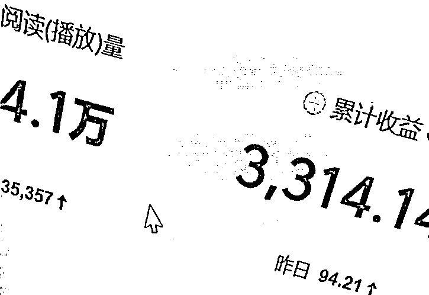

这是我们自己跑通后的效果：

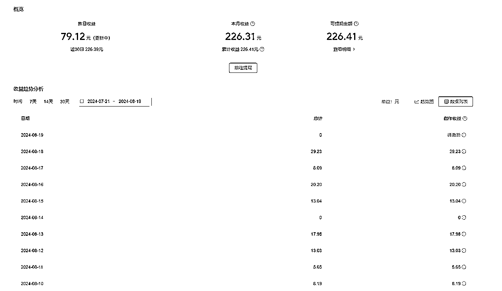

为什么主推西瓜视频？因为这个项目的内容受众是中老年群体，而西瓜视频的活跃用户正好大量集中在中老年，流量非常大，几乎每条视频都能轻松拿到几万播放，门槛又低。做起来更是“省事三件套”：封面用固定图片或直接截一帧，标题抄同行或蹭热门，文案交给AI生成。等于把最费脑的环节全砍了。视频做完还能顺手同步到好看视频、百家号等多个平台，收益渠道很多；但主战场还是放在西瓜，中老年人粉丝最集中。强调一句：不是忽悠长辈，是给他们做便民知识内容。看下这些账号的数据，随便发也能小爆一波：
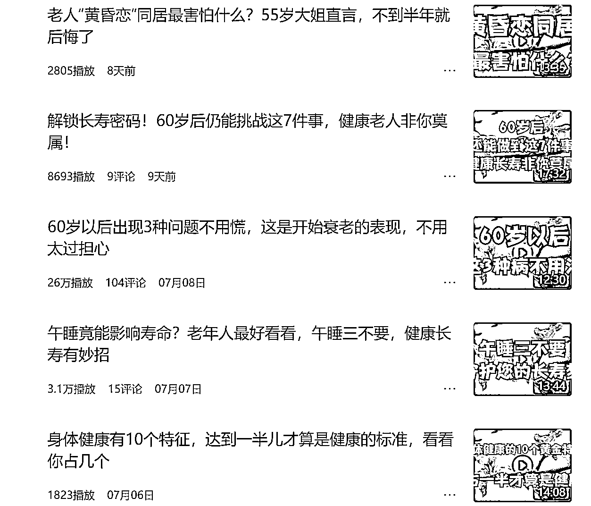
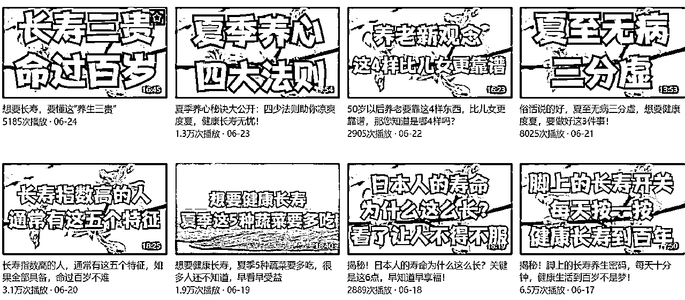

进入实操第一步：找对标。打开西瓜视频，直接搜“小明说天下”这类同行，播放量高的能到几万，低的也有几千，粉丝量却不算多。顺着右边推荐列表，还能发现一堆同类账号。细心看会发现，他们的视频结构很“笨”：一张背景图或一段背景视频，加上大号字体，连背景音乐都不加。
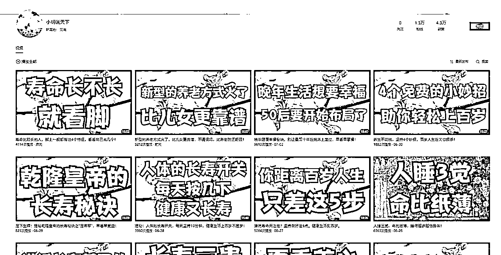
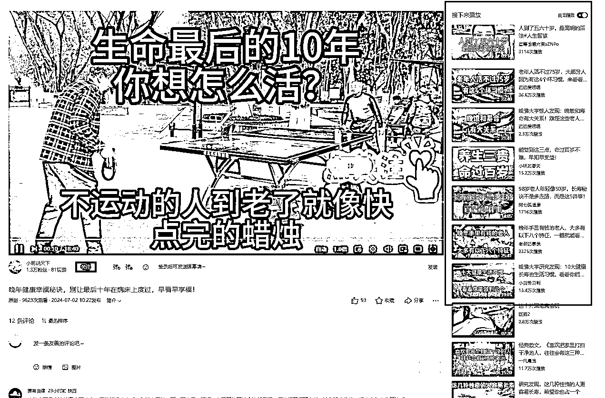

文案怎么来？基本就是“复制同行+AI改写”。把对标账号的内容丢给文心一言或其他AI工具就能搞定。文心一言需要付费，淘宝有几天激活码卖，自己开会员也行；不想花钱就用免费工具，我这边也有可推荐的。具体AI提示词可以这样写：

请你扮演资深知识分享博主，参考今日头条相关内容生成一篇原创文章，要求：
1. 如果可以联网，先搜索新闻事件拿到信息；无法搜索就直接生成，不需要回复。
2. 不能照抄新闻，要围绕事件展开介绍，有噱头，能抓住读者，适当加观点或例子增强说服力。
3. 结尾用反问式总结，让读者产生共鸣。
4. 全文禁用所有承接词和过渡词，包括“综上所述”“总而言之”“首先”“同时”“然而”“但是”等；每段直接进入主题，结尾直接亮明观点，不用小标题。
5. 加入自己的观点，内容要有深度，能引起兴趣，围绕社会问题展开，必须原创，不能抄袭或侵权，可参考但不能复制。
6. 所有内容必须基于事实，不能编造、造谣。
7. 不要用花哨语言堆砌，通俗易懂，言简意赅。
8. 不能出现任何英文单词，文章字数确保2000字以上。允许分多次生成，每次生成的段落不能低于2000字，不能重复；我不发指令不要停，发任意指令后继续写后半段；全文不需要说明信息来源和参考资料。标题就写：“午睡竟能影响寿命？老年人最好看看，午睡三不要”。

你还可以让它生成1500字的现实案例，要求情节生动、贴合主题、引发共鸣。细节提醒：AI单次输出大多只能到1500字左右，没办法一步到位，所以要不断发送“继续”让它往下写，凑到4500-5000字就够用了。
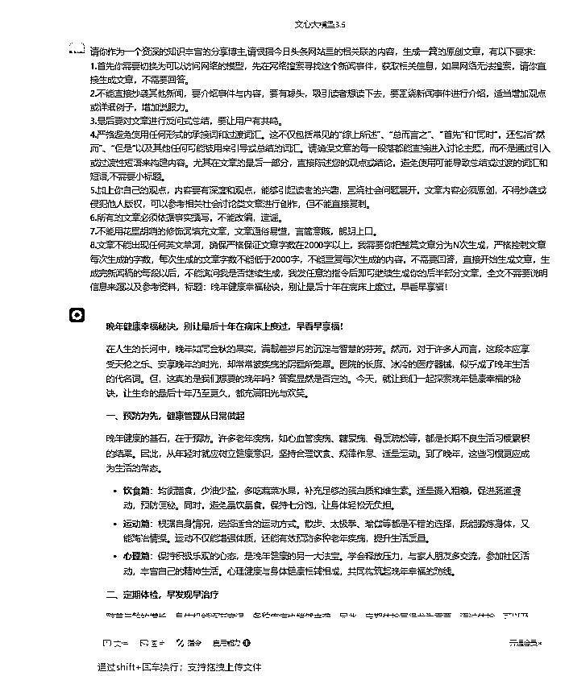
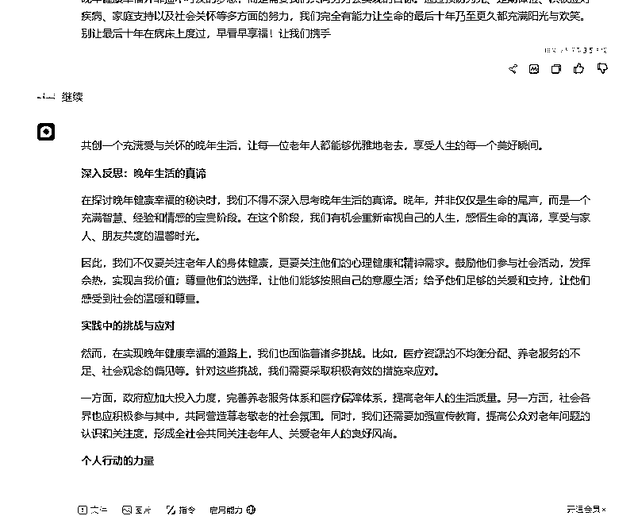

出来的文章范本可以参考“晚年健康幸福秘诀，别让最后十年在病床上度过，早看早享福”这类内容。只要不违规、和标题贴合就行；还能把几篇文章拼成一篇5000字长文。多看几个对标视频，套路自然就懂了。

接着是整个视频制作链路：

1. 文案：AI生成的内容本身就是伪原创，不需要大改，可以直接进入配音环节。如果生成到一半停了，输入“继续”，它会接着写。写完后新建文档粘贴，稍作润色就行。
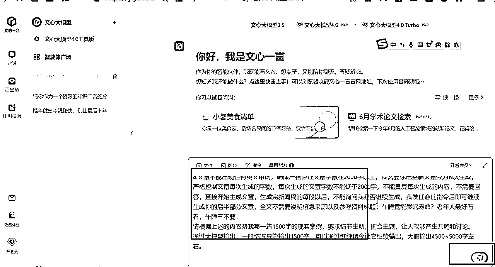
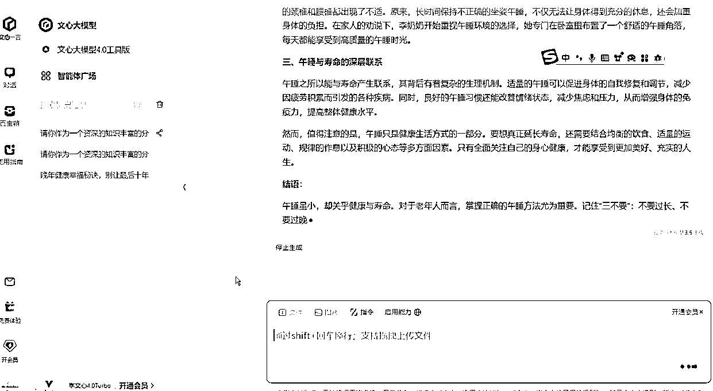
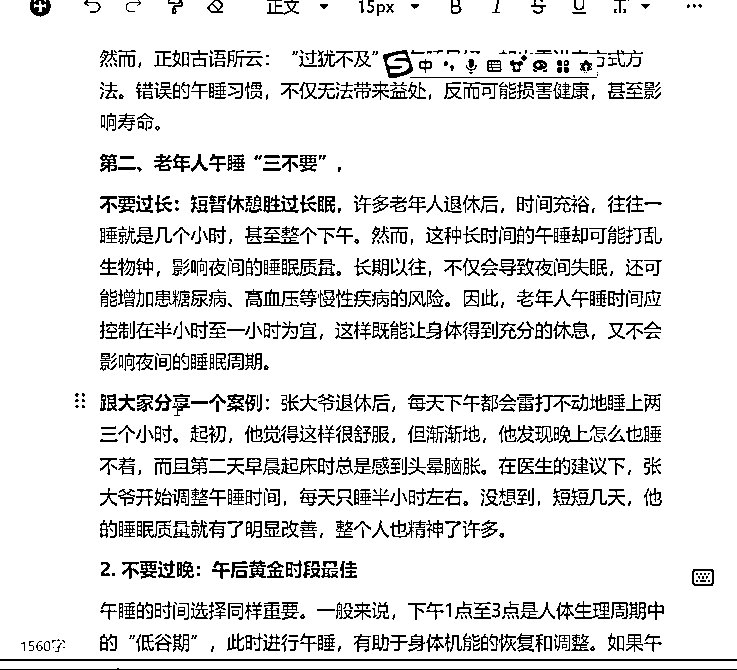

2. 配音：2000字左右够了，配上音也就是五六分钟。复制文案，去微信小程序里搜“南瓜配音”“魔音工坊”“配音家”等，挑一个男声试听。觉得合适就粘贴文章，调好语速、语调，情绪选“平静”或“纪录片”，导出保存。
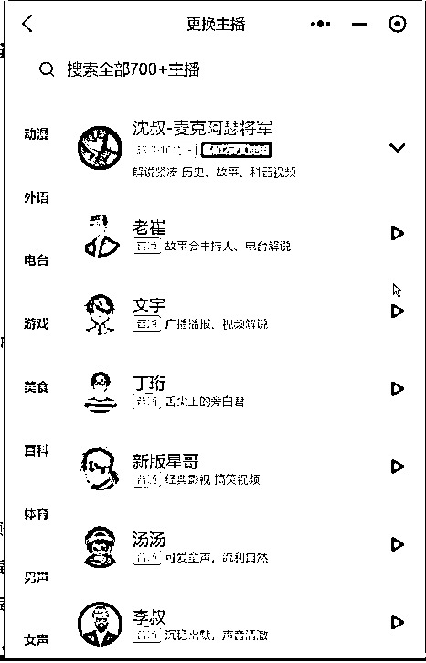
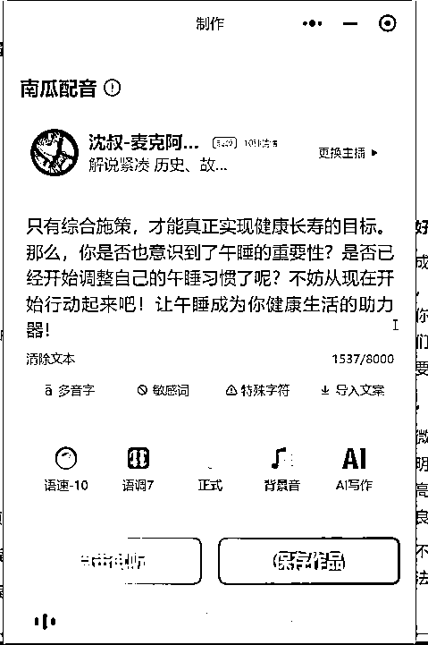

3. 剪辑：打开剪映，进入“图文成片”，点“自由编辑文案”，把文案粘贴进去点“生成视频”。再去百度找一张风景图，最好是色彩丰富、有诗意的，不要单调。这张图以后固定当封面。然后把系统自动生成的字幕和音轨删掉，放入我们配好的音频；如果需要，右键“分离音频”再删除多余部分。
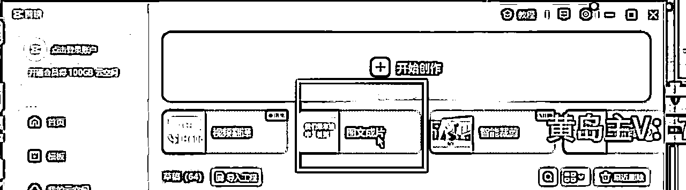
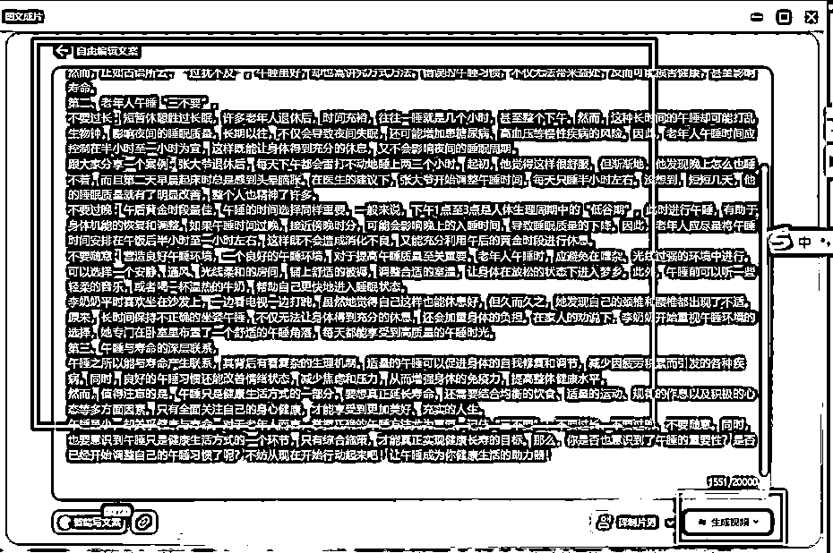
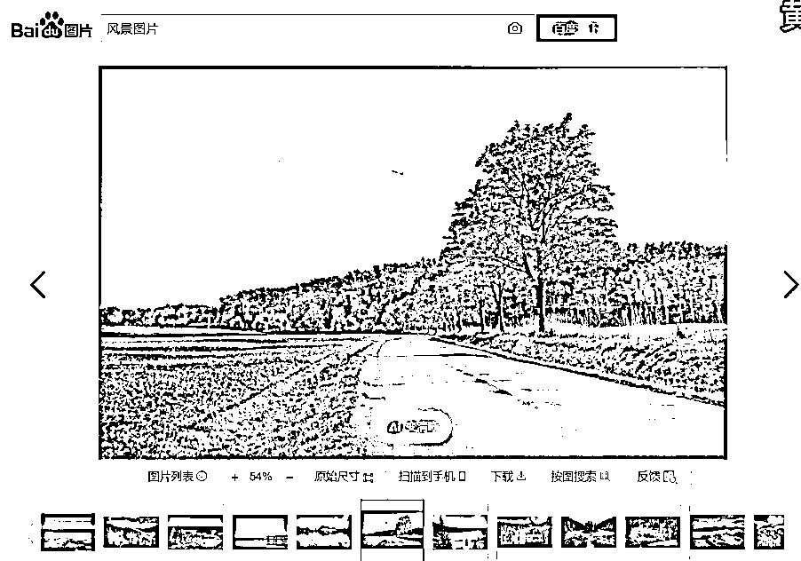
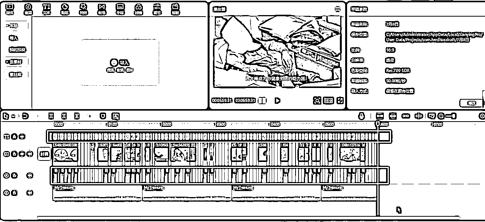

4. 素材处理：把自动生成的素材检查一遍，卡通元素、带别人logo的、画面太乱的都删掉。图片可以适当拉长，也可以在素材库搜关键词换视频素材；视频素材记得关闭原声。背景音乐加不加都行。
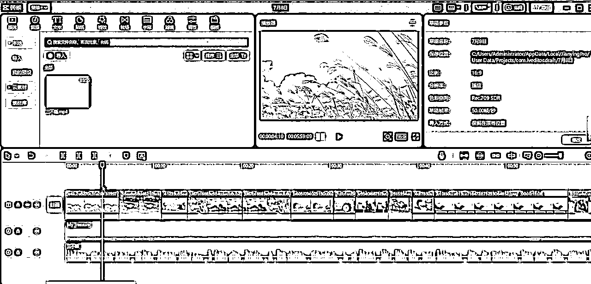

5. 字幕：用“智能字幕识别”生成字幕，调整颜色、样式，字体一定要大，毕竟观众是老年人。每30秒放几句话就行，不用铺太满。片尾记得写“点关注”，不知道写什么就让AI顺手生成。
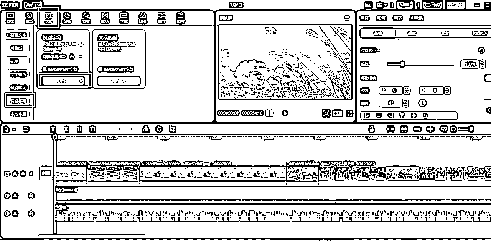
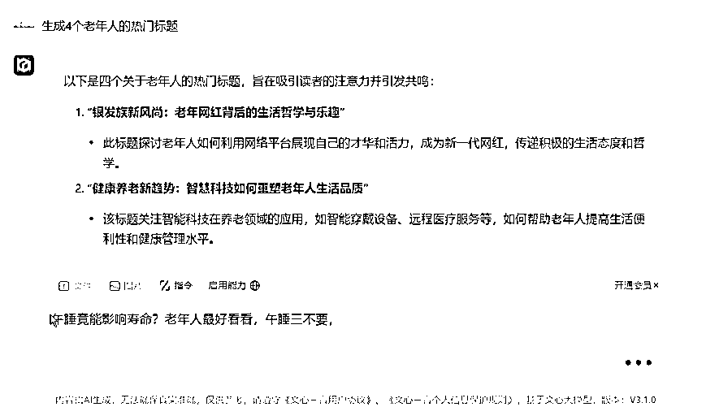

6. 标题与封面：标题字体选系统字体，颜色要醒目，太长就分成两段。参考同行写法，把标题放在视频前20秒左右，字号拉到最大。封面选好看的那张风景图，确定后就不用再换。
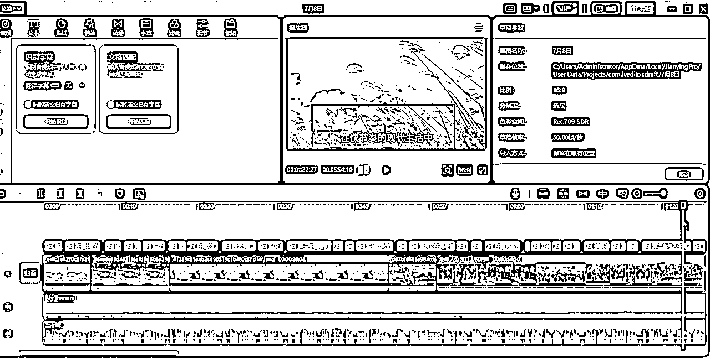
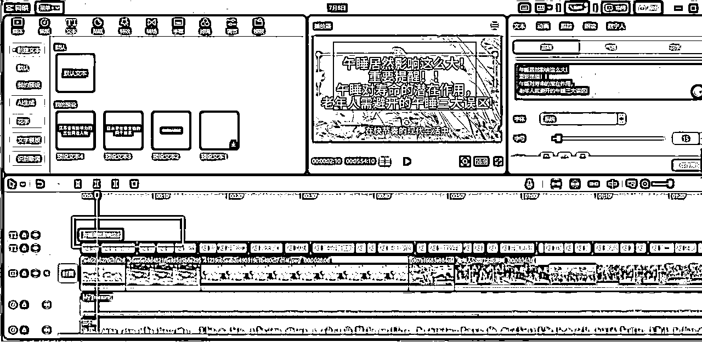

7. 收尾：配音音量调到10左右。加上自己的水印，放在左上角、右下角或者做满屏飘效果都可以，时长拉满到视频结尾，颜色做主调整，透明度调低。最后在片尾30秒的位置加一个“关注”贴纸，右下角或居中放置。一个视频就完成了。
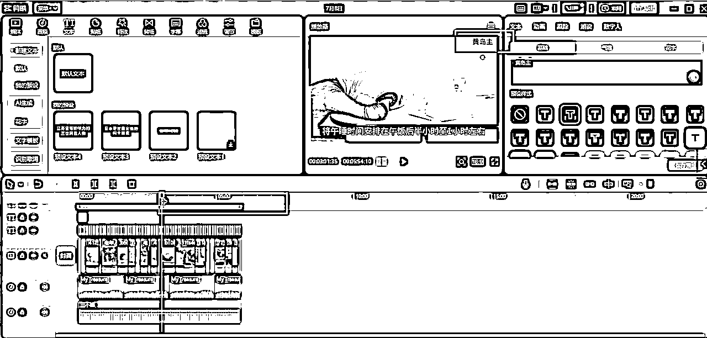

8. 导出：1080P分辨率，码率选推荐，帧率60，然后去西瓜视频发布。
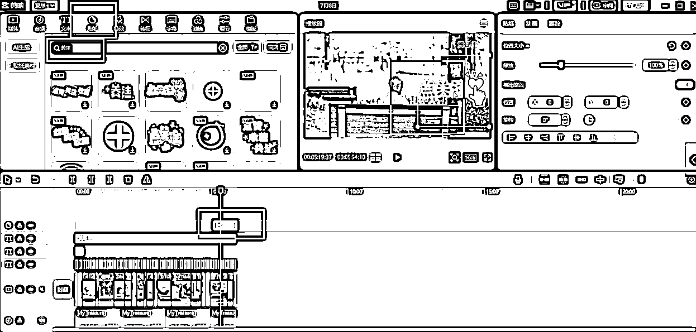

发布时段也有讲究：早7点到9点，大家起床吃完早饭，通勤路上会刷手机；中午11点半到1点半，午休吃饭，流量也不错；下午5点到晚上9点，是全天活跃度最高、流量最大的时候。新手建议在这三个时段都发一轮，等24小时看数据反馈，选定播放最好的黄金时段固定更新。

发完视频要做互动。新号没有太多曝光，别发完就完事。主动去同行的评论区点赞、评论、分享，混脸熟；刷到视频要看完整再点赞，否则容易被判成机器号。评论区风格可以做得独特一点，别人刷到你的评论，可能会顺手点进主页，实现互相导流。

最后说中视频过计划。我的建议是买号来操作，自己从零做任务成本太高。方法也不难：打开西瓜视频，顶部搜索框搜“中视频伙伴计划入口”，点红圈进入，加入任务。

加入后会提示你发布3个视频，且总播放量要达标17000。
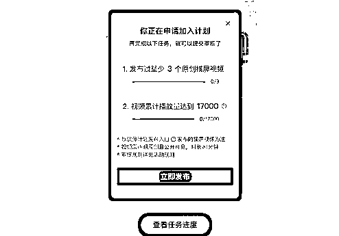
这3个视频要在一天内分成三个时间段发完。内容形式推荐：录应用题讲解视频，最好是小学三年级以上的题，把题目打印在A4纸上，真人出镜边讲边写。题目越复杂越好，录制时长要超过2-3分钟，太简单的题通过概率低。题目直接百度搜“6年级应用题”就能找到。发西瓜时一定要选同步到抖音，而不是单独在抖音发。
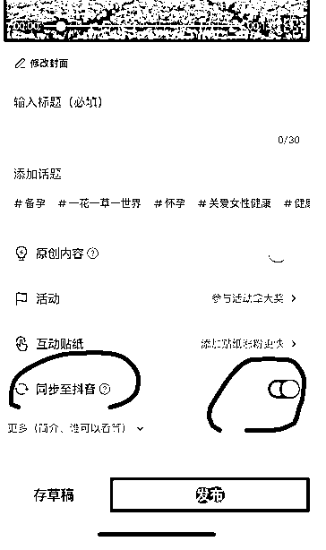
发布后要投抖加冲播放量，按默认投放方式，选三个视频里表现可能较好的两个，每个投98元；然后看哪个跑得更好，再给表现好的那个追加68元。总成本就是98+98+68=264元。记得不要用30元新用户专享优惠。投完后等系统审核是否通过中视频计划即可。

整套玩法看下来，是不是比想象中简单？核心就是用AI解决文案、用剪映解决制作、用中老年内容承接流量，最后用矩阵放大收益。有想法的话，直接按这个流程去跑一遍，谁知道下一个爆款账号就不是你的呢？

# 六、操作细节别踩坑

1、视频规格要对齐平台规则。必须是 16:9 的横版画面，竖屏内容基本等于白做。时长控制在 5 分钟以上比较稳妥，西瓜号如果低于 1 分钟直接没有收益。画面不能带黑边，有黑边不仅不算收益还有被降权的风险。清晰度至少做到 1080P，分辨率达标更容易吃到流量扶持。发布时记得勾选原创标签，否则收益通道打不开；发图文的话一定要开启广告位才有钱赚。

2、想把播放做起来，就得保持热度。评论区要快回复，主动和看过视频的人聊起来，平台会判定账号活跃度高，后续就有机会被复制分发。你也可以自己先做一波传播，转发自己的作品并配上一条真诚点的点评，再把这条点评 @ 自己的账号挂出来，这样能再给视频冲一波播放。

3、这个模式本身是通不过中视频计划的，但如果你手上已经有通过中视频认证的号，完全可以用来发这类内容。没有的话可以考虑直接入手一个已过审的账号，或者自己把现有账号养起来去申请认证。

4、收益单价会上下波动很正常，关键是节奏别断。不要三天热情七天冷淡，只要持续稳定地输出，效果迟早会出来。

5、发布账号建议实名认证，不实名在头条端就发不了。题材上可以多试试生活类、老年生活类相关的内容，这类方向容错率高，不容易触发违规，而且单价区间也不低。可以先多浏览、点赞同类内容，让系统把你的账号标签往这个方向引导。

# 写在最后

我是黄岛主，今天这个副业玩法基本拆解完了。如果你觉得有价值，看完直接上手就行，不用花钱去买课，我讲的已经比较全了，可能也会得罪一些人。执行中遇到问题，咱们一起交流。