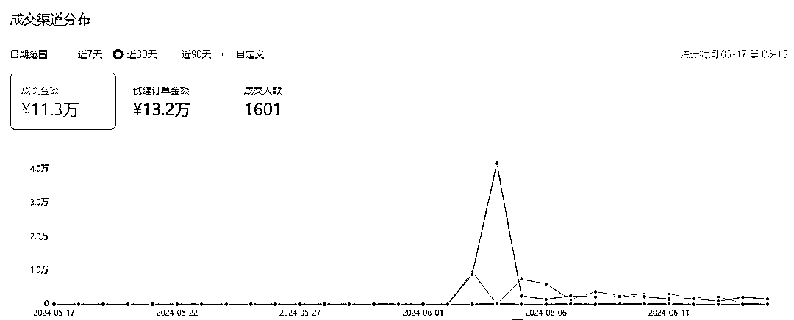
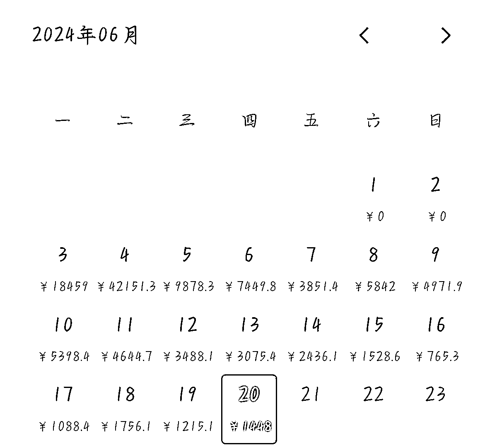
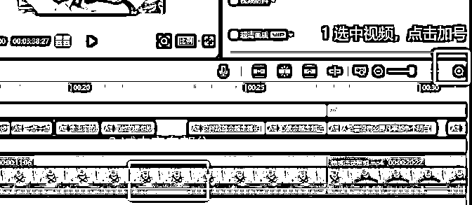
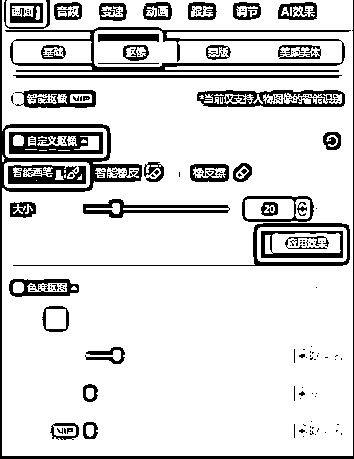
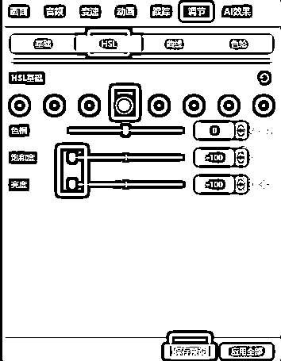

# 小白入局视频号口播航海，5 月起号 20 天破 10 万 GMV 的复盘
作者：龙哥

大家好，我是龙哥。副业折腾两年，换了十几个赛道都没起色，这次参加 5 月的口播带货航海，算是第一次吃到像样的正反馈。我的第一条口播从 5 月 16 号开始发，到 6 月 3 号才迎来首爆，截止 6 月 20 号累计 GMV 破 10 万，长尾还在持续出单。后面流量趋缓，但依然有稳定成交。数据细节如下：

第一次写复盘，可能有不足请直接指出。五月口播航海手册里的方法已经很全，我就不重复造轮子了。这篇主要拆解我第一条爆款是怎么来的，操作中几个容易被忽略的小点，以及这段时间的心理变化，希望能给一两点启发。

# 一、爆款拆解

## 1. 先定个大致方向跑数据

前期近半个月我基本照着文案库拍，1 个产品拍 3 个脚本，投到 3 个账号。刚开始播放量都很低，基本在千以下。但随着数量堆上去，账号整体推荐也在缓慢爬升。

我测试了厨师、维修工、洗衣店老板、读书人几个 Persona，大致看出厨师人设的推荐量略优，后面就集中往厨师方向多做。

## 2. 主动找对标

跑完素材库里的品仍没出单，我开始自己找对标。先在广场搜燕麦片、小炒酱这类品，看到口播就看完点赞，第二天我的推荐流基本被口播占满，然后开始筛选。

筛选标准：能不能快速模仿，点赞分享是否高，发布时间是否近，是否还在直播带货。符合这几点的就重点研究。

发现很多爆款拍法很简单，有的就是固定机位怼脸录。口播赛道，表现形式和文案逻辑比精致度更重要。

## 3. 改编后执行

锁定几个对标后开始提炼文案。爆的那条是燕麦片，核心是减肥替代主食。我觉得跟厨师人设契合，就做了改写，加入了身份钩子：

“很多人问我当厨师怎么还不胖，是不是做的菜不好吃，其实是我找到了方法”

让说服力更强。文案本身有前后对比，我就用高兴的情绪上来，拍的时候尽力表现那种发自内心的放松感。视频定在早上 4 点半发。

## 4. 数据一动就开播

早上五点多起来刷新，发现播放已经几千且在快速涨，我立刻联系代播开播，基本没丢流量。中间请假一天，隔段时间看直播数据，用同一脚本换角度、换手持道具补发了好几个视频进行引流。当天最强一条冲到 10 万+，直播当日 GMV 过万。

那条视频最终跑到 126 万播放。

## 5. 爆款的后续变现

市场上很多团队做抠像，我在广场刷到有人在用我的内容做二创，就联系了对方。按行业惯例给到境外人 10% 分成，有个人也有团队在做，也带来额外收入。可以主动找抠像团队扩散收益，属于躺赚。

同时我把该视频用租号的方式多发，租了 3 个号，其中一个冲到 10 万+，GMV 7000+。怕违规风险就先停了。

# 二、操作中的几个小细节

## 1. 拍摄小技巧

1. 拍前先把文案通读几遍，判断情绪基调。笑点文案可以先看段子笑起来再开拍；严肃类就压情绪。通读后心里有数更自然。
2. 如果拍到一半卡顿，不要重来，保持不动几秒，后期用剪映智能剪口播直接把停顿剪掉。情绪断层严重时，可以把文案拆成 2-3 句一段，读完一段停一下确认再继续。
3. 眼神总飘到提词器，可以拉远一点拍，眼神会变小不容易被注意。侧身采访式构图也不错，看起来更自然。
4. 没绿幕的话，衣服和背景色差要大，抠图会干净很多。
5. 长期做的话建议双机位，一个正面一个侧面，素材复用更多，测品效率更高。
6. 角度别俯视仰视，尽量保持平视，观感更舒服。

## 2. 我的剪辑节奏

*   拍完先用剪映智能剪口播，依托文案去重和去卡顿。如果通顺度仍差，就拉长时间线，用音频波形手动精修，如下图

*   剪好后全选建复合片段，点右侧自定义抠像。目前这个抠像对绿幕非绿幕都比较干净。绿幕抠出绿边时，去调节-HSL选绿色，把饱和度和亮度拉到最低即可

*   抠完叠背景图，可加变老特效、换音色，按需处理后导出备份

*   把抠好的口播视频做字幕识别，再把对标视频用智能镜头分割，删掉对标口播只留画面素材，放在口播轨道上层，按字幕对齐即可，效率最高，如下图：

*   关闭对标素材原声，四角可加个小贴纸点缀。对标素材模糊可去抖音找同类高清画面替换。

## 3. 发布与直播配合

1.  一条起飞后可直接原样重发，仍有流量。
2.  视频起量第一时间开播，自播或代播都行。盯好直播数据大屏，5 分钟内短视频引流人数低于 20 就检查入口是否掉线，用小号搜视频看头像是否显示直播中。没掉就立刻补视频引流。
3.  能备 6 个号最好，3 条视频 × 6 个号 = 18 条曝光。1 个主号，5 个小号授权发布。主号发原创，半小时后小号原样搬运，不打原创。
4.  断播几小时后再开，建议播长点，至少 2 小时。如果是连续 24h 被强制下线，可立刻重开，有概率承接旧场。可播十几分钟再暂停。流量稳时就一直播，找代播 24h 不间断。
5.  无法即时开播时，先挂直播预告留存流量，评论区一定要引导。
6.  爆后流量下滑但点赞增速快，开播进人不顺时，可用第 4 点的短时开播法。也可以预约 2-3 天后的直播承接。
7.  代播要盯，承诺是虚的，数据和结算要核对。

# 三、心路

## 1. 小白的项目沉淀

这个建议给和我一样做了很久副业但收益稀薄的同学。项目之前我也是透明小白，迷茫低效。每天刷帖子，最初越刷越焦虑，后来发现共性就是一条：下场干。

第一个项目是闲鱼无货源。直接模仿对标上架，联名书 PDF 爆过，一天信息刷爆，但单赚几毛到一块，号因盗版被封。换号做长颈鹿椅子，一单 129 赚 29，后续无流量坚持一个月放弃。

现在回头看，当时每天通勤找对标上架，坚持堆量大概率能起。你看我当时的问题：账号少，一封停滞；心态不对，容易因短期无反馈放弃。闲鱼本质是选品概率，长期堆量总有回报。

中间还做过抖音练字、视频号混剪带货、创作者分成、多多视频、京东短视频、百家号、红包封面、爱心代码等，多数投入大回报低。回头看很多项目如果坚持和放大，效果会更好。比如闲鱼，每天 10 多分钟上 3-4 个品，爆了再找人回复，时间能省很多。

## 2. 头条爆文带来的底气

这次坚定做口播的底气来自之前做头条 RPA。看到星火内容大师可自动生成文章并分发，我用影刀做了自动发文机器人，每天定时发，两个多月发了 245 篇，有一篇赚了 200 多。

成功关键是前期准备充分，自动化后坚持。无收益期也能扛住，后面爆是必然。后来看过一句话很适用：先定数量目标，比如 100 篇、100 条视频，没达标前别急着判死刑。这是之后我做项目的一条铁律。

## 3. 视频号口播的实战

项目经验和自我洗脑让我心态稍稳。报名后不犹豫直接拍直接发。首条毫无水花，群里有人报喜我还是焦虑。但我给自己定了 100 条视频的底线，觉得赛道已被验证，100 条测试不出来才算不适合。

像晓文教练说的，新手别盯结果，先把动作做对、执行量拉满。我持续拍、不断看手册和直播复盘，优化表情、流畅度、拍摄手法。

第 19 天早上五点查数据，发现一条不抱期望的视频爆了，我原本看好的反而没动静。项目随机性很大，准备好了才能接住。

当场找代播开播，心情很激动。上午 8 点半要上班，就请假一天补素材。感谢助教三月在爆发后全天候指导。

6 月 3 号白天一直播到晚上 7 点多，因视频号限流账号被限，直播间不进人。我让代播下播，暂停直播。拍了十条申诉素材到 8:30 未通过，出门散心回来发现申诉已过，流量又起来了。此时已错过开播窗口，6.3-6.4 系统维护无法开播。视频从 10 万冲到 80 万，橱窗单 4 万多，直播的话至少翻倍，心态一度爆炸。后来在助教和朋友安抚下冷静。

想挂预约时已晚，跑掉不少流量。爆后老视频也会被带动，流量回流也在出单，一切不是白做。

如果重来，爆后一定暂停播满 24h，减少人为失误。实操才能发现问题并解决，收获的不只是数据，还有抗压和判断。

## 4. 心态是关键

保持平稳思考，激情执行。心态不好会错过机会。赛道已被多人验证，可行性不用怀疑，剩下的就是执行力和迭代。等到量够了再说不适合，而不是上来就否定。

别被鸡汤吓到，这都是亲身经历。焦虑时给自己设可控目标，比如本周拍 20 条、写 30 篇，别盯赚多少钱。每天比前一天进步一点点，走到目标再评估。

流程跑通再考虑放大，先照手册和教练做。做就完了，先把第一步走稳。

# 四、致谢

这次口播航海让我副业收入有了质变，算是真正意义上的第一桶金，后续可以深耕。

感谢助教三月在爆量后任何时间都打电话指导，让我少了很多慌乱。感谢郭晓文教练、李超鹏教练的后续方向指引和连麦复盘。感谢小六六的文章指导，让我这个首帖小白能理清思路。感谢赚钱航海运营和领队志愿者的付出，手册和文案都写得很细，跟着做即可。

强烈建议大家报名 7 月航海特辑，视频号口播赛道现在饭已经喂到嘴边了。7 月 5 号开始报名，拼手速了，期待七月天天爆单。