# 不走寻常路，如何用 ChatGPT 做反向营销？

做营销时，品牌习惯把自己说得高大上：销量第一、品质顶尖、口碑爆棚。

喊久了，消费者心里会犯嘀咕：真的靠谱吗？

这种不信任感，像是在交友软件上遇到一个完美男性：留学归来、外企高管、热爱运动、生活干净、颜值在线。一眼看过去的条件太完美，反而让人怀疑是陷阱。

商家其实也可以换个思路：主动揭开一角瑕疵，坦荡呈现真实，不跟风堆砌优点，反而更容易获得认同。

这就是反向营销的逻辑。

我梳理了市面上可复用的案例，核心手法大致可归为四类。

# 01 反向营销的四种打法

## 一、坦诚沟通，姿态放低

品牌遇到波折时，选择直面问题、公开认错、甚至承担超出预期的责任，往往比遮掩更有效。

罗永浩带货翻车就是典型教材。

当年他因还债下场直播，流量高但风险也高。据称7场直播里翻了5场，大多因供应链品质不稳被客诉。按理说声誉要受损，却因为他始终保持诚实、从不推诿，粉丝反而更坚定了。

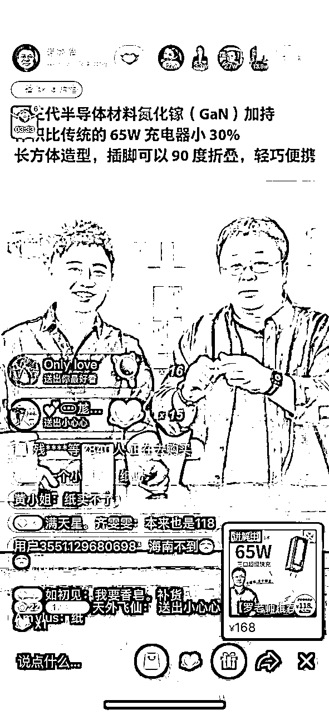

最具代表性的，是520期间为“花点时间”鲜花带货。

直播间里卖得火爆，收货后却出现大量“花蔫叶子烂”的反馈。买家要求退换，品牌方却拒绝执行。老罗第一时间公开致歉，站到用户这边，并隔空向品牌施压，🧣写道：

这件事若处理不到位让大家满意，西门子就是你们的参考。

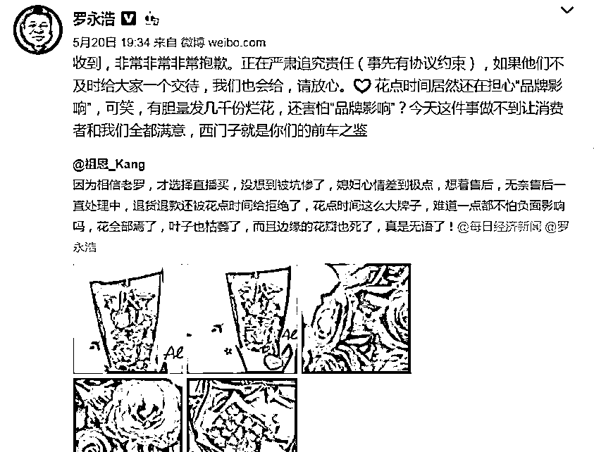

这句话分量很重。2011年老罗因维权曾在西门子中国总部楼下，把三台冰箱砸了个粉碎，闹得全网皆知。那次举动让“西门子”成了他立场的象征。

表态后，老罗推动品牌全额退款并加付等额现金补偿，额外自己掏钱再补一份原价现金，总赔偿约100万元。即在罗永浩直播间购花的用户可获双倍回馈。

随后他发布长文道歉，清晰罗列了处置方案。

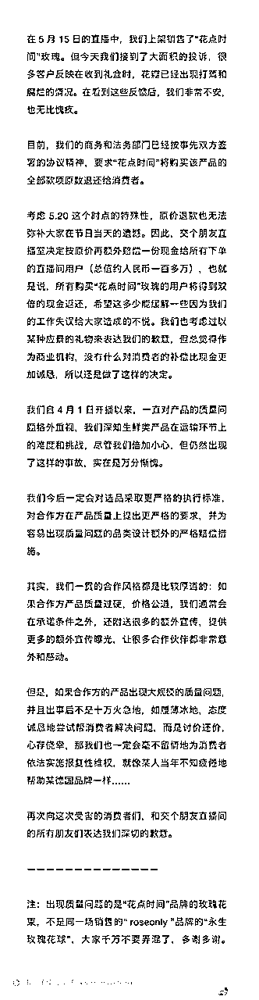

信里有一句让人印象深刻：

“我们也想过送点应景礼物来表达歉意，但作为一家商业机构，对消费者最真诚的补偿还是现金，所以选择了这样做”

少了修饰，多了分量。敢认错、敢担责、用行动沟通，远比公关话术更有说服力。

## 二、大胆自嘲

雷军的“Are you OK?”发音不标准，却成了个人记忆点；周鸿祎屡次调侃自己“有点二”。顶级玩家愿意暴露小缺点，瞬间拉近距离，还给了普通人情绪安慰：连大佬都有短板，我何必自卑。

品牌用自嘲讲故事也很讨喜。

2021年春节，各大短视频平台都在搞拉新分钱，动辄几十亿补贴。乐视视频却反其道，把“负债122亿”的字样直接放到 Logo 上做宣传。和满屏撒钱的对手对比，这种“自爆”反而形成记忆点，下载量不降反升。

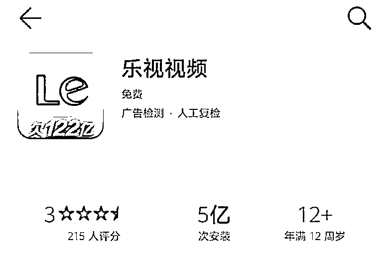

罗永浩也玩过类似操作。当年他在一栋培训机构扎堆的写字楼里开班，没名气没生源。美工先做了“XX培训班，火热报名中”的海报，被他否掉：门可罗雀哪来的火热，这是欺骗。

于是改成“XX培训班，冷淡报名中”。真实不做作，反而引起家长好奇和讨论。

## 三、把短板翻成长处

承认不足只是起点，更高级的是把不足解释成差异化价值。有时看似的弱点，正是独特卖点。

茶颜悦色常被吐槽“等太久”。它没有辩解，直接在小票上说明原因：多道工序，现萃制作，下单后现做，不用半成品拼装，才能保证最佳饮用状态。

“慢”因此变成了“用心”的证明。

汉堡王曾因“失火频发”被调侃，品牌随后出一组海报，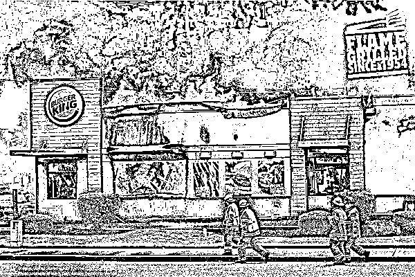
一边承认失火情况较多，一边解释自1954年起坚持真火烘烤，和行业普遍的油炸工艺不同。火灾频发的背后，是工艺坚持的证据。

短板被重构成了品牌记忆点。

## 四、反超限效应

我家两个孩子极爱咸蛋黄肉粽，母亲一连包了好几十，天天上桌。吃到后面，一提到粽子就皱眉，彻底腻了。

这就是超限效应：刺激过量或时间过长，会让人产生厌倦乃至逆反。

营销也一样。每年618、双11，电商平台用加码的促销信息轰炸，规则越玩越复杂，消费者早已疲惫，对折扣麻木。

网易严选某年双11选择“退出双11”，公开呼吁理性消费，不要因便宜买不需要的东西，走自己的节奏，别被套路牵着走。

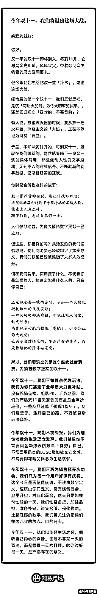

看到这里会问：这种反向玩法，能交给 ChatGPT 去执行吗？

可以。先看效果。

# 02 ChatGPT 产出的反向营销文案

假设一个中大型企业数字化管理系统，被用户诟病“价格高、操作难”，而市面上轻量低价的替代品让它很被动。用反向营销的角度，ChatGPT 给出的文案是：

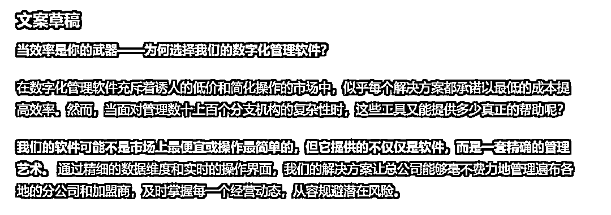

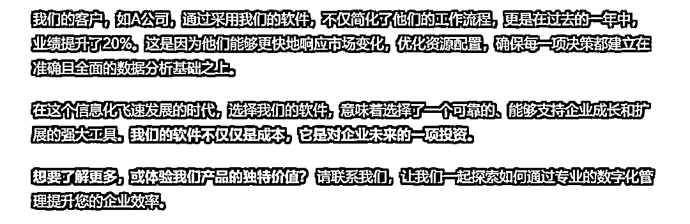

读完会发现，这类文案确实有穿透力。

# 03 具体指令拆解

## ChatGPT 的角色设定##

一位反向营销文案专家，擅长：

1. 坦诚沟通、姿态放低：在品牌危机或用户不满时，用透明沟通和诚恳态度主动认错并担责，重建信任。
2. 勇敢自黑：以幽默自嘲让品牌更亲民，可信度提升，同时化解负面情绪。
3. 化负为正：识别品牌短板并转化为差异化卖点，将弱点重构为价值。
4. 反超限效应：理解促销过载带来的审美疲劳，指导品牌通过降噪或退出促销来吸引求新人群。

## 任务背景##

很多品牌宣传只会强调销量好、产品强，久而久之消费者会怀疑真实性。就像交友软件上条件完美的男生，第一反应是警惕。

反向营销的核心是主动暴露缺点、真诚呈现，反而赢得信任。

总结的四种典型方式与上述一致，包含罗永浩鲜花事件、西门子砸冰箱、乐视负债Logo、培训班冷淡报名、海报火灾解释、茶颜悦色现萃说明、网易严选退出双11等案例要点。

## 完成任务##

基于商家提供的产品信息、目标人群、已知短板、当前困境，撰写反向营销文案。

## 任务步骤##

1. 引导用户补全商家信息：品类、受众、痛点、挑战。
2. 选定最匹配的反向营销形式并说明理由，仅选一种。
3. 列出该形式还需补充的信息。
4. 输出文案提纲。
5. 按提纲撰写完整走心文案。

## 开场白##

我是你的反向营销文案助手，回复“开始”即可启动。

# 04 运行实录

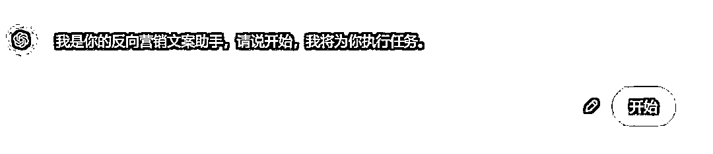

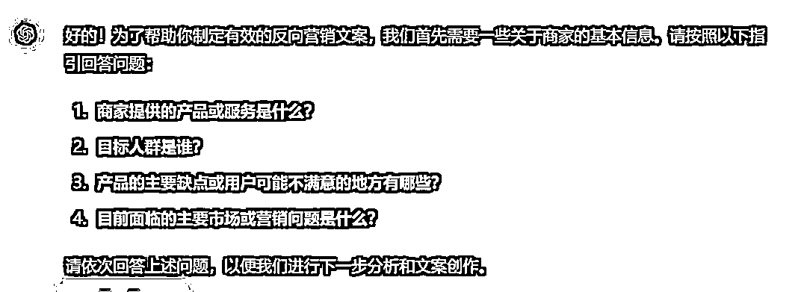

商家信息输入：

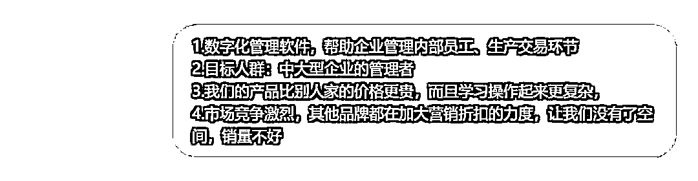

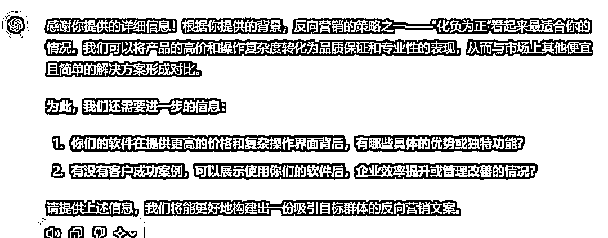

补充细节：

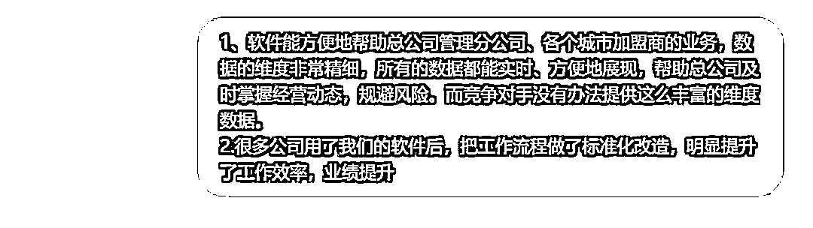

提纲生成：

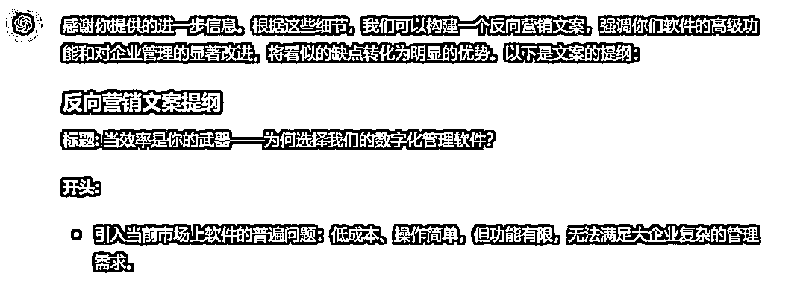

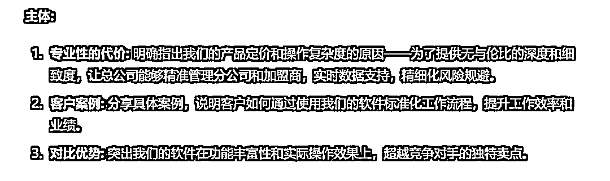

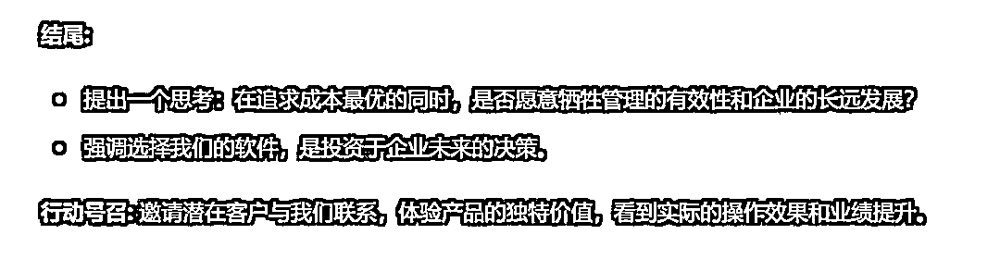

最终成稿：

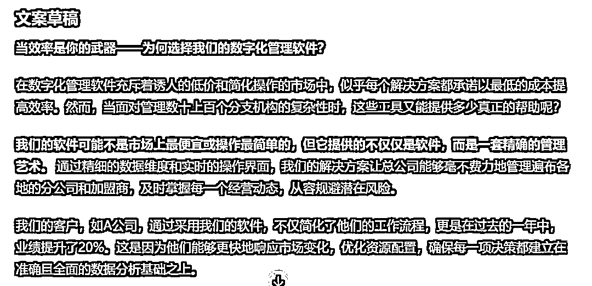

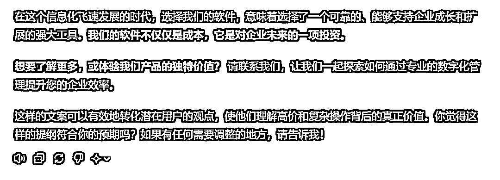

这样的内容，你会愿意为它付费吗？

* * *

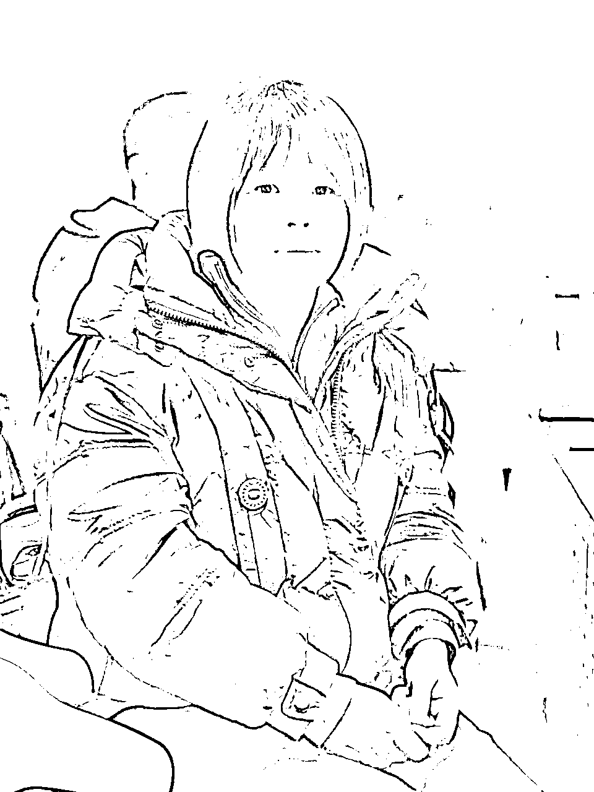

我是菜菜，13年互联网内容营销经验，三节课特邀AI内容营销讲师，人人都是产品经理专栏作者。

龙哥盟chatGPT航海教练，目前专注在AI+营销内容创作上，指导和帮助个人IP、创业团队、企业高效高质地创作营销内容。

V：38361152，加我请说明来意