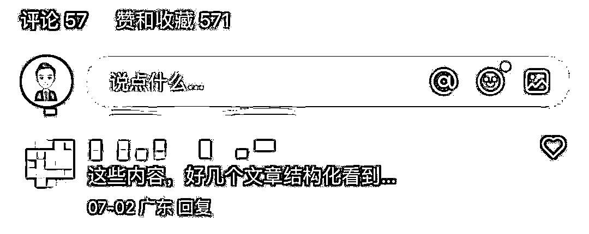
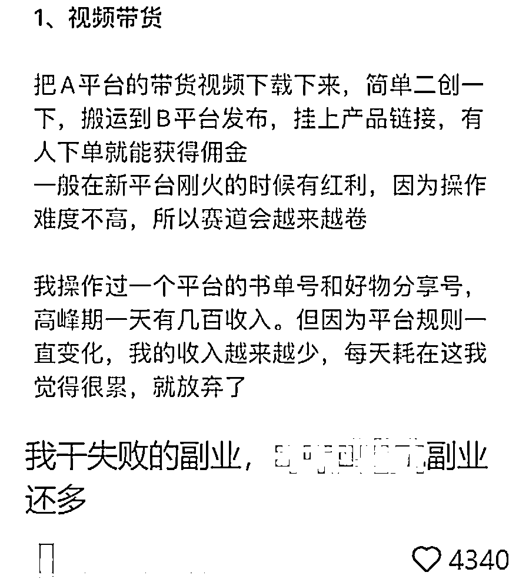
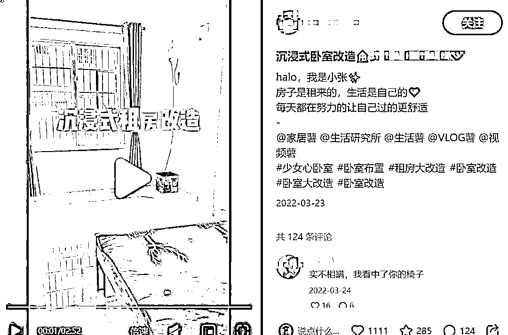
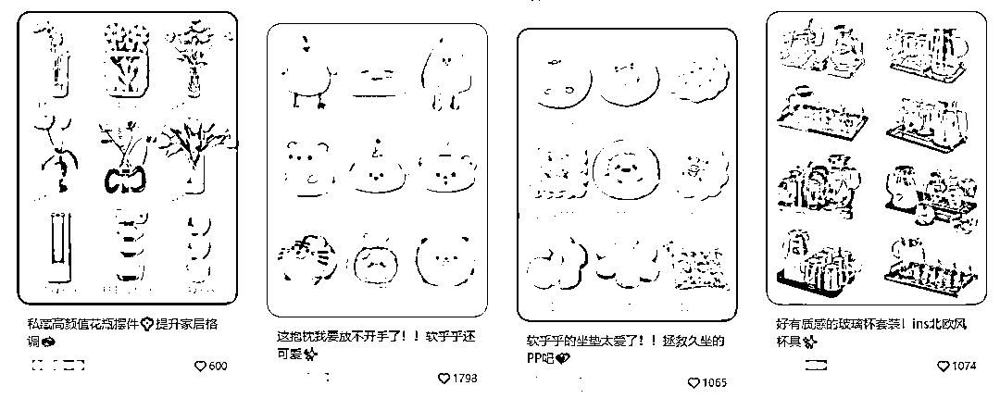
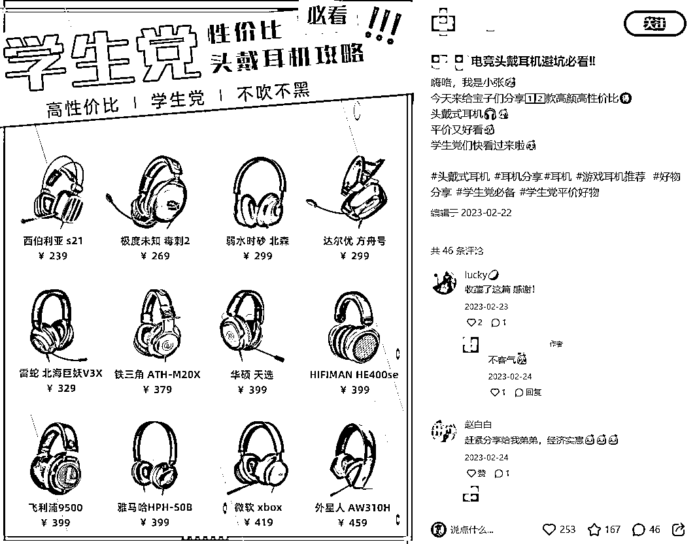
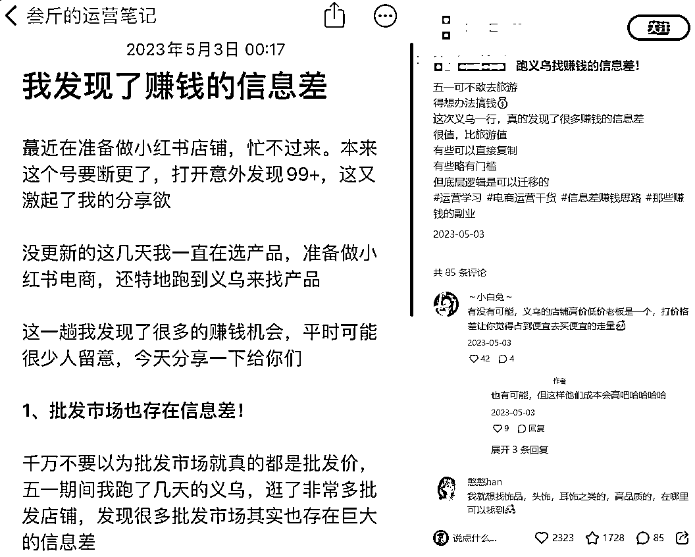

# 我做小红书踩过的 10 个大坑！

小红书这4年，我掉进去过的10个深坑，每一个都让人长记性

大家好，我是叁斤，公众号也叫“叁斤”。从其他行业跨界到自媒体，专注小红书已经有4年，期间做过好物分享号、电商、个人IP，基本把主流变现路径都走了一遍。这一路没少掉坑，也耽误了不少时间，今天就细数一下我亲身踩过的10个大坑，希望能给你提个醒。

1. 被流量焦虑绑架
每次开新号，我都会陷入一种“数据恐慌”。发完笔记后，每隔10分钟就忍不住刷新，盯着小眼睛数，没人点赞就开始胡思乱想：是不是被限流了？是不是违规了？还是话题不行？
其实我比谁都清楚平台规则和算法，也出过不少爆文，所以更怕新号做不起来，觉得丢人。但后来我想明白了，这种焦虑纯粹是内耗——你要关心的不是这条笔记的数据，而是下一条怎么做得更好。
也是在这个阶段，我摸索出“控制变量起号法”：每条笔记发出去后，强迫自己别看数据，先忙别的；等24小时后再回来看，根据反馈决定下一条怎么调，比如换封面、换标题，重发一次。
新手最容易犯的错就是流量焦虑，我的建议是：发完笔记直接退出小红书，该干嘛干嘛，刻意忘记自己发过内容。

2. 1:1照搬爆款
一开始我很坚持原创，觉得抄爆款做不出真正有价值的内容。可后来满屏都在教人“抄”，连我自己辛苦写的爆款也被别人搬，心里就不平衡了：既然大家都抄，我为什么不行？
于是我也开始整篇整篇地模仿爆款，爆文概率确实上来了，可点赞很多，关注却少得可怜，转化率几乎为零。认真想了一下，那段时间内容本身就不扎实，全靠抄，运营能力一点没长，个人IP更是没影，坚持了大概一个月就放弃了，白白浪费了一个成长期。
最近还看到有个旧笔记下面有人留言：“类似的内容我在好多号上都能刷到……”我一时语塞，也庆幸自己后来及时收手。
说实话，抄爆款起号确实快，但如果你想长期做、想建个人IP，这条路还是趁早别走。

3. 模仿对标账号
刚开始学小红书，我也是靠对标起号的。人家发什么选题，我就跟着发什么，追得很积极。可跟得越久越发现，这个账号除了“能更新”，好像没有“我”。下一个选题该写什么？怎么把学到的知识点融进自己的故事？怎么让对标的内容变成真正的原创？我全都答不上来。
最后账号成了没有灵魂的“信息搬运站”，涨粉难，更别提变现，无奈之下只能放弃。
后来我从自己重新出发，不再演别人，只讲自己的经历，反而跑出了爆款。比如说有一条笔记，我没列“什么副业能赚钱”，而是把那些做砸过的副业挨个讲了一遍，结果成了小爆文。
对标跟抄爆款一样，都适合起号，可要是你想要一个真正属于自己的账号，想让粉丝认可你这个人，就别依赖模仿。我现在依然会拆解对标账号，但目的不是照搬，而是找出他们身上某一点值得学习，然后去超越。

4. 盲目追热门赛道
早期我的账号经历过好几次转型，有一回盯着家居类目，觉得接广告容易、单价也高，就冲了进去。账号不算失败，涨了几千粉。
可收入基本没起来。原因后来我也总结了：家居赛道虽然广告多，但要看你账号有没有种草属性、整体调性够不够；我的审美撑不起好看的家居画面，拍摄水平也拍不出高级感，时间更无法天天耗在布置房间和剪视频上。笔记里出现的全是廉价物件，贵一点的产品放上去也不显好，调性一直提不上去，高价值广告自然轮不到我，最后只能换赛道。
所以新手选方向，一定得看自己手上有什么，别眼红别人赚钱就乱入。哪个赛道都有人赚钱，问题是那个人不一定是你。我也算试过了，现在看家居博主赚得多，一点不羡慕，那钱真不好挣。

5. 做没有“人”的账号
早些年起过不少号，倒都是原创，可每篇都是一个模子印出来的，同质化严重到连我自己都分不清。内容基本都是一个模板：除了产品贴图，没有情绪、没有观点、没有个人痕迹。这种号太好复制了，粉丝看你跟看别人没区别，粘性自然很差；品牌方也不傻，同质化内容根本给不了高价。
后来转做个人IP，开始输出带“人味”的内容，哪怕是几张备忘录截图，也会有粉丝追着催更。
给新手的提醒：一定做带人设的个人IP账号。无人设号很难让粉丝记住你，“关注”也就变得毫无理由。

6. 定位换来换去
转型家居赛道的时候，我看租房改造很火，转头就开了个租房改造号。数据上不去，又发现图文测评好像容易接广告，马上跟着发……最后这个号成了大杂烩，什么内容都有，数据稀烂，只能放弃。
做个人IP时我也犯过同样的错。一开始想做副业方向，测评副业、分享项目，可做了几次就发现自己根本不喜欢这个方向——自己做过的副业本来就不多，又不愿意花心思发掘新项目，结果账号断更很久。
所以，找到合适定位之后，千万别频繁换，试错的成本远比想象中高。

7. 等准备好了再开始
做笔记需要准备什么？我最初的逻辑是：先学会写文案、拍摄、运营，再动手做小红书。结果呢？学什么都没学会，号也一直没开起来。
我相信很多人也是这样，总觉得“等条件够了”。直到我看到一条特别简单的笔记：图上就是淘宝店铺截图，文案也只是把店名抄了一遍，居然也能火、也能赚钱。那一刻我才明白，我拖着没做，不是不会，是懒。
现在还是有人总说：手机拍出来不够好看、不会口播、不会写文案、没有好看的房子衣服、没有设备……可没有谁的账号是“完全准备好”才做起来的。哪怕MCN机构做达人，也是先跑起来，看到反馈再补装备。
做自媒体的人，永远等不到“完全准备好”的那一天，所有东西都是在更新中慢慢变好的。总想万事俱备再开工，最后只会永远不开始。

8. 写自嗨式内容
做个人IP那阵子，我分享的是自媒体干货，可我非常爱用“你应该怎样”的教导口吻，结果数据差得没法看。
用户刷小红书是为了放松，不是为了上课。再说了，我眼里的痛点，也许只是自认为“你应该学”，根本不是用户真正的需求。
后来我把视角换掉，“你应该怎么做”变成“我是怎么做的”，数据立刻好了不少。比如我会讲在义乌看到别人靠信息差赚钱的经历……
所谓自嗨，就是文字很漂亮，但全篇都在自我表达，根本不考虑读者想看什么。新手特别容易踩中，比如把知识写得太专业、把信息铺得太满，还默认用户都看过你以前的内容。

9. 为了日更而日更
刚运营那会儿，我看了个“运营秘籍”，说新号要关WiFi注册、用微博注册、一定要日更，我当圣旨一样执行，不管多忙都强行更新。
可后来发现，忙起来随便赶一条内容发出去，基本没水花。一次实在没东西发就断更了，忙完一周再更新，数据完全正常——断更根本没副作用。
从那以后，日更不再是我不变的指标，我要求自己和团队：单篇内容质量不过关，宁可断更也不硬发。
现在我依然是这个习惯，没想清楚就不更新。日更不是重点，质量才是。

10. 把涨粉当先，变现放后
我做过一个美食号，粉丝做到3万多，广告费却只有300块。
当时只盯着广告收入，什么火发什么，结果是笔记火了、粉也涨了，但商家就是不来找。复盘才知道：吸引来的粉丝大多是十八岁以下，广告价值很低；而且内容里没有种草位，账号不具备引导消费的属性，品牌方怎么会买单？
后来我调整了做法，每个账号都反过来：先想怎么变现，再根据变现方式找目标用户，最后才起号。
新手做自媒体，也一样先定目标再动手。带着明确目的去做，变现效率会高很多，不至于像当年那个我，几万粉还在为300块发愁。

以上，就是我在小红书上踩过的10个大坑，当然还有数不清的小坑。我是跨行一路摔过来的，把这些写下来，只希望你能少摔几次。