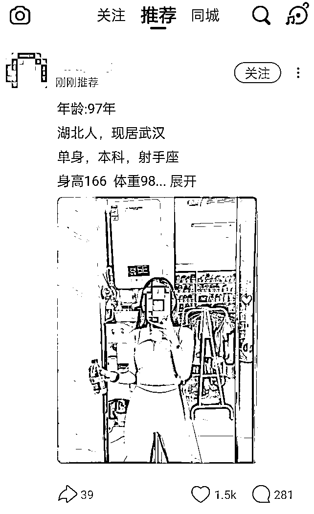
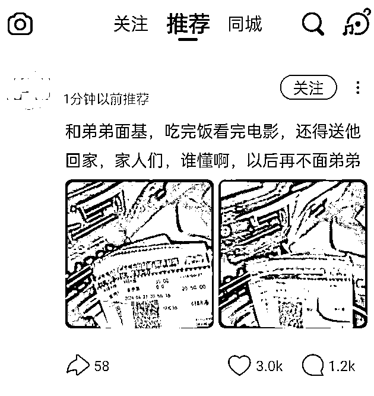
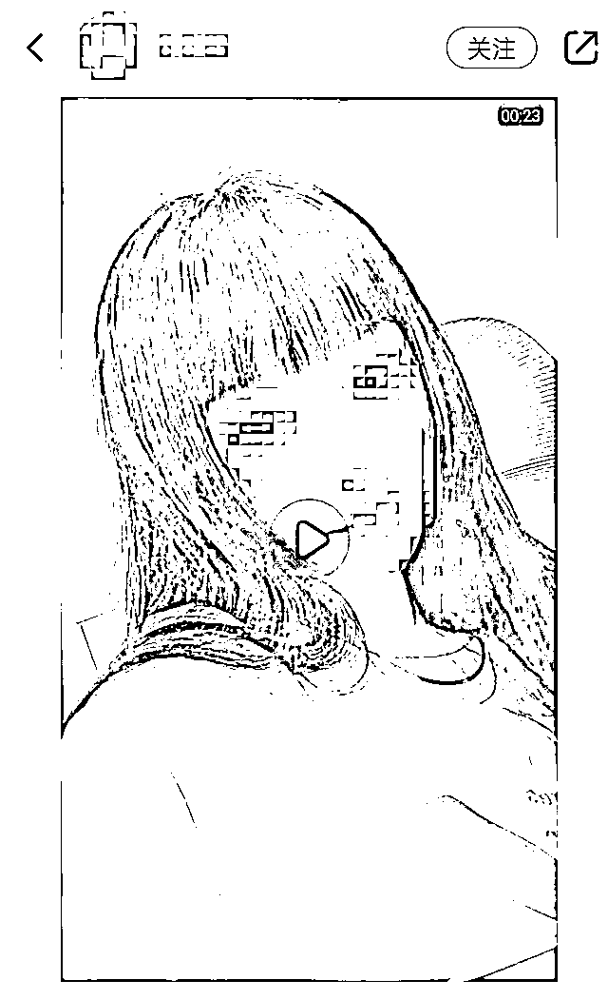
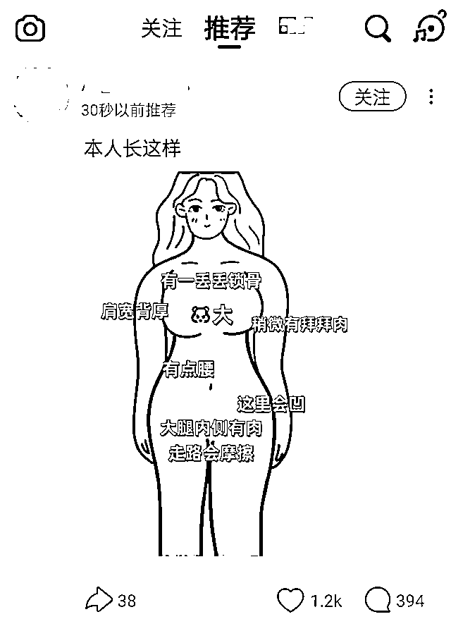
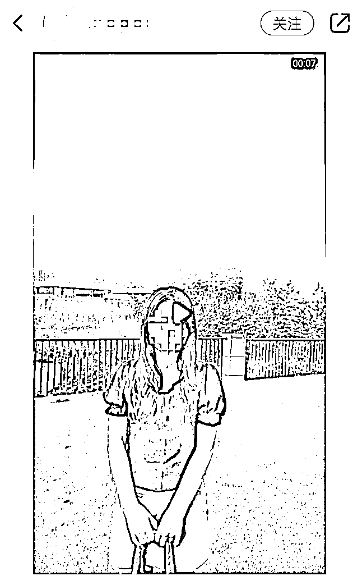

# 半个月6万落地：同城脱单项目实操拆解

# 我为何入圈

大家好，我叫元英，是龙哥盟的新人。几周前在👸号刷到赚钱的推文，被里面的干货震到，当晚就关注并刷了十几篇。越看越上头，顺手在百度查了下背景，才知道龙哥盟从2017年起步，累计6万+人加入，七年续费率远超同行。这哪是👸号，分明是宝库。我当即花了2765元入群。进群后我一头扎进精华帖和中标案例，刷到凌晨三四点还停不下来。圈子里高手云集，干货密度极高，我现在每天都在啃老玩家经验。

# 项目由来

看完一圈分享，我越来越认同赚钱的核心：真诚利他才有复利。所以今天抛一个我亲手跑通的小项目出来抛砖引玉。同城速配这个赛道不像百万级大生意，门槛相对低，更适合一个人或小团队起步。下面是我最近半个月的真实复盘。

## 关键数据一览

项目定位：一句话总结，就是在Soul上做获客，沉淀到私域完成转化与交付，用会员费变现。

复盘周期：2024年6月20日 - 2024年7月3日，后因出国暂停

团队配置：2人，我负责获客转化，发小负责交付，他本身是国家二级心理咨询师

硬件：5部手机，5个微信号，其中4个做转化，1个做交付

有效引流：300+人，全部是筛选过的多金优质男性

最终成交：46单

流水：6万+

## 为什么做这个

现在单身群体已经是社会常态。2023年全国单身人口超2亿，男性单身约1.1亿。结婚率持续下滑，2013年9.9‰到2022年仅剩6.7‰，离婚率却在攀升。经济下行让年轻人对未来更谨慎，更想先找个能聊得来、能共情的伴侣，而不是冲动结婚。工作忙、圈子窄、缺靠谱平台，这三重痛点让“找对象”这件事变得越来越刚需。我就想用专业的方式去解决这部分男性的单身焦虑。不仅提供认识优质异性的渠道，更要通过系统服务提升脱单效率。单身人群的情感需求只会越来越大，这个赛道天花板很高。

## 项目三步走：引流-转化-交付

### 引流

1. 朋友圈/私信周边的单身男性：需求确实存在，但熟人很难为钱买单，让推荐也被嫌伤感情。❌
2. QQ群/微信群：进了恋爱交友群很快被踢，留下的咨询多为猎奇，转化极低。❌
3. 公域短视频：抖音、快手、B站、📕合计引来30多人，付费意愿差，客单价也低。❌
4. Soul：当下最稳的入口。我通过Soul把300多名精准男性拉到微信，后续全部精力都放在这里了。✔️

Soul为什么有效
注册用户破亿，日活数百万。男女比例约6:4，男性略多，集中在18-35岁的一二线城市青年学生和职场人。平台匹配机制强，重情感交流，用户活跃度高，非常适合做同城脱单的冷启动。

Soul具体玩法

1. 相亲资料+生活照：引流快，精准度高，但导流到微信容易触发封号。

2. 相亲文案+约会照片：流量大、有吸引力，但用户精准度一般。

3. 美女视频+引导性文案：精准且流量高，内容敏感度高，易违规封号。

4. 幽默段子+搞笑图：能吸男性注意，流量高，精准差且制作耗时。

5. 真人口播+情感话题：精准度高、具备长效价值、封号风险低，但对拍摄投入要求高。

我总结：1和3见效最快但活得短，2和4量大但乱，5更适合长期做。做久了必须真人出镜做IP，才能保证流量稳定和成交率提升。

### 转化

加微信后先做需求摸底，再介绍服务。走会员制，不付费不启动服务。

SOP如下：
信息登记：让用户如实填表，基础信息、择偶要求、生活照，信息越全匹配越准。
精准展示：根据资料定制Soul展示内容，用户确认后自行发布。
接触指导：给话术模板，指导与心仪异性交流，微信深度沟通。
1对1陪跑：遇到卡点随时连线，我们做辅助。

收费节奏经历三次调整：
首测期 520元/7天，验证Soul流量和转化是否跑通。
第一次上调 888元/7天，路径打通后提价降压。
第二次上调 1299元/7天，随着成员增加，交付压力加大。

当前转化率约15%，我觉得还有很大优化空间，主要是专业感和信任感还能再做强化。

### 交付

交付=帮助付费会员实现脱单。难点不小。

会员长期单身的核心原因大致四类：
社交能力弱：表达不清、不会倾听、怕被拒绝。
形象管理差：穿搭随意、仪容不上心、肢体语言没自信。
社交面窄：圈子固化，几乎不参加线下活动或兴趣社群。
择偶标准过高：期望不切实际，对自身条件认知偏差。

前三类通过陪聊指导、形象咨询、引流策略基本能改善。最难啃的是第四类，需要长时间引导他校准自我定位，降维期望。这类客户耗精力。

需要明确的是，我们不能承诺100%脱单。我们的价值是提供专业服务，让会员认识更多硬性条件匹配的异性，提升概率。最终成不成，主动权在用户。我们要做的是合理管理预期，避免过度承诺。

目前交付能力有限，服务主要包括：Soul展示定制、开聊话术指导、微信阶段聊天陪跑。未来想往深做：形象重塑、情商提升等高客单服务。

## 实操笔记

什么内容容易爆？
情感共鸣类故事、心路感悟；幽默段子类；高质量高颜值图片；引导评论互动的提问。

怎么快速摸市场？每天刷Soul广场和同城页，需求变化一眼就能看出来。

同城脱单还有哪些平台？牵手、陌陌都可以先注册体验，熟悉玩法和用户画像。

小白能做吗？能。先把Soul官方教程啃完，注册账号发瞬间，积累手感。别在美图、剪映这些基础工具上卡住。

要不要建微信群？不建议。群里鱼龙混杂，管理成本高，容易变成吹水群，还会引来风险。

用户付费却不肯发照片怎么办？先解释照片对匹配率的重要性，再不行就礼貌拒绝。找对象不是盲盒，透明度是基本盘。

没转化的用户怎么养？朋友圈持续输出：脱单案例、付费截图、情感干货，用内容慢慢回温。

怎么安全收款？优先用支付宝，减少微信封号风险。

Soul账号老被封怎么办？避开“加微信”等敏感词，不在平台开车、挑衅、辱骂。

会员投诉怎么处理？先弄清情况，再以疏导为主，不讲理的先摆事实给方案，沟通后多会让步，实在解决不了就退费，别纠缠。

# 一点创业感悟

创业的压力是打工的十倍，但回报也匹配。最近每天都在处理突发状况，问题解决了又来新问题，反反复复，但能力确实在涨。我对自己更有底气了。实践让我成长，赚钱圈让我少走弯路。接下来我会继续深耕。

分享结束，欢迎同路人交流。我是元英，专注同城快速找对象这个小而美的生意。