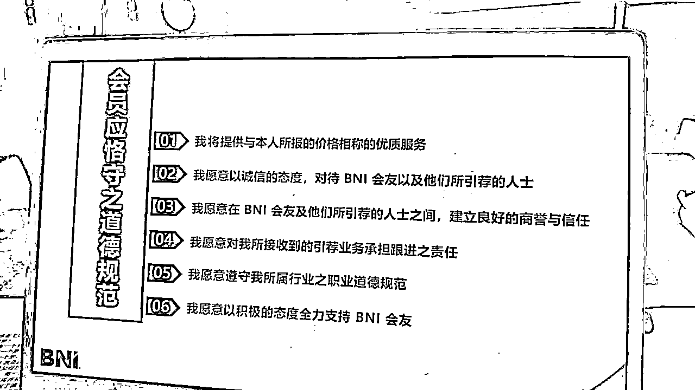
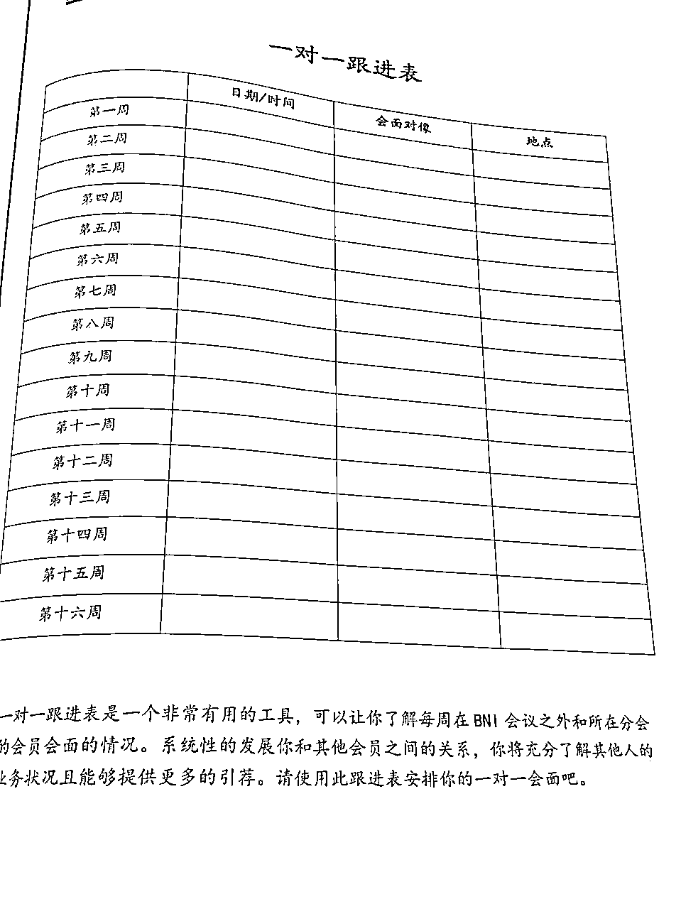
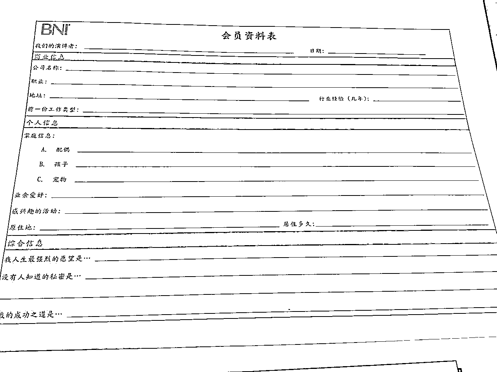
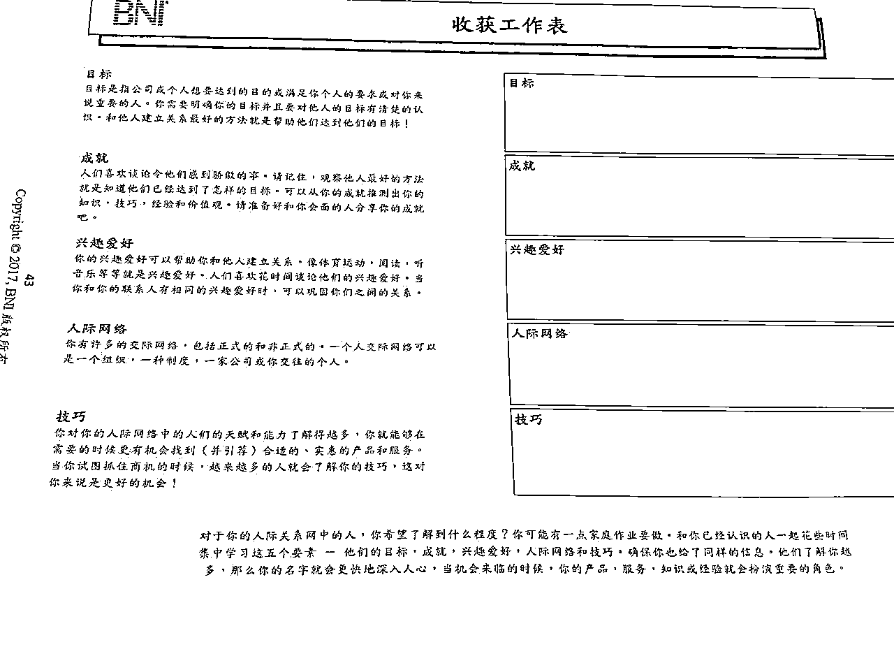
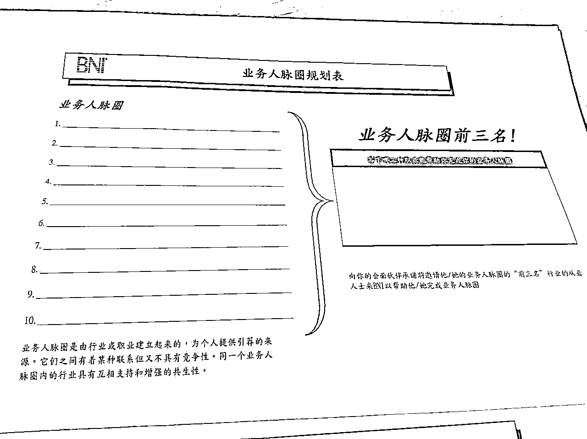
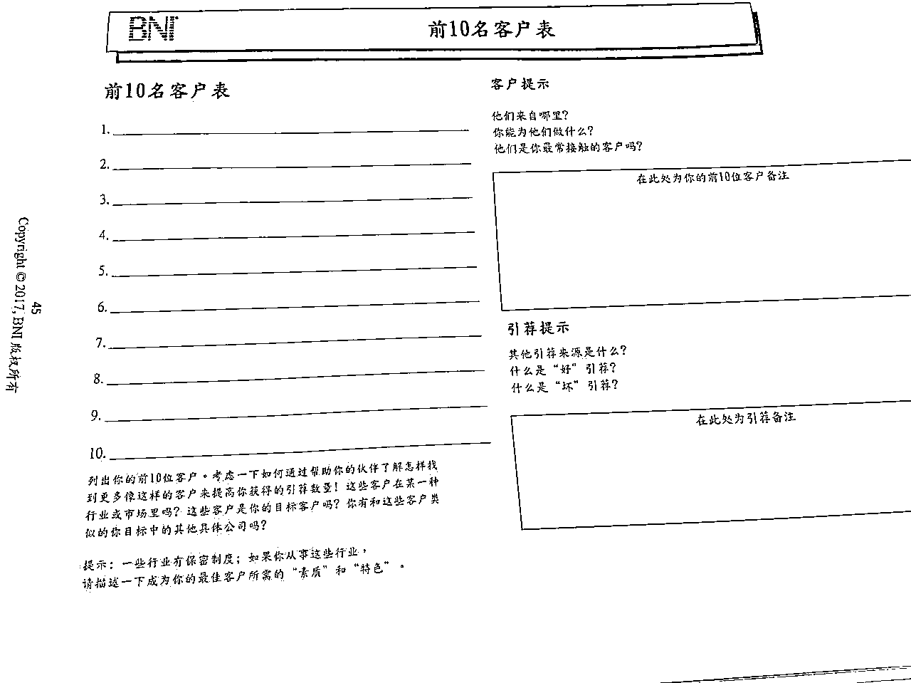
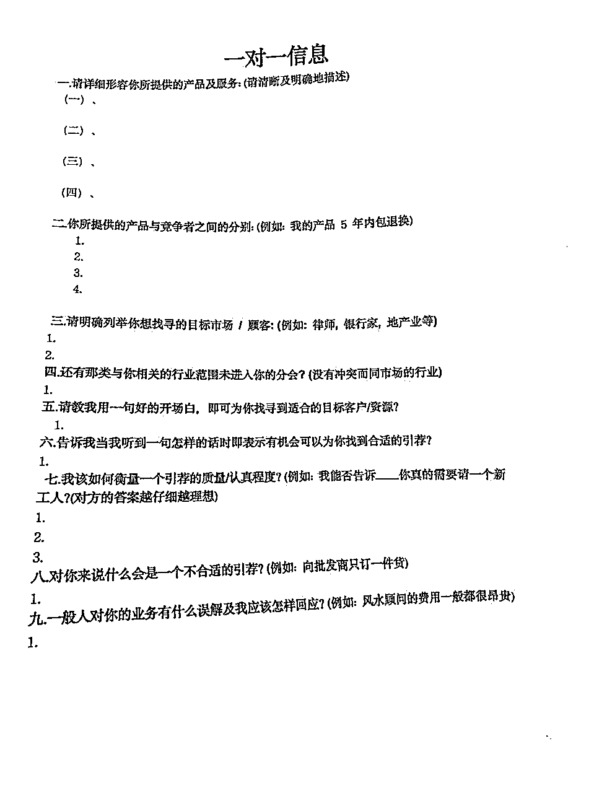
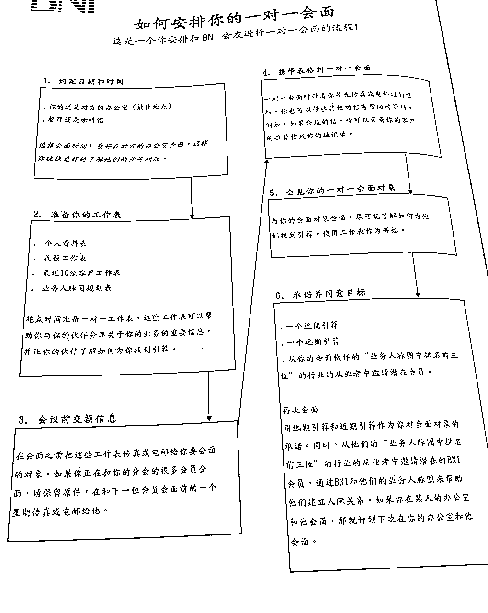
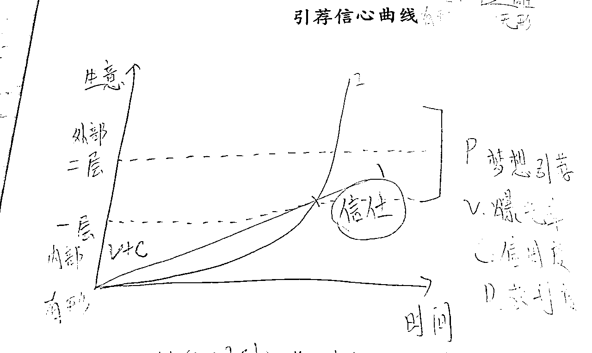

# 花7000块进了一个“生意互助会”，我把它的全套玩法扒了个底朝天

> 文章来源：[https://ooldqbgx5t.feishu.cn/docx/TCtSdoPiooAtLtxhuixcjudOG0nog](https://ooldqbgx5t.feishu.cn/docx/TCtSdoPiooAtLtxhuixcjudOG0nog)

先自我介绍一下：我是莎拉，常驻深圳。

生财有术四年老会员，也是航海家，手里有国家高级烘焙技师的证书。平时主要折腾实体门店的运营打法、私域流量的经营策略，外加帮别人做个人品牌的内容输出。

前阵子我跑进了一个线下商业互助社群，体验了几周之后，不得不承认——他们这套东西设计得相当精巧。

我把它的操作机制、配套工具、核心方法论完整地梳理了一遍，才整理出今天这篇拆解。

就算你不打算加入任何类似组织，这套思路拿去经营你自己的生意和人脉，也一样能打。

全文按这个线索展开：

第一部分：BNI到底是什么来头
第二部分：BNI凭什么让人做出成绩
第三部分：它的优点和短板

## 一、BNI这个组织，到底是什么来头

### 1. 历史有多久、现在有多大

BNI的全称是Business Network International，说直白点就是“国际商业人脉网”。它是一个做跨行业资源链接的全球性生意社群，核心就一件事：帮会员们在商业活动中结识伙伴、深化关系，最终实现业绩增长。

组织的创办人是美国的Ivan Misner博士，时间点是1985年。

到今天，BNI已进入全球超过66个国家和地区，下面有7800个分会，会员总数累计有22万。

大中华区版图里，深圳、广州、佛山、厦门、香港、澳门、台湾都设有分会。

### 2. 理念、使命和入会底线

BNI最重要的精神内核，用一句话讲就是：Givers Gain——想先得到，先给出。你帮别人对接生意，别人才愿意把机会同样介绍给你。

它的使命并不复杂：用一套有章法、主动出击、高度职业化的口碑传播系统，帮助会员做大业务量，同时和一群优秀专业人士结成长期稳定的友好合作关系。

另外，每个入会的人都要宣誓遵守道德规范，这是板上钉钉的规矩。

### 3. 入会流程、培训安排和早会制度

入会要走这些程序：递交申请表格→缴纳7250元的年度费用→接受登门拜访考核→材料提交委员会审定→批准后正式成为会员。

另外，参加培训要额外交180元场地费。

每个分会每周选一个固定工作日开商务早会，时间固定在早晨6:30到9:00。具体设在星期几，每个分会自定，有的周二开，有的周五开。

早会的费用构成：会员180元，嘉宾200元，包含酒店场地和早餐。

说白了，BNI通过费用门槛和时间门槛，天然完成了一轮精准筛选：

- 首先，一年拿得出七千多会费、每月再掏720元早餐费的人；
- 其次，工作日上午能腾出时间参会的老板、高管、自由职业者；
- 最后，还得着正装出席、能公开发言、善于跟人打交道。

### 4. 内部系统如何运转

有两个设计特别有味道：

第一，每个分会里，一个行业只留一个代表名额。没有同行内耗，只有互补协作。

第二，每个会员本质上就是其他人的“兼职销售”。组织会不停训练你：怎么帮伙伴找到合适的生意资源。

**再看它的组织架构：**

最上面是执行董事（ED），下面是国董（ND），再往下是全球支持团队（GST）。

分会这一层设有领导团队（LT Leader Team），包含团队主席、副主席、财政秘书；再往下有会员委员会（MC）、新会员辅导师、教育协调员、活动统筹员、来宾接待员、增长统筹。

还有一个特色机制叫“协力团队”——客户画像相似或业务存在互补的行业（比如餐饮、烘焙、咖啡），可以自愿组成互助小组，互相带生意。

**日常运转可不止开会：**

- 每周固定开一次线下早会
- 早会里每人做60秒业务陈述
- 每周至少安排一次双人深度对谈
- 每周都要带新面孔来参会
- 每周为会员输出引荐——可能是商业机会，也可能是潜在人脉
- 每周安排企业实地走访
- 培训、能量营团建、其他线下活动定期轮番上阵

**配套考核：分会红绿灯系统**

分会健康度从七个维度评定：

1. 分会总人数
2. 近半年的会员增长数量
3. 12个月内的续会比例
4. 每周产出的引荐数量
5. 每周到场的嘉宾人数
6. 嘉宾成功转为会员的比例
7. 会员的缺席比例

打分规则是这么定的：

- 人数超过30人：得15分
- 半年会员净增超过4人：得15分
- 12个月续会率达到或超过70%：得15分
- 每周人均引荐数超过1.1次：得15分
- 每周嘉宾人数达到2位以上：得15分
- 嘉宾转会员比率超过20%：得10分
- 缺席率控制在5%以下：得15分

灯号判断标准：

- 0到25分：黑灯
- 30到45分：红灯
- 50到65分：黄灯
- 70到100分：绿灯

能长期保持绿灯的分会，对外吸引力极强，海外会员都会专程来交流。一个分会能持续亮绿灯，往往代表它运转非常稳定、健康。

## 二、BNI到底用什么方式帮你做出成绩

### 1. 成体系的培训

官方有一套“会员成功之道”计划，英文是member success progam。

培训内容涵盖了：新会员进阶课程、30秒/45秒/60秒自我陈述训练、5分钟/8分钟/10分钟演讲打磨、单人深度交流技巧、引荐能力提升、协力团队协作方法、领导力培养等。

### 2. 线上工具

- 官方网站：www.bni.com
- 成功学院资源站：www.bnisuccess.com
- 播客内容平台：www.bnipodcasts.com

### 3. 每周早会的完整议程清单

一场早会，固定走20个流程节点：

开场自由寒暄接待→介绍来宾及领导团队、会员委员会、来宾接待人、教育协调人、活动协调人→宣讲BNI宗旨→安排人际交往主题分享→表彰本月杰出会员→传递名片盒环节→欢迎新会员及续约老会员→会员60秒业务陈述→嘉宾逐一自我介绍→副主席作工作通报→会员委员会汇报→财务秘书安排轮值演讲人→会员10分钟主题演讲→引荐与见证发布→引荐真实性复核→财务秘书财务通报→主席致谢到场来宾→嘉宾分享参会感想→活动信息公告和特别提示→抽奖→会议收尾

### 4. 双人深度交流：这门功课最有含金量

BNI最强调的一个动作，就是每周安排至少一次“双人深度交流”。

注意，这里不是喝杯咖啡的泛泛寒暄，而是至少60分钟的高质量对话。同一个对象，也可以约在不同时间段反复深聊。

这项动作的核心价值：一个是摸清对方的真实情况，另一个是让自己获得更高质量的引荐。

配套工具体系相当完善：

- 交流进度跟进表：登记预约安排和推进状态

- 人物档案卡：填写对方的基础背景资料

- 成果梳理表：记录对方想达成什么、已经做到什么、喜欢什么、擅长什么

- 关系网络图谱：把对方所处的行业、职业关联画成一张网。这些行业彼此有交集但互不竞争，可以互相成就、循环供血，从而源源不断地制造引荐来源

- 头部客户清单：写出对方最重要的十个客户

- 一对一情报档案：涵盖对方的产品/服务介绍、独到优势、目标客群画像、同赛道玩家分布、引荐时应使用的开场白、怎样的推荐算高质量、如何判断推荐对不对路、不应该做出的引荐、外界对这个行业常见的刻板印象及应对说法

- 完整拜访执行路径：先商定具体时间→填好准备台账→碰面前互换背景资料→带上表格准时赴约→展开深入对话→明确承诺和共识目标

有句话说得好——当两边服务的客户群体高度重合时，你能替别人对接的资源，也恰好是别人能反向带给你的机会。

### 5. 引荐：这个组织的硬通货

**先看引荐信心曲线**

想让人给你带生意，前提永远是：对方已经对你有了足够的信任。

这条曲线非常直观：横轴是时间推移，纵轴是生意规模，引荐量从零起步持续爬升。

你内心对引荐成果有一个预期轨迹（曲线1），现实中的引荐落地有另一条运行轨迹（曲线2）。两条线交会的地方，就是“引荐爆发点”。

爆发点之前的部分，意味着会员彼此内部贡献的引荐；交点之后，则代表会员从外部世界带回的资源开始兑现。

**每人拿到的引荐天差地别**

决定差距的有三大变量，英文缩写是VCP：

- V：Visibility，意思是曝光度。得先让别人知道你的存在。
- C：Credibility，意思是可信度。靠专业表现和稳定靠谱一点点积累口碑。
- P：Profitability，意思是利润贡献。最后才能走到成交，实现经济回报。

所以，BNI从头到尾讲的是长期深耕，不是短线套利。

不同的领域、不同的产品、不同的人，拿引荐的节奏也完全不同。实物型、高频消费的产品，别人容易想到你；无形服务、低频需求的产品，被推荐的频率天然低很多。

个人层面的变量也在起作用：你投入多少、能接住多大流量、用心程度、坚持多久，每一个都实打实影响结果。

美国市场的经验数字是：想等到爆发点，平均需要3年。第一年学习适应，第二年建立信任，第三年进入收获期。而在中国，这个周期据说可以压到18个月。

**三步五阶获取引荐法**

- 培训：反复上课、不断复盘、大量输出分享。上课次数和引荐数量基本成正比。
- 出勤：早到现场、状态拉满、持续推进曝光。
- 邀约：主动邀请嘉宾参会，把人脉通道打开。
- 交流：每周保持深度对话，把对方和自己的工作都搞透。
- 引荐：先给别人送出生意，信任积累够了，成交自然找上门。

**一次令人惊艳的引荐分三层：**

- 普通引荐（good referral）
- 精准引荐（ideal referral）
- 梦想引荐（dream referral）——素材里有个真实案例：英国一名画家，因为BNI牵线，接到伊丽莎白女王助理亲自打来的电话，邀请他为女王画像。人家一单就能吃穿三年。

**引荐人群定位漏斗**

面向B2B生意，从上到下逐步聚焦：所有人脉→行业圈层→企业组织→业务部门→具体职位→关键姓名

面向B2C生意，思路是这么一路收窄：所有人脉（倾向高净值人群）→我提供什么产品/服务→哪些人群对此有需要→我通讯录里谁是潜在买家→我要启动哪类引荐

**一次出色引荐的标准动作：**

- 先征得本人同意，才可以使用他的名义
- 用私人信息或邮件做出有温度的背书
- 先核实需求真伪，再向对方说明“我认识的人正好能帮你”
- 需求确认后，把双方的会面时间敲定
- 还可以更进一步，安排三方同时在场碰面

### 6. LCD：60秒把生意讲明白

BNI里面有个高频词叫LCD——说白了就是在最短时间里把你的业务价值讲得一清二楚。

**第一步，把业务切分成一个个精确的小模块。**

举我自己的例子，我把产品线切成了这些LCD版本：

- 日常面包、曲奇、点心类
- 生日蛋糕定制类
- 父亲节、母亲节、情人节、圣诞节、儿童节的节日蛋糕
- 青团、粽子、月饼、年货礼盒
- 企业茶歇、学校活动、会议宴会甜品台
- 亲子DIY烘焙体验
- 专业烘焙技术线下课
- “莎拉陪你终身成长”知识星球
- 实体店铺创业指导课

**第二步，准备充足的支持材料。** 宣传小册、介绍信、推荐函、样品、照片，随取随用。

**第三步，LCD的标准公式：** 姓名→公司/品牌→所属行业→产品/服务定位→案例/见证→我需要的引荐。

拿我自己毕业蛋糕那个LCD来举例：

> 我叫莎拉，专注烘焙领域，国家高级烘焙技师，在这个行业深耕7年。
> 我们做现烤现制、动物奶油的蛋糕和甜品，可以根据每个班级的需求定制专属毕业蛋糕，把全班师生名字和祝福语都做到蛋糕上。
> 到目前为止，已经为深圳中学、红岭中学等50多所学校做过毕业蛋糕。
> 我现在最需要的引荐是：幼儿园、小学、初中、高中、大学的家委会核心成员。

### 7. 十分钟主题演讲怎么备

每个人的演讲机会，组织会提前六周排定并发出通知。

准备节奏：确定分享主题→撰写演讲稿→制作辅助演示→邀请10到15位亲友现场支持→反复排练→正式登台。

**这十分钟千万别踩这些坑：**

- 拿大量时间罗列产品功能细节
- 专业名词满天飞
- 说大话“什么人都能服务”“一条龙全包”
- 现场随便接受提问
- 试图当场成交
- PPT翻页翻个没完
- 忘了给嘉宾准备小礼物

**正确的打开方式是这样的：**

- 开场1分钟给全貌
- 花2分钟突出你的独特市场定位（USP）
- 拿1分钟讲最出彩的重点客户故事
- 用3到4分钟教大家“怎么帮我介绍生意”
- 准备2到3个LCD版本备用
- 讲真实成交案例
- 会讲有温度的故事
- 请会员当众背书
- 把嘉宾带到场
- 道具要备齐，最好有助手和应急预案
- 最后就是：练、练、练

### 8. 每个环节背后都藏着深意

BNI对每一个细节的用心，细品都是戏：

**出席。** 本人到场是最高的优先级。人到，生意才到，资源才到。

**替代人。** 实在来不了，就把同事、朋友甚至客户训练成“发言人”代你出场。

**早到。** 真正跑出成绩的人，常年6点到6点半之间到场。守时是最便宜的信用建设。

**自由交流。** 引荐本质靠关系深度。早到、会后留下来多聊、额外约谈，都是经营关系的好方式。

**各种时长的演讲。** 每一个版本都要精心准备。BNI的演讲课，能让你站上台更有底气、表达更有说服力。

**引荐单。** 当会员教你如何为他寻找引荐时，当场把要点记在引荐单上，平时常翻看，保持敏感度。

**引荐的真正含义。** 所谓真正的引荐，就是“电话那头的那个人，正在等着你的电话”。引荐单要带去会场，白色联交给接收人，黄色联留给自己，粉红联交给副主席。

**嘉宾。** 总是带嘉宾来的人，人脉连接面更广，产生的引荐也更多。BNI会专门训练你：请谁、怎么请、怎么跟进才有效。

**感谢单。** 当会员为你带来生意且顺利成交时，写一张感谢单投进抽奖箱，既是仪式感，也是正向强化。

**写见证。** 如果会员给你或你的客户提供了优质服务，为他写一段推荐见证。这是帮他积累可信度的绝佳方式。

**一对一。** 保持定期深度对谈，你才知道对方能提供什么价值，以及怎样为他引荐最合适。反过来，他也同样会为你花时间。

**贡献证明。** 对分会有三种公认的正面付出：给会员介绍引荐、带嘉宾参与、为会员写下见证。

**目标设定。** 这套机制会推动你整理自己的人脉资源库，同时完成分会的人脉网络建设。

**BNI的态度底色只有八个字：先予后取，永不匮乏。** 永远别说“我没有”，换个角度看，永远说“我有”。设定个人目标和业绩目标，引荐数量要达到多少、成交金额要实现多少，全部摊开来，用行动去兑现。

## 三、光鲜背后，优势与槽点并存

### 让我觉得惊喜的地方：

- 依托高密度的培训和频繁碰面，把一群陌生人锻造成彼此深信的强关系网络
- 系统化地训练会员的利他思维、长期主义视角，同时顺带锻炼了表达能力、沟通能力和带团队能力
- 所有流程目标导向、效率极高，每一步都对着“促成合作”这一件事使劲

### 再说几句公道的吐槽：

- 会员整体年龄偏大，以中年老板群体为主
- 有人长期拼事业，身体状态已发出警报，精力不如年轻人
- 行业分布上，传统实体产业占主流——建筑工程、制造业这类居多
- 互联网领域和小众新业态的年轻创业者，占比还远远不够

说到底，BNI真正打动我的，不是“开早会”这个形式。而是它把“人脉变现”这个玄乎的事，做成了一台精密运转的机器——用规则倒逼你利他，用训练教会你专业，用引荐结果检验你做到没有。这套方法，放到任何人的商业社交里，都是可以随身携带的硬本领。

希望能给你们一些启发。下次继续聊。