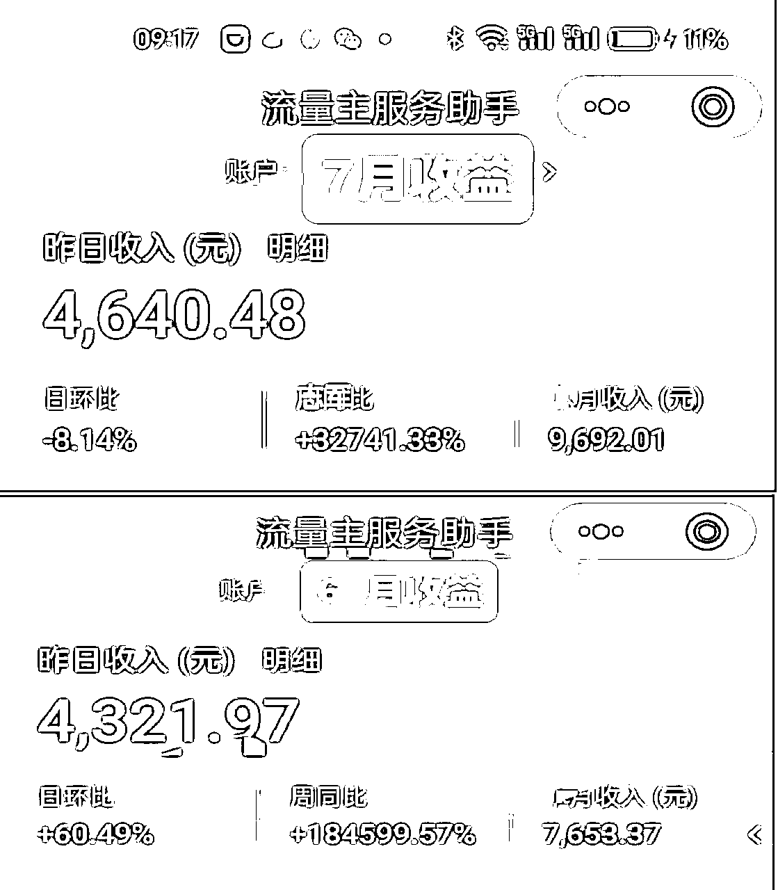
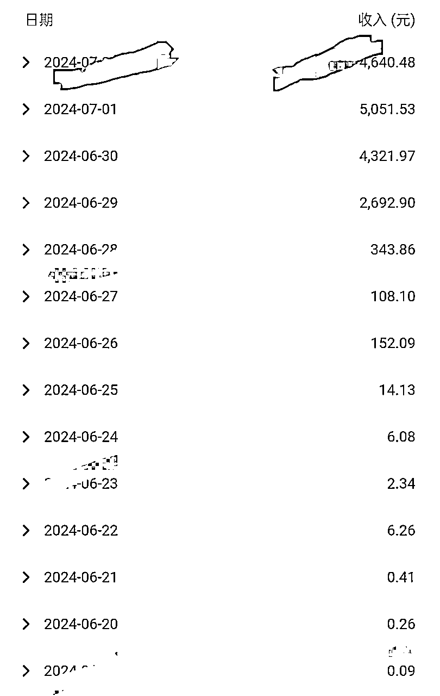
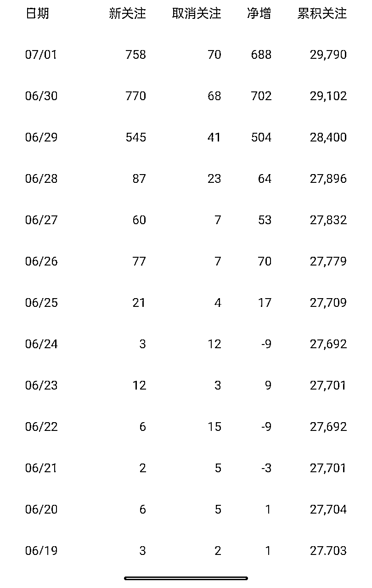
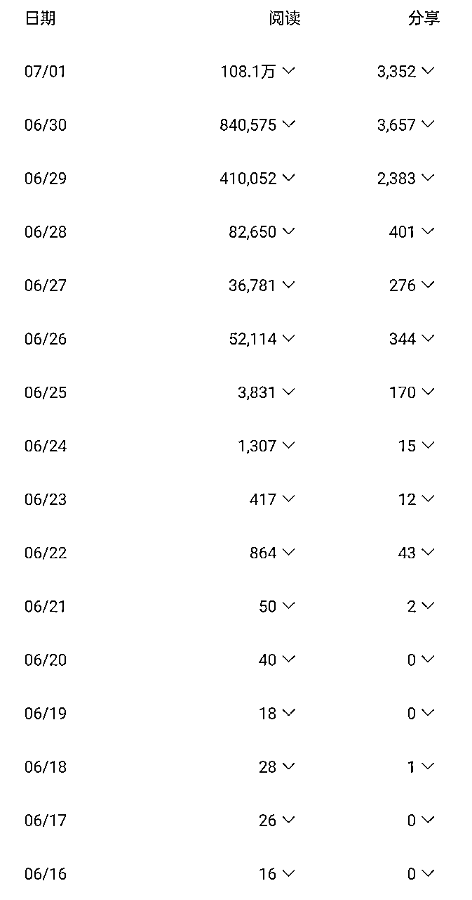
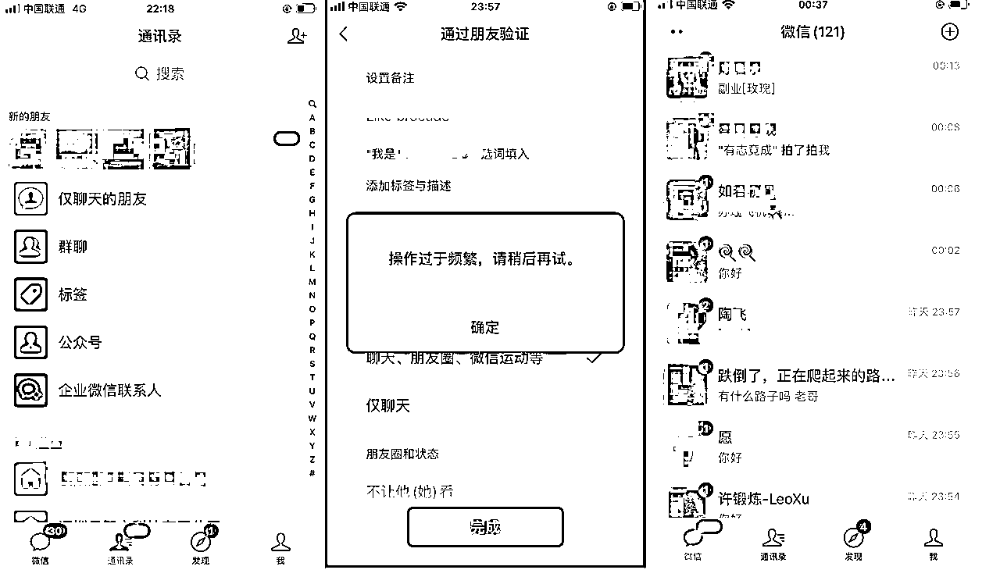
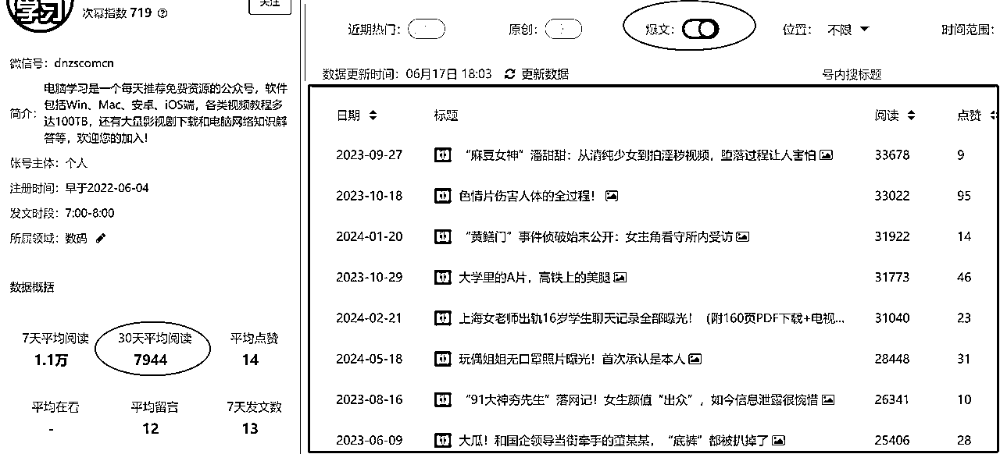
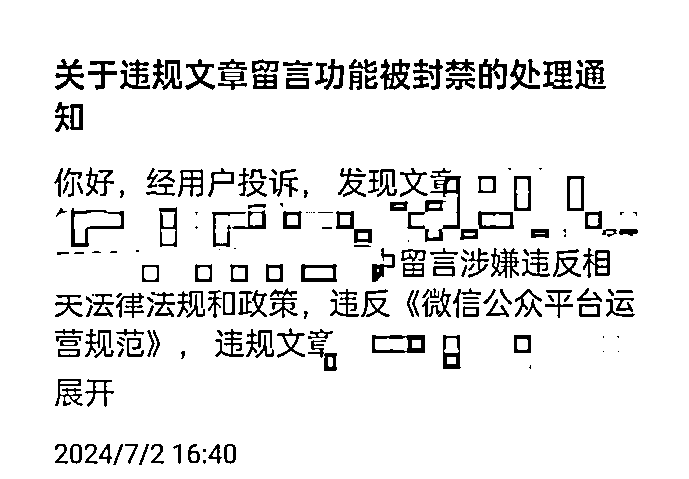
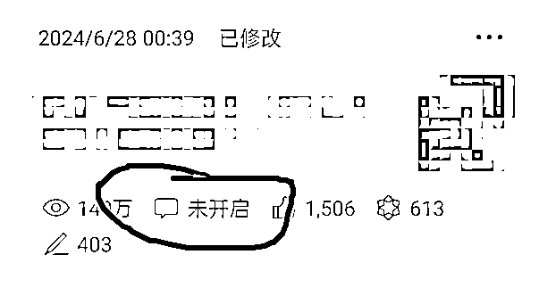

# 👸号爆文实战：21天阅读量破350万，副业收益1.7万+，我做对了这几件事
作者：龙哥

> 圈友投稿分享

大家好，我是龙哥，本职是程序员，业余做技术自媒体，目前自由职业。

6月的爆文航海即将收官，受领队@Y024 Y哥的邀请，把这段经历整理成文，希望能给同样在路上的圈友一些参考。

## 一、成果先晒一波

截至7月2日的数据：航海这21天，累计阅读量300万+，其中两篇突破百万，单篇最高冲到143万；总收益1.7W+；👸号涨粉2000+；🛰️私域新增好友1600+。目前数据还在持续增长中。

每日收益明细

粉丝增长数据

每日阅读量

私域这边用了两个🛰️号分流承接，大号加满600人后启用小号，每天加到四五百人时就会触发操作频繁的提示。

## 二、过程复盘

说实话，这次航海差点就错过了，幸好看了鱼丸的私信赶上了末班车。我的策略是用两个号同时发力：一个IP号，一个小号。小号两万多粉，但已经断更三个月，之前一直发编程技术内容，这次干脆拿来专攻爆文。

当时的心态很简单：先把押金赚回来。所以打卡、发文都很认真。和大多数人一样，前7天几乎没什么动静，阅读量基本都来自已有粉丝。

那几天我很少盯着数据看，每天就机械地重复：找选题、找素材、凑内容、发出去。直到26号，后台突然多了十几条留言，我顺势看了一眼阅读量，直觉告诉我：推荐流量进来了。

接下来的方向就清晰了——专门找面向大众的低粉爆文来发。

起初我手搓了一篇互联网名人相关的内容，跑到了10万+；后来又用GPT换成猫哥教练推荐的Claude，写了一篇技术文，阅读量只有1万多。我清楚问题不在工具，而在选题——技术文的受众盘子就那么大，天花板一眼望得到。

于是转向互联网科技领域的大众化选题。选定对标后，我套用兔子鱼教练教的口述写法——私以为这就是费曼学习法的变体——把别人的爆文按自己的理解重新讲一遍，再配上合适的图片素材，推荐量果然上来了。后面基本都走这个路子。自己实在编不出来时，就让Claude帮我想草稿，再用自己的口吻重新输出，这样系统也不容易判定是AI生成。

### 1. 什么样的爆文会再次爆

“爆过的内容还会重复爆”这个道理大家都知道，可真自己做的时候却容易失灵。哪怕标题原封不动照抄，也未必能复制对方的成绩。怎么选爆文选题，就成了拉差距的分水岭。

不管是手写还是让AI模仿原文，写出一篇70分的文章都不难，真正决定阅读量天花板的，是选题本身。

如果爆过的内容谁抄谁火，那未免太捡便宜了。你写不爆，大概率是选题已经被抄烂了，或者你找的根本不是低粉爆文，当然，也有运气的成分。

关于低粉爆文的判断，我有一套自己的标准：不一定非得是新号或粉丝少的号，很多十几万、几十万粉的账号也会出爆款。关键是看这个号有没有“异常值”——比如平时阅读稳定在1万左右，突然冒出一篇四五万甚至十万+，这就是异常值，用次幂工具很快就能筛出来。

举个例子：有个号粉丝20万+，月均阅读8000左右，用“爆文”筛选功能挑出阅读量最高的那几篇，高出均值好几倍的就是异常值。

这类有异常值的爆文，模仿的人越少越好。你能在别人之前锁定它们，内容自带信息增量，再次引爆的概率就大得多。这就是先手吃肉的逻辑，考验的是信息搜集能力。

按这个方法选出来的文章，我的阅读量甚至能远超对标——比如那篇收益8000多的百万+爆文，原文才4万多阅读，对方的号均阅读也只有1万左右。

### 2. 如何把读者导入私域

写爆文不能只赚流量费，能引到私域才算吃透多重收益。

但这类爆文本身不带个人IP，读者很少因为账号背后的人而来加好友。单纯留个🛰️号，转化很有限，就算加🛰️送资料效果也一般。

我的策略转变是：把钩子换成“进副业交流群”。副业是刚需，尤其是现在的大环境下，大家普遍想在群里获取信息差，所以🛰️几乎被加爆——目前已有1600多人加进来。

这里有个小技巧：如果🛰️号被提示添加频繁或接近加满，你有一次更换🛰️二维码图片的机会。我的大号快满时，就换码用小号继续承接。

还有一点很重要：好友务必当天通过。隔一天人家就忘了从哪加的你，信任为零，很容易被删。为了增加一点信任值，我会免费送一份资料。如果不想手动验证，直接关掉验证开关自动添加也行。

不过刚加来的好友变现能力有限，陌生人的信任要靠持续触达价值来养。但免费流量不要白不要，先进来再说，慢慢转化。

### 3. 手写还是AI写

没有绝对的答案，我自己两种都用：有时纯AI、有时AI辅助、有时纯手写。想批量生产就选AI，想走精品路线就手写，后者还能打磨自己的写作功底。

### 4. 评论管理怎么做

如果你的号有留言功能，那对推荐算法来说是个关键变量。一方面能拉高整体完读率，另一方面能提升互动率。其他条件一样的话，留言更多的文章在赛马机制里会胜出，获得下一轮流量推荐。

评论最好手动精选。尤其是入池后评论暴增，不要因为省事就开自动，林子大了什么鸟都有。极端情况下会有人留人身攻击甚至反动言论，这类评论很危险，一旦被举报整篇评论区都可能被封。我有两篇爆文虽然全程手动精选，最后还是被封了评论功能——有人故意在评论区挑民族对立。确实，这类争议评论一开始是“神助攻”，能引来更多留言，但后来评论区直接失控、互相攻击。即便我没放出那些二级留言，最后还是被举报了。正确的做法是：看到这类评论，整条都删掉。

不过话说回来，评论被封并没有直接影响文章推荐，该推的照推。毕竟点赞、在看这些互动指标也能支撑数据跑量。

## 三、几点总结

说到经验，其实赚钱前辈们已经整理得非常系统了：怎么选领域、找对标、挖爆文、用AI工具……打开航海手册照着做，能解决80%的问题。

我补充几点自己的体感：

**第一，坚持写，别下牌桌。** 开局水花不大是大概率事件，扛住、持续优化，推荐概率就会一点一点累积起来。

**第二，成功的捷径是抄——抄成功案例。** 打造爆款不能自嗨式写作，也别一条道走到黑。多看别人什么选题能爆，挑爆过的话题来写，成功率就是比别人高。工具也要善用，比如我找爆款选题时习惯先去次幂扫一眼低粉爆文，看看哪个适合自己写。

**第三，降低预期，减少焦虑。** 期待越高，失望越大。成功本身是概率游戏，即使动作全做对，短期内也未必出理想结果。不如只管努力、减少内耗，等运气来敲门。

## 四、感谢与致意

特别感谢@兔子鱼教练，你的推动让我有了更多分享欲，群里有人提问你也总是第一时间解答。

@猫哥教练的直播每次都干货拉满，教程都是直接喂到嘴边的那种。

还有张波教练的两场直播，讲得非常细致。领队@Y024 Y哥，每天像管家一样忙前忙后照顾大家。志愿者小伙伴的每日提醒也很贴心。

感谢老马的鼓励。

最后感谢龙哥和赚钱团队，给了我们这样一个优质圈子和航海项目，让我有机会链接这么多优秀的老师和伙伴。

## 五、致圈友

我2020年就加入了赚钱，但多数时候只是“看客”，没有真正下场。2024年打开赚钱的频率明显高了，刷精华帖、看风向标，也主动尝试分享，还中标过一次。

如果没有参加这次爆文航海，我大概率不会日更爆文，更不可能拿到这份成绩。就像那句话说的：时间花在哪里，回报就会从哪里长出来。

看见、相信、快速学会、不内耗——这是能赚到钱的正确姿势。别人能在赚钱找到自己的路，我做到了，你也一定可以。

如果这篇复盘对你有启发，那就顺手点个赞吧😄