# 知网AI智能写作平台上线，AI写作真的要起飞了

# 关于我

嗨，我是龙哥。中医学本科毕业，后在深圳大学读了工商管理硕士 MBA。

目前在做 GPT 效率提升的陪跑教练，也是广东省人工智能训练师的考评员。

同时担任深圳健康管理师考试、全媒体运营师等相关考试的命题人。

现在是创业状态，正在摸爬滚打求生存。

2024年的主营方向为人社部人工智能训练师的培训与认证。

一、选题怎么来
二、

# 平台功能速览

最近，知网正式推出了知网AI智能写作平台。

实话说，功能太猛了。

它跟市面上其他AI写作工具的本质差异在于两点：一是可以无脑连贯输出超长篇幅，二是能规范引用知网真实文献。

我拿它和也能引用的秘塔做了横向对比，文章的完整度与逻辑连贯性明显更强。

再和能写论文的GPT比，知网AI引用的文献是真实可查的，不是系统编造的。

目前产品还在内测阶段，通过审核后可享受7天免积分体验，之后使用就得消耗积分。

积分获取主要有两种途径：
1、直接充值
2、邀请或被邀请，双方各得500积分

注册链接：点击此处，注册领取500积分

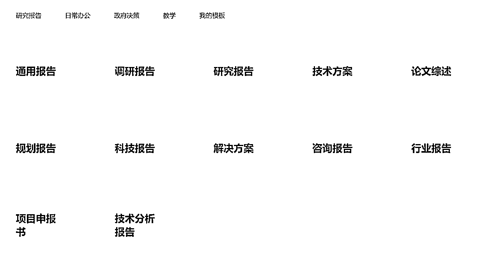

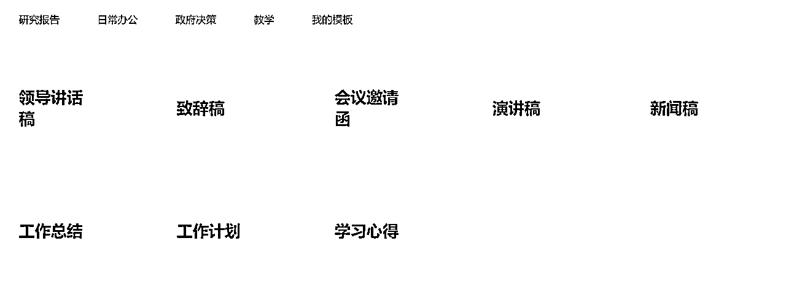

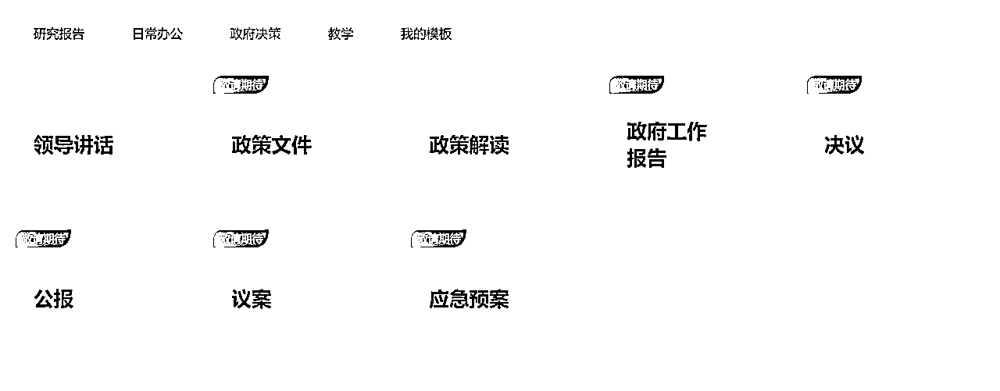

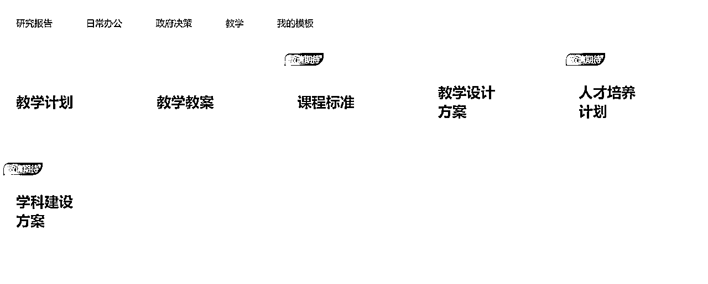

# 实操全流程拆解

下面就以科技类报告为例，带大家走一遍知网AI写作的完整链路和核心功能。

## 第一步，先建文档定主题
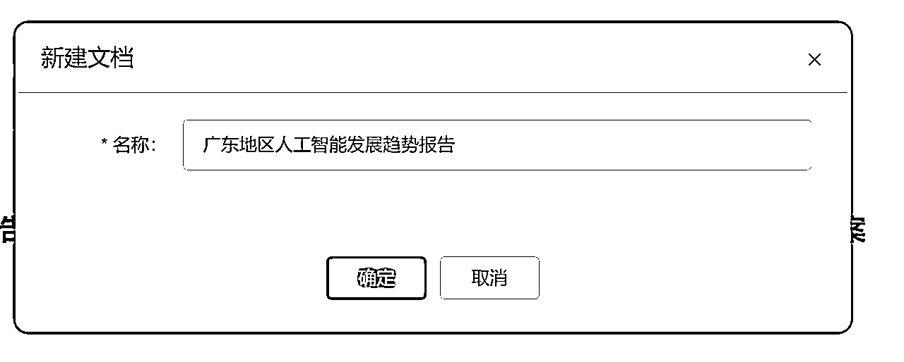

## 第二步，进入写作界面
打开后左侧是一个空白的Word文档，右侧是AI的生成区。
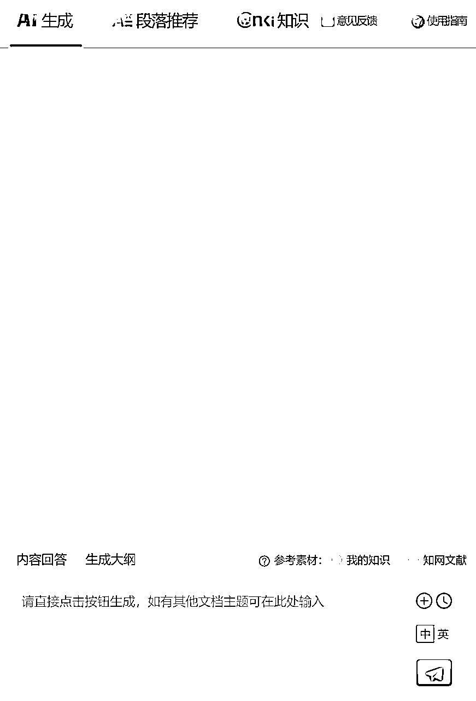

## 第三步，用引用来生成大纲
底部可以接入个人知识库，也可以直接基于知网文献库进行引用式大纲生成。

这次我只勾选知网文献引用来生成提纲。
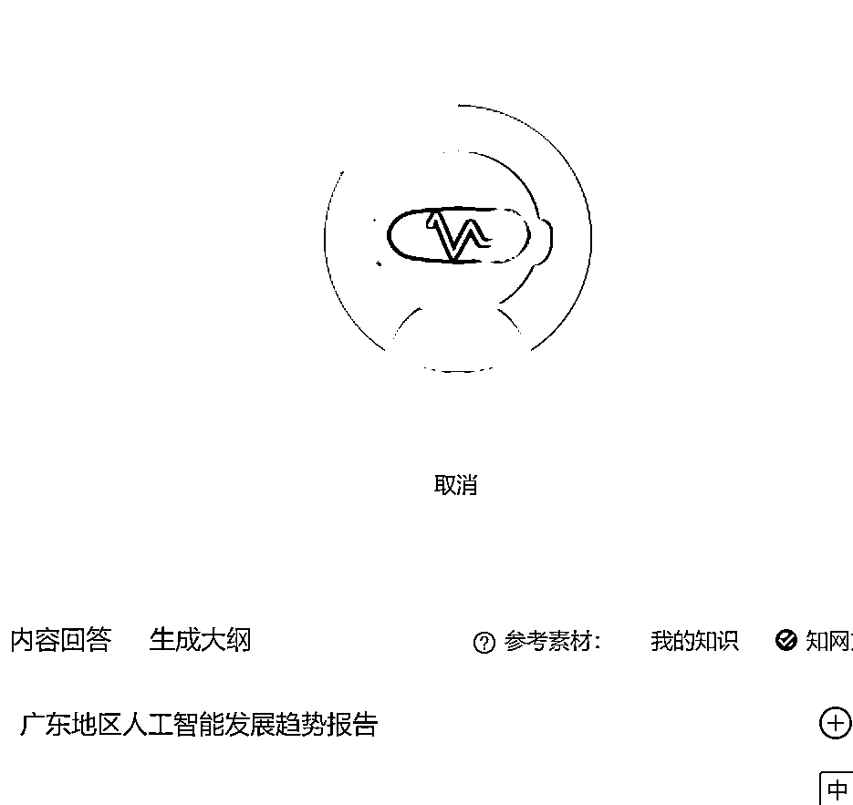

## 第四步，自动生成概述
大纲生成完成后，系统会询问是否继续生成概述。

等我喝完一杯水，概述已经出来了，速度感人。
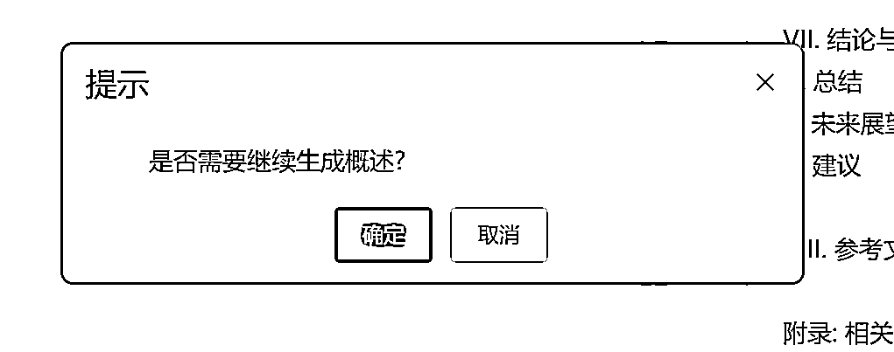

## 第五步，一键生成全文
紧接着弹出窗口询问是否立即生成正文。
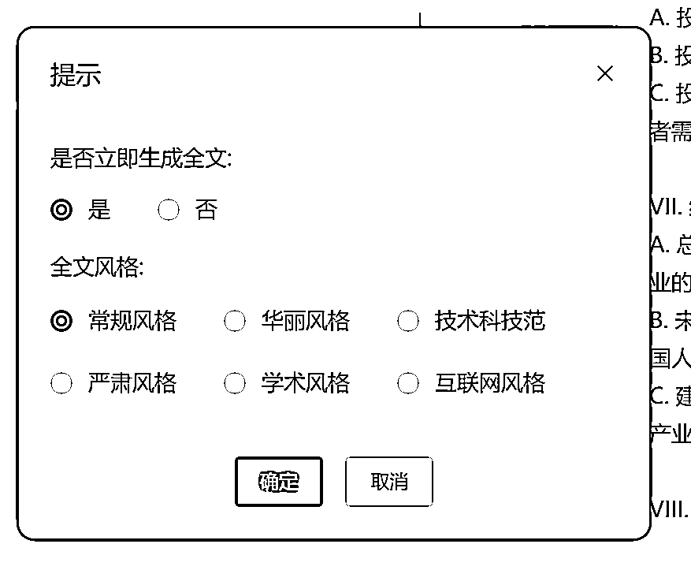

还有风格可选，太香了。

这里我按主题选了科技硬核风格来出稿。
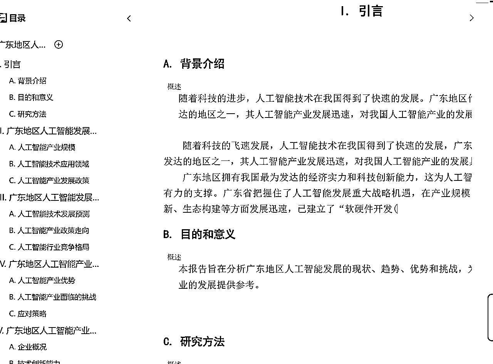

文档开始唰唰唰自动撰写。
## 第六步，导出成稿
写完后可以一键导出并自动排版，我这里用默认排版就行了。
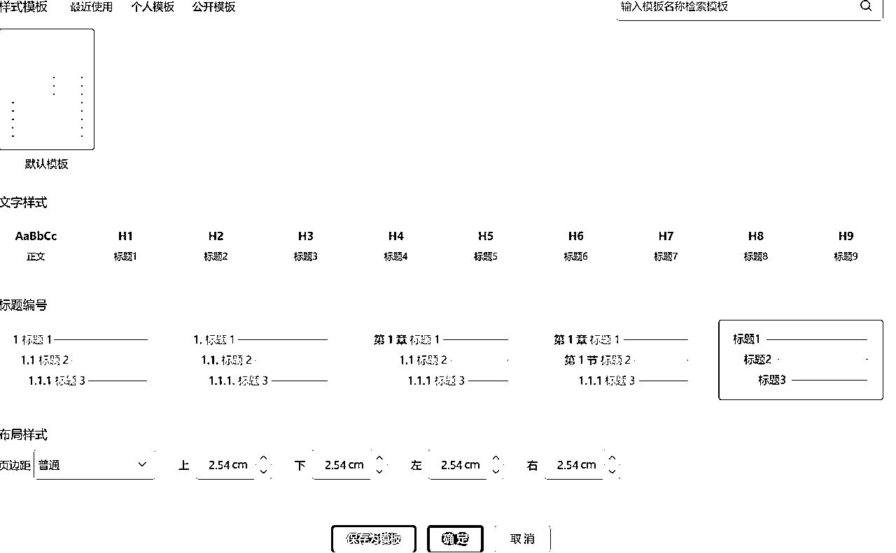

整篇报告共8章，16037字，用时11分钟。

全程没人工改动，连选题都是丢给知网AI直接定的。

感兴趣的朋友可以往下看正文。

# 生成效果展示

## 报告全文
再演示几个其他类型，操作逻辑基本一致，只是选项会多一些。

## 新闻稿：AI生成版
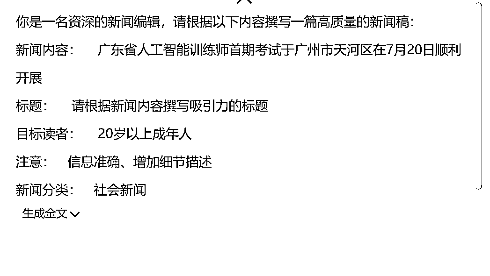

## 学习心得
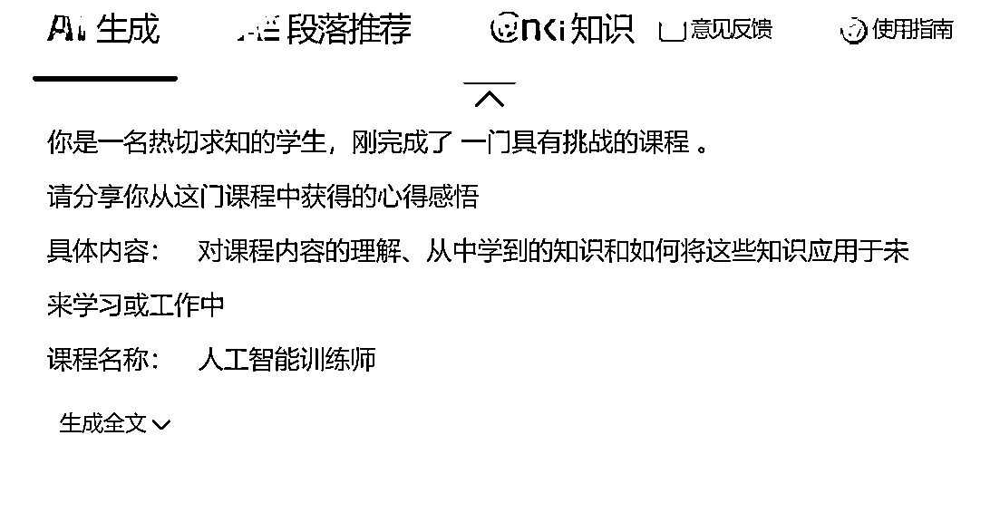

## 工作计划
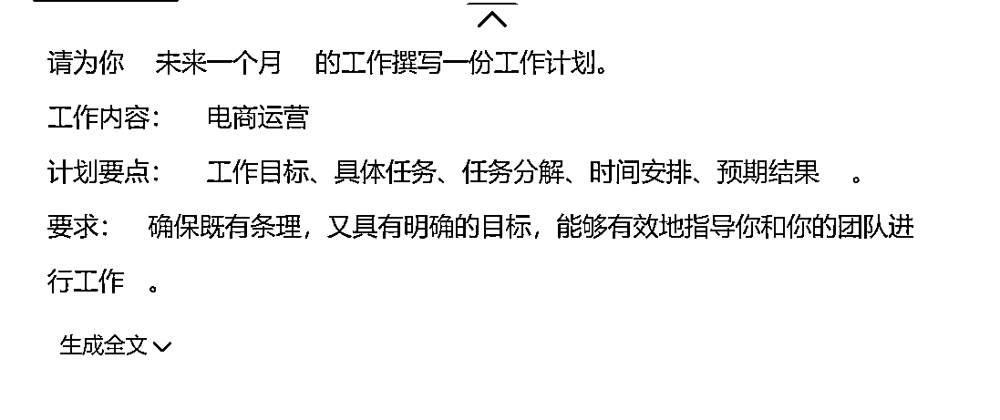

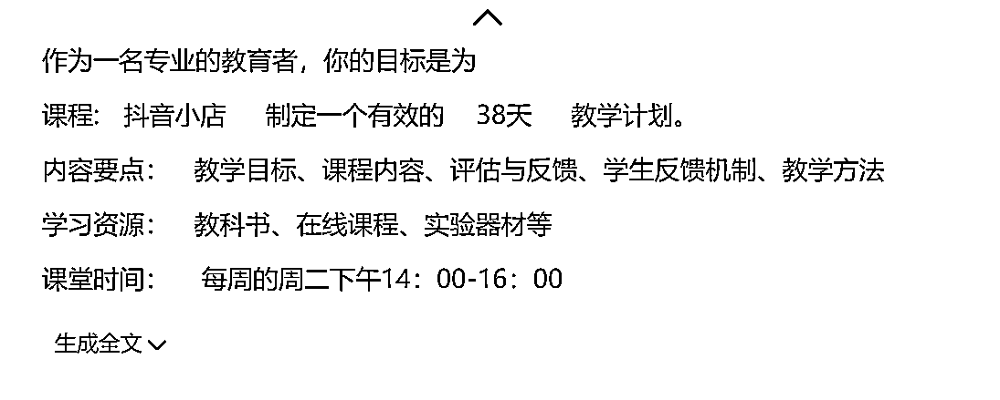

## 培训计划
用下来你会发现，知网虽然没明说限制，虽然内测免积分，但薅羊毛的次数其实是有限的。

点击此处，注册领取500积分

# 这波能怎么赚钱，我的几个判断

欢迎大家在评论区补充纠正。

## 1、做学科搭建
从学科整体规划，到教案编写，到上课前的准备，再到每节课的讲稿，都能交给AI打底。

教培行业的准入门槛被再次拉低。

## 2、辅助做课
有了主题就能迅速搭出课程大纲，再配合 AIPPT 等工具，整门课的雏形几分钟就出来了。

## 3、代写业务
不再展开，知网AI把AI代写的门槛降了，效率也提升了，接单更容易了。

## 4、代注册卖号
任何平台内测期的账号都有市场，之前可灵的账号在淘宝长期稳定在50元/个。

## 5、做定向培训
在原有AI培训的体系里，把它作为一项核心工具来教。

欢迎引用我的内容，但用了请记得告知我，谢谢。
## 6、公考+📕引流
能写公文啊，直接卖公文模板包。

最后祝大家早点把AI学明白、用起来、玩得转。

工作效率上来，就能把更多时间留给真正有价值的事~

知网AI注册链接：点击此处，注册领取500积分