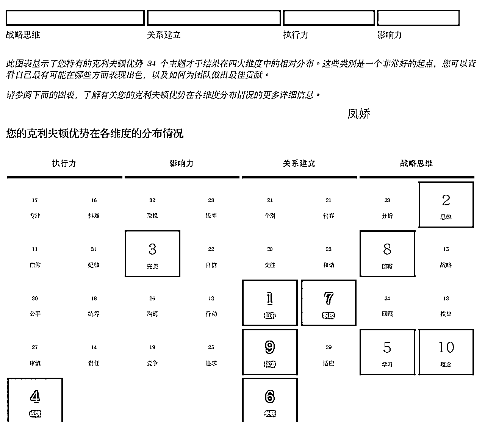

# 从内耗到定位清晰：我用盖洛普优势测评给自己“做减法”

大家好，我是凤娇。今天想把过去21天沉淀下来的心得摊开聊聊。

今年3月刚结束一场航海打卡，正好填补了我4月裸辞后第一段自媒体探索期的空档。这21天我把注意力全部放进优势挖掘和旅途体验里，慢慢明白了为什么某些瞬间会特别有觉感和愉悦感，收获远比想象中多。于是6月的优势挖掘航海，我毫不犹豫又报了名，把它当成一次持续认识内在自我的练习。

要先谢谢醒醒教练每日提供的打卡模板和点评。比起之前那种毫无方向的记录，这次的打卡有清晰的21天学习节奏，会结合个人情况去推进。教练的提问方式我很喜欢，好的追问让我反复审视自己的行为逻辑、驱动力和目标感，自我觉察能力被拉高了好几个层次。

打卡下来我真正get到一件事：优势 = 天赋 × 投入。我开始更立体地去理解自己的前五大才干，也学会了怎么去做改变。不是用木桶理论盲目补短板，而是扬长避短，用擅长的东西去绕开消耗。

# 先说说我是谁

【姓名、🛰️名】李凤娇

【坐标】上海

【三个标签】ANYTIFF 品牌公司创始人、天赋优势教练、包装设计专家

【过往经历】

1、设计总监：深耕设计12年，横跨4个行业「印刷>广告>互联网>食品」
2、专业背景：出版印刷+工商管理

【代表性成果】

1、综合打通设计+品牌+营销，三大能力叠加，帮助客户销售额同比增长4倍；
2、跨界学习投入6位数，开启自我探索旅程【冥想+疗愈+优势+财富】，重拾文学与哲学阅读；
3、热爱挑战，2024年裸辞创业，创办品牌公司深耕新媒体，在实战中不断提炼优势；

2024年裸辞，彻底告别打工模式，全职投入个人IP与ANYTIFF品牌设计公司的运营。

我想用新媒体建立一个无法被替代的个人品牌。

支撑我放下年薪30万+的稳定工作，迈向无限游戏的，除了家人支持和前期积蓄，最核心的是我一直在持续探索、不断认识自己。

这次分享的重点就是：我如何借助盖洛普测评更清晰地认识自己，进而锁定📕账号的定位方向。

# 我的盖洛普画像

四个维度排序：战略思维 > 关系建立 > 执行力 > 影响力

战略思维【思维2、学习5、前瞻8、理念10、搜集13、战略15】
关系建立【伯乐1、关联6、积极7、体谅9】
执行力【成就4、信仰11、责任14】
影响力【完美3、行动12】

从这个结构能看出，我习惯先想清楚：我要在哪一个赛道做事？要解决什么意义和价值？达成目标需要补足哪些能力？我能否独立走完整个闭环？如果走不完，后半段需要谁来补位？想明白了，再去找对的人，迭代后开干。

只有思路先清晰，我才知道该组建怎样的团队。否则只会在项目里反复试错，做着不喜欢的事，既消耗时间也折磨自己。

这段时间反复复盘，我发现Top10甚至Top15的才干在四个象限都有分布，这让我更确信自己潜在优势的广度。

说到果断裸辞，根源就来自【盖洛普航海的个人优势探索】。

测评告诉我，我的「思维+成就」组合很难忍受重复机械的工作。如果每天按流程走、处理紧急事务、没时间思考也没决策权，我会非常煎熬，因为战略思维被闲置了。这也直接影响了职业选择的方向。与电商设计师那种高速套模版的工作相比，我更想要有思考空间、能和产品经理共创的快乐。我无法接受扼杀想象力和创造力的规则，也反感狼性、权威式的管理，因为那样会伤害关系。

过去在平面设计领域，无论是广告、互联网还是快消，我的创造力都得到了验证。这些工作需要大量的人际协作、支持他人成长、持续输出创新成果，带给我强烈的价值感和意义感，也让我结识了不少贵人。

但凡是需要严格打卡、按部就班处理数据的场景，我都会感到被束缚，会质疑：人是活的，规矩是死的，远程就能发挥创造力，为什么还要浪费2小时通勤去打卡？看到职场无法满足成长，我就做出了当下最理性的选择。

更深的感悟是：优势被用在对的地方，结果来得更快。回顾职场历程，我靠直觉不断在喜欢的赛道累积，虽然行业切换，但设计师的创造力一直是我的核心资产，让我持续感受到意义。只是这四个维度在使用时也有盲区：

* 战略思维：擅长决策却讲不清逻辑，或嫌对方笨不愿沟通，会显得高冷傲慢，甚至表达不清。
* 关系建立：擅长换位却忽略自我需求，过度迁就，会被视为好欺负、玻璃心。
* 执行力：闷声做事不展示价值，容易被边缘化。
* 影响力：推动力强但缺乏说服力，会被认为强势、只会说空话。

所以应用优势时，要留意它最能发光的场景，同时有意识地觉察和修正盲点。

优势让我看清人生梦想，更坚定自我、破圈成长，提升认知和眼界。
它让我明白，随心而为往往就是直觉的方向。
它提醒我，要把自己当成一家公司来运营，必须创造交易价值，考虑买方心理，不能自嗨式规划。
它让我确认，知识和技能已是坚实后盾，下一步是思考如何把专业商业化在自媒体上。

内在越来越笃定，从打工思维转向老板思维。
Gap两个月里，我安心学习、安心航海，听从内心。

## 用优势避坑做定位

学习优势后我意识到，弱点可以用擅长的方式来绕开。我开始放大优势，终结了过去因聚焦劣势带来的不自信和不配得感。

清晰自己的才干特质，帮助我快速筛掉不合适的事。我不会因为市面哪个赛道赚钱就冲进去，也不会轻易改航线。看到主播带货火爆我不会去开直播间，因为不喜欢、不舒服，知道自己坚持不下去。

所以我选择好好掌舵自己的船：发挥战略才干，在大海上保持方向感。宁可目标清晰再行动，也不愿漫无目的瞎跑，最后方向全偏。

比如，我擅长独处、策略和思考，创意型工作我非常享受。职场13年持续深耕设计，正是因为喜欢【思维+前瞻+理念+搜集+战略】。而我的「沟通26」和「取悦32」靠后，所以裸辞后做自媒体，我不会选择高强度的直播带货这种需要大量陌生人沟通的模式，排除法帮我省下了试错成本。

我擅长通过支持他人成长，在自由、被尊重、强调创造力的环境里深度协作【伯乐+体谅】。所以在墨守成规、日复一日的重复工作中很难受【纪律31】，我选择遵从内心的召唤去追寻使命。

我能保持积极心态把任务流程化【积极+成就】，加上【思维+完美+体谅】，脑中总有各种天马行空的点子。也正因为更了解这些才干，我更清楚为客户提供何种方案最合适，能站在对方立场交付专业满意的作品。

我曾学习心理学一年，做过50+案例，却常被负面情绪拖累。看完盖洛普图才明白，是因为【体谅】很高，配上【完美】，让我总想去补窟窿；【信仰】高，对真实性和意义感要求苛刻；战略思维强，1:1频繁维护用户极耗能。而我的优势排序是战略思维>关系建立，本身更擅长独处、聚焦做复杂课程和战略规划。

这次航海让我更客观地看待自己，优点很多。接下来要把才干通过刻意练习转化为优势，同时管理好阴影面，减少自动化驾驶带来的负面影响。

慢，就是快。
这是我的核心价值观。
只有先想清楚要实现什么，才能规划路径、需要做什么、如何达成。

## 我的账号定位与下一步

经过自我探索，我更细化了内容方向，也明确了接下来两个月的执行计划，进入真正的自媒体实操期。在执行中持续复盘、优化，保持坚持，享受过程，把结果交给时间。

以包装设计为切入为例，接下来两个月会围绕账号定位分享专业，同时拓展视野。

⛽️目标：聚焦📕，双账号测试，共涨粉2000
🧠学习方向：平台规则、引流方式、商业战略布局、内容创作、专业阅读

1、凤娇的秘密花园【心理学】
视觉：手写字体+共鸣文案+设计排版
内容：优势挖掘+内在探索+自我觉察/生活感知
* 自我篇：旅行、音乐、live house、演唱会、阅读、裸辞后的状态、我的勇气来自家庭支持
* 亲子教育：与儿子的陪伴日常、觉察瞬间
* 夫妻关系：情绪稳定的伴侣、鼓励与支持、对自由的允许
* 父母支持：感谢父母接送与照顾，让我安心追梦

2、ANYTIFF 包装设计
视觉：专业设计模板
话题：包装设计+食品快消+To B外资客户+山姆会员店
* 行业洞察：消费者行为、山姆渠道研究
* 市场营销：消费者调研、品牌营销咨询
* 专业分享：包装结构、字体设计、版式应用
* 印刷知识：纸张选择、色彩落地、完稿交付、运输测试

## 执行策略

我依旧用优势去做策略，通过学习快速拿到结果。

初期聚焦我擅长的设计领域，深耕主线、拓展认知边界。

在📕上，我先垂直锁定包装设计，为有品牌历史、小而美的团队，特别是想进驻中国山姆、Costco等会员店的外资企业，提供符合会员店要求的包装设计与PDQ陈列解决方案。对企业而言，包装不仅是包装，更是产品、品牌和企业优势的外化，是品牌流通能力的体现。

目标：2个月内完成📕2000粉计划

优势盘点：
TOP15才干中，【战略思维+关系建立】占10个才干，擅长策略、信息与工具整合、系统搭建、资源匹配与落地。
影响力靠后，不擅长招募新人与快速成交。

策略：
* 伯乐1+思维2+学习5+理念10+搜集13+战略15
快速学习平台规则、创作者与用户需求，找到三方平衡点，制定销售漏斗与SOP，并带领执行
* 取悦32+统率28+专注17
不擅长快速引流与主动掌控

路径：
先用内容找到同频客户，独立跑通MVP闭环，实现自动化成交。
再用关系建立优势，连接擅长引流与转化的伙伴。
最后与有影响力的朋友互补协作。
我负责账号定位、战略布局、运营策略与内容创造。

补充一句真心话：个人IP的答案，最终只能由自己给出。无论付费与否，工具再多，定位的清晰度来自自我认知。Coach模式不会给现成答案，而是用专业引导你独立思考。如果你要明确答案，没人能替你；如果你要有人陪你思考，请找同频的老师【赚钱里有很多，欢迎来体验优势挖掘航海】。

以上是我这次盖洛普航海后，对账号定位与内容创作的初步方向。

2024年，我对打造商业闭环充满信心。我会集中火力，用优势击穿一点，创造出可验证的成绩。

期待见证我从0到1的过程。后续会按定位落地实操，和大家分享结果与感受。

# 后续思考

1、持续做价值规划
离开职场创业后，我每天都在问：还需要什么知识、技能和能力？哪些工作能提升这些要素？在所有价值中，我能努力的更多是知识、技能与能力。与之前只为学习设计技能不同，现在我有商业全局观，不再为学习而学习。我把大量书籍里的知识输出与应用，并有了更强的勇气。

2、无用之用是为大用
我现在常读哲学、文学，重新构建思考方式。过去我觉得这些学科空洞，学了找不到工作。现在才体会到，它们承载着人类顶级智慧，是商业世界的底层。过去我把时间花在迁移能力最弱的知识上，导致世界观片面，用黑白对错看待事物，引发内耗。地基不牢，房子再好也经不起风雨。专业知识与技能像是钢筋水泥，但地基是底层思维与认知。

3、商业知识
把自己当公司运营，除了可执行的专业，还需要更多商业学习。赚钱是刚需，要把专业商业化，需要细分定位、竞争策略、思考能为哪类企业提供什么服务、谁会买单。我在用商业模式画布梳理全局，避免陷在执行细节。工具还在实践中，成熟后会分享。

# 最后

感谢21天航海的教练、志愿者与群里伙伴的陪伴。
欢迎一起交流优势理解、📕运营与创业心得。
构建影响力的方式很多，最舒服且有效的，往往是擅长且喜欢的。
祝大家早日把才干全部转化为优势，一起龙哥盟！