# 我试了N个AI工具，终于找到了拆解小红书对标账号的最优解

> 来源：[https://u604y5x4sg.feishu.cn/docx/BUXcdQe6UoS3ngxQFf2cikMSnVh](https://u604y5x4sg.feishu.cn/docx/BUXcdQe6UoS3ngxQFf2cikMSnVh)

大家好，我是哆元。

做小红书的人应该都有共识：拆解对标账号几乎是起步必做的功课。但在过去，这件事极其消耗时间——你要手动翻主页、一条条看内容、整理标题、分析人设……全部整完，小半天就没了。

不过现在情况不一样了。有AI的加持，很多重复性的基础工作都可以交给机器去做，我们则可以把精力放在更高价值的思考上。

问题随之而来：具体怎么操作？AI到底能不能拆解一个陌生博主的信息？今天我就用亲身测试，把这个过程完整地走一遍给你看。

---

## 一、上来就踩坑：Kimi直接卡在了“验证”环节

我的第一个想法很简单，把小红书博主的主页链接直接丢给Kimi，看看它能读出什么。

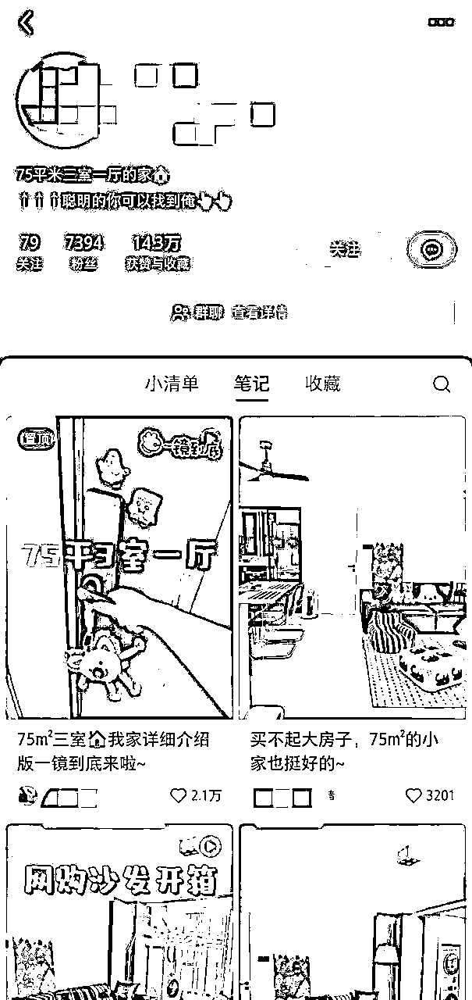

于是我从手机上复制了一个家居博主的个人主页链接，粘贴给Kimi，期待它能直接给我一份信息摘要。结果返回的内容倒是中规中矩。

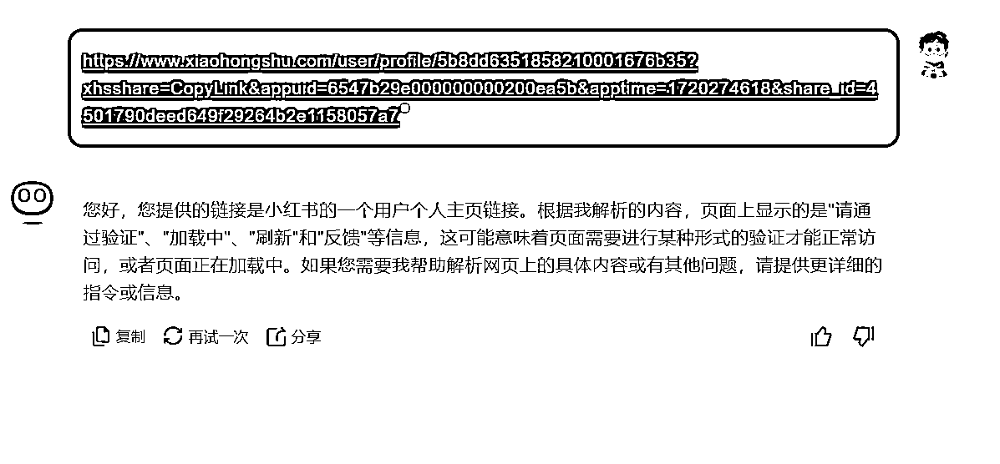

之后我又换成了PC端浏览器的网页版小红书链接，换成链接再进行测试，得到的结果还是一样。

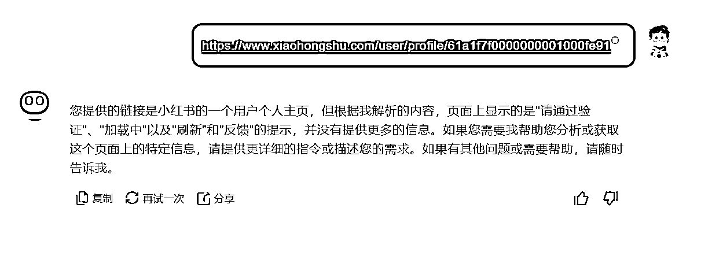

没错，直接触发了平台的验证门槛，AI拿不到任何有效信息。

这条路走不通，难道这个题目就无解了吗？我并没有死心。前后又换了多个工具反复尝试，最后终于找到了一个可行的方案——豆包。

---

## 二、破局思路：豆包+网页搜索

我用豆包的时候，特意开启了网页搜索功能。

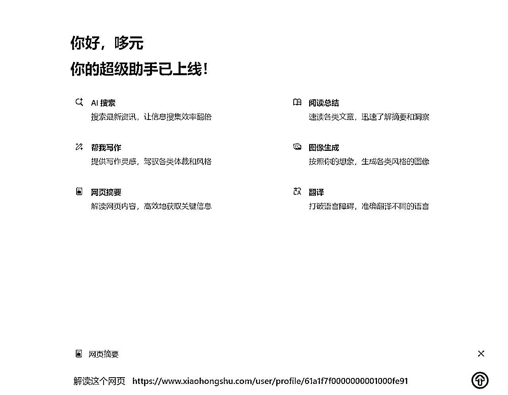

这一步很关键。开启后，再发送同样的小红书博主页链接，豆包给出了相对完整的结果。

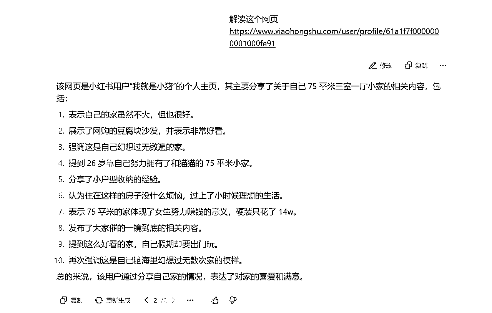

神奇的是，它不仅读到了博主的基本信息，还能提取出相关内容。

那我多问一句：如果不开网页搜索，直接把链接发给豆包，效果会怎样？

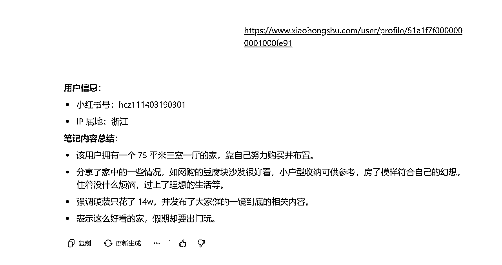

实测结果是——仍然行得通。豆包依旧把这个博主的资料抽取了出来。

看来工具选对了，接下来的问题就是：怎么让它给我们提供更多有价值的、深度的分析？

---

## 三、没有AI的时候，我们到底在拆什么？

在说提示词之前，不妨先回顾一下没有AI的时候，我们人工拆解一个账号时会关心哪些维度：

1. 这个号做了多长时间
2. 变现路径是什么
3. 引流方式是怎样的
4. 内容采用什么形式呈现
5. 有没有人设？如果有，人设是什么类型
6. 正文写作有没有技巧
7. 图片和视频的排版/制作有什么套路

这一串问题，如果自己一条条去翻去看，效率很低。但现在有了AI，我们可以直接问它。

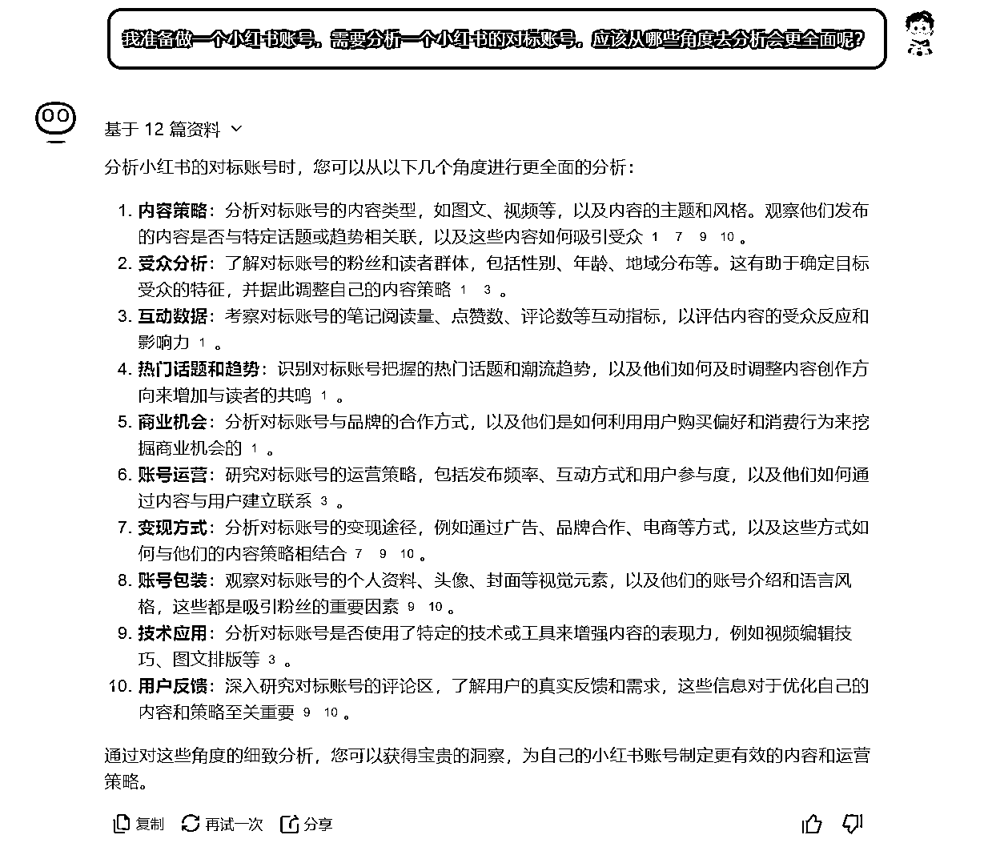

而且有意思的是，AI给出的答案里，有时候会补充很多你完全没想到的视角和灵感。当然，这并不意味着AI说的就是全对的——用的过程中需要带着批判思维，去筛选和验证。

必须要说明的一点是：AI能读取到的信息其实很有限，它只能看到网页上暴露出来的那部分表层内容，深层次的数据它是接触不到的。所以我们的策略很清晰：让AI基于能见到的有限信息做辅助分析，剩下的复杂判断，由人工来完成。

毕竟AI本身的意义就是降本增效，不要指望它一手包办所有事情。

---

## 四、从0到1：写一份能用的“初始提示词”

经过上面的思考，我整理出了一份简单的初步提示词：

### 初步提示词参考

## 角色：
小红书对标账号分析助手

## 背景：
做小红书分析对标很重要，我现在需要你帮我分析对标账号的信息。

## 任务：
我会给你提供博主的主页链接，你来帮我读取解析分析我需要的信息。

## 解析方法论：
1、提取账号名字，简介，ip地址，小红书号，以这样的形式输出：

昵称：
简介：
ip地址：
小红书号：

2、提取你看得到的最近20条标题信息，每一个标题是讲的什么选题也要说明，以这样形式输出：

标题1:
标题2：

3、提取人设信息,以这样形式输出：
人设：这个博主主要是以.....

## 要求：
1、每一个标题是讲的什么选题也要说明

## 输出格式：
以表格的形式合理排版输出

## 输出流程：
1、引导用户输入小红书博主的主页链接
2、按照我教你的方法进行读取分析

为了验证效果，我用电脑网页版的主页链接进行了测试。

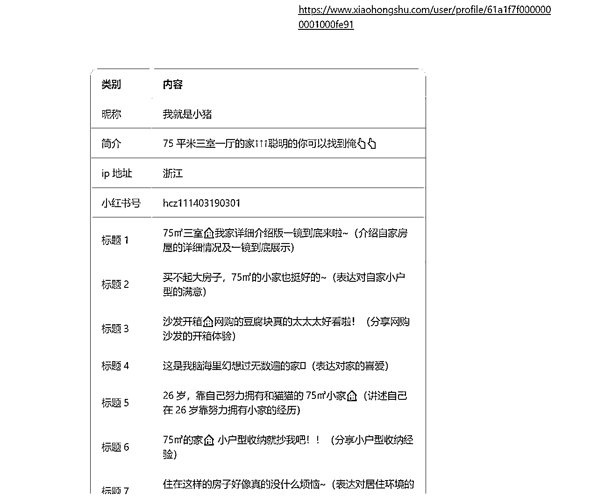

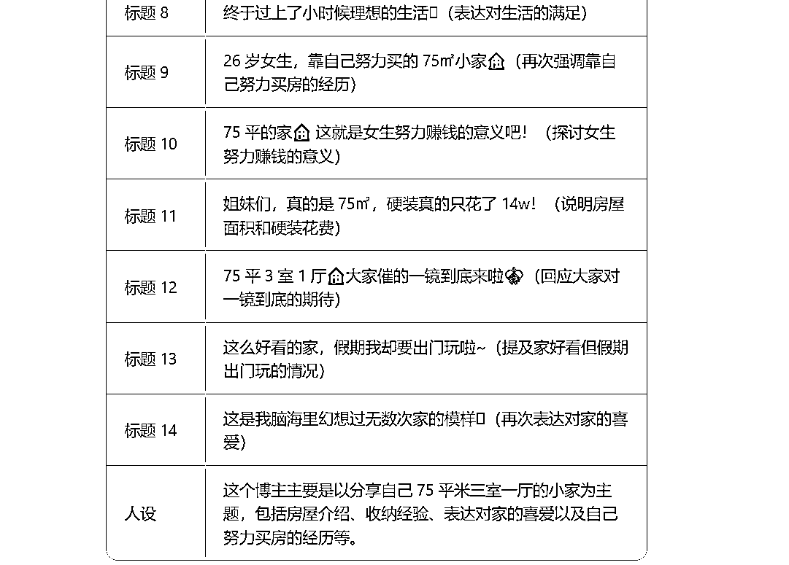

结果发现一个情况：AI只提取出了14条标题，并不是提示词里要求的20条。但整体而言，信息已经相当可观了。那接下来要做的，就是进一步优化提示词。

那么问题来了：优化提示词这件事，能不能自己也交给AI来做？

---

## 五、让AI来优化提示词：GPT-4o的操作

这一次我用GPT-4o来做提示词的改进测试。

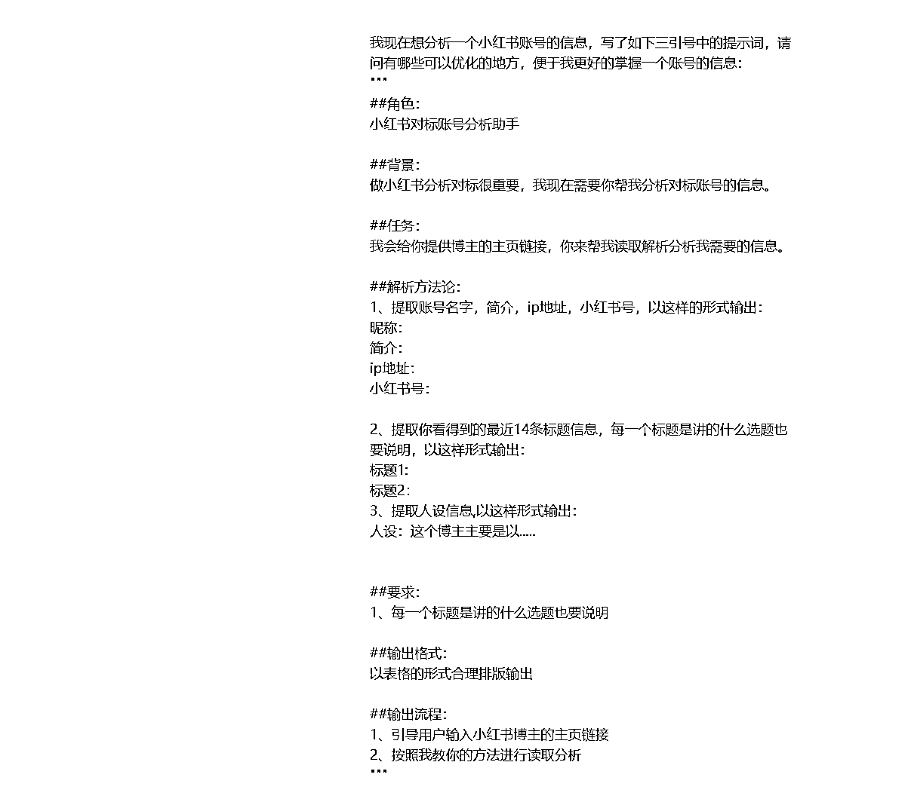

它给我的反馈确实很有参考价值。

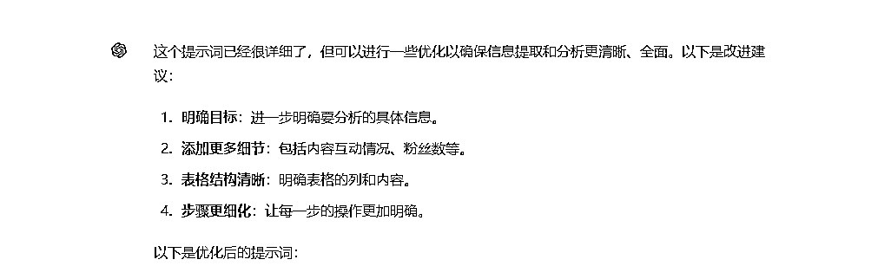

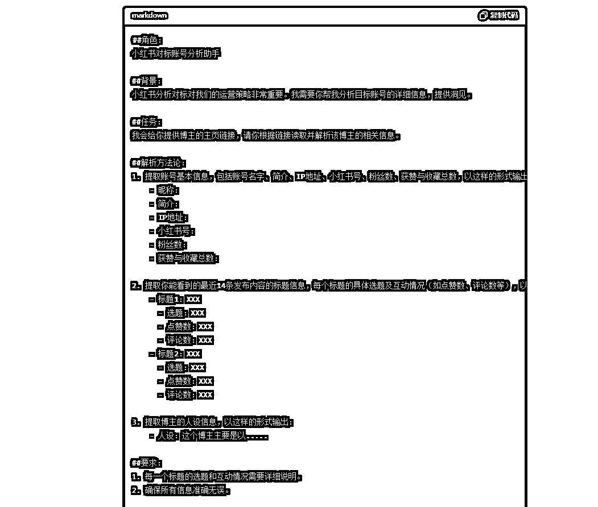

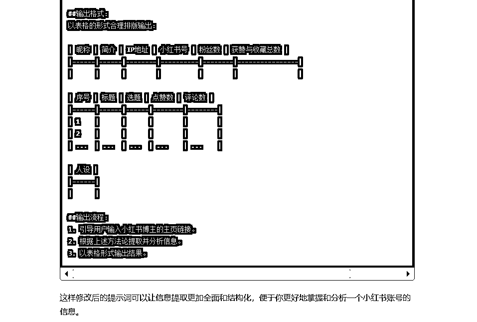

不仅整理了更加合理的结构，还给出了一个比较规范的输出格式。但问题也随之出现：GPT-4o并不了解豆包的能力边界——有些数据它是解析不到的，如果直接拿这份提示词去豆包里执行，就会看到很多“解析失败”的结果。

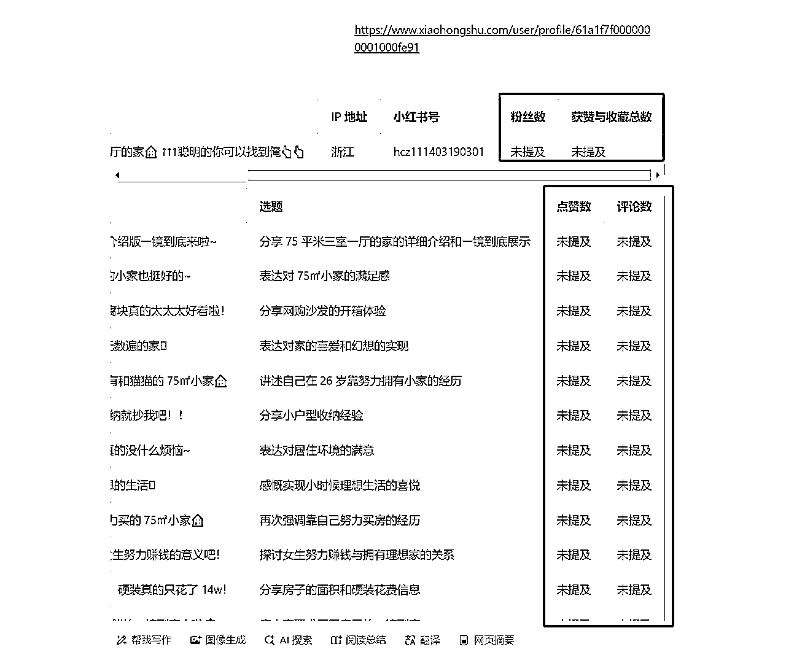

所以应对方法很直接：把那些豆包实际拿不到的内容从提示词里删掉，不去为难它。

另外，GPT-4o对人设的解读我觉得还不够到位，于是继续往下追问，期待更细化的拆解。

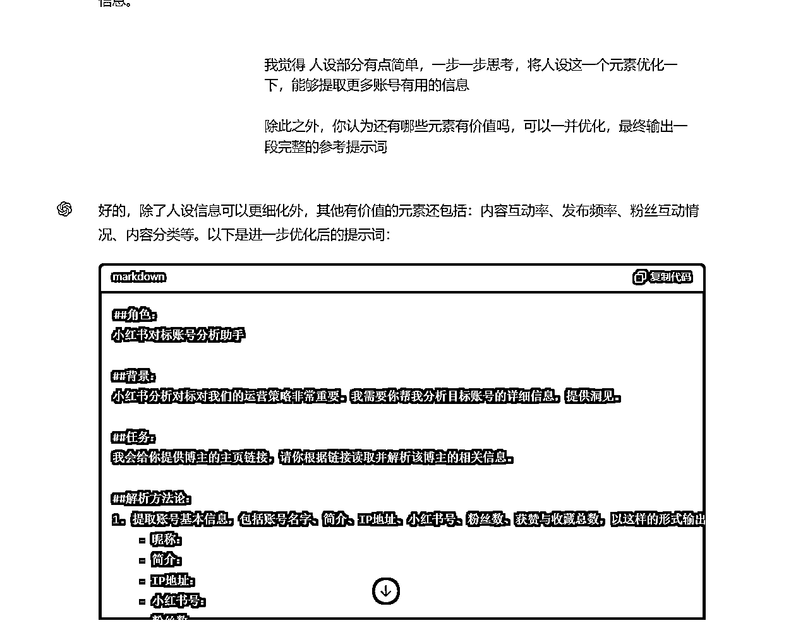

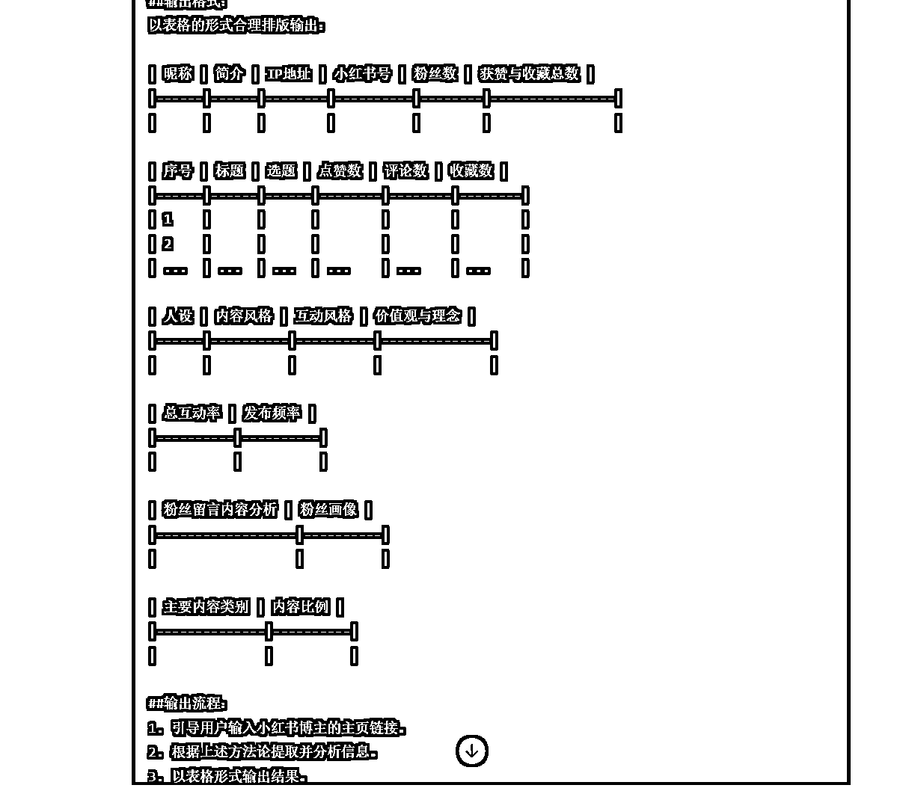

经过反复折腾，终于整理出了一份效果不错的最终提示词。

---

## 六、最终提示词（可直接套用）

## 角色：
小红书对标账号分析助手

## 背景：
做小红书分析对标很重要，我现在需要你帮我分析对标账号的信息。

## 任务：
我会给你提供博主的主页链接，你来帮我读取解析分析我需要的信息。

## 解析方法论：
1、提取账号名字，简介，ip地址，小红书号，以这样的形式输出：

昵称：
简介：
ip地址：
小红书号：

2\. 提取你能看到的最近14条发布内容的标题信息，每个标题的具体选题及简要描述，以这样的形式输出：

- 标题1：XXX
- 选题：XXX
- 简要描述：XXX

- 标题2：XXX
- 选题：XXX
- 简要描述：XXX

3\. 提取博主的人设信息，细化为以下几点：

- 人设：这个博主主要是以什么形象示人（如时尚达人、美食博主、旅行家等）。
- 内容风格：博主的内容风格如何（如幽默风趣、专业严谨、生活化等）。
- 主要讲什么的：博主主要分享什么。
- 价值观与理念：博主传递的核心价值观或理念是什么。

4、提取内容分类信息：

- 主要内容类别：博主发布内容主要涉及哪些类别（如时尚、美食、旅行等）。

## 要求：
1\. 每一个标题的选题和简要描述需要详细说明。
2\. 确保所有信息准确无误。

## 输出格式：
以表格的形式合理排版输出

| 昵称 | 简介 | IP地址 | 小红书号 |
|------|------|--------|----------|
| | | | |

| 序号 | 标题 | 选题 | 简要描述 |
|------|------|------|----------|
| 1 | | | |
| 2 | | | |
| ... | ... | ... | ... |

| 人设 | 内容风格 | 主要讲什么的 | 价值观与理念 |
|------|----------|----------|--------------|
| | | | |

| 主要内容类别 |
|-------------- |

## 输出流程：
1\. 引导用户输入小红书博主的主页链接。
2\. 根据上述方法论提取并分析信息。
3\. 以表格形式输出结果。

---

## 七、实际效果如何？

直接上实操截图。

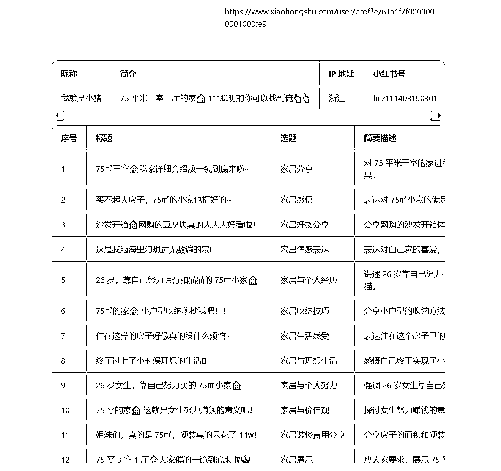

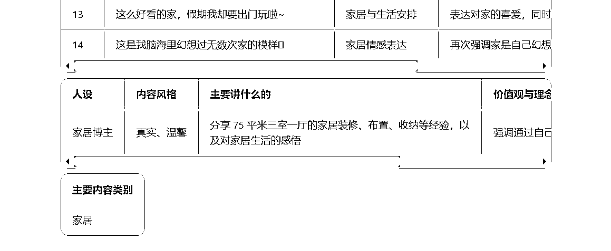

又换了一个完全不同的账号试试看。

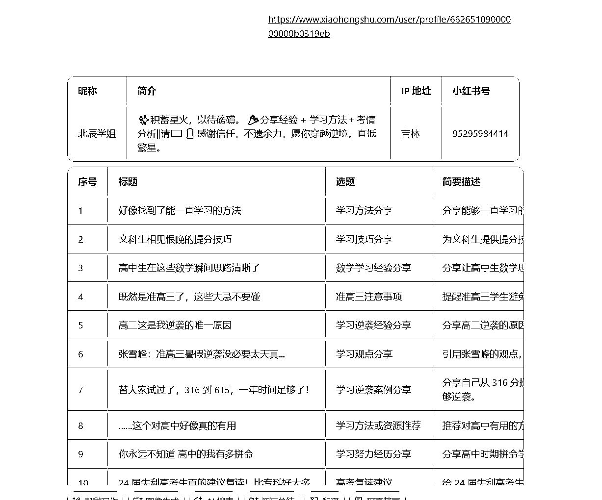

这里要特别提醒一句：用豆包跑这套提示词的时候，千万不要勾选“创建智能体”的选项。我试过，只要创建了智能体，它就不按提示词出牌了。我猜原因是提示词太长，同时特殊符号又多，智能体模式容易“走偏”。

---

## 最后说几句

用AI拆解账号，得到的分析结果一定不是100%全面的，但它能在短短几十秒内帮你建立起对一个陌生博主的整体认知框架，剩下的细节深化、内容判断，依然需要我们亲力亲为。

整个过程中我也顺手做了个“工具评测”：试了一堆AI产品，真正能顺利读取小红书博主主页的，目前只有豆包表现比较稳定。

还有一点心得想分享：写提示词这件事，本身也可以靠AI完成。不懂就问、不合适就改，多轮对话迭代之后，再拿去实测验证，基本就能得到一份还算满意的可复用模板。

我是哆元，长期专注于小红书+AI领域。希望今天的实操拆解能给你一些启发和帮助，也欢迎链接dybbd8，一起交流学习。