# 小红书情感粉矩阵引流，单月变现5w+实操拆解

各位同行大家好，我是挽心。

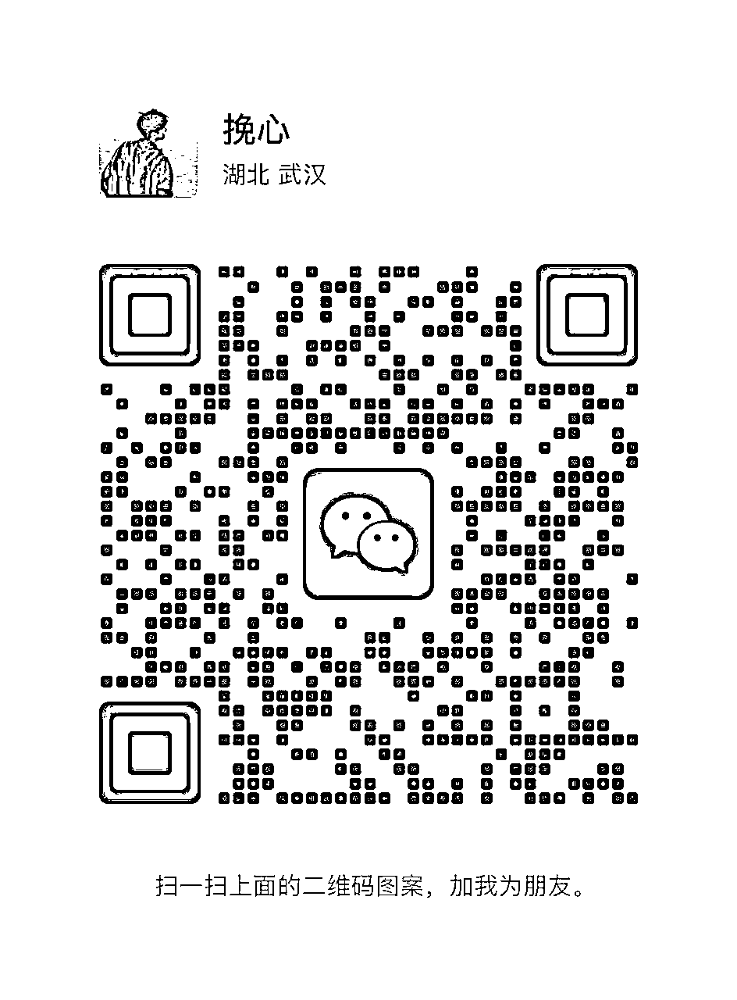

又和大家聊一聊。业内都知道我一直深耕婚恋赛道的流量变现。曾给大家讲过抖音侧的打法，原文在置顶。年初过后抖音的审核趋严，内容同质化严重。

抖音图文矩阵被集中清理，游戏混剪的投入产出也不理想。所以我们团队把主攻方向搬到了小红书。

在小红书试错一段时间后，我们摸到了可复制的路径，实现了月度5万以上的收入，且每个月稳定为后端输送1000+高意向用户，单人每天稳定获取30+精准粉。

今天把在小红书做婚恋粉拉新与变现的全链路展开说，希望能给正在找方向的朋友提供参考。

# ✅ 成果呈现

## 1、账号表现

在小红书上通过不断迭代内容与策略，我们拿到的结果是：单月单人操作6个设备，拉粉900+。客单50算下来变现4.5w。

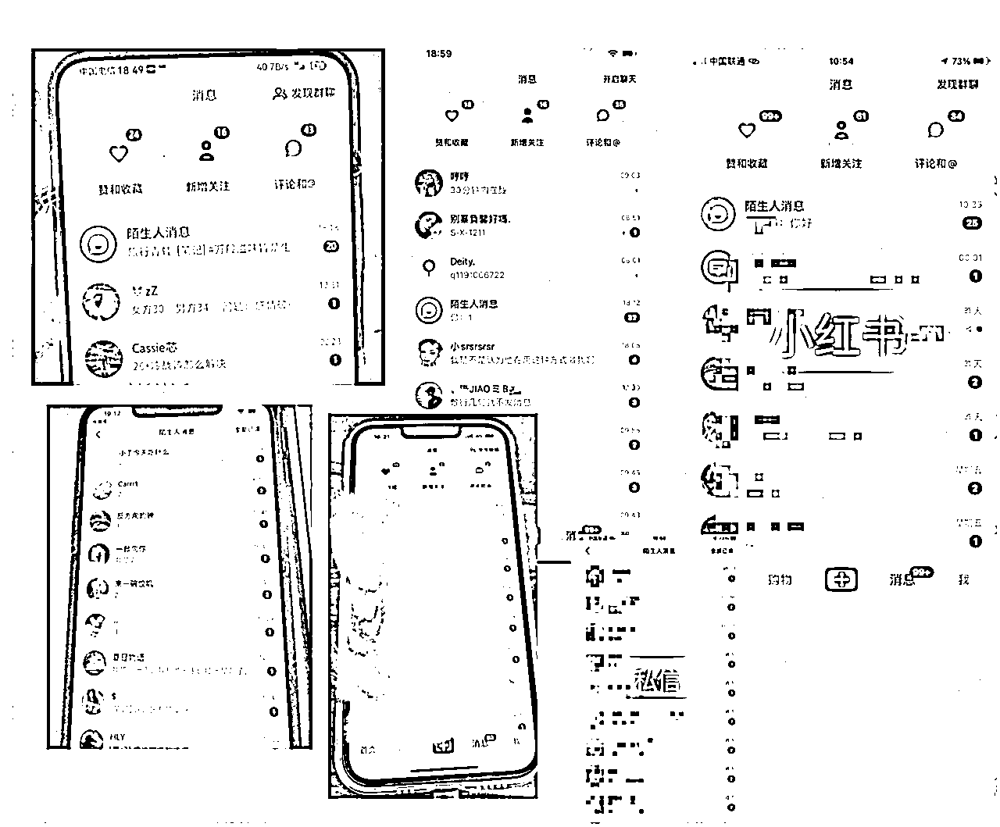

## 2、变现截图

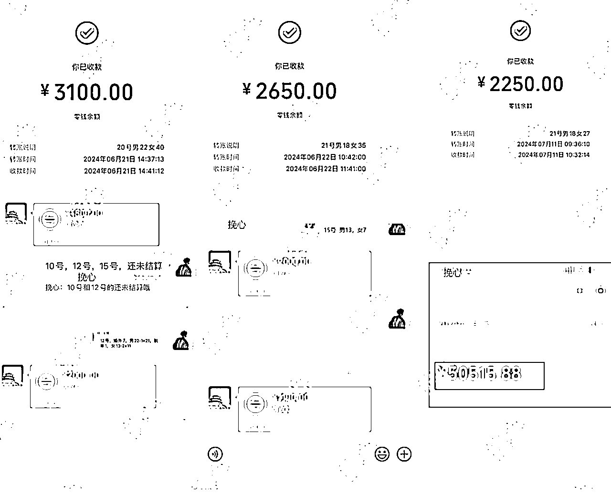

# ✨ 婚恋粉流量变现是什么

这个概念在之前的分享里已有介绍，这里直接沿用，重点放在小红书的具体打法。

## 1、婚恋粉的定义

通俗讲，就是带有恋爱挽回、婚姻修复、脱单追求等需求的高意向用户。

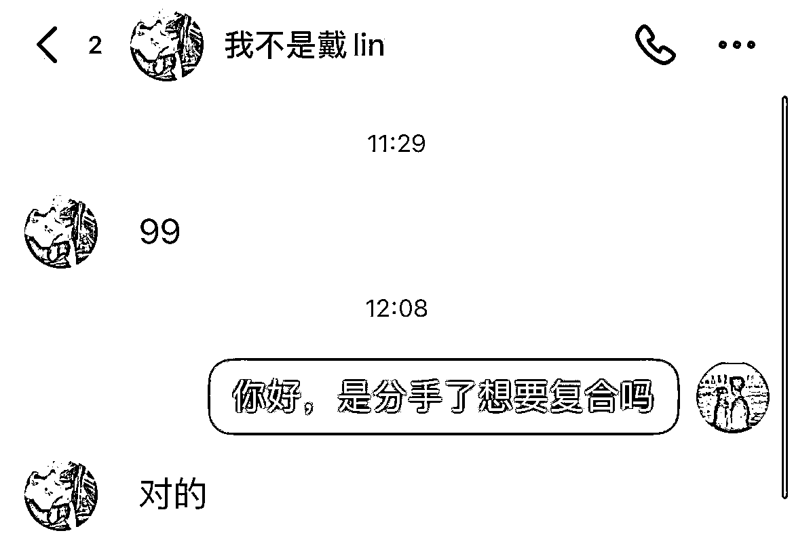

① 恋爱挽回

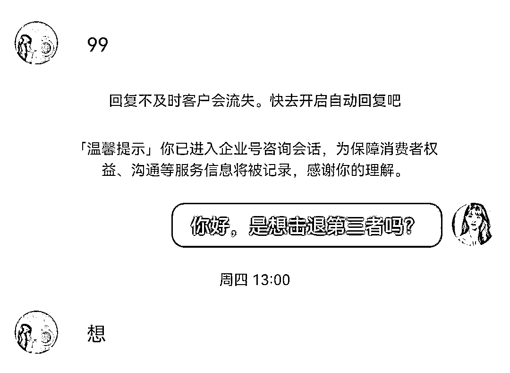

② 婚姻修复

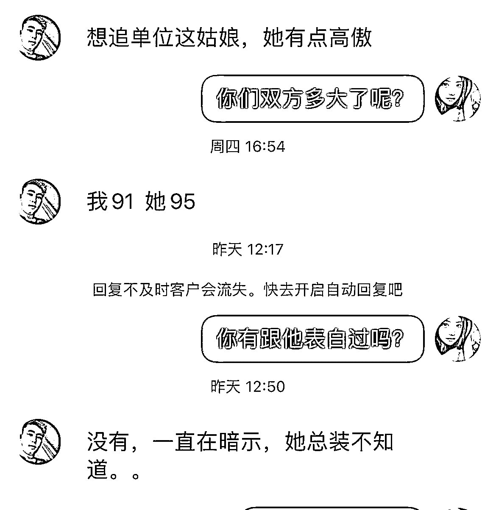

③ 脱单

## 2、变现逻辑

在抖音、小红书等平台发布情感类内容，吸来有需求的用户后，把他们导到情感咨询师的微信，完成交付后次日结算。情感流量的成交价通常在40—100区间，受数量、质量、类型影响。

## 3、为什么做这个项目

### 3.1 婚恋粉的特性

① 情感诉求强烈：这类人群正处在感情困境，对指导和咨询有刚需。
② 互动积极：习惯在评论区和私信表达，内容容易获得二次传播。
③ 转化效率高：需求紧迫，触达后只要服务匹配，成交概率可观。

### 3.2 项目本身的优点

① 门槛低：不需要专业资质、不需要高粉量、不必拍视频、不必开直播，准备几组号就能启动。
② 轻运营：没有繁琐售后，不像电商要处理退换货，也不像课程要整理资料。只做引流，后端负责转化，基本属于零成本起步。
③ 全人群适配：学生、教师、职场人、宝妈、副业爱好者都能参与。既可做副业补充收入，也可做主业甚至搭建工作室做规模化。

# 一、小红书前期：基建

小红书的用户付费意愿与付费能力都在线，日活2-3亿，人群集中在年轻女性，精准且消费力强。小红书的内容风控是最严格的平台之一，把这里玩转了，其他平台就容易得多。

做婚恋粉引流，四个基础要素必须先打牢：账号、网络、设备、模板。前三项归为基建。基建没打好，再好的模板也可能0曝光或不加热。下面拆解具体做法。

## 1、账号

账号是自热的核心之一，选择和管理要点如下：

1. 账号来源

* 运营商厅卡：用本人身份证办理流量卡或普通卡。
* 号码商/卡商平台：新卡3~6元左右，适合长期培育；老卡10元以上，适合短期猛攻。
* 接码平台：仅限短期，稳定性差。

1. 账号挑选

* 运营商厅卡：自用卡，稳定可靠，最适合自热。
* 号码商：适合截流，价格低但新卡需养。
* 接码平台：短期救急用。

1. 建议：优先选运营商厅卡，建议挑选老号段如13、15、18开头，操作时尽量不连WiFi。

## 2、网络

网络质量直接影响自热效果：

1. 运营商厅卡流量：设备量少时用，稳定省心。
1. 全国跳IP流量卡：飞行模式切换一次IP就变，适合中等体量。
1. 软路由：可配置多WiFi，每个WiFi挂不同代理，适合大体量。

1. 建议：设备少用厅卡，设备多上软路由。核心是做到一机一卡一IP，注意IP的干净度与稳定性。

1. 提醒：

* 平台判定的是对外出口IP，非本地内网IP。
* 一机一卡一号情况下，即使归属地相同，也较难被关联。

## 3、设备

设备健康度决定账号存活率：

1. 设备清理

* 安卓机上若连续封掉3~5个号，需双清刷机并修改串号。
* 苹果机可设置还原，或用爱思助手刷机。

1. 验证码接收问题

* 苹果机偶发“发送失败”，一般是网络或账号设置问题。

1. 设备扩容方案

* 模拟器、云手机、虚拟机、分身软件等均可扩张，但IP处理要跟上。
* 建议：保持一机一卡一号一IP的黄金组合。

1. 注意：设备异常最常表现为内容加热失败，需定期体检维护。

通过规范账号、网络、设备，可以显著提升婚恋粉的获取效率，实现流量稳定增长。

## 4、基建自检

操作中可用以下方法自检：

1. 账号自检

* 发随拍：发一张外景随拍，看是否能过推广。若随拍都无法加热，说明账号问题，需换号。

1. IP自检

* 换IP测试：用跳IP卡或其他方式换环境测试。若换IP后正常，说明IP环境不洁。

1. 设备自检

* 刷机复测：双清或刷机后若恢复正常，则为设备问题。

1. 模板自检

* 若随拍能加热而作品模板不能，可能是模板踩雷或号权重低，可用高权重老号或继续养号验证。

做好以上自检，可确保账号、网络、设备、模板的底层达标，运营表现自然提升。

# 二、小红书中期：养号+模板

## 1、养号

养号就是模拟真人使用。有人说要3~7天，实际运营商卡注册的号养一周多数能出“恭喜”。

核心动作：搜索、阅读、点赞、收藏、评论、关注。

先在搜索框输入本赛道关键词，把搜索结果至少看完2/3；每天点赞>10、收藏>10；评论区做真实互动；每天关注2-3个万粉以上同类博主。

一天养2-3轮，每轮30分钟以上。

## 2、模板

模板即内容的骨架。好的模板要简洁、可复用、可快速调整，降低重复劳动。

自热模板本质是同行的答案。照着已能过推广的模板做，大概率也能获得流量。起号后用同一套形式持续输出，再考虑钩子优化。

### 如何打造爆款模板

以婚恋挽回为例，关键词“分手挽回”“婚姻修复”，实测有效的模板有：

模板一 封面图+话题+评论区置顶文案

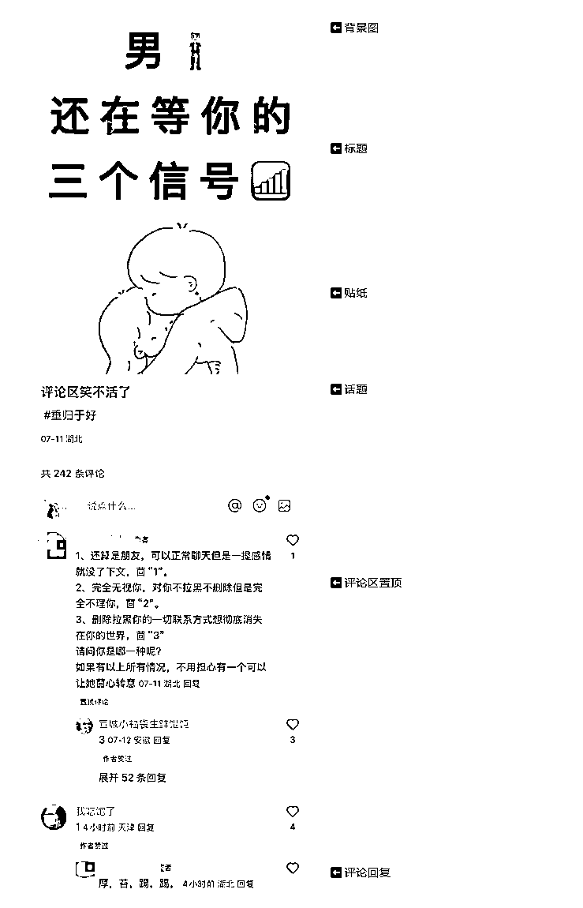

模板二 封面图+内页图+话题

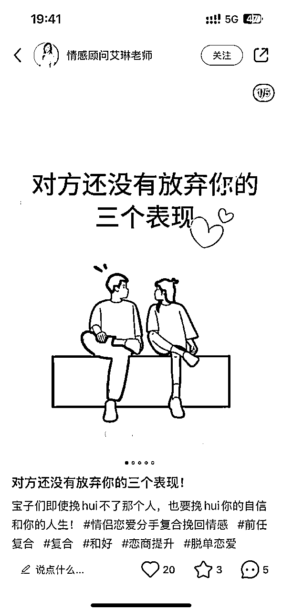

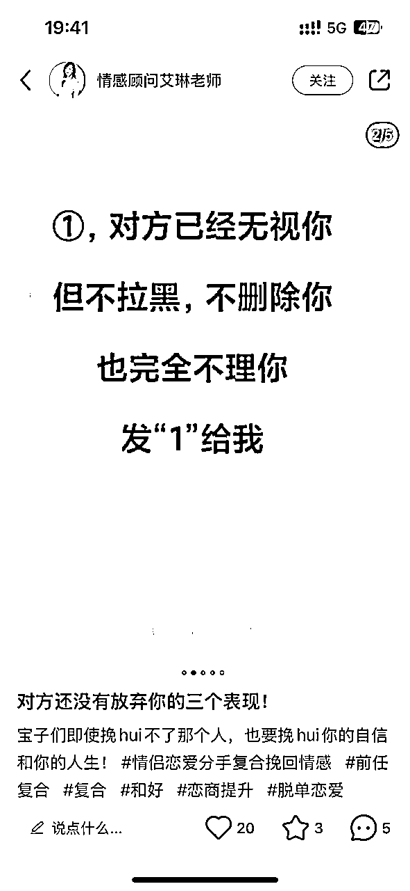

模板三 封面图+正文+话题

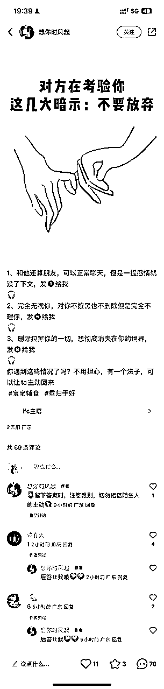

只需替换图片即可，图片由背景+标题+贴纸构成。用醒图或稿定设计即可批量制作，后续只换贴纸。

* 模板需反复打磨，不同赛道违规逻辑不同。标题违规就改标题或不写；正文互动风险就排查图片、正文、评论区；导流风险就换引导方式。
* 模板要能触达用户决策，符合大众认知。
* 小红书图文检测以图识字且随机抽检，扫到即判定。
* 新号与老号对轻度违规词容忍度不同。能持续来粉的模板才是好模板，批量不来粉要回炉打磨。

# 三、小红书后期：筛粉+引流

## 1、筛粉

情感粉单价高，后端要求也高。以常规标准为例：

类型：分手挽回、婚姻修复、婚姻挽回、脱单追求
年龄：23-46岁
意愿：明确想挽回
时间：分手/离婚一年内
备注：抑郁症、极端、暴力等一律不收

因此我们用三问筛选：

确认意愿与类型：是分手想要复合吗？/是想修复婚姻吗？/是想追求对方吗？
确认年龄：双方各多大？
确认时间：分手多久了？/离婚多久了？/认识多久了？

引导加微信：\/细聊可以吗？我来安排？
咨询师微信:*****
结束语：加微信时备注网名，方便核对结算。

一般不直接发送“微信”等敏感词，谐音也不用。要网名只是为结算核对。

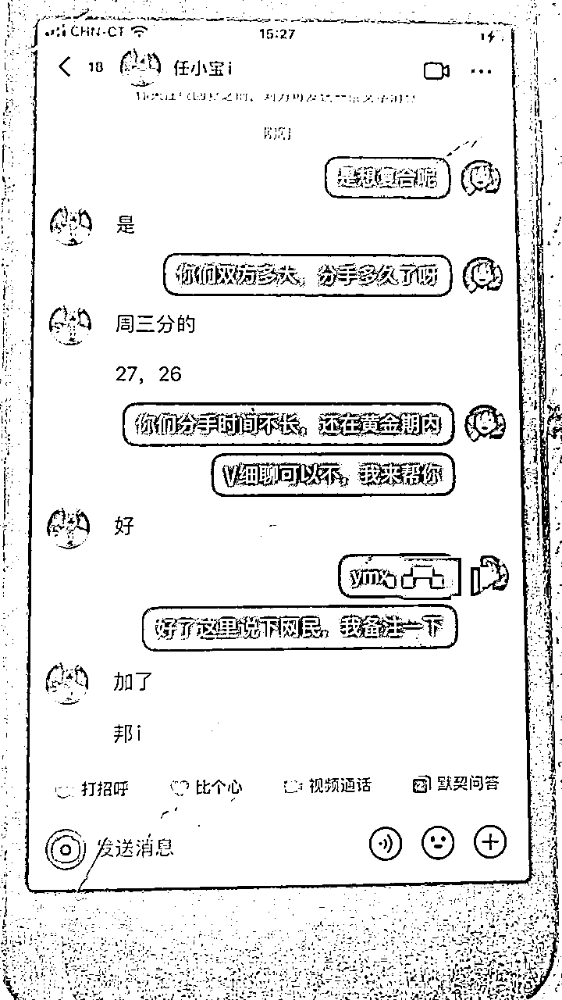

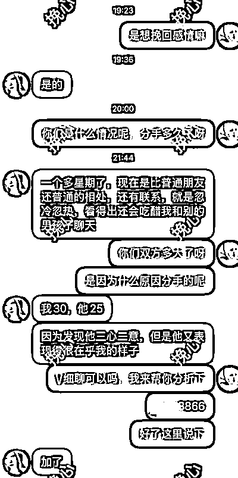

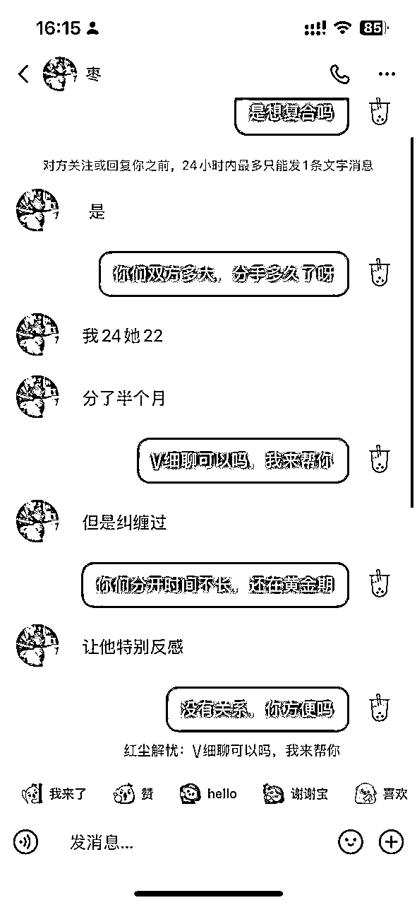

## 2、常见引流方式

情感粉的后端微信经常变动，小红书号、群聊、@小号等方式容易失效。以下为实测有效的引流手段。

### a、专辑引流

新建专辑，名称改为微信号。用小号发钩子图收藏，可直接分享。

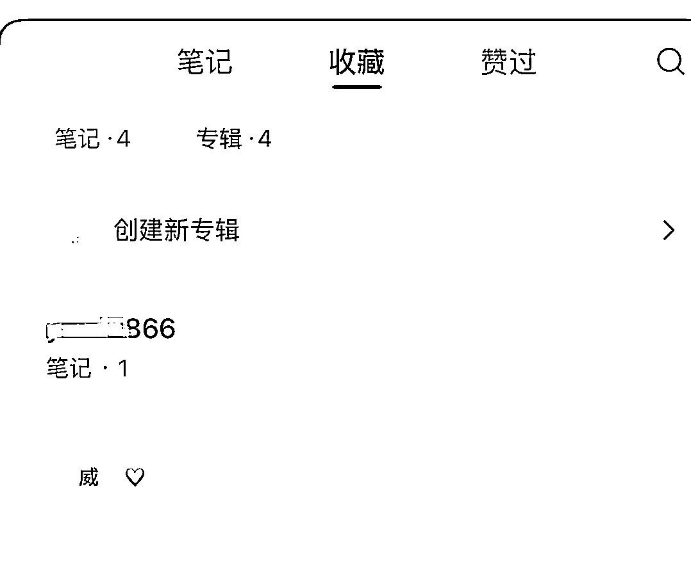

### b、表情包/图片引流

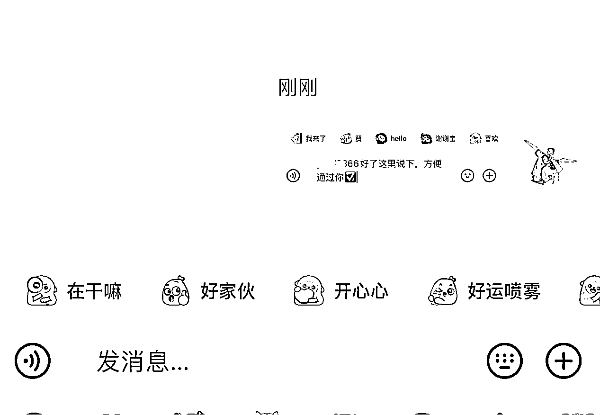

### c、单独拉群引流

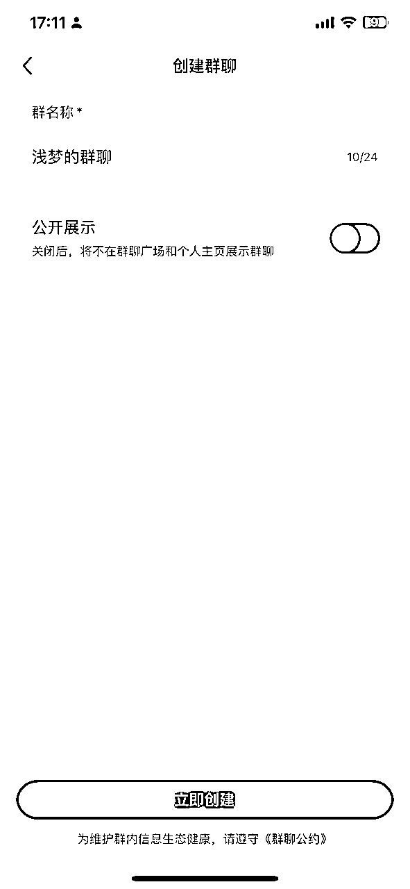

① 创建群聊

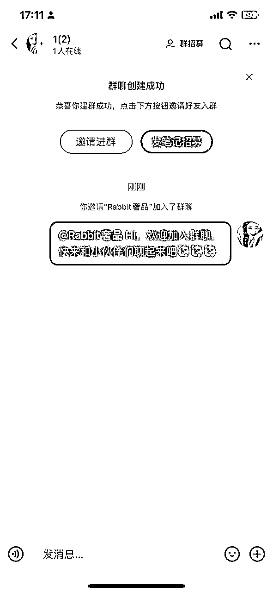

② 邀请用户进群

群内发微信不易被拦截，比私聊直发存活率更高。

# 四、踩坑与建议

新人起号忌心急，要冷静逐步试错，不要一上来就重投入。

矩阵本质是废号流，心态要摆正。

基建不能偷懒：定期清理设备、更新账号、优化网络、调整模板。定期重置系统，使用靠谱流量卡与软路由，测试优化模板。

避免用力过猛，避免短时间内大量发帖或高频互动，容易被判定。失败是经验积累。

后端稳定最重要，合作前谈清价格、标准、结算方式，减少扯皮。

做离钱近的事，不要绕圈子自我感动。

# 五、其他玩法

## 1、平台选择

情感流量不止小红书，抖音、视频号同样可操作。

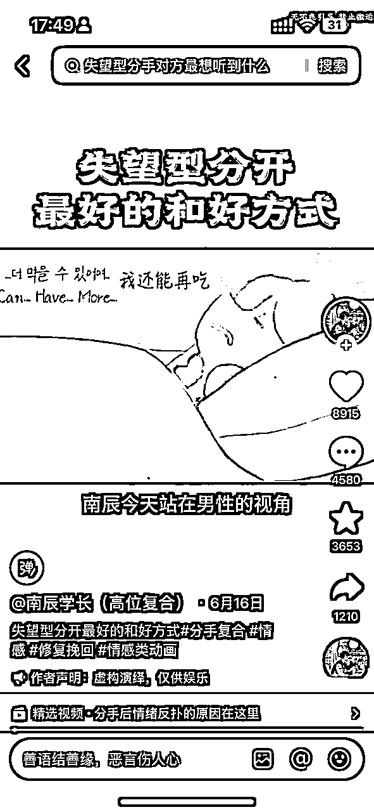

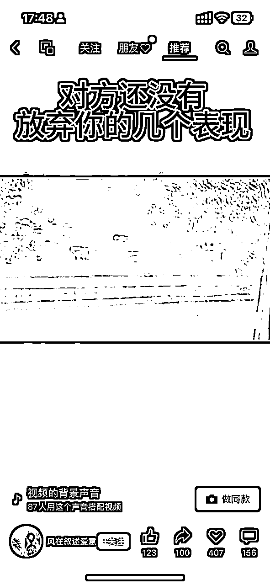

## 2、流量变现

* 卖流量：对接情感公司，直接售卖给需求方。
* 自我转化：在小红书或抖音做情感内容创作，将流量导入私域，自己做咨询或产品转化。

## 3、内容分发

* 自建矩阵发布：账号自控，引流更可控。
* 代发兼职：找小红书代发进行内容发布，利用他人账号资源。

我合作过的代发资源：

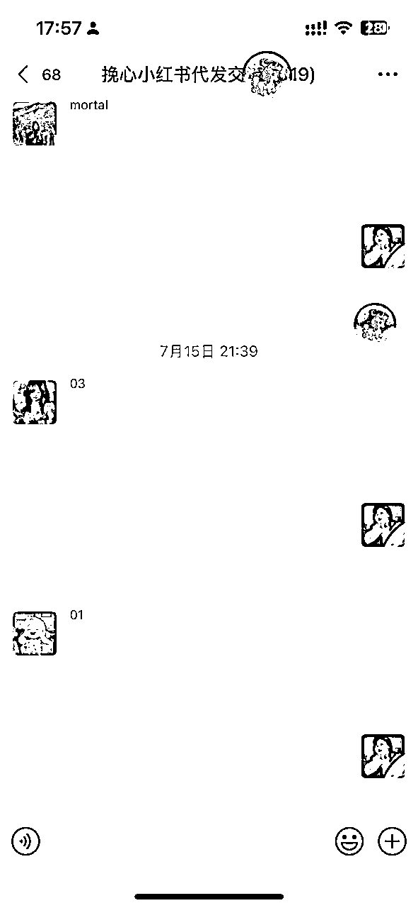

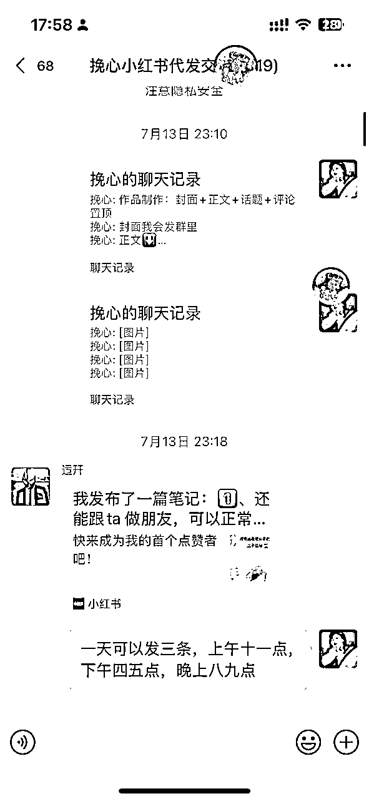

这些玩法可组合使用，按资源灵活配置。

# 六、常用工具

## 1、比特浏览器

https://www.bitbrowser.cn/

## 2、比特小红书养号：

## 3、图文批量制作

点击下载

## 4、刷机教程

https://onfix.cn/rom

# 七、结语

今天的分享涵盖了技术、思路、感悟与实操经历。这是第一次输出如此长的干货，希望能帮大家打开思路，解决卡点。

成功是累积的结果，保持学习、持续优化、坚定目标、灵活调整，不惧失败，它本就是成长的一部分。

感谢收看，祝大家在各自赛道取得好成绩。

我是挽心，期待下次再见，一起成长！