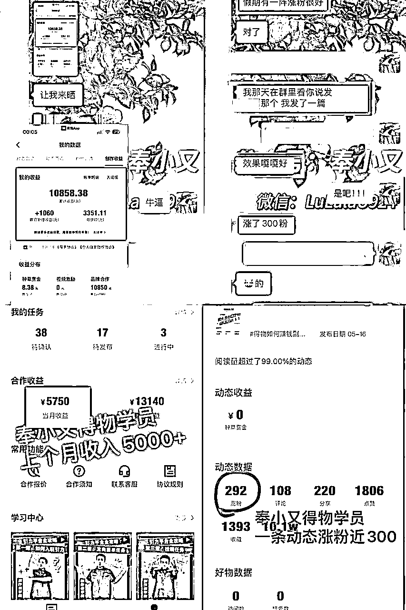
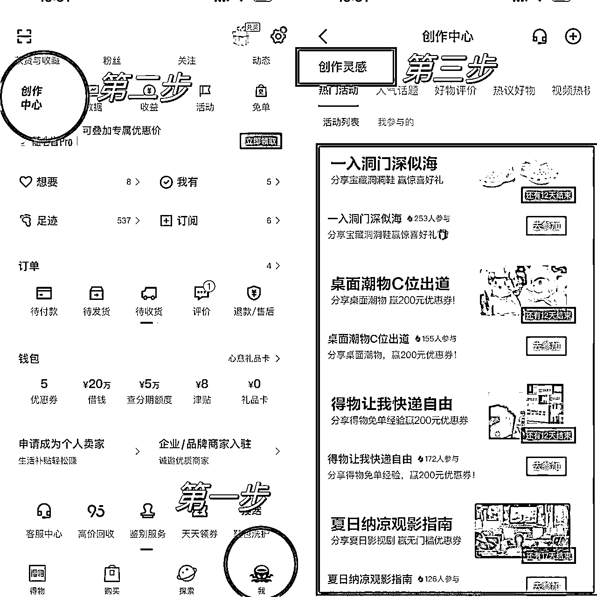
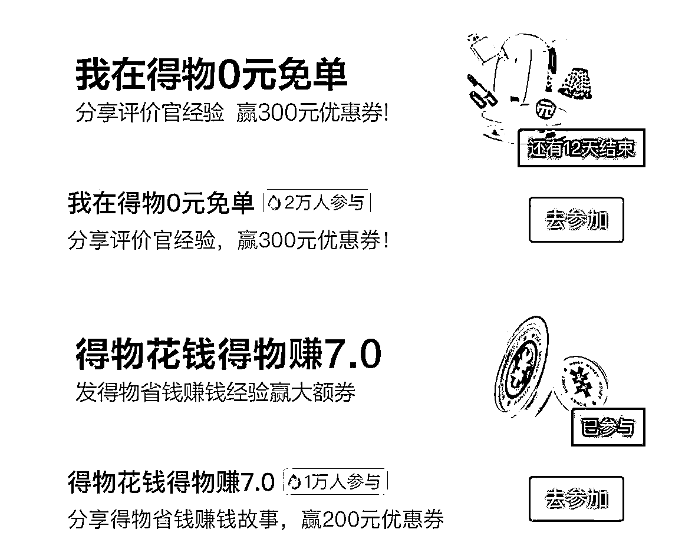
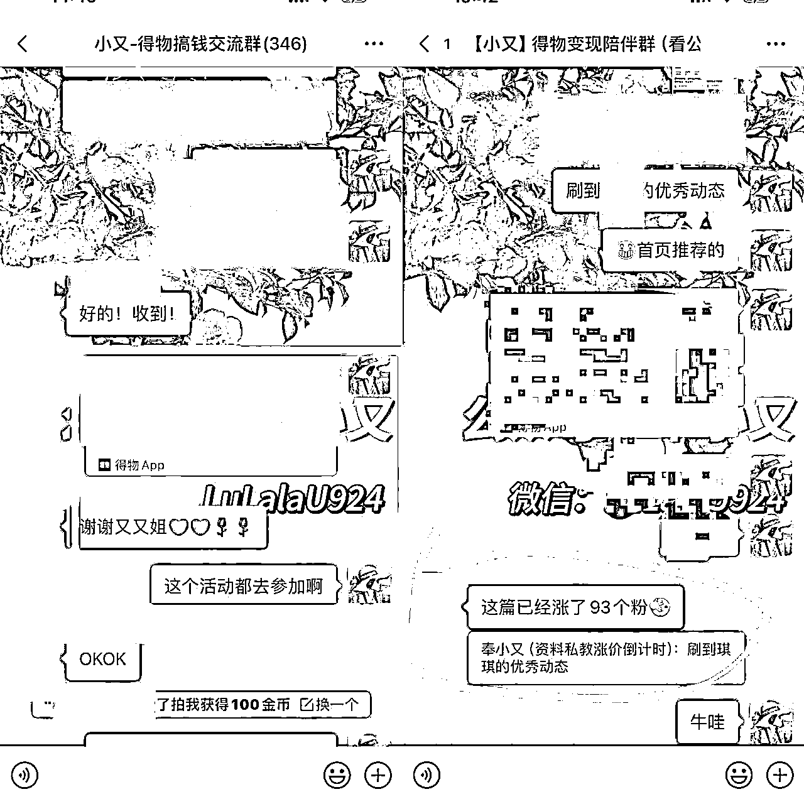
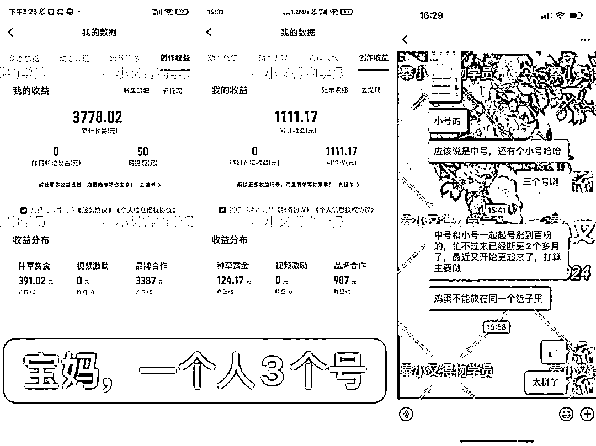
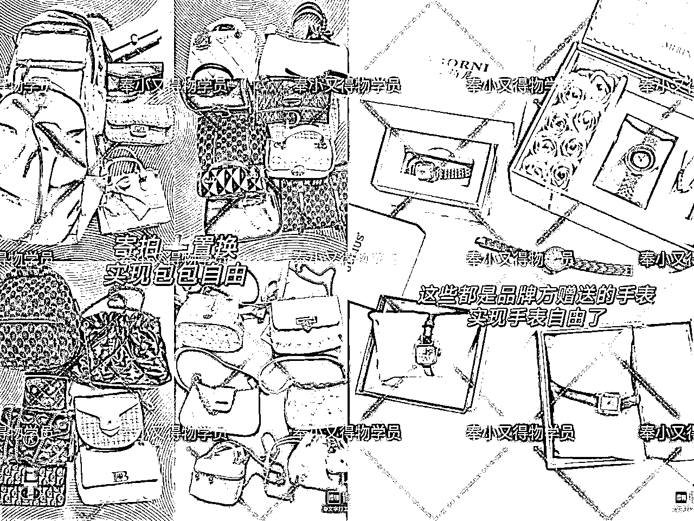
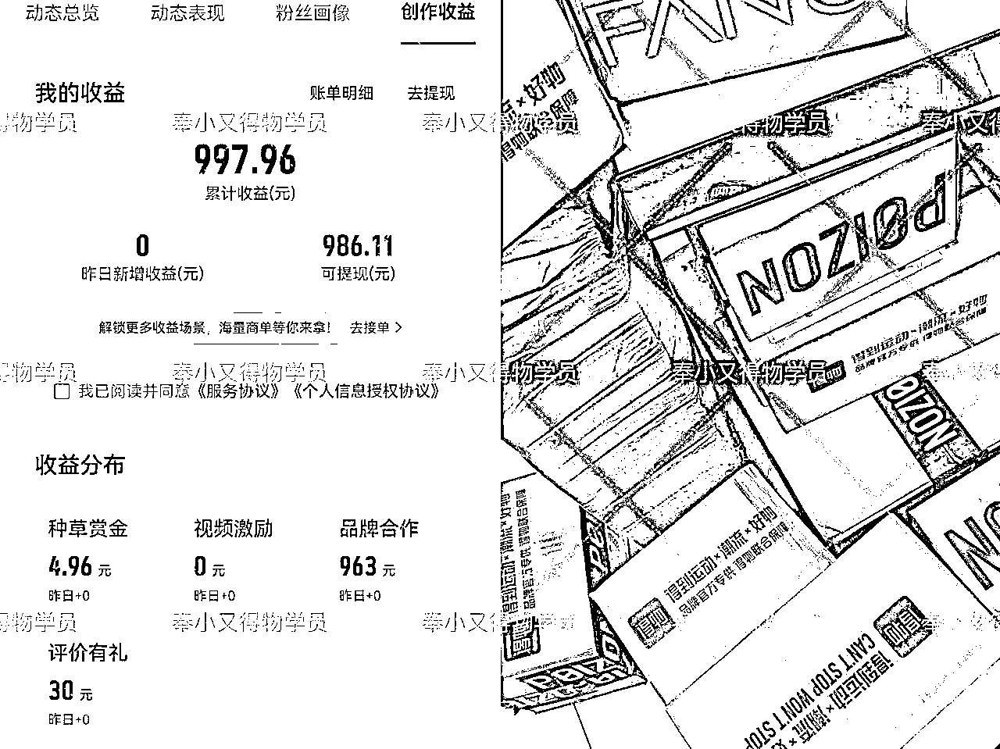
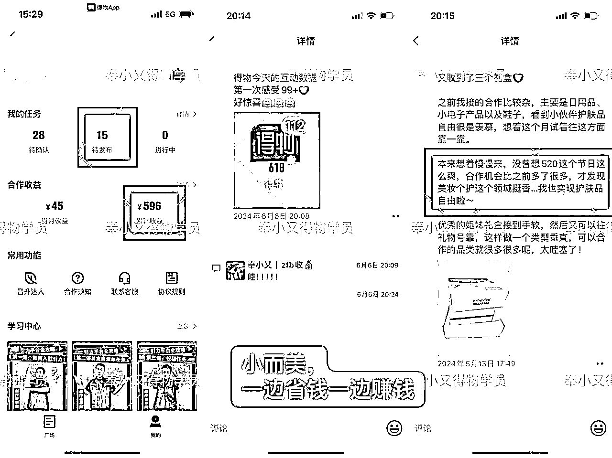
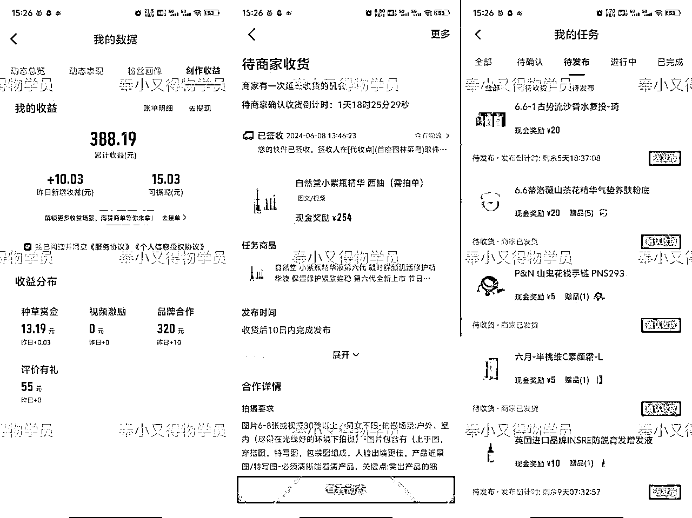
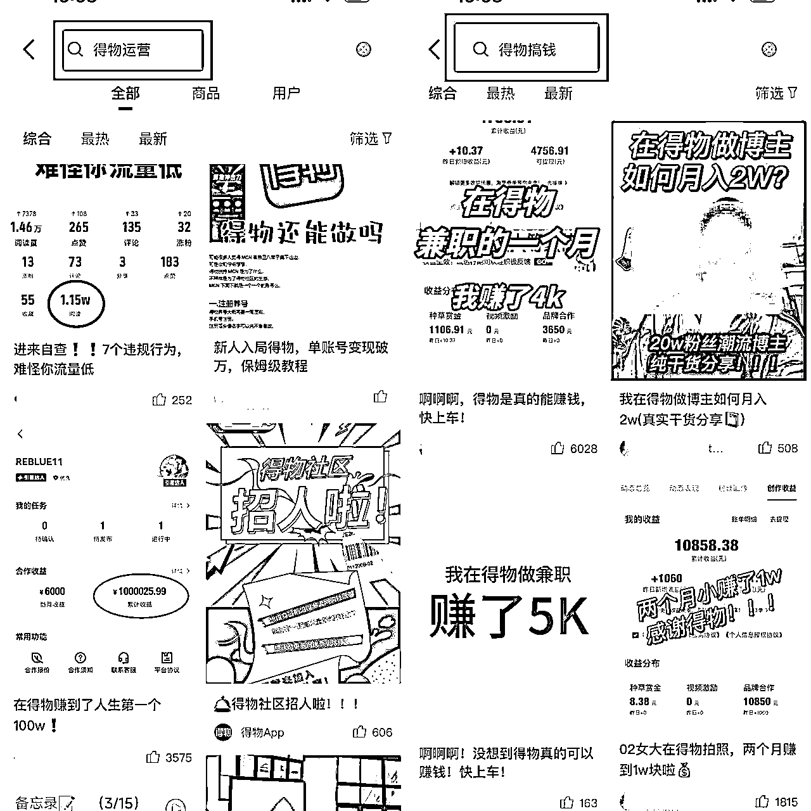

# 单号月入过万，单篇笔记涨粉近三百，为什么说得物依旧是普通人最容易起飞的自媒体赛道

大家好，我是小又。

得物这个赛道我之前也聊过，有兴趣的可以翻我之前的笔记。

现在入局得物的人越来越多，平台比起去年卷多了，规则也收紧不少。过去还能用的涨粉套路、和种草无关的爆数据玩法，现在基本都踩红线了。所以最近确实有一批人选择撤退。

但现实是，哪怕环境变了，依旧有人靠得物拿到人生第一个万元，单条动态涨粉292人。

也有朋友留言说卡在选题上，不知道挑什么赛道、发什么内容。今天我就把起号思路、避坑写法、以及安全涨粉的方法一次性讲清楚。

## 一、新手起号别纠结，先把号跑起来

如果你是第一次做自媒体，对赛道完全没概念，那就别硬抠，先发再说。手里有什么就发什么，前期杂乱一点完全正常。先冲到100粉，号活了自然知道自己适合什么。100粉之后再考虑垂直。

当然，如果你本身就有积累，比如化妆很在行，鞋包收藏不少，直接做垂直赛道启动更快。

总有人问：我东西少得物上又找不到，怎么办？

其实根本不是事。

发的内容不一定要是得物在售的商品，只要是好物种草都可以。非得物渠道购买的，只要得物能买到，就能挂链接。

觉得自己没东西？洗面奶沐浴露洗发水总有吧，手机电脑耳机总有吧，一两双球鞋一两个包包总有吧？

一个单品至少能拆成3条内容：图文测评、开箱、实拍使用。这样换个角度换个主题，同款也能发多次。100粉之前的启动素材就够了。

100粉后就能接商单，到时候可拍的产品自然会越来越丰富。

## 二、得物种草文案怎么写才不违规

做过得物的都知道，文案稍微营销一点就容易被判定违规。📕那种写法在得物基本用不了。多违规几次，平台就会认为你在接私广，直接封一个月广告权限。

结合我自己的实操和带徒弟的经验，降低营销感的核心就这几条：

1. 严禁拿大牌踩小牌来捧自己，这会被认定为拉踩。
2. 别用一点也不、超级、最、唯一、第一这类极限词，太像广告。
3. 别写功效类词，比如祛斑、生发、减肥、美白，极易触发审核。
4. 成分最好少提，商单可以，个人日常笔记尽量避开。
5. 别制造“这东西绝了大家快冲”的氛围，语气放平，真实体验为主。

给你一个好用的写作骨架。以推荐一款清爽洗面奶为例：

你的肌肤困扰是什么 > 这款洗面奶对你而言解决了什么 > 产品特点是什么 > 实际使用感受如何 > 质地怎样 > 整体效果评价

把这几层讲清楚，一条合格的种草笔记就成型了。核心是真诚复盘，别夸大。

## 三、新手如何合规高效涨粉

去年靠互粉涨粉还行，现在基本废了。得物查互粉很严，一经发现就要封1-2个月引力广告权限。

纯靠内容涨粉对新手来说门槛又高，很难像头部那样让人一刷就关注。

我找到了一个既安全又被平台鼓励的新手涨粉打法。

得物创作中心定期会推出官方涨粉活动，主题多为挑战XX天涨粉XXX，入口在下面：

活动里有些会送大额无门槛券，纯涨粉的话就报名涨粉挑战赛。

另外还有一些干货类活动也会带来涨粉，比如：

主要就是分享你在得物运营中的方法、踩坑经验、实操干货，写得越干货越受欢迎。

除了前面提到的涨292粉的同学，也有不少徒弟涨了几十粉。

方法用对了，涨粉并不难。粉丝基数上来，广告单价自然水涨船高，还能免费用到大量产品。我有学员做下来，包包塞满家里，手表也自由了。

很多人觉得做得物不赚钱，就是薅免费产品。500粉以内确实收益不高，但产品+佣金叠加也挺香。

就算没碰到官方活动，晒一次真实的收益截图，发一条干货总结照样能吸粉。

例如：

这类内容都有效。写的时候多参考别人的表达逻辑。

但有且仅有一点必须强调！！！

千万别直接抄别人的文案，很容易被判定违规，得不偿失！一定要原创！一定要原创！一定要原创！

以上就是今天的全部干货。

得物作为一个相对年轻的平台，对新人依然友好，但规则只会越来越严。想做的朋友建议尽早进入，早入局早吃红利。

最后唠几句大实话，共勉。

用户一直需要新的面孔。
平台一直需要新的创作者。
品牌方一直需要新的流量。

所以，别拿自己和成熟的头部博主比。想到就去做，头部吃肉，我们后进来的踏实做，也能喝汤，而且真的不难。

冲吧！