# 普通二本大三生，在付费星球泡了三年，我如何从透明做到50W矩阵

先介绍下我自己：我叫辛亥，03年生，目前大三，坐标江西上饶。现在和搭档小川一起做AI绘图像+网文种草的内容号，矩阵累计关注50多万，跑得最好的账号被收入了龙哥盟的航海手册，成为对标案例。

平时我在社区里发言不多，因为厉害的人实在太多，自己这点成绩不好意思拿出来说。不过三年里我一直在航海项目里担任服务者角色，所以有些圈友应该对我的ID有印象。

这篇文章的最初由头是鱼丸找我约稿，想让我聊聊近一年的收获和线下组局的事情。正好我想给自己这三年的社区经历做个复盘，就一起写下来，希望能给后来的人一些参考。

# 一、我和这个社区的缘分，始于一篇帖子

那是我高考完的暑假，偶然读到一篇流传很广的复盘，作者是西琳君（现在叫西猫仁），内容是分享他和创始人聊咨询的过程。据说这是全社区第一个公开这类对话记录的帖子，看完非常震撼。

那篇帖子给我指了路：

【知识星球】链接：https://wx.zsxq.com/dweb2/index/topic_detail/815251285585242

【公众号】链接：https://mp.weixin.qq.com/s/XIOHauYjxwesDQQq6KfVXw

顺着文末的联系方式，我加了西琳君的微信。那时候我什么都不懂，连“钩子”都没听过，但胜在胆子大，什么奇怪问题都敢问。西琳君是龙珠圈子里的老成员，我那时对这个社区毫无概念，结果聊了没几句，他就主动提出要送我一张入场券。

当时我整个人是蒙的：一个素不相识的人，愿意花几千块赠给一个才聊过几句的高中生，这份信任感远超我的想象。那一刻我直观地明白了这个社区提倡的“真诚、利他”，这就是我的第一堂课。

我很感动，但最后没有收下。我觉得自己太嫩，至少要先去沉淀一年，攒点能力再说，否则就算进去也只会焦虑。和现在第八期不一样，那时候没有那么多新手指南和思维课，也没有人一步步带你入门。

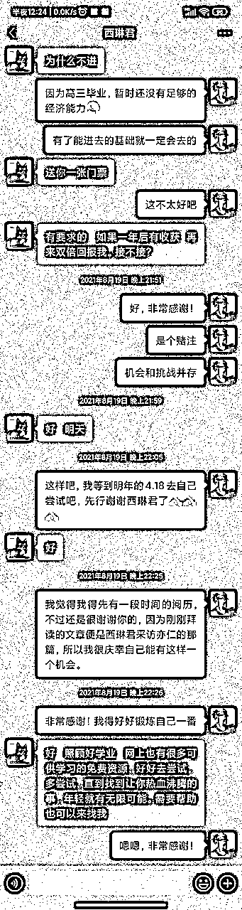

虽然门票没收成，但这份善意我一直记得。后来在江西年会的分享中，我还专门感谢过他。想听细节的，以后可以私聊。

每次复盘这段经历，我都会想：为什么当时他愿意帮我？难道是因为我年纪小、刚高考完比较特别？可能有这部分原因，但后来接触的人多了，我越来越确定，核心在于我那时候心态很平等。我没有卑微感，也没想过去巴结谁，更不因为“自己没资源没价值”就不敢开口。我就是把对方当作一个普通人，自然地聊天、提问、表达好奇。这一点真的非常重要，太多人卡在“不敢”和“怕打扰”上，其实试一下的成本远比你想象的低。

如果让我给想结识大佬的人三条建议，那就是：

1. 心态平等：别预设立场，别觉得自己低人一等，也别把对方神化。
2. 真诚：展示真实的自己，装出来的东西经不起时间考验。
3. 主动：很多关系的起点，就是一句“你好”。如果当初我没加微信，后面的一切都不会发生。

# 二、让人认识我的两个动作

## 1、把精华帖翻出人脉网

我早期做过一件很“笨”的事：把我感兴趣的那些大神的帖子全部翻了一遍，并且挨个点赞。通过他们写的东西、回复的口吻、关注了谁，我能大致判断出这个人的水平、领域和性格。然后再顺着他们的人脉关系网往远处看，很多原本没有交集的点就会连成线、织成网。

举例来说，你无意中刷到一篇讲“网感”的精华帖，觉得很有收获，于是点进作者主页，发现他还产出过很多其他干货。再看他在其他地方的发言，这个人的立体形象就出来了。

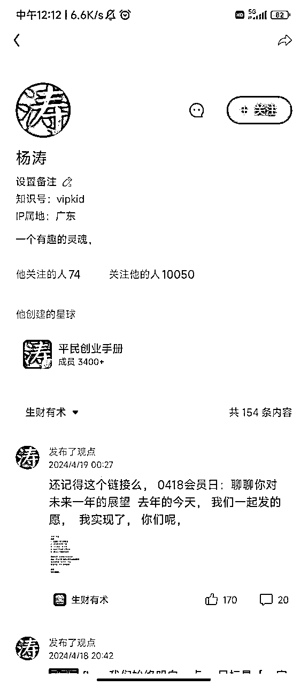

然后，关键的一步来了：去看看他的关注名单。注意别从上面往下翻，要从底部开始，因为关注列表是按时间倒着排列的，越早关注的人沉得越深。

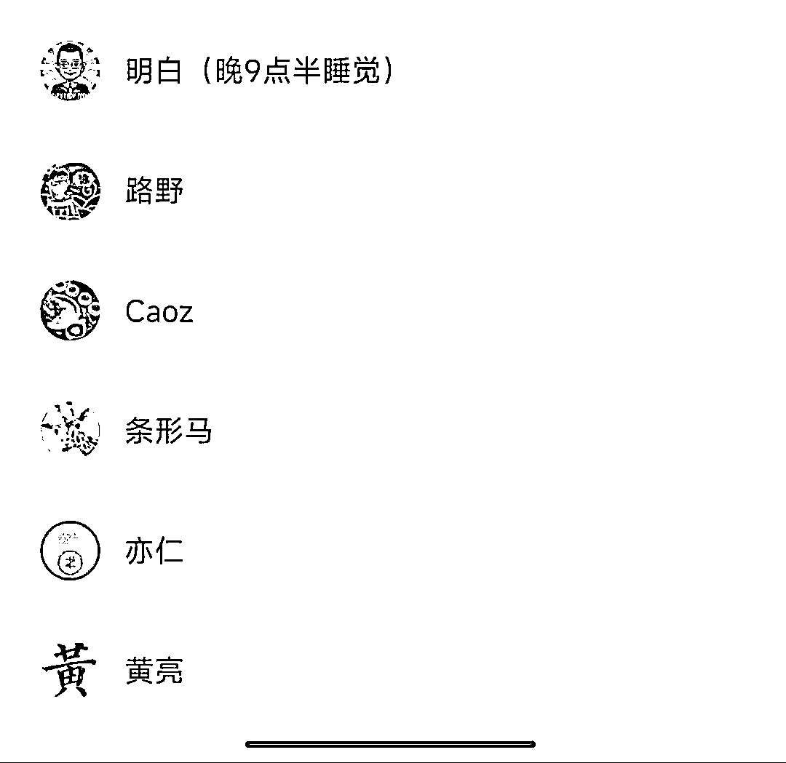

我截图里排着的，很多都是社区里公认的嘉宾。顺着这些嘉宾再往下挖，又能发现更多值得学习的对象。这个方法本质上是借“大节点”来扩散人脉，效率极高。

不过要提个醒：现在很多免费或付费的星球，加入后会自动关注星主，所以名单里也有不少“水分”，需要交叉验证再判断。

我最初引起两位老师注意，靠的也是点赞。那年知识星球做年度总结，统计“这一年在你的帖子下点赞最多的人”。在龙珠俱乐部（后来的航海家俱乐部）的前身里，我给两位老师点的赞都排在首位。虽然当时我不在俱乐部，没法直接加好友，但至少在他们脑海里留了一个“爱学习”的正面印象。后来多亏一位靠谱的前辈姐姐牵线，把名片推给他们，我才正式加上微信。

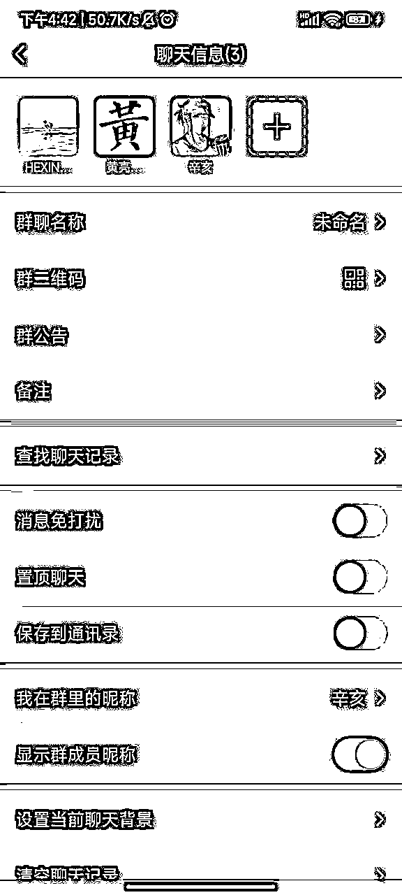

这套方法不只适用于知识星球，放在即刻、推特（X）上一样有效。看主页、看关注列表、顺着前辈的足迹去延伸，能让你挖到一片富矿，兴奋好几周。

当然，信息过载也会带来焦虑。这时我会回头看西琳君那篇复盘，让自己静下来。那位创始人说过：先聚焦一个目标，赚到钱之后，选择权自然就多了。

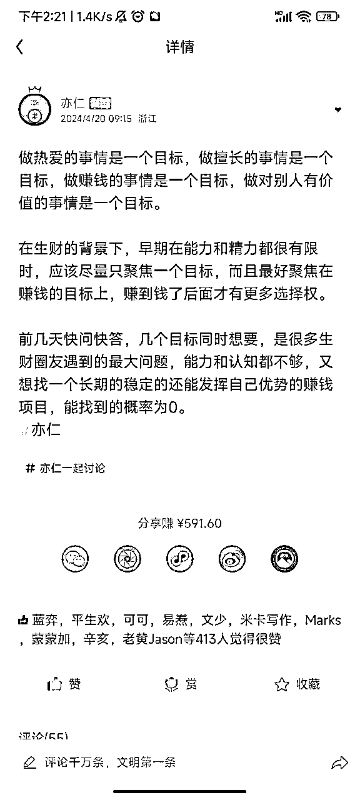

如果不知道从哪里开始，那就跟着航海走。龙哥盟这个社区里，对零基础普通人最友好的入口就是航海项目。

## 2、在航海里当“自己人”

航海的项目非常多，内容质量也高。尤其是航海手册，迭代了好几个版本，有面向新手的，也有面向进阶的，比外面那些割韭菜的课程良心太多。有些课程其实就是把航海手册抄去卖，圈友守住这个宝藏就够了。

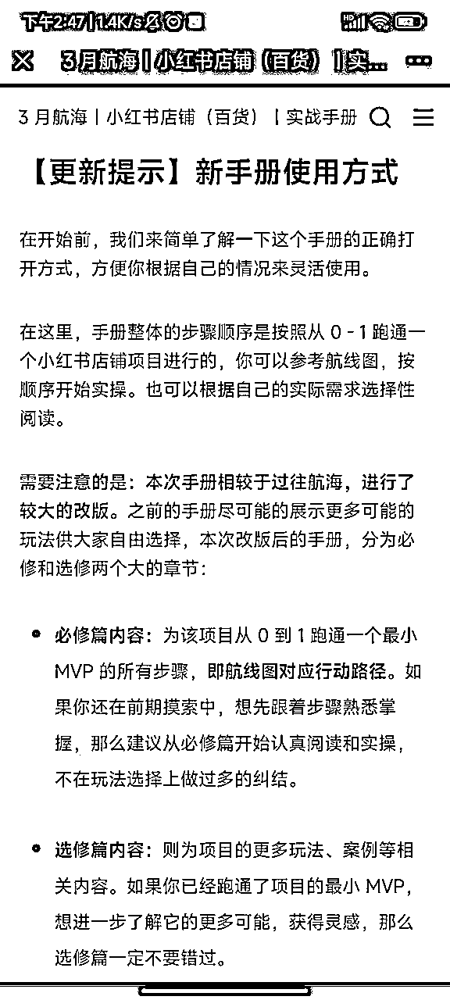

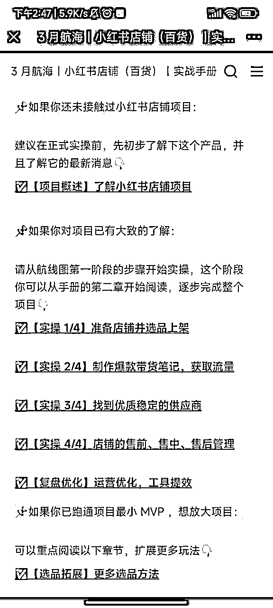

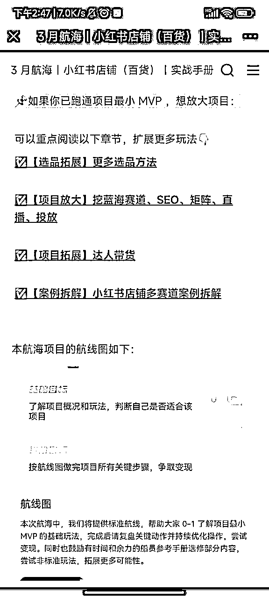

这是我参与过的航海，前前后后差不多十期了。去年第七期开始，我一期都没缺，可以算全勤。

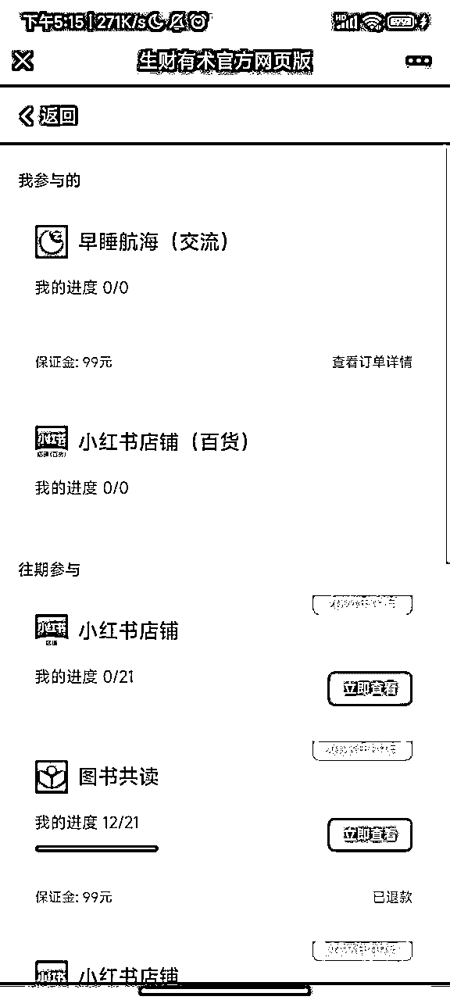

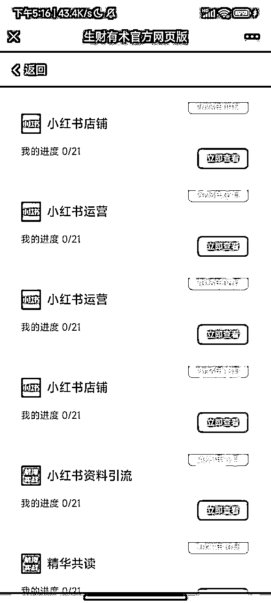

很多人可能会奇怪：为什么航海打卡记录里看不到我？因为大多数时候我不是学员，而是以领队、分享官、答疑官的身份在服务大家。

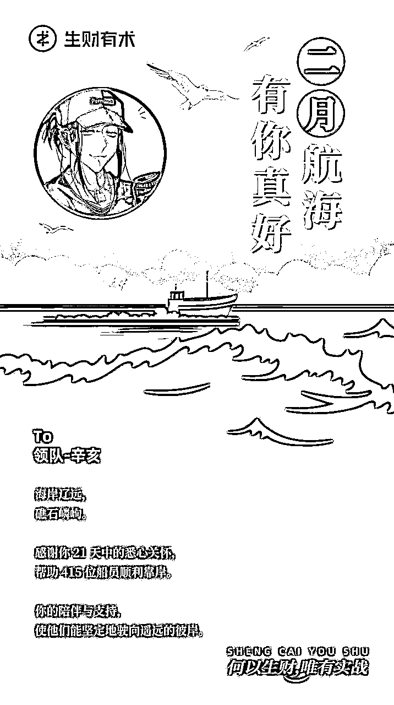

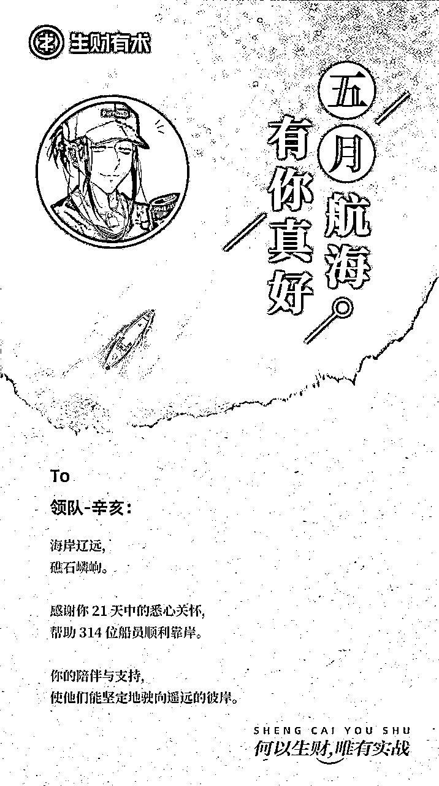

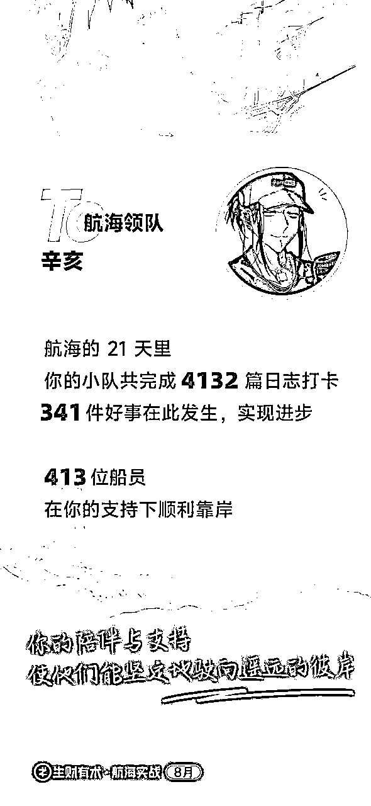

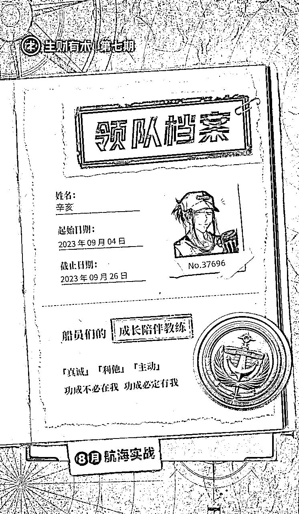

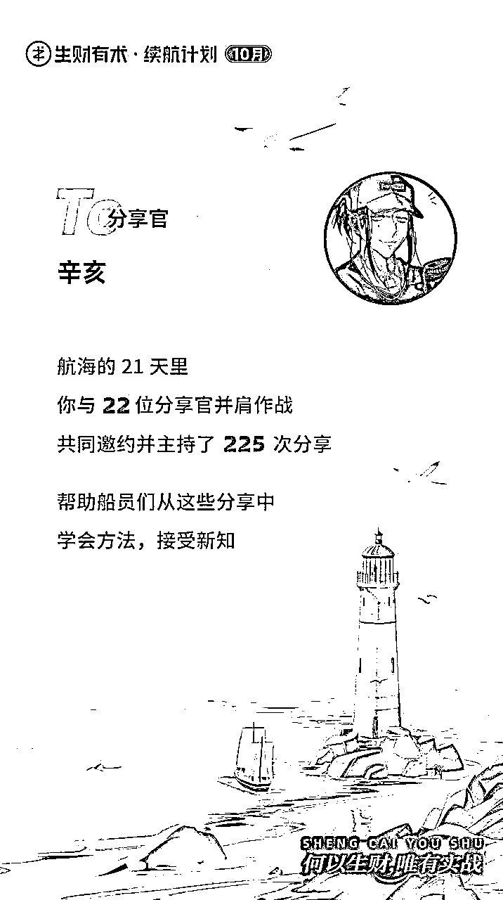

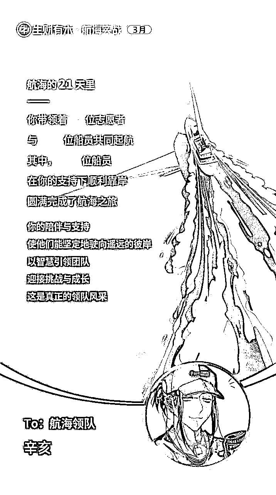

跟着航海走了这么多期，也看着它的玩法和海报一年年迭代，算是亲历者了。

现在我要认真推荐一个破圈方法：如果你想在这个社区里被更多人认识，至少去服务三次航海。

别觉得这是在免费打工。你服务的对象是官方，每次出现你代表的是官方团队的一部分。对于一个没背景、没人脉、没资源、没渠道的“四无”青年来说，这就是借势。平时够不着的大佬，有了这个身份后，加上微信就是一件很自然的事。当然，不能利用职权夹带私货，否则路会越走越窄。

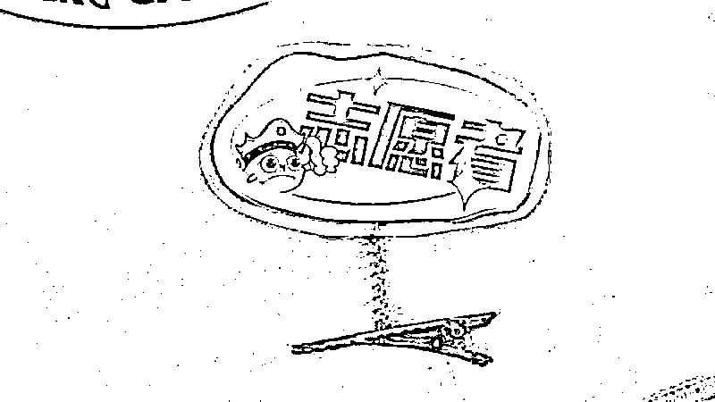

为什么我这么推崇服务者角色？原因有几个：

第一，靠近官方。官方策划活动、招聘人员时，优先想到的一定是熟悉靠谱的面孔。很多内推机会，就是在这样的接触中产生的。

第二，能接触到更多有结果的人。带队的教练大多是拿到过不错成绩的圈友，比如我们江西社群的书豪教练，带过好几期航海，口碑很好。你是工作人员身份去请教，对方会更愿意多说几句，甚至给你开个小灶。

第三，能学到社群运营的一线经验。从玩家视角切换到主办方视角，你会发现组织一场活动、带动一个社群、维护一套秩序，这里的门道远比外界拆解的要深。做志愿者就相当于直接进内部看答案。

第四，官方不会让服务者白付出。内测名额、周边礼物、术值积分、现金奖励都会有。在这个平台，服务一次航海可以免费参加一次交流型项目，术值攒够了能兑换门票和龙珠，做几次合格基本就挣回入场券了。

如果是在校大学生，那就更划算。飞书协作、社群运营、内容剪辑这些能力，你都可以通过服务航海免费练，还能被更多人看见。

最关键的是，你会逐渐在官方那里建立起“靠谱”的口碑。这个圈子其实很小，好事传得快，坏事更快。互联网也有记忆，别拿前途去赌。老老实实做事，踏踏实实做人，这才是最快的增长路径。

这个方法同样可以迁移到其他圈子。我还在花爷、狗哥等朋友的社群里做过服务者，现在我的大部分人脉，九成以上都来自这些社群，关键时候帮了我不少忙。

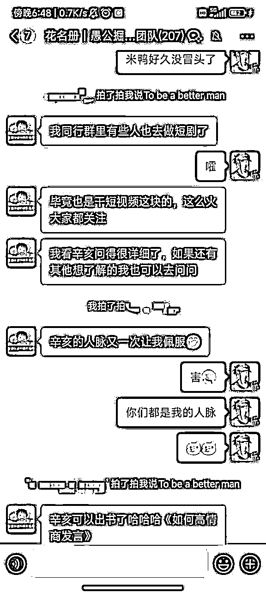

## 3、线下见面，把ID变成一张脸

最后一个破圈途径是线下见面。龙哥盟第七期里，最让我又兴奋又遗憾的就是线下环节。

兴奋的是我连续两年参加了线下见面会，还受邀在江西年会上做分享，和一位很有成绩的前辈同台。遗憾的是江西本地的圈友实在太少，尤其是我们上饶，一个城市的圈友数量可能还不如广州一所大学里的多。想组个局都凑不齐人，这也是欠发达地区的无奈。

两年下来我最深的体会是：线上千言万语，都抵不过一次面对面。见过真人、吃过一顿饭，信任感会完全不同，后面的合作也就顺了。

2022 年 418 我进了赚钱，第一次真正意义上参与的线下活动就是 2023 年的全国见面会。那是我头一回踏入千人级别的线下聚会。

平时圈里的交流大多在线上，聊聊打打电话也就到此为止了，人都没见过一面，却总有一种按捺不住的想见面的渴望。凡是去过线下的老圈友都懂这种感觉。所以对新来的朋友，我的建议很直接：一定要多去线下，特别是这种大规模的场子，收获往往超出预期。

不过我要先泼一盆冷水：去见面会一定要带着明确的目的去。只抱着学习的心态去，基本等于白去。线下信息量太炸了，你什么都想拿，什么也没捞着，满腔热情带回家，最后只剩更深的焦虑。

我去不是为了单纯学习，我是奔着破圈去的。后来复盘下来，给自己提炼出了三条实操。

#### 一、主动开口

一年到头来现场的人不少，可真敢开口的没几个，社恐是常态。

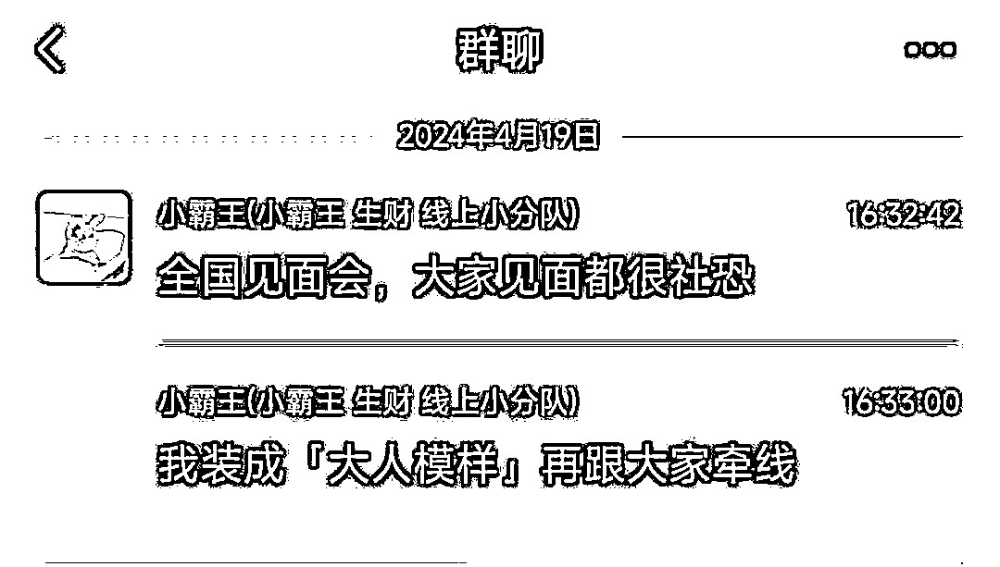

这就产生了一个很现实的红利。大家常讲表达者有红利，其实社牛者也有红利。更别提线上能说、线下更放得开的那批人了，他们几乎不需要刻意破圈。

涛哥花爷那种颜值我比不了，所以我的照片就不上了。只想说一句，线上聊一千遍，也不如线下见一次面！

这里必须强调一个核心认知——大佬真的很好接近，大佬真的很好接近，大佬真的很好接近

我反复说三遍，是因为我们自己给自己加戏太多。总觉得要先有价值才能去加微信，才配开口。事实上能认识，能加上大佬微信，就说明你们已经在同一个圈层、同一个语境里了，价值观天然有交集。这是一种身份的共鸣，根本不用有心理负担。大佬们都很好说话。别怂，直接上。当你真正线下链接了几位同台的大佬，你会发现心里那道自己砌的墙自己塌了。

所以才需要主动走出来，主动线下连接，才有破圈的可能，才有贵人出现的机会。

可如果你选择社恐，选择觉得自己不够格，那以后你可能会后悔，为什么当年跟你差不多的那个人，现在已经完全不一样了，你曾经平视的人，现在只能仰望了。

#### 二、制造惊喜

惊喜不是硬来的，是你给自己一个可以被记住的角色。

我常用的就两招：

1. 客串摄影师，帮大家拍照留念
2. 给欣赏的前辈写明信片，或者买他写的书去请他签名

先说第一招。给自己一个摄影师的身份。夜话进行中大家自我介绍，你在拍，那大家对你的第一印象就定格为摄影师了。二十个人以上的场子里，要被所有人记住很难，除非你极其出众。但大家回忆起那场夜话，几乎都会记得那个一直拍照的人。

和那种正式大会的官方摄影不一样，线下的分享现场往往没有人专门拍照。这时你拿着相机在拍，结束后把照片整理好发给分享者，再附一则简短的复盘，对方会觉得特别受用。

第二招，给喜欢的前辈写明信片，请他签名。这逻辑很简单，我用自己的事举例。

23 年赚钱见面会的夜话是我第一次参与，发起人是球球姐丁邱洁律师。为了更近一步了解她，我提前买了她的书《创业十日谈》读完了。所以见面会一看到她办夜话，我直接就报名了。

那次我带了第一桶金买的相机，全程给人拍照，在自我介绍环节因为这个动作被大家记住，首印象就是积极、热心。

带书除了读，更重要的是现场找作者签名。在众人见证下，你拿着前辈的书去请签名、合影，情绪价值直接拉满。一本书不贵，但它会成为你们之间一段很长久、很具体、甚至能讲成佳话的故事锚点。

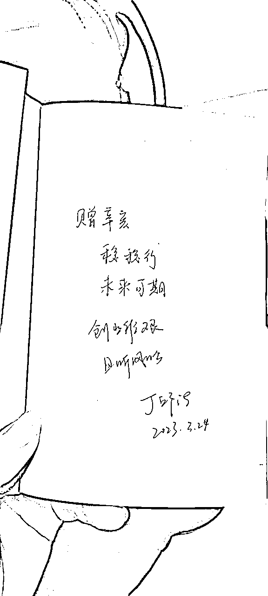

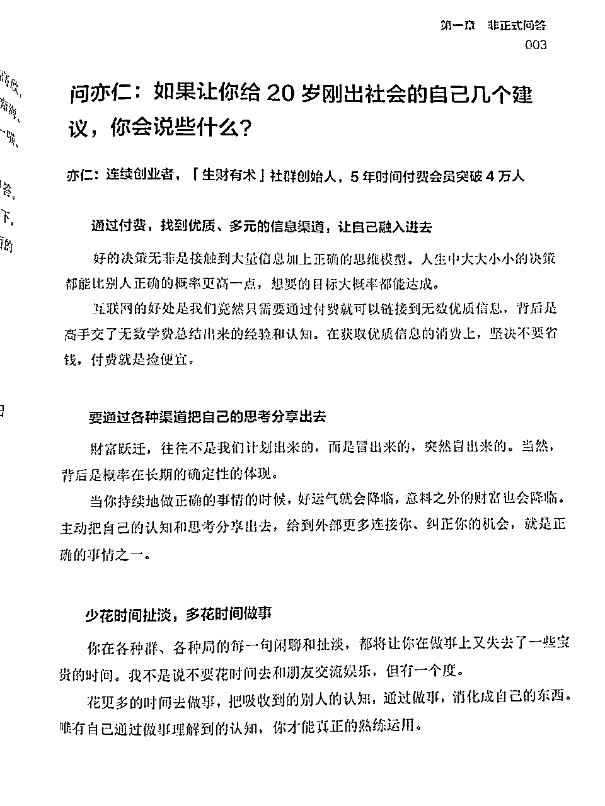

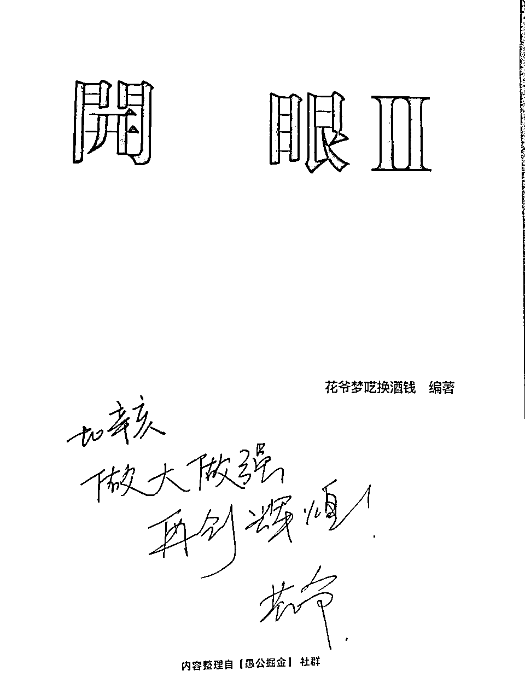

于是 2024 年航海家见面会，我又玩出了新的花样，具体是什么，你可以自己体会。

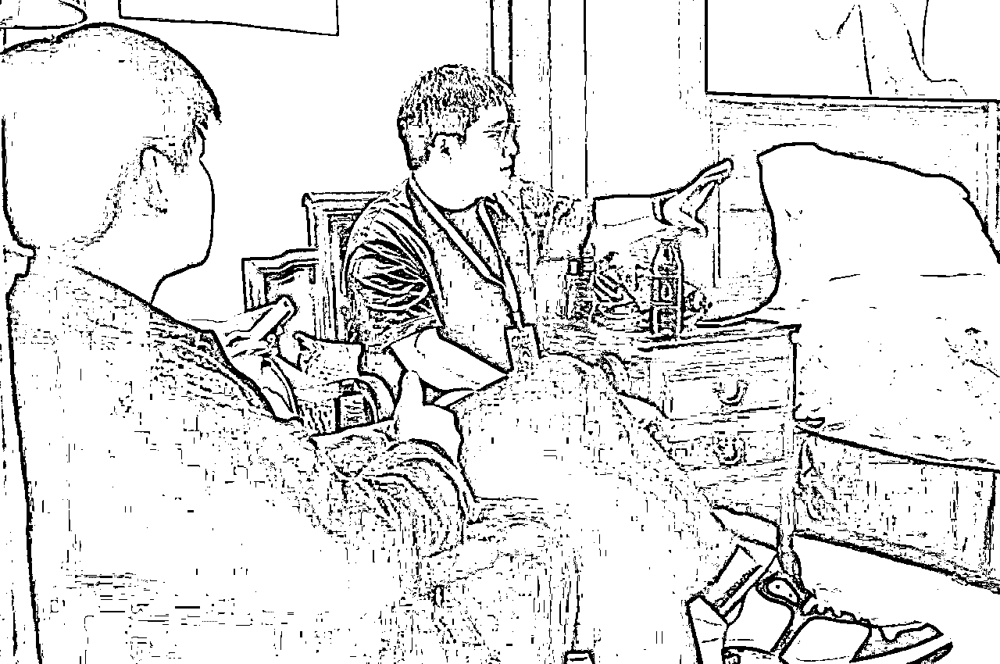

大柯老师也亲笔给我留了签名，感谢。

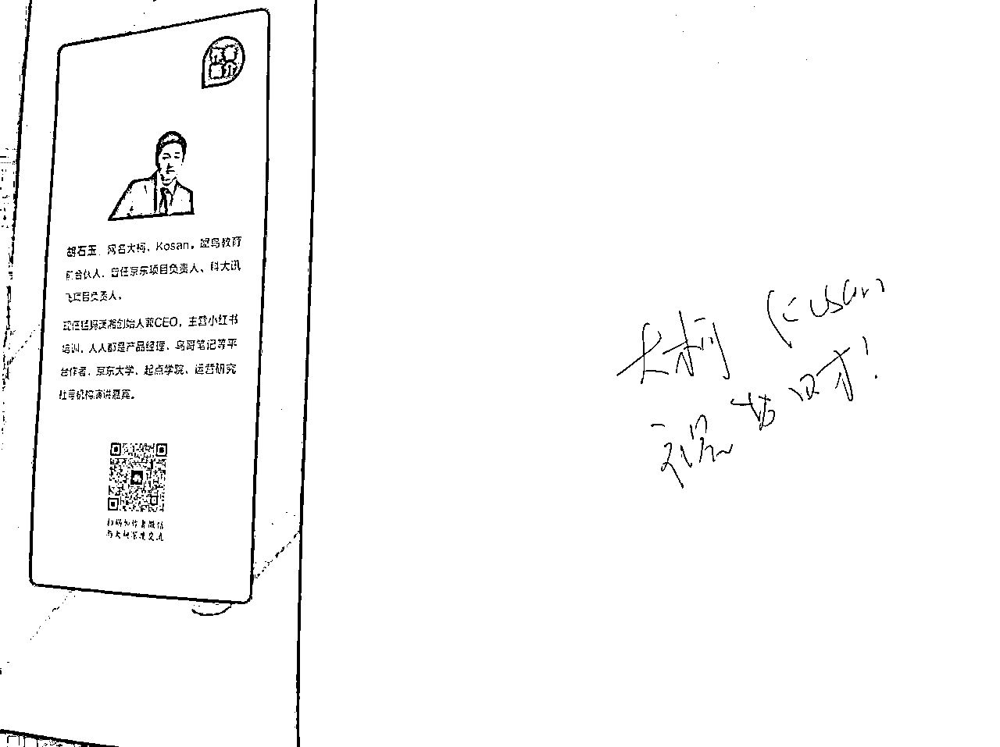

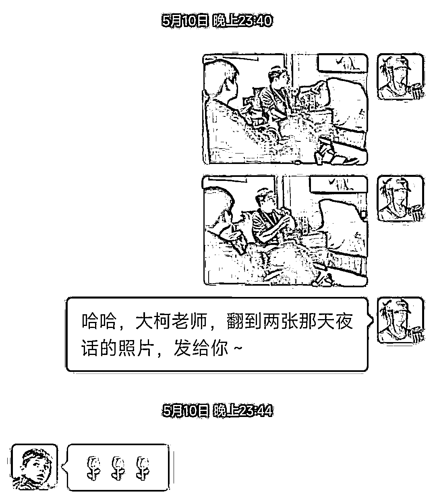

如果心仪的前辈还没有出书怎么办？也可以写一张明信片。用心夸奖，或表达相识的感恩。赚钱会员日曾经有过夸夸赚钱好圈友的主题，我想夸的人太多了。链接放这里：https://t.zsxq.com/K6W5T

如果你习惯刷精华帖，你一定会有无数的“啊哈”时刻。被激励、被感动、开眼界、有共鸣。请一定要让写下这些内容的作者知道你的反馈。

本想放一张我写给条形马、马大爷的明信片，可惜忘了拍照，就留一段我当时“考古”他发帖时的感言吧，明信片里我也写了这段。

真诚、利他、乐于分享的人，请坚持初心。分享你的经历、你的成长、你的赚钱飞轮。这就是赚钱的基因。

我也会继续践行这条建议。别担心你讲的东西别人讲过了，别人讲得更深。古人说闻道有先后术业有专攻，多发帖、多被看见、多感受赚钱这个高能赚钱场域带来的积极能量。哪怕只是点个赞、评论一下，也是在给社区添砖加瓦。

#### 三、特殊身份

做志愿者，还是做志愿者。

《别独自用餐》里讲作者年轻时当球童，正因为耐心细致，被雇主引荐认识了不少权贵，那段特殊的身份给他的人生带来了巨大好处。同样，做志愿者就有异曲同工的效果。你能接触到更厉害的人，看见成功人群的共性，明白为什么成功的人越来越成功、富有的人越来越富有。也更清楚应该跟谁同行。

赚钱在志愿者体系建设上是我见过最强的社群生态之一。作为普通人，想破圈、想靠近官方，不做志愿者，我想不出第二条路。

怎么说呢，就拿 2024 年航海家见面会举例。千人局没有志愿者配合几乎无法运转。各种调度、接待、签到，工作量极大。

其实那次我差点没赶上。学校考试撞期了，周四通知延期，我立刻买票飞过去，还好赶上了。事后跟条形马、秀儿、醒醒、牙牙、左烨紫复盘这件事，条形马还调侃我跟赚钱有缘，命中注定要来。

我虽然没正式报名志愿者，但全程参与了前台签到录入、嘉宾房间分配等工作。不少前辈朋友的房间都是我安排的。能服务大家的感觉真的很好！！！

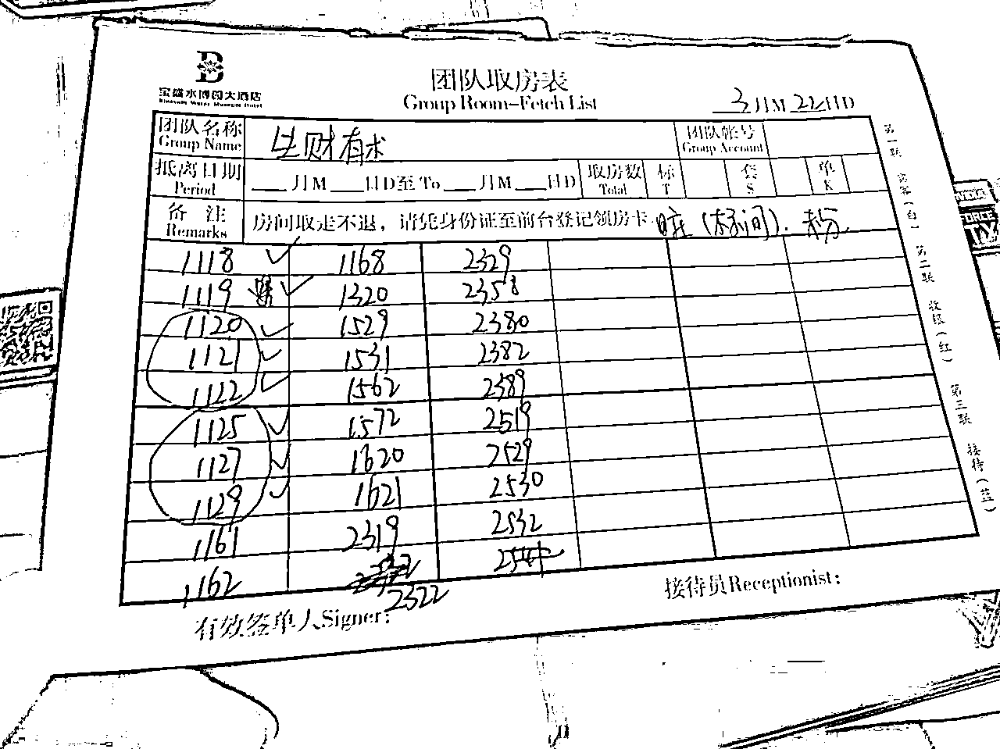

航海家见面会三天两夜，我一直跟着团队和志愿者伙伴们跑，维护秩序、签到录入、拍照、跟酒店对接、核验身份。认识了很多人，学到了很多，也因此有了两次和前辈合作的机会。

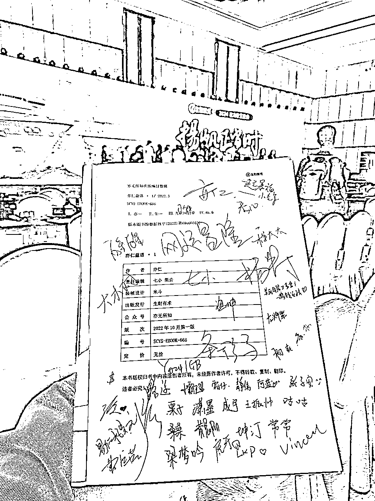

感谢、感激、感恩。我们一起，龙哥盟～

# 彩蛋：龙哥讲的一个叫 Luke 的故事

龙哥老师在志愿者感谢宴上分享了这个故事。

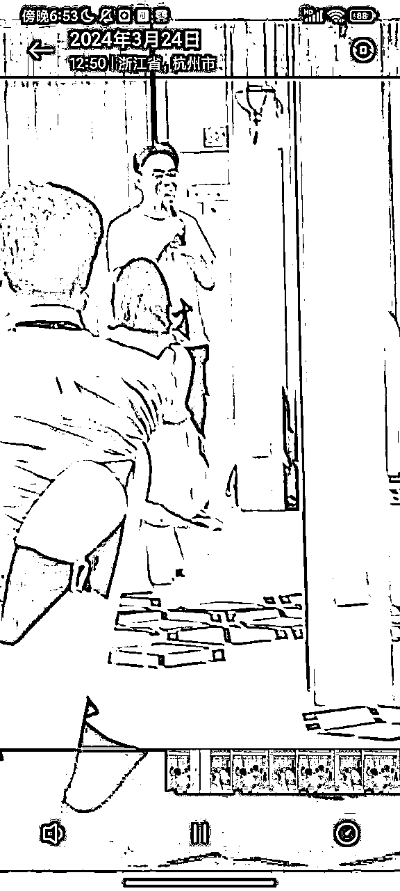

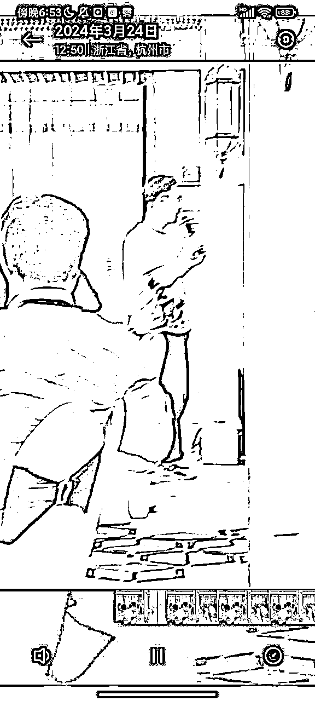

龙哥说，大学时他喜欢泡一个网路电话论坛，当时他只是个无名小卒。论坛的内容很有价值，他也因此赚到了第一桶金。一开始他只是潜水、灌水，后来越灌越多。

后来他做了一件事——主动做社区志愿者。帮论坛管理帖子、运营活动。慢慢地，他进入了核心圈子，接触到了仰望的大佬，获取到更深层的信息。

他在整理内容时学会了社群运营。在做志愿者的过程中，他把打免费电话的知识整理出来放到贴吧引流变现，赚了第一桶金。

也是在这个社区认识了一个朋友，多年后朋友找他一起研究一个赚钱机会，两人一起赚到了人生的第一个 100 万。

这一切的起点，只是他认同这个社区，想成为志愿者，想回馈自己所学。

Luke 就是龙哥的英文名。故事里的 Luke，就是他自己。

在任何一个组织里，最好的成长方式，就是去支持这个组织，和组织一起成长。

谢谢大家的阅读，一起龙哥盟~