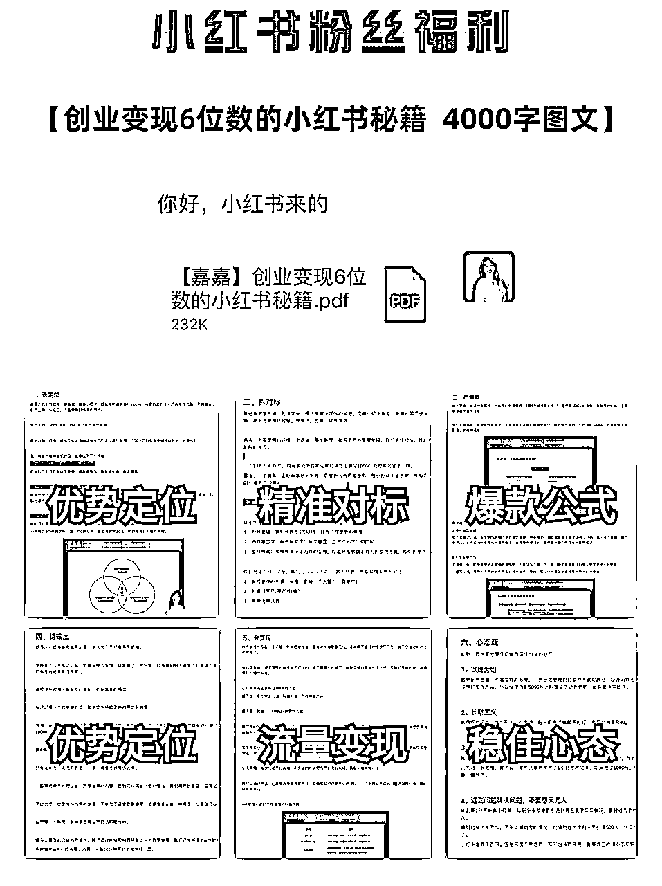
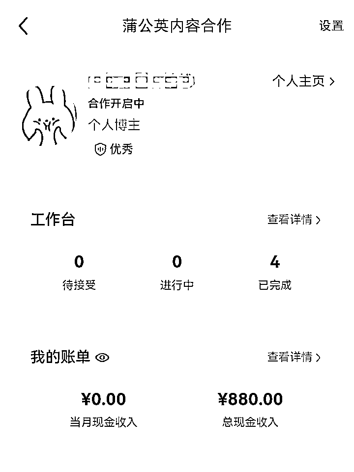
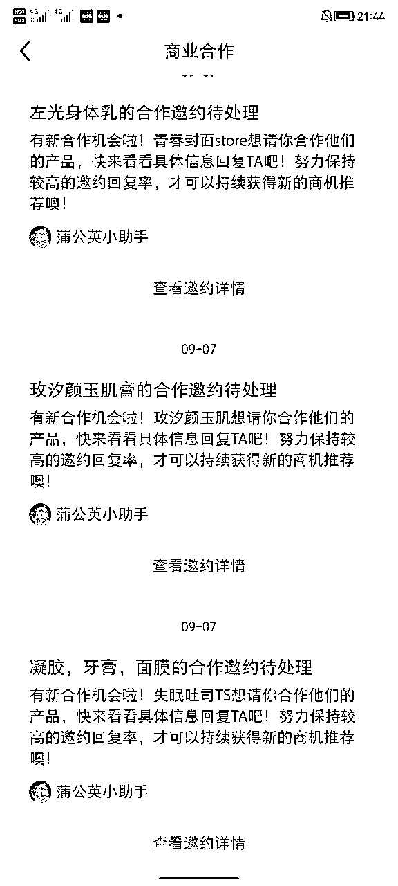
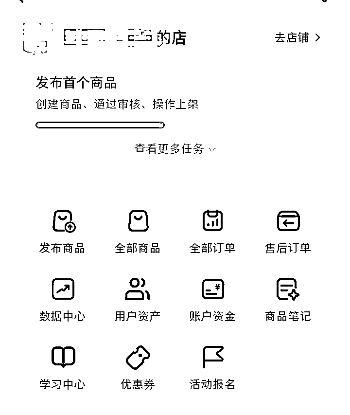
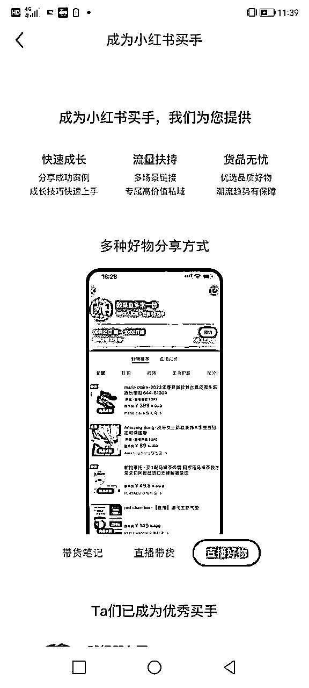
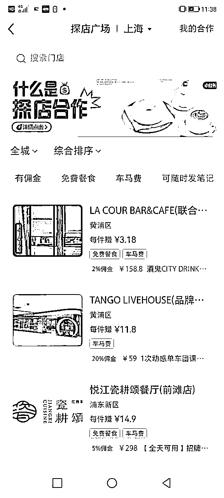

# ('小红书的6种变现方式', (2, 12))

小红书赚钱的6种方式，全在这里了

大家好，我是张嘉嘉。算起来也算个自媒体老兵了，平时主要帮职场人和个人创业者，把小红书账号做成能赚钱的IP。教育、情感、职场、企业管理、收纳这些赛道，我都亲手跑出过变现闭环。

经常有人私信问我：小红书是不是除了接广告、引流就没别的玩法了？当然不是。今天我就把这6种变现路数一次性讲透。

**一、把流量引到私域成交**

有人会奇怪：平台本身就能变现，干嘛还要往微信引？这主要是针对非标品和高客单价产品。越贵的东西，越要靠信任和用户粘性来促单。你通过朋友圈内容、一对一私聊这些动作，把信任做足了，转化率才会高。

我自己有个8000粉的小红书号，三个月内靠私域卖知识付费产品，进账差不多6万。

这里要提醒一句：现在平台都希望用户留在站内，对导流行为打击很严。所以得用一些低风险、有技巧的引路方式，才不容易踩雷。具体方法我单独写过，翻翻前面文章就能看到。

**二、做达人接商业广告**

小红书天生就是种草土壤，广告变现的玩法相当灵活。只要账号风格与品牌调性对得上，商家就会主动找上门。

合作方式主要有两种：

一种是走站内蒲公英渠道，粉丝到一千就能解锁。报价一般按粉丝数的10%来定，算比较合理。这是我去年一个5000粉图文号的数据。

另一种是去第三方平台接单。那边会根据粉丝量、内容质量等定价，很多单子不要求粉丝数，笔记发布审核过了就能拿钱，通常一篇5到10元。在小程序或者接单群都能找到，QQ上搜索“小红书接单”，一搜一大把。

不过这种方式的风险也得说清楚：要么商家赖账不给钱，要么被平台认定没报备就发广告，直接违规。

**三、开小红书店铺**

如果你有货源，可以直接开店；货源不足的话，也能去拼夕夕或者1688找货，走无货源模式。更省事的办法是卖卖资料包、虚拟产品，我自己的笔记合集就卖出过10份。

开店门槛相当低，没有粉丝也能开，完成专业号认证就行。店铺类型包括个人店、个体户、企业店，还有专卖店/旗舰店，按类目交保证金。

**四、做买手挂链接赚佣金**

不想自己开店的话，粉丝到达1000位，就能解锁带货功能。去选品广场挑货，用户只要点你笔记里的链接，或在直播间下单，佣金就自动进你口袋。

选品跟着账号的赛道走就行，图书、美妆、母婴都可以。

**五、走探店拿团购分佣**

本地生活是小红书最近两年的重头戏，不少线下店都入驻做了团购。像餐饮券、美容体验这类，探店博主都可以合作。按这个方向走，同样是千粉解锁挂链接资格，有人通过链接下单，你就能拿返佣。

**六、靠直播变现**

直播变现不只是带货，还有打赏礼物这条路，很多娱乐主播就靠这个赚钱。我看了下，小红书目前手游直播这块还不算卷，游戏打得好的可以试试，尤其Z世代喜欢的“蛋仔派对”这类型，应该挺有潜力。

这6种模式我梳理完，自己也跑通了前3种。如果问我看好哪个，我会选私域引流变现。不过不管你选哪条路，起步前都得先定好赛道，想明白变现路径再动手。说到底，拥有自己的产品和完整商业闭环，才是能走得久的真正答案。