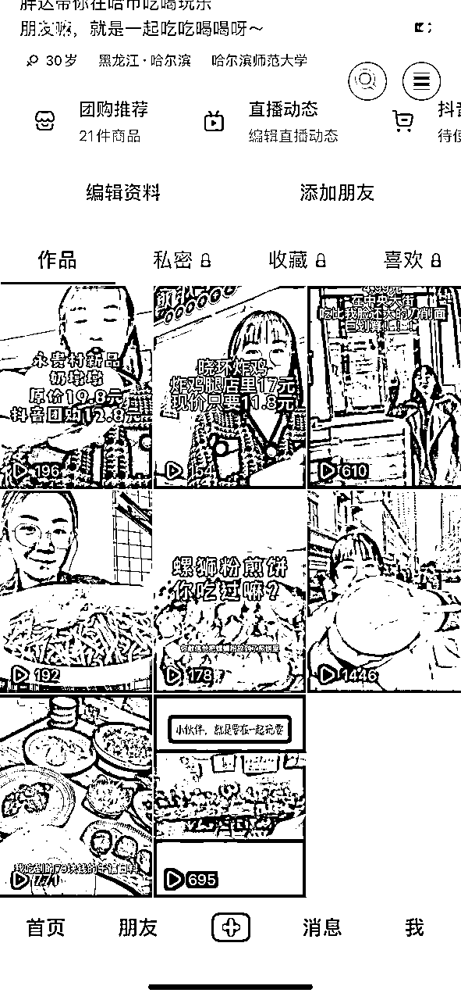
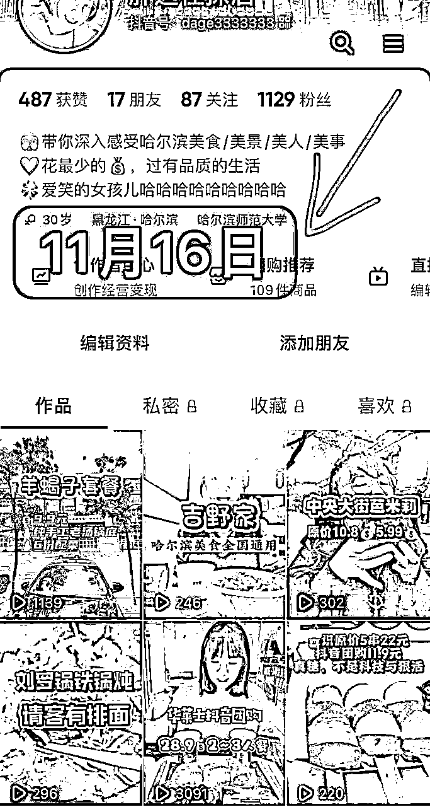
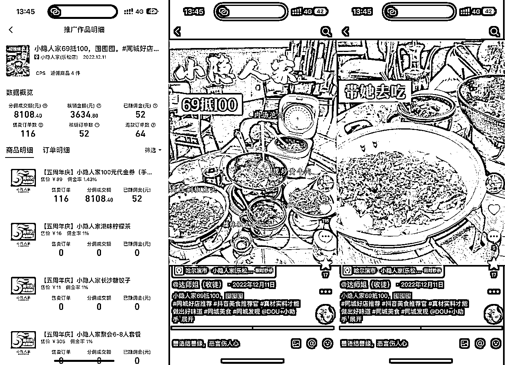
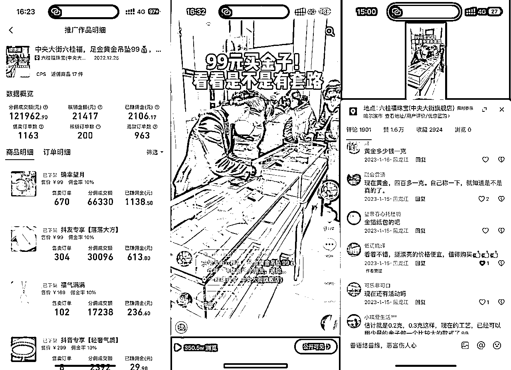
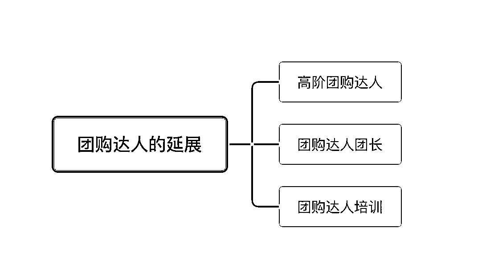
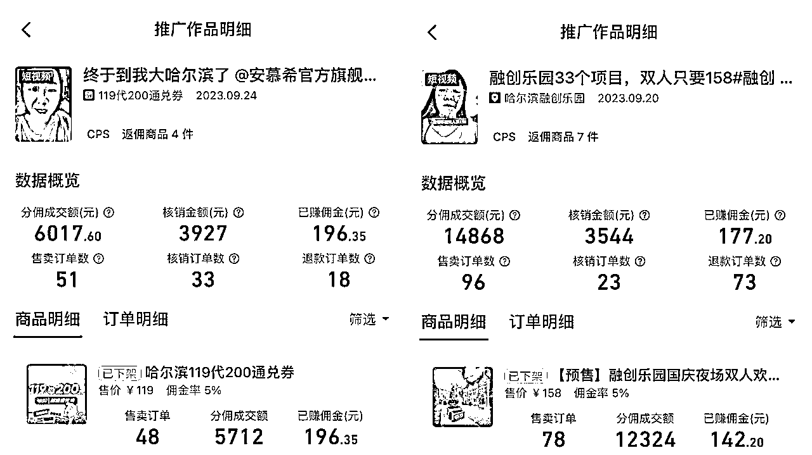
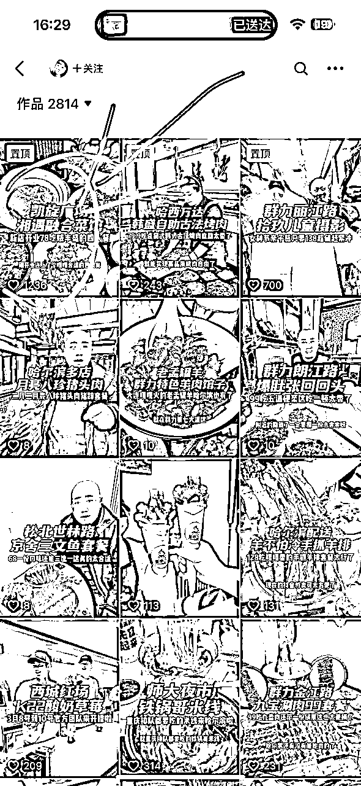
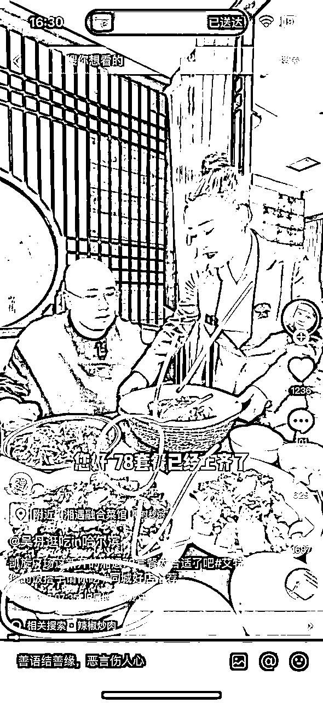
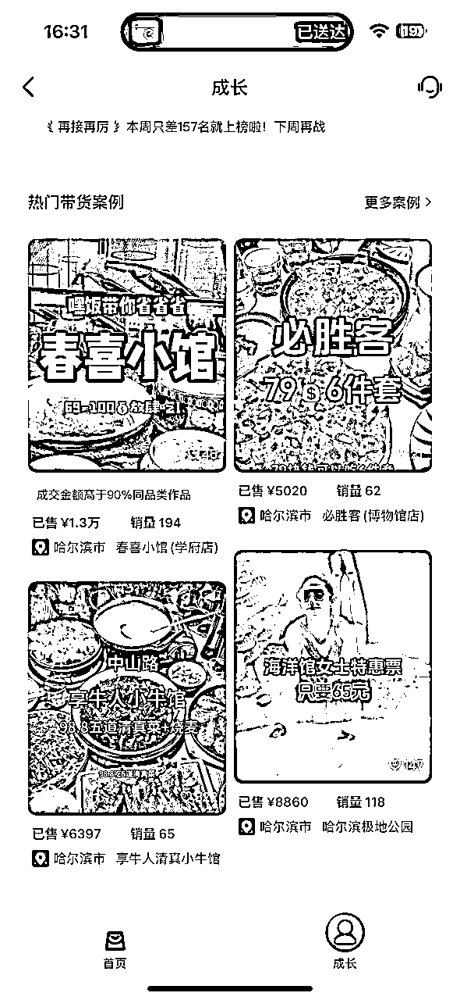
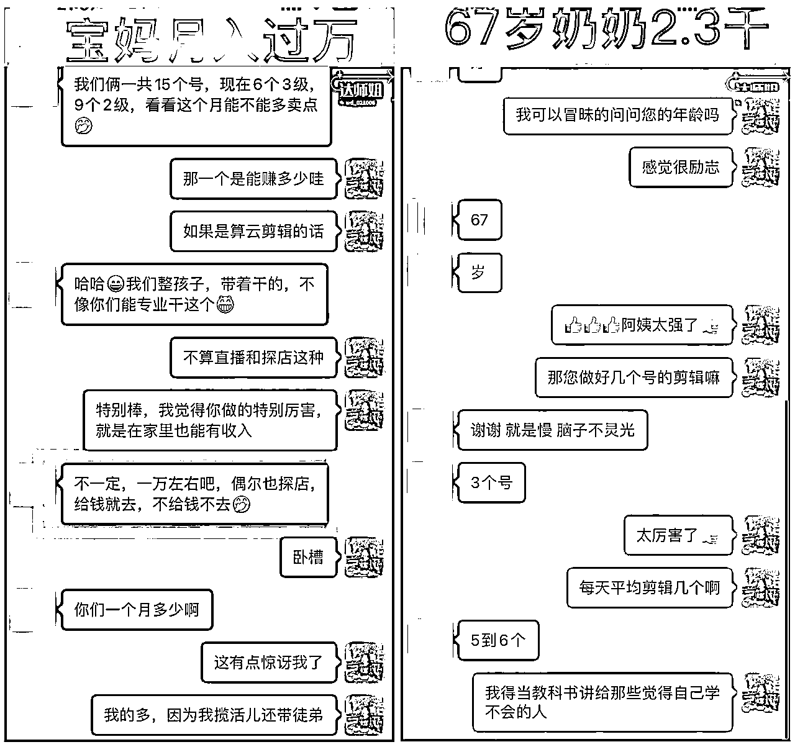

# 【抖音探店】跟着航海两个月从零到哈尔滨前30，41万+的实操复盘，普通人也能复制

一年多前我从零起步，跟随赚钱航海进入本地生活赛道，真的赚到钱了，线下人脉也拓宽了。更关键的是，现在坐月子在家，月均也能稳定2万+。这份感恩我一直记着，今天就把从0到1的完整经历摊开来讲清楚：这个赛道能挣哪些钱，现在还能不能做，适合什么人做，选品、文案怎么打，以及新手最容易踩的坑。

目录

为什么我会入这个局

团购达人有哪些变现方式

我从小白到熟手的三个阶段

现在入局还来得及吗，适合谁

新手快速上手的打法

## 一、我为什么会做这个项目

我叫达师姐，之前是上海的普通白领。30岁临近，买房遥遥无期，生育窗口也在逼近。2021年我回到东北老家，月薪到手3k多，比在上海时少了太多。存款不敢乱花，每天焦虑不知道要熬到什么时候。

我喜欢小城的安逸，但接受不了低收入，于是开始找副业。要求就三个：一个人能干、不花钱、业余时间做。

赚钱航海里的项目我翻了无数遍，当时小白到看不懂。听说抖音团购能白吃白喝，我就报了名。跟着小航海操作2个半月，业余时间把本市排名从1万名开外拉到第23名，收入35万+。回东北后这条路成了我真正的新出路。现在主业加副业月入3-5万，时间自由，还怀了龙凤宝宝。回头看，在上海是为生存，现在才是我想过的生活。

我在这个项目里是彻彻底底的0起点，所以经验对新手很友好。

零拍摄剪辑经验，只会用美颜相机自拍
零资金投入，连抖加都没投过
零设备，用了4年的旧手机，后来才升级
零团队，一人扛。起初老公当手机支架，后来我基本全自己来，周末偶尔带徒弟一起

## 二、团购达人到底能赚哪些钱

以我个人为例，累计41万+，而且还能白吃白玩。

CPS佣金约2万：按核销订单结算，一单10块，100单就是1000块。核销就是用户买了券后实际到店用了，和大众点评逻辑一样。

车马费+云剪辑约12万：车马费是拍摄的保底广告费，有没有卖出去都能拿。云剪辑是足不出户，用商家给的素材剪辑发布，相当于远程剪辑+发帖的费用。

To B商家推广约20万：给本地商家做推广，几千到几万不等。核心是做达人矩阵，根据品牌调性和老板需求整合资源派单，我作为中间人赚服务费。

收徒陪跑约7万：有人想入行，我能带出成绩，就收学费。

咨询感谢：商家或想入行的人来问问题，红包几百很常见。

隐形福利：社会尊重度提升，亲友圈更宽容；认识大量商家老板资源；白吃白喝门票随便拿。我每天拎一兜子吃的回来了，吃不完分给同事朋友，几百块的海洋馆、冰雪大世界门票送人也开心。

CPS+车马费+云剪辑+To B推广+教学+咨询，这个组合的好处是孕晚期不能出门，我也照样能赚钱，全在家里搞定。

## 三、从小白到熟手的三段路

### 第一阶段 0-2个月：发怵、迷茫期

跟着航海起步，粉丝1000+开通团购达人就能带货。

刚开始我只知道要出去拍，不懂云剪辑。自己花钱买东西拍，一天排7、8家，老公吃到快吐了，还抱怨没赚到钱就先花了。后来我干脆自己出门。

在这个领域我完全零基础，连认识的同行都没有。问题都很小白。

第一次探店，我紧张到在门口站了40多分钟。怎么开口？店员会不会凶我？拍了要怎么办？会不会被嘲笑？心里一堆问号。后来咬牙进去，发现没那么可怕，还送了几块拿破仑。第一次亲眼见到探店达人能免费吃喝是真的。

拍摄是硬扛心魔，但卖不掉。播放量100-200，找不到原因，也看不见希望，感觉在瞎干。

一个月后转机出现，播放量提到上千上万，订单开始起来，佣金也来了。

原因大概三点：账号养号一个月更垂直，被系统打上标签；选品对了，品本身有热度，带货双向增益；文案结构调整，把重点往前放。

这一阶段全是盲走。网上总说3天爆款10万+，我却做了两个月也没爆款。但数据在慢慢爬升。

### 第二阶段 2-4个月：提速、抓机会

12月出现了小爆款，第一次单品卖100单。甚至有一条我都没拍，没到店，就在某乎找两张别人P好的图二次编辑，卖出116单。原来项目没那么难。

后来做云剪辑出单，不用出门在家剪就有剪辑费。做了两个月第一次到店拍爆单，两条视频卖500单。可惜赶上疫情，老板阳了店关门，大部分订单退了，只核销一成，当时很难受。

爆单视频里我把1公里说成旁边，评论区被骂。反而学到关键：视频要有槽点，才有互动，互动才会被推流。所以我挨个回评论，哪怕在解释。

12月底哈尔滨零下30度，我在办公室坐一周特别不想出门，但副业要坚持。那天打气走出去，一拍直接冲到5级，入局2个半月，单条视频把带货力排名送进全市前30。单条收益2000多，连发4条一共3k左右，可惜商家引导退款核销量低。

视频链接可自查：【4.69 复制打开抖音，看看【达师姐（收徒）的作品】中央大街六桂福，足金黄金吊坠99💰，过年了送给亲戚... https://v.douyin.com/iLDx8Sj5/ 12/20 W@z.gO ATY:/ 】

分析点：

品自带吸引力。姚永刚老师说过金子好卖，价格低到不匹配，又是正规品牌，自带冲突感，用户会想验证真假。

我用消费者视角拍，不是替商家夸，而是抛真实疑问：99元金子是真的吗？足金吗？有套路吗？把顾虑讲清，促进下单。

视频控制在一分钟内，能把事说清就行。

总结：好品+讲消费者想知道的内容=爆品。

级别上来了，但能力跟不上。我每天刷3小时手机找品找素材，盯商单群。疫情期间群里没人动，大家躺平，我却一直盯着后台和销售额，不断进群扩圈。环境差我也不放弃。

1月一条视频在抖音+快手佣金5000，让我真正感受到长尾效应。这条是23年1月的，放到24年1月还在出单。

长期曝光=好品+好视频，对商家和达人都是双赢。

当时我只是5级达人，圈子里站不住脚，只能按级别拿车马费+佣金，还不能自报价。

### 第三阶段 4-12月：拓宽，一鱼多吃

#### 1、高阶团购达人

一开始在群里接单，上榜单后被MCN和达人团长注意到，单子越来越多。我要上班，只能利用午休、晚上和周末，有时一晚上接3个拍摄单，回来自凌晨剪。后来为提升单位时间价值，我提高报价，量减半，收入更高，时间更自由。

我合作的达人几百到几千一条，时间成本相同，产出天差地别。所以核心是不断优化内容，包装自己。

#### 2、团购达人培训

1月有成绩后，我开始收徒。把日常过程放在朋友圈，第一个月收4个，都跑通了。带徒弟的过程让我发现自己擅长从0到1拆解，很能理解新手卡点。

通过朋友圈和抖音累计收了20多个徒弟，宝妈到高管，20多到40多岁，都拿到了结果。

想说的是：大咖不一定能教小白，他们忘了0到1的痛点。带小白时间成本高，收益和拍条视频差不多。除非是机构化教学。

如果你能跑通项目想带人，大胆做。没案例时少收钱，但一定要收钱，有交付才有责任感。只要真诚分享过程，就有人愿意付费。

#### 3、团购达人团长

帮商家做矩阵推广，给达人派单，做中间商撮合。需要商家资源、了解达人擅长和性价比。

半年我合作了60多个商单。我在本地零资源零人脉的小白，怎么来的？

达人身份带来主动找上门的商单。榜单前百长期展示，商家或MCN会来询价。我会顺势问是否需要矩阵，我可以招募团队。

朋友圈扩散。我参加线下演讲俱乐部扩大交友圈，圈内有人需要推广第一个想到我。

客户转介绍分钱。用增量思维大方分佣。朋友55开，陌生人送礼物，让合作方感觉不吃亏，下次还介绍我来。

同时把事办漂亮。上家半夜出幺蛾子，我从不抱怨，我就是沟通解决的人。很多商家宁愿找我也不找熟人，因为不伤感情，提需求直接。

所以探店达人的四种变现路径：

早期只CPS，1-2级
中期车马费+CPS，3-5级
后期车马费+CPS+本地运营+教学

## 四、怼脸视频每天10分钟，日赚百元

孕期不方便出门，我在家做怼脸视频。躺着录7-8秒，不洗头不化妆，零成本。先跑起来再说，美不美后面再优化。初期10条有1条成，慢慢变成5-5，后面9-1。

不要一开始模仿顶级博主，把门槛降到最低，做最小可行品，先上车。

### 文案底层

怼脸视频就是一种便携云剪辑。镜头主体是脸，随时随地能拍。

降级版做的好也很赚钱。

一条佣金将近200，制作成本不到30秒，抖音直接录制，加关键词加配乐发出去就行。

一天录5条，一条200，饭钱就有了。

怼脸视频两要点：

从消费者角度找品亮点，让人在几秒内知道：这和我有什么关系？我为什么现在要买？

用户关心的是划不划算？不去能退吗？好不好吃好玩吗？

比如我先生打电话我不敢大声说话，也能拍。这个视频没有一句废话：之前不打折，现在有折扣→价格138元→可以带1.2米以下儿童→表演4场。吸引→亮点→内容，完整闭环。

### 选品

电商选品定生死。探店赚车马费时商单不能选品，但账号起步阶段，选品决定你3天上5级还是1年上不去。

我们是货带人，不是人带货。不要想把冷门产品卖爆，选大众已知的、喜欢的品。

佣金也很关键，别选卖几毛钱的。孕期我在家做低质量口播CPS单号也能3000/月。

有效方法：

爆单榜。看短视频榜单，扩大范围。如果城市小选全国的。困难都可以通过换方式解决。

比如哈尔滨第一名极地公园，我会点开看关键信息

最近很多朋友入局本地团购，都在问怎么挑品、怎么拍、怎么变现。把实操逻辑梳理一遍，收藏慢慢消化。

**先把选品标准想清楚**

看一个团购品，先自问三件事：折扣力度到没到自己心动的程度？自己会不会掏钱买？抽成比例能不能接受？还有一个反向判断：如果一个商品的推广者数量明显高于实际成交数量，往往是靠资金硬推出来的，不是真有价值，尽量避开。

榜单前五十是个好入口。这些账号能排上去，肯定有可学之处。打开其中一个，别盯着总数据，去找异常点——比如某条内容点赞特别突出，去评论区看互动是否自然，有没有造假痕迹。然后再判断三点：该商品现在是否仍在架？作为普通消费者是否觉得性价比可以？能不能在抖音、📕等平台找到可用素材？若是头部品牌，本身影响力足够，甚至不需要素材，直接口播即可。

举个例子：刷到一条3月7日刚发布的笔记，卖78元套餐。点进去看套餐包含什么，是否划算，换自己来推会怎么讲？能不能在📕和抖音找到参考素材？这些问题想清楚，心里就有数了。

热门案例的拆解思路相同，也是获取靠谱品的一个渠道。

活用平台推荐机制。长时间刷团购探店内容，算法就会持续推送相似视频。被推荐内容如果让你产生心动，第一时间停下来审视：到底是哪个点触动了你？能打动你的点，大概率也能打动别人，可直接拿来用。

另外，别浪费自己的历史内容。曾经走红过的东西，很大概率还能再红。灵感枯竭时，翻回自己过往作品，把小范围爆过的重新剪一遍，往往能再来一波。与其在别人的池子里捞鱼，不如先把自己池子里的捞出来，更快更稳。

**镜头表现力：达到及格线就能超平均**

选品、文案、镜头表现其实是三者互补。镜头感稍弱，也能靠前两者补回来，但提升上去会放大优势。

1. 让画面动起来
大脑对动态画面+声音+文字的组合接受度最高。一个人脸怼镜头、面无表情念稿，观众很快就划走。哪怕是手势变化、表情切换，都能明显提升完播。几千播放和十几万播放的差距，很多时候就在动静之间。

2. 台词要熟
很多视频看上去僵硬，就是因为边想词边说。面对镜头本身就消耗注意，再加上背词，很容易像背课文。给自己设一个够得着的台阶，先做7-8秒左右、3-4句的短片，更好记、更好拍，完播也更高。若还是记不住，就一句一句录，录完再剪。能坚持下来的方式就是好方式。

3. 给声音加变化
念经式的平调会让人放松，歌手的表现会让人情绪起伏，就是因为音高、节奏、轻重有变化。可以尝试快讲慢讲、放大声细声、悄悄说，只要出现起伏，就是进步。

4. 眼神要有戏
眼睛是传递能量的窗口。尤其是近景视频，观众注意力高度集中在眼部。睁大、微调、切换，都能让表现加分。这部分属于表演基本功，意识到就够了。

5. 用场景补位
如果前几项欠缺，可以借助外部环境。车内对话、假装通话、雪地拍摄，都是零成本提升感染力的方式。初期会有镜头恐惧、怕被看见、嫌弃自己录的东西不好，这很正常。每天录十几个，一周左右羞涩感会明显下降。记住，是否化妆、身材、颜值，都不是决定性因素，关键是是否持续输出。

**常见误区**

最适配人群是宝妈。原本就要带孩子外出，一个月吃喝玩乐本就要花费不少，做探店相当于把开销省下来。过程中孩子还能见世面、练表达、增进亲子关系。

不在一二线城市怎么办？在家做剪辑完全可行。我认识的全职宝妈利用空闲时间剪辑，十几个账号月入过万；还有一位六七十岁的阿姨，三个号一个月也能有两千多。一单几块到几十块，都是累积起来的辛苦钱。

团购达人大致分两类：

一种不出门做剪辑，收入来自剪辑费加佣金，门槛极低上手快，但账号沉淀有限；另一种出门实探，收入是车马费加佣金，账号价值会随等级提升，需要持续迭代才能做得更好。

没有轻松赚钱的项目。见过的人里，没有谁是躺赚的，吹嘘轻松的要保持警惕。本地生活团购赚不到暴富，但大佬也看不上这种小额收入，普通人月入数千是可以实现的，都是用时间换来的。随着等级提升，同样的探店，车马费会从几十涨到几百，时间价值自然提高。

别用自己的标准去否定市场。刚开始总会怀疑：能卖出去吗？会有人看吗？会不会是平台送的假粉？世界很大，喜好各不相同。粉丝数和点赞数对新人来说都不关键，能否成交、佣金到手才是核心指标。

内容一旦起量，立刻跟进。我有一条卖饰品的视频上了百万流量，马上发一条同主题的，又火；再改剪一次，又火。连续发了五条，把热度吃完才停。热点自己不蹭，别人也会蹭。

两种心态容易导致赚不到钱：一是嫌小钱不赚，大钱又拿不下；二是认为红利已过，现在入场没机会。事实上红利确实已过，平台不再额外扶持，但团购依然是普通人从零到一门槛低、易出单的选择。任何项目都有人做到百万元级，为什么不能是你？

资源和背景普通的人，只有执行力这股劲。先做，再把做出来的东西改好。感谢赚钱，在孕期和坐月子期间仍能保持收入。感谢靠谱和芷蓝的指引。祝大家找到适合自己的方向，2024发财。

下一篇会写起号路径：先在家做云剪辑积累剪辑费和CPS，再转实探号拿车马费和CPS，还能兼顾吃喝玩乐，持续关注。