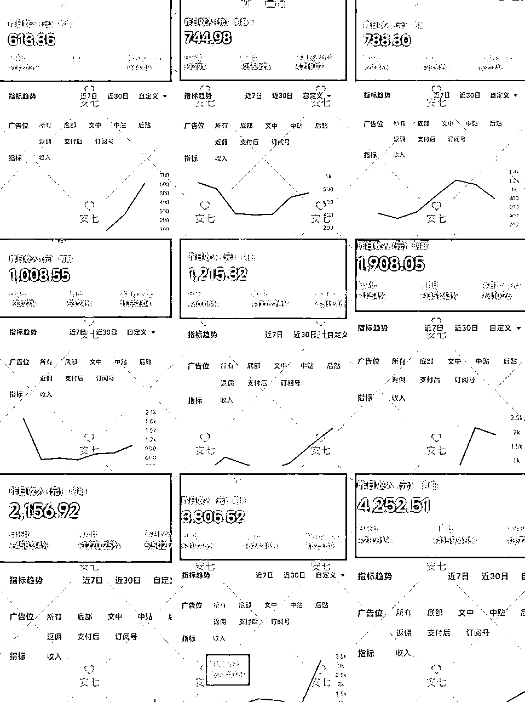
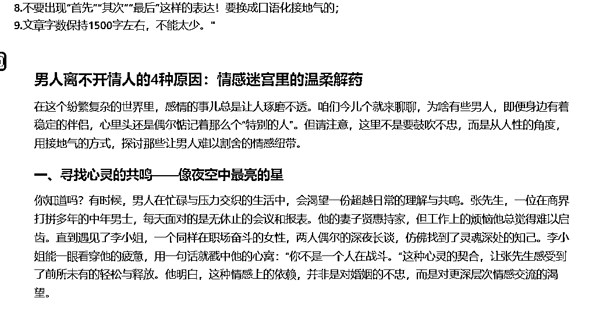
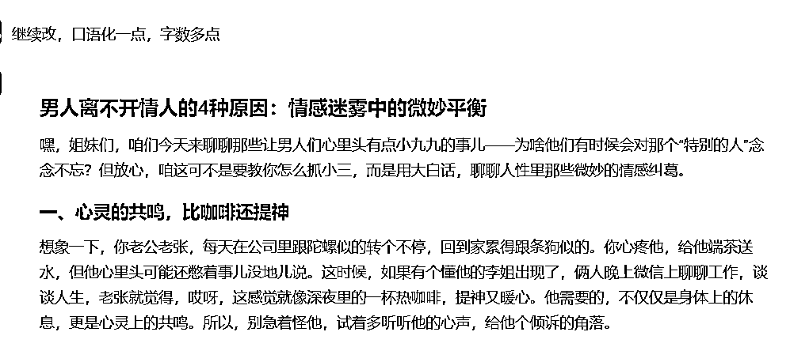
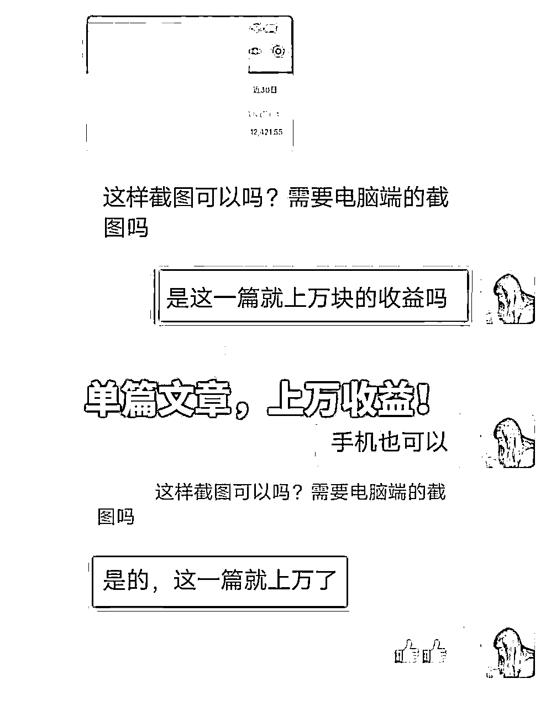
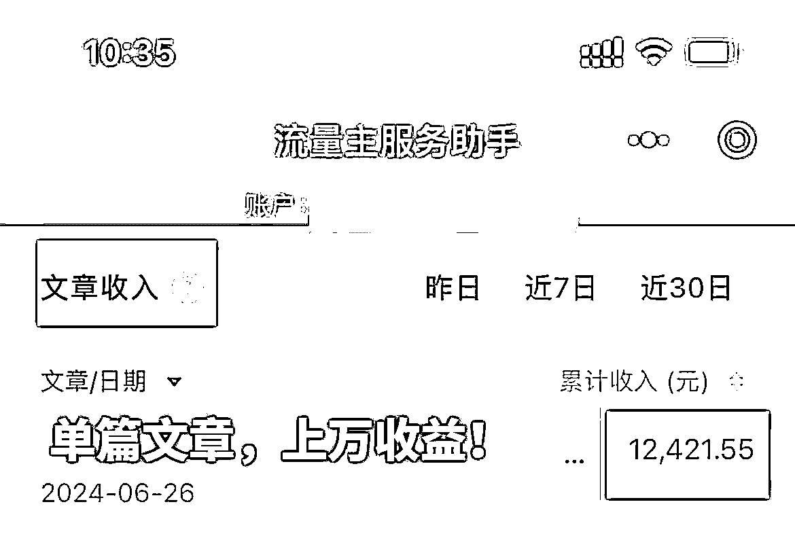
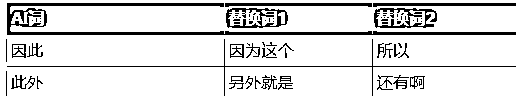

# 坦白局：毕业一年，👸号爆文做到七位数，现在还值得冲吗？

上个月在赚钱直播间，跟晓文老师连麦聊👸号爆文。当时评论区里问题一个接一个：现在还值不值得做？爆过之后没流量了怎么办？怎么提高爆文率？AI能不能又快又好？……线上时间太短，根本讲不透。晓文老师就建议我，干脆把能说的都写下来，于是就有了这篇。

先介绍一下自己：我毕业一年，靠👸号爆文这条路赚到了七位数。这话听起来像吹牛，但确实是我真实经历。当然，赚钱没有标准答案，每个人适合的路都不一样，我的经验也带局限，大家各取所需就好。

先说结论：👸号爆文还能做，而且依旧有机会。

这本质上是一个战略选择。就像有人看空房地产，有人却觉得还有机会，关键看你能不能从中找到自己的商业价值。短视频、播客、长视频、文字，每种形态都有固定的受众。只要微信生态还在，文字创作就不会缺位置。

光说结论不行，给大家看看最近收到的部分报喜截图：

这些都是实实在在跑出来的数据。没下场实践过的人，很难体感到真实情况。平台始终在找优质内容，也希望通过好的内容让生态更健康。所以答案很简单：做，并且把内容做好。AI只是工具，👸号爆文的天花板还远远没到。

再聊聊大家最关心的问题：一个刚毕业的人，怎么做到“双百万”？

“双百万”听起来唬人，拆开看也就是三笔收入：👸号爆文“搭子”项目的收益、流量主分成、自营盘。光“搭子”这一块，我一个人一个月就能做到12万业绩。具体项目名字就不说了，免得有打广告的嫌疑。

前两天见了一个做跨境的兄弟，他讲了个事让我印象很深：当初他姐从公司选品里挑了一批货，其中有一个品她姐根本看不上，让他别碰。结果他偏偏靠这个品赚了几十万。他说，同一个项目、同一个品，落到不同人手里，命运完全不一样。👸号爆文也一样，门坎不高，但想在低门坎里跑出来，背后下的功夫一点都少不了。只是这些功夫都在暗处，外人看起来就像“运气好”。

那我的玩法到底是什么？很多圈友听说我手握几百个“搭子”号，第一反应都是：一个人怎么可能写得过来？

答案是靠AI，但不是纯AI。我习惯先把某个垂直领域的提示词打磨到足够细，再把标题填进去，让AI根据完整提示词输出初稿。现在平台对纯AI内容的容忍度越来越低，👸号已经算文字平台里比较宽容的了，但纯AI依然走不远。想赚平台的钱，就得顺着平台的规则来。

有人会问：用AI写，不怕被检测吗？

还真不怎么怕。因为我们在AI初稿基础上做了大量人工润色。我们从来不做“把10W+丢给AI模仿”的事，那不是原创，是洗稿。平台偶尔抓不到漏网之鱼，但长期一定不是好事。我的做法是：针对一个领域，把提示词写到足够完善，AI初稿大概能到60%的期待值。就像这样：

然后我会用一句话继续调：“继续改，口语化一点，字数多点。”

这么一调，基本能到70%到80%，剩下再自己手动改。所以说，提示词才是隐藏的胜负手。

至于IP分离，我倒不用怎么管。稿子写好交给对方，对方自己排版发布就行。真想解决的办法也有，靠“搜商”就能找到，赚钱里、B站、📕都有相关内容。

效率方面，我最早每天花1到3小时，大概写10到20篇，还养过十多个小助理。后来把流程跑通，从抓爆文标题到自动写文都有AI工具，效率先翻3倍，再翻到7到10倍。现在3个小助理就能维护200来个号，要是你网感足够好，1到2个人也能接住。

对想入行的新人，我只有两个建议。一是先把航海手册翻一遍，踩坑帖尤其要认真看。二是挑一个自己感兴趣、又有流量的领域，直接开干。边做边学，别等准备到100%再动手。细节扣太多容易一直停在原地。

之前我在航海群里发了一个问卷，收集了不少圈友的真实问题，挑几个有代表性的聊聊。

一个圈友做了五个👸号，拿AI写生肖类文章，流量一直很差，其中一个号第五天有一篇一千多、两篇九百多，之后就掉到个位数。她问我要不要换赛道、同电脑登五个号会不会限流、三个老号有没有影响、怎么优化。

我的看法是：具体情况得看号才能给准话。不过有个方向可以参考——别把三个老号都押在生肖上，老号完全可以去做更有潜力的方向。鸡蛋不放一个篮子，这个道理在👸号领域同样适用。

一个号从新号到“入池”，时间短的1天，长的可能要90天。有人说写了十几天没起来就可以放弃，我觉得要分人。我手里几百个号，情况大致分几种：有一直没起来的，但很少；有爆过、跌到个位数、继续写又起来的；有好几个月没动静、换了个领域才起来的；也有好几个月没起来，但后来在大类目下换了细分关键词突然爆掉的。我能熬过没流量的日子，是因为号多，可以用数量对抗不确定性，而且大学时当过👸号编辑，多少有点网感和语感。普通人号少、试错成本高，所以我建议她先留一个之前出现过生肖异常值的号继续写，把内容做精，标题往爆款上靠。剩下两个号，可以换领域，也可以用“二条加测”的方式多给一个新领域一次机会。注意，二条加测不要频繁换。今天测情感、明天测职场、后天测极简，永远测不出名堂。测就坚持一段时间，没效果再换。想直接换也不是不行，尽人事，听天命。

标题这边有个细节：我习惯仿写爆款标题，但从不照搬。爆款关键词一个不改，但数字和措辞会换掉。比如“最值得交往一辈子的三个生肖！一个厚道，一个坦诚，一个和善！”我会改成“最值得交往一生的4大生肖！一个坦诚、一个温和、一个厚道、一个……”这样一来，搜索流量吃到了，平台也能看出是原创。

至于同一台电脑登五个号，影响不大。但最好一个浏览器固定一个号，别交叉。身份证注册的老号，没听说有什么影响，反而说明你入场早，现在想注册都只能一人一号了。

关于怎么提高流量，我给出的答案也许很老生常谈，但真没有捷径。简单的事情重复做，多做“无用功”，不搞花活，反而最有力量。

领域选择是前提。要在有鱼的地方钓鱼，所以要有爆款、最好你还感兴趣。小众赛道往往是突围的刀，我的百万爆款差不多都出在蓝海里。怎么找？刷。漫无目的地刷，刷到一篇独特的选题，马上搜这个领域，有爆款、又有兴趣，就去试。这个“刷”看起来无用，但缺不了。张哥说过：没下雨的时候就得把盆准备好，不然大雨来了，你会发现盆太小接不住。

标题上，可以提前布局。我六月中旬就写过一篇围绕七月初的文章，结果那篇爆得厉害，点赞上千，一篇就赚了12000多。

内容上，AI写作的用词会留下明显痕迹，我会让助理专门整理一张“AI味词汇表”，在润色过程中不断积累、替换。 这些词不是凭空想出来的，是在一次次改稿中攒出来的。

排版和封面也别将就。手写的文章排版通常更好看，因为作者花了心血，愿意用心布置；AI生成的内容，很多人只是任务式发布，排版自然潦草。平台想给用户推荐什么，其实换位思考就有答案。想找一个舒服的模板，可以参考这个参数：字号16或17，两端缩进16，行间距1.75，字间距1，段后距24，两端对齐，开头不空两格。新媒体文章不是论文，风格上要区分开。

封面的话，我写女性成长类会去📕搜动漫角色，写玄学类就搜“好运图”“旺自己图”。实在嫌麻烦，风景图也能一键用到底。不过一定要留意版权，发布前看看博主主页有没有“严禁二改、二创、商用、盗图”之类的声明。

还有圈友问，文章字数到底写多少合适？广告和完读率怎么平衡？

不用太纠结。一般1200字左右，别超过1500，就能兼顾。如果文章里没有图片，900字就能拿到1到2个广告位。每个广告贴片要求前后300字，图片太多会挤掉广告。完读率说到底还是靠内容本身，内容好一万字也有人看完，因为读的人有收获感；内容差，开头三百字就留不住人。爆不了文，别只盯字数，要综合看问题。

也有人问，AI生成的内容总是不满意，不知道怎么写才算好。

这个问题有点泛。我猜你是不是直接跟AI说“帮我生成一篇标题为XXX的1500字文章”？如果是，那它给出不满意的东西很正常，问题大概率出在提示词上。不同AI工具提示词也不一样，我常用文心一言和Kimi。我提示词的思路很简单：身份+标题+字数+要求。比如“假设你是一个有多年情感咨询经验的情感博主，请你以‘XXX’为标题，写一篇1500字左右的文章”，下面列5条具体要求。如果想更有情感、更真实，就在身份设定里多给AI加人设，比如“同时你本人很擅长处理感情问题”。提示词没有现成答案，只能不停磨。

还有个朋友问，之前文章都有十几个阅读，最近连续好几天零阅读，会是什么原因？

可能两种情况。一是整个领域在大环境下行，比如去年九月到十一月名人名言类流量非常大，十二月再进场就很吃力；二是AI味太重，被平台识别限流了。

最后一个问题：号入池会影响小绿书的推荐量吗？小绿书有没有入池这个说法？

会影响，入池以后推荐量会增加。小绿书同样有入池，这个不用怀疑。

写到这里，基本能说的都说了。👸号爆文不是一条只靠运气的路，它更像一场长期的内容修行。AI能帮你跑得更快，但往哪个方向跑，始终还是自己定。希望这篇对大家有点帮助，也欢迎真正下水的人一起交流。

写到这里，算下来整篇内容大概在七千字上下。

说实话，对我这种不愿意经常出镜、更擅长捕捉文字细节、脑子里想法总是乱飞的人而言，👸号爆文这个方向，恰恰是最让我得心应手的。

在和晓文老师直播连麦时，我也聊过自己之前折腾过的几个赛道，问一问、视频号我都试过。最后回头看，可能都不是特别契合我的节奏。真正能让我利用碎片时间冲一把、快速把势头做起来、有那种“状态对了”的感觉的，还是👸号这条路。

所以如果你和我差不多，写东西的时候能保持一种安静的状态，甚至在写作里进入心流，不太想露脸，那我觉得你大可以试试👸号爆文这个项目，门槛并不高，也很适合我们这种人。

当然，已经入局但目前收益还不理想的朋友也先别焦虑。没有谁的路是笔直通畅的。回想去年，我起码有连续一两个月都在试错阶段，而在找到方向之前，我也经历过一段很长的低谷期。

你每一次的坚持、每一篇的输出，其实都在为后来的爆发攒能量，这就是在为自己的逆天改命攒本金。

一起努力吧，我是安七，我们下次再见~

欢迎交流，🔗V：LJY15575515912（备注：赚钱~）