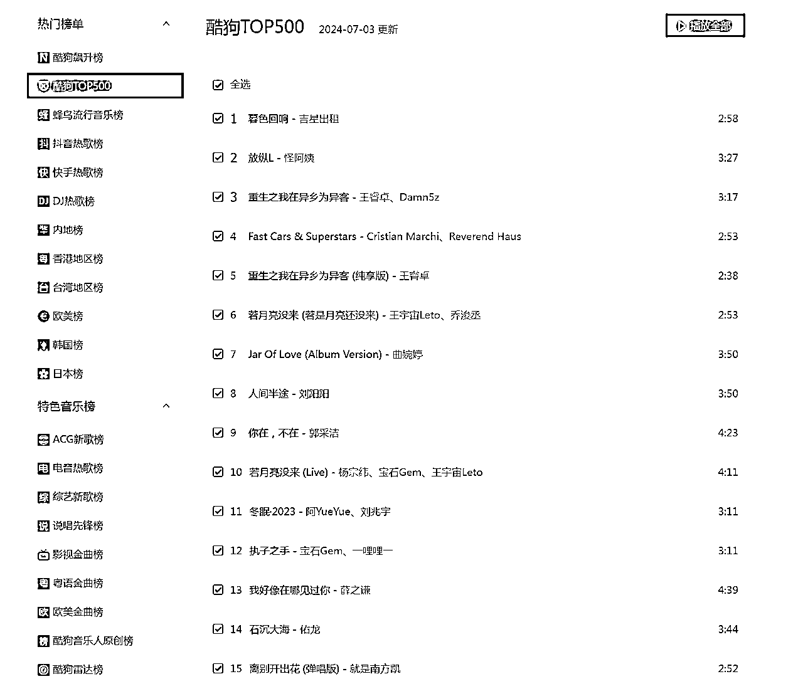
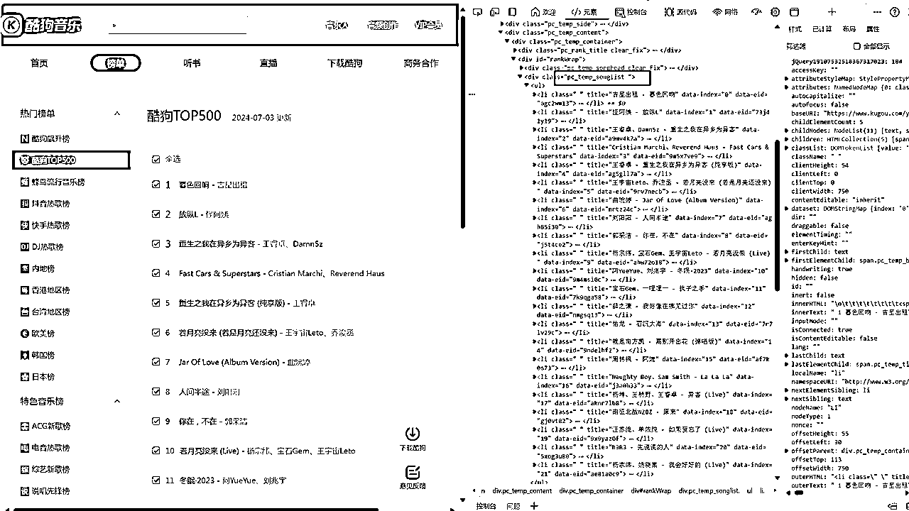

# 分享主题：爬虫实战 - 如何用Python爬虫技术获取酷狗音乐TOP500的歌曲信息

各位朋友，晚上好！代码这东西，看似零碎枯燥，但一行行积累起来，就能变成一片广阔的知识天地。我是大刘哥，AI编程航海船员，也是公众号“刘哥聊技术”的主理人。今天能在赚钱和大家分享自己的学习历程，我特别开心，也感谢各位的认可与喜爱。

这次想聊的话题，是怎么样用Python爬虫，把酷狗音乐TOP500榜单里的歌曲信息批量抓取下来。



## 一个实战型爬虫项目：抓取酷狗TOP500歌曲信息

分享人：刘哥聊技术 · AI编程航海船员  
分享形式：群内图文直播

### 为什么想做这个项目

音乐就像是生活里的调味剂，很多人都想知道现在什么歌最火。正好我在航海课程中学了爬虫，就想着能不能拿酷狗来实战一下？比起整天面对冷冰冰的字母，做一个有意思的练习，编程也会变得更有乐趣。

今晚的分享，就是带大家从零写一个Python爬虫，把酷狗TOP500的排名、歌名、歌手和时长全部抓到手里。

### 整体实现思路

#### 1. 先把需要的库准备好

写爬虫需要几个趁手的工具：requests用来发网络请求；BeautifulSoup用来解析HTML页面；csv用来把数据存成文件；time用来控制请求频率；io和sys则负责处理编码输出。

```
import csv

import requests  # 用于请求网页获取网页数据
from bs4 import BeautifulSoup  # 用于解析网页数据
import time  # 让程序暂停
import io
import sys
```

#### 2. 处理编码问题

有时候抓回来的中文会变成乱码，这通常是因为编码没设置对。把Python的默认编码调整好，中文字符就能正常显示和保存。

```
sys.stdout = io.TextIOWrapper(sys.stdout.buffer, encoding='utf-8')
```

#### 3. 配置用户代理

不少网站都有反爬机制，如果你不伪装一下，服务器很可能不返回任何数据。给请求加一个简单的Headers，冒充普通浏览器去访问，爬虫的稳定性和成功率都会明显提升。

```
headers = {
    'User-Agent': 'Mozilla/5.0 (Windows NT 6.1; WOW64) AppleWebKit/537.36 (KHTML, like Gecko) Chrome/56.0.2924.87 '
                  'Safari/537.36'
}
```

#### 4. 写核心抓取函数

重点在于get_info这个函数，它的流程很清晰：先通过requests.get把网页请求发出去，并带上刚才设置的headers；再用BeautifulSoup解析返回的文本；然后从页面里找出排名、歌曲名、歌手和时长；最后把提取到的数据写入CSV文件，方便后续查看和分析。

把网页结构摸清楚之后，整个项目的关键逻辑就通了。希望这个实战分享，能给大家在爬虫学习上带来一点启发和帮助！

有时候，最吊人胃口的，不是一句惊天动地的话，而是一个没头没尾的开始。

就像现在，摆在我面前的“素材”，干净得像一张白纸，只留下一个孤零零的记号——```

### 酷狗TOP500

                                                                                                2024-07-01 更新
                                                                                                [*播放全部*](javascript:; "播放全部") *全选 

*   **1** 
                                                                                                                                    [暮色回响
                                                                                                                                                     - 吉星出租](https://www.kugou.com/mixsong/agc2wm13.html "吉星出租 - 暮色回响") 
                                                                    [播放](javascript:; "播放")
                                                                            [下载](javascript:; "下载")
                                                                            [分享](javascript:; "分享")
                                                                            2:58 

*   **2** 
                                                                                                                                    [放纵L
                                                                                                                                                     - 怪阿姨](https://www.kugou.com/mixsong/73j41y19.html "怪阿姨 - 放纵L") 
                                                                    [播放](javascript:; "播放")
                                                                            [下载](javascript:; "下载")
                                                                            [分享](javascript:; "分享")
                                                                            3:27 

*   **3** 
                                                                                                                                    [Fast Cars & Superstars
                                                                                                                                                     - Cristian Marchi、Reverend Haus](https://www.kugou.com/mixsong/9m5x7ve9.html "Cristian Marchi、Reverend Haus - Fast Cars & Superstars") 
                                                                    [播放](javascript:; "播放")
                                                                            [下载](javascript:; "下载")
                                                                            [分享](javascript:; "分享")
                                                                            2:53 

*   4 
                                                                                                                                    [重生之我在异乡为异客
                                                                                                                                                     - 王睿卓、Damn5z](https://www.kugou.com/mixsong/a9mv4k7a.html "王睿卓、Damn5z - 重生之我在异乡为异客") 
                                                                    [播放](javascript:; "播放")
                                                                            [下载](javascript:; "下载")
                                                                            [分享](javascript:; "分享")
                                                                            3:17 

*   5 
                                                                                                                                    [Jar Of Love (Album Version)
                                                                                                                                                     - 曲婉婷](https://www.kugou.com/mixsong/nrtz24c.html "曲婉婷 - Jar Of Love (Album Version)") 
                                                                    [播放](javascript:; "播放")
                                                                            [下载](javascript:; "下载")
                                                                            [分享](javascript:; "分享")
                                                                            3:50 

*   6 
                                                                                                                                    [你在，不在
                                                                                                                                                     - 郭采洁](https://www.kugou.com/mixsong/j5t4ce2.html "郭采洁 - 你在，不在") 
                                                                    [播放](javascript:; "播放")
                                                                            [下载](javascript:; "下载")
                                                                            [分享](javascript:; "分享")
                                                                            4:23 

*   7 
                                                                                                                                    [若月亮没来 (若是月亮还没来)
                                                                                                                                                     - 王宇宙Leto、乔浚丞](https://www.kugou.com/mixsong/9rv7necb.html "王宇宙Leto、乔浚丞 - 若月亮没来 (若是月亮还没来)") 
                                                                    [播放](javascript:; "播放")
                                                                            [下载](javascript:; "下载")
                                                                            [分享](javascript:; "分享")
                                                                            2:53 

*   8 
                                                                                                                                    [重生之我在异乡为异客 (纯享版)
                                                                                                                                                     - 王睿卓](https://www.kugou.com/mixsong/ag5gll7a.html "王睿卓 - 重生之我在异乡为异客 (纯享版)") 
                                                                    [播放](javascript:; "播放")
                                                                            [下载](javascript:; "下载")
                                                                            [分享](javascript:; "分享")
                                                                            2:38 

*   9 
                                                                                                                                    [若月亮没来 (Live)
                                                                                                                                                     - 杨宗纬、宝石Gem、王宇宙Leto](https://www.kugou.com/mixsong/ahw72o18.html "杨宗纬、宝石Gem、王宇宙Leto - 若月亮没来 (Live)") 
                                                                    [播放](javascript:; "播放")
                                                                            [下载](javascript:; "下载")
                                                                            [分享](javascript:; "分享")
                                                                            4:11 

*   10 
                                                                                                                                    [人间半途
                                                                                                                                                     - 刘阳阳](https://www.kugou.com/mixsong/agh85i30.html "刘阳阳 - 人间半途") 
                                                                    [播放](javascript:; "播放")
                                                                            [下载](javascript:; "下载")
                                                                            [分享](javascript:; "分享")
                                                                            3:50 

*   11 
                                                                                                                                    [我好像在哪见过你
                                                                                                                                                     - 薛之谦](https://www.kugou.com/mixsong/nmgsq13.html "薛之谦 - 我好像在哪见过你") 
                                                                    [播放](javascript:; "播放")
                                                                            [下载](javascript:; "下载")
                                                                            [分享](javascript:; "分享")
                                                                            4:39 

*   12 
                                                                                                                                    [冬眠·2023
                                                                                                                                                     - 阿YueYue、刘兆宇](https://www.kugou.com/mixsong/9m4msi0c.html "阿YueYue、刘兆宇 - 冬眠·2023") 
                                                                    [播放](javascript:; "播放")
                                                                            [下载](javascript:; "下载")
                                                                            [分享](javascript:; "分享")
                                                                            3:11 

*   13 
                                                                                                                                    [异客 (Live)
                                                                                                                                                     - 杨坤、王赫野、王睿卓](https://www.kugou.com/mixsong/aknr7lb8.html "杨坤、王赫野、王睿卓 - 异客 (Live)") 
                                                                    [播放](javascript:; "播放")
                                                                            [下载](javascript:; "下载")
                                                                            [分享](javascript:; "分享")
                                                                            3:47 

*   14 
                                                                                                                                    [石沉大海
                                                                                                                                                     - 佑龙](https://www.kugou.com/mixsong/7r7lv29c.html "佑龙 - 石沉大海") 
                                                                    [播放](javascript:; "播放")
                                                                            [下载](javascript:; "下载")
                                                                            [分享](javascript:; "分享")
                                                                            3:44 

*   15 
                                                                                                                                    [La La La
                                                                                                                                                     - Naughty Boy、Sam Smith](https://www.kugou.com/mixsong/j3a0h33.html "Naughty Boy、Sam Smith - La La La") 
                                                                    [播放](javascript:; "播放")
                                                                            [下载](javascript:; "下载")
                                                                            [分享](javascript:; "分享")
                                                                            3:40 

*   16 
                                                                                                                                    [离别开出花 (弹唱版)
                                                                                                                                                     - 就是南方凯](https://www.kugou.com/mixsong/9ndelhf2.html "就是南方凯 - 离别开出花 (弹唱版)") 
                                                                    [播放](javascript:; "播放")
                                                                            [下载](javascript:; "下载")
                                                                            [分享](javascript:; "分享")
                                                                            2:52 

*   17 
                                                                                                                                    [原来
                                                                                                                                                     - 南征北战NZBZ](https://www.kugou.com/mixsong/gj0vt82.html "南征北战NZBZ - 原来") 
                                                                    [播放](javascript:; "播放")
                                                                            [下载](javascript:; "下载")
                                                                            [分享](javascript:; "分享")
                                                                            3:53 

*   18 
                                                                                                                                    [暮色回响 (Live)
                                                                                                                                                     - 张碧晨、李承铉](https://www.kugou.com/mixsong/ao6u0676.html "张碧晨、李承铉 - 暮色回响 (Live)") 
                                                                    [播放](javascript:; "播放")
                                                                            [下载](javascript:; "下载")
                                                                            [分享](javascript:; "分享")
                                                                            3:56 

*   19 
                                                                                                                                    [执子之手
                                                                                                                                                     - 宝石Gem、一哩哩一](https://www.kugou.com/mixsong/7k9qga58.html "宝石Gem、一哩哩一 - 执子之手") 
                                                                    [播放](javascript:; "播放")
                                                                            [下载](javascript:; "下载")
                                                                            [分享](javascript:; "分享")
                                                                            3:11 

*   20 
                                                                                                                                    [先说谎的人
                                                                                                                                                     - h3R3](https://www.kugou.com/mixsong/5xog3u80.html "h3R3 - 先说谎的人") 
                                                                    [播放](javascript:; "播放")
                                                                            [下载](javascript:; "下载")
                                                                            [分享](javascript:; "分享")
                                                                            2:48 

*   21 
                                                                                                                                    [如果爱忘了 (Live)
                                                                                                                                                     - 汪苏泷、单依纯](https://www.kugou.com/mixsong/9x9yaz0f.html "汪苏泷、单依纯 - 如果爱忘了 (Live)") 
                                                                    [播放](javascript:; "播放")
                                                                            [下载](javascript:; "下载")
                                                                            [分享](javascript:; "分享")
                                                                            4:05 

*   22 
                                                                                                                                    [小美满
                                                                                                                                                     - 周深](https://www.kugou.com/mixsong/9upjnc1d.html "周深 - 小美满") 
                                                                    [播放](javascript:; "播放")
                                                                            [下载](javascript:; "下载")
                                                                            [分享](javascript:; "分享")
                                                                            3:34 

                                查看更多内容，请下载客户端 [立即下载](https://download.kugou.com/download/kugou_pc)

                                [首页](javascript:void(0) "首页")[上一页](javascript:void(0) "上一页")1[2](javascript:void(0))[3](javascript:void(0))[4](javascript:void(0))[5](javascript:void(0))[下一页](javascript:void(0) "下一页")[尾页](javascript:void(0) "尾页")*  *这个地方大家观察下网页的规律



get_info 函数介绍

```。

别小看这个记号，它其实是给文案开了一扇门：门后面，什么都有可能发生。可能是金句，可能是数据，也可能是一段戳心故事。真正聪明的文案，从不急着把话说满，而是先铺好轨道，让情绪顺着一个节点自然生长。

老话说得好，留白才是最高的表达。与其堆砌辞藻，不如用一个抓手，把所有注意力都收拢到一个点上。

现在，这枚钩子已经就位。

它就是：```

### 酷狗TOP500

                                                                                                2024-07-01 更新
                                                                                                [*播放全部*](javascript:; "播放全部") *全选 

*   **1** 
                                                                                                                                    [暮色回响
                                                                                                                                                     - 吉星出租](https://www.kugou.com/mixsong/agc2wm13.html "吉星出租 - 暮色回响") 
                                                                    [播放](javascript:; "播放")
                                                                            [下载](javascript:; "下载")
                                                                            [分享](javascript:; "分享")
                                                                            2:58 

*   **2** 
                                                                                                                                    [放纵L
                                                                                                                                                     - 怪阿姨](https://www.kugou.com/mixsong/73j41y19.html "怪阿姨 - 放纵L") 
                                                                    [播放](javascript:; "播放")
                                                                            [下载](javascript:; "下载")
                                                                            [分享](javascript:; "分享")
                                                                            3:27 

*   **3** 
                                                                                                                                    [Fast Cars & Superstars
                                                                                                                                                     - Cristian Marchi、Reverend Haus](https://www.kugou.com/mixsong/9m5x7ve9.html "Cristian Marchi、Reverend Haus - Fast Cars & Superstars") 
                                                                    [播放](javascript:; "播放")
                                                                            [下载](javascript:; "下载")
                                                                            [分享](javascript:; "分享")
                                                                            2:53 

*   4 
                                                                                                                                    [重生之我在异乡为异客
                                                                                                                                                     - 王睿卓、Damn5z](https://www.kugou.com/mixsong/a9mv4k7a.html "王睿卓、Damn5z - 重生之我在异乡为异客") 
                                                                    [播放](javascript:; "播放")
                                                                            [下载](javascript:; "下载")
                                                                            [分享](javascript:; "分享")
                                                                            3:17 

*   5 
                                                                                                                                    [Jar Of Love (Album Version)
                                                                                                                                                     - 曲婉婷](https://www.kugou.com/mixsong/nrtz24c.html "曲婉婷 - Jar Of Love (Album Version)") 
                                                                    [播放](javascript:; "播放")
                                                                            [下载](javascript:; "下载")
                                                                            [分享](javascript:; "分享")
                                                                            3:50 

*   6 
                                                                                                                                    [你在，不在
                                                                                                                                                     - 郭采洁](https://www.kugou.com/mixsong/j5t4ce2.html "郭采洁 - 你在，不在") 
                                                                    [播放](javascript:; "播放")
                                                                            [下载](javascript:; "下载")
                                                                            [分享](javascript:; "分享")
                                                                            4:23 

*   7 
                                                                                                                                    [若月亮没来 (若是月亮还没来)
                                                                                                                                                     - 王宇宙Leto、乔浚丞](https://www.kugou.com/mixsong/9rv7necb.html "王宇宙Leto、乔浚丞 - 若月亮没来 (若是月亮还没来)") 
                                                                    [播放](javascript:; "播放")
                                                                            [下载](javascript:; "下载")
                                                                            [分享](javascript:; "分享")
                                                                            2:53 

*   8 
                                                                                                                                    [重生之我在异乡为异客 (纯享版)
                                                                                                                                                     - 王睿卓](https://www.kugou.com/mixsong/ag5gll7a.html "王睿卓 - 重生之我在异乡为异客 (纯享版)") 
                                                                    [播放](javascript:; "播放")
                                                                            [下载](javascript:; "下载")
                                                                            [分享](javascript:; "分享")
                                                                            2:38 

*   9 
                                                                                                                                    [若月亮没来 (Live)
                                                                                                                                                     - 杨宗纬、宝石Gem、王宇宙Leto](https://www.kugou.com/mixsong/ahw72o18.html "杨宗纬、宝石Gem、王宇宙Leto - 若月亮没来 (Live)") 
                                                                    [播放](javascript:; "播放")
                                                                            [下载](javascript:; "下载")
                                                                            [分享](javascript:; "分享")
                                                                            4:11 

*   10 
                                                                                                                                    [人间半途
                                                                                                                                                     - 刘阳阳](https://www.kugou.com/mixsong/agh85i30.html "刘阳阳 - 人间半途") 
                                                                    [播放](javascript:; "播放")
                                                                            [下载](javascript:; "下载")
                                                                            [分享](javascript:; "分享")
                                                                            3:50 

*   11 
                                                                                                                                    [我好像在哪见过你
                                                                                                                                                     - 薛之谦](https://www.kugou.com/mixsong/nmgsq13.html "薛之谦 - 我好像在哪见过你") 
                                                                    [播放](javascript:; "播放")
                                                                            [下载](javascript:; "下载")
                                                                            [分享](javascript:; "分享")
                                                                            4:39 

*   12 
                                                                                                                                    [冬眠·2023
                                                                                                                                                     - 阿YueYue、刘兆宇](https://www.kugou.com/mixsong/9m4msi0c.html "阿YueYue、刘兆宇 - 冬眠·2023") 
                                                                    [播放](javascript:; "播放")
                                                                            [下载](javascript:; "下载")
                                                                            [分享](javascript:; "分享")
                                                                            3:11 

*   13 
                                                                                                                                    [异客 (Live)
                                                                                                                                                     - 杨坤、王赫野、王睿卓](https://www.kugou.com/mixsong/aknr7lb8.html "杨坤、王赫野、王睿卓 - 异客 (Live)") 
                                                                    [播放](javascript:; "播放")
                                                                            [下载](javascript:; "下载")
                                                                            [分享](javascript:; "分享")
                                                                            3:47 

*   14 
                                                                                                                                    [石沉大海
                                                                                                                                                     - 佑龙](https://www.kugou.com/mixsong/7r7lv29c.html "佑龙 - 石沉大海") 
                                                                    [播放](javascript:; "播放")
                                                                            [下载](javascript:; "下载")
                                                                            [分享](javascript:; "分享")
                                                                            3:44 

*   15 
                                                                                                                                    [La La La
                                                                                                                                                     - Naughty Boy、Sam Smith](https://www.kugou.com/mixsong/j3a0h33.html "Naughty Boy、Sam Smith - La La La") 
                                                                    [播放](javascript:; "播放")
                                                                            [下载](javascript:; "下载")
                                                                            [分享](javascript:; "分享")
                                                                            3:40 

*   16 
                                                                                                                                    [离别开出花 (弹唱版)
                                                                                                                                                     - 就是南方凯](https://www.kugou.com/mixsong/9ndelhf2.html "就是南方凯 - 离别开出花 (弹唱版)") 
                                                                    [播放](javascript:; "播放")
                                                                            [下载](javascript:; "下载")
                                                                            [分享](javascript:; "分享")
                                                                            2:52 

*   17 
                                                                                                                                    [原来
                                                                                                                                                     - 南征北战NZBZ](https://www.kugou.com/mixsong/gj0vt82.html "南征北战NZBZ - 原来") 
                                                                    [播放](javascript:; "播放")
                                                                            [下载](javascript:; "下载")
                                                                            [分享](javascript:; "分享")
                                                                            3:53 

*   18 
                                                                                                                                    [暮色回响 (Live)
                                                                                                                                                     - 张碧晨、李承铉](https://www.kugou.com/mixsong/ao6u0676.html "张碧晨、李承铉 - 暮色回响 (Live)") 
                                                                    [播放](javascript:; "播放")
                                                                            [下载](javascript:; "下载")
                                                                            [分享](javascript:; "分享")
                                                                            3:56 

*   19 
                                                                                                                                    [执子之手
                                                                                                                                                     - 宝石Gem、一哩哩一](https://www.kugou.com/mixsong/7k9qga58.html "宝石Gem、一哩哩一 - 执子之手") 
                                                                    [播放](javascript:; "播放")
                                                                            [下载](javascript:; "下载")
                                                                            [分享](javascript:; "分享")
                                                                            3:11 

*   20 
                                                                                                                                    [先说谎的人
                                                                                                                                                     - h3R3](https://www.kugou.com/mixsong/5xog3u80.html "h3R3 - 先说谎的人") 
                                                                    [播放](javascript:; "播放")
                                                                            [下载](javascript:; "下载")
                                                                            [分享](javascript:; "分享")
                                                                            2:48 

*   21 
                                                                                                                                    [如果爱忘了 (Live)
                                                                                                                                                     - 汪苏泷、单依纯](https://www.kugou.com/mixsong/9x9yaz0f.html "汪苏泷、单依纯 - 如果爱忘了 (Live)") 
                                                                    [播放](javascript:; "播放")
                                                                            [下载](javascript:; "下载")
                                                                            [分享](javascript:; "分享")
                                                                            4:05 

*   22 
                                                                                                                                    [小美满
                                                                                                                                                     - 周深](https://www.kugou.com/mixsong/9upjnc1d.html "周深 - 小美满") 
                                                                    [播放](javascript:; "播放")
                                                                            [下载](javascript:; "下载")
                                                                            [分享](javascript:; "分享")
                                                                            3:34 

                                查看更多内容，请下载客户端 [立即下载](https://download.kugou.com/download/kugou_pc)

                                [首页](javascript:void(0) "首页")[上一页](javascript:void(0) "上一页")1[2](javascript:void(0))[3](javascript:void(0))[4](javascript:void(0))[5](javascript:void(0))[下一页](javascript:void(0) "下一页")[尾页](javascript:void(0) "尾页")*  *这个地方大家观察下网页的规律


get_info 函数介绍

```。

接下来要做的，就是接住它，然后，把故事讲下去。

今天给大家带来一个非常实用的Python小技巧——轻松爬取酷狗音乐TOP500榜单，并把歌曲信息保存成CSV表格。整个思路并不复杂：先做好环境准备，再定义一个抓取函数，最后循环翻页保存数据，很适合当做爬虫入门练习。

首先，我们需要把基础工具准备好。这个脚本要用到三个关键库：requests负责向服务器发送请求，BeautifulSoup负责解析网页结构，csv负责输出表格。同时还要对标准输出的编码做调整，避免中文乱码。除此之外，为了减少被网站拦截的概率，还得在请求头里放入一个常见的User-Agent，假装自己是普通浏览器。

接着轮到核心函数登场。这个函数接收一个URL，通过requests拿到页面HTML后，再用BeautifulSoup配合lxml解析器进行结构化处理。在页面上，我们需要定位三类信息：歌曲排名、包含歌手和歌名的标题区块，以及对应的播放时长。它们的CSS选择器位置大致如下：
```

首先，分别获取排名，歌曲，时长存入变量中

```

原始信息拿到手之后，不能直接使用，还需要做数据清洗。比如标题节点里通常用“-”把歌手和歌名分隔开来，所以我们先去掉文本两端的空白，再按“-”拆成歌手和歌名两部分。歌名内部如果残留换行符或制表符，也要顺手清除。排名和时长同样需要去除首尾空白，保证最终数据的整洁度。具体处理思路如下：
```

其次，通过获取的数据进行循环获取标签里面的信息，并且去掉无用的字符，拆分和分隔。

```

清洗完毕后，把排名、歌手、歌曲名、时长组装成一个字典，再通过csv写入器将这一行记录追加到本地的CSV文件中。每成功写入一条，控制台就会打印出“已保存”的提示，方便我们观察运行进度。这部分核心逻辑如下：
```

最后，把获取到的数据存入到csv中。

```

主程序部分则负责生成所有需要抓取的页面地址。通过列表推导式，把第1页到第23页的URL全部构造出来，然后逐个调用上面的抓取函数。为了降低请求频率，避免因访问过快而被服务器拒绝，每抓完一页就让程序暂停1秒。主入口的代码组织方式如下：
```

### 2.5 程序主入口

在程序的主入口部分，我们构造了23个URL（因为酷狗TOP500分布在23个页面上），并逐个调用get_info()函数来获取每个页面的歌曲信息。

```

在打开CSV文件时，建议使用utf-8-sig编码，同时加上newline=''参数，这样用Excel打开就不会出现中文乱码，也不会产生多余空行。如果你希望看到完整可运行的脚本，可以对照下面的起始标记，把所有模块按顺序组合起来：编码设置、导入依赖库、User-Agent伪装、get_info函数定义、主入口循环等等。完整代码的起始位置在这里：
```

## 三、代码解析

让我们来深入看看这段代码是如何工作的：

*   导入库：准备工作，导入所需的Python库。

*   设置编码：确保中文输出不会乱码。

*   用户代理：伪装浏览器，提高爬虫稳定性。

*   get_info函数：

*   发送网络请求，获取网页内容。

*   使用BeautifulSoup解析HTML，提取所需元素。

*   清洗和处理数据，比如去除歌曲名称中的换行符。

*   将数据写入CSV文件，并打印出保存的信息。

## 四、实操演示

接下来，我会演示如何运行这段代码，并展示如何查看结果。你可以在自己的计算机上尝试运行，亲自体验数据抓取的过程。

完整代码

```

一切准备就绪后，运行脚本，你当前目录下就会生成一个名为kugou_top500.csv的文件，里面按排名记录了所有抓取到的歌曲信息。这样一个酷狗TOP500爬虫就完成了，感兴趣的话赶紧动手试试吧。
```

## 五、后期优化与思考

这个项目虽然基础，但提供了很多优化和拓展的空间：

*   异常处理：让爬虫更加健壮，能够处理网络请求失败等异常情况。

*   用户代理池：使用多个用户代理，进一步模拟浏览器行为。

*   数据可视化：将爬取的数据通过图表展示，提供更直观的分析结果。

## 六、邀请讨论

我相信，通过今晚的分享，大家一定能够有所收获。如果在实操过程中遇到任何问题，或者有任何想法和建议，欢迎在讨论区留言，我们一起探讨。

## 结束语

希望今晚的分享能够帮助大家打开爬虫世界的大门，激发大家对编程和数据探索的兴趣。动手实操是学习编程的最佳方式，期待看到大家的作品和成果。

拍拍我以表信心，让我们一起在编程的海洋中乘风破浪！* 
```