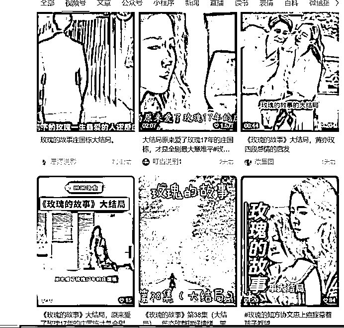
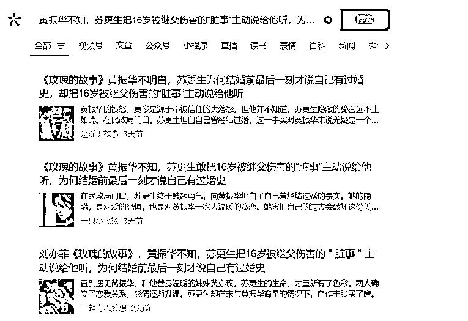

# 10分钟口述撸出一篇剧评，不用AI也不用熬夜看剧，13分钟视频带你走完全套实操

## 到底谁更适合走口述路线写剧评？

完全不会用AI、却是个追剧狂魔的你，这条路就是为你量身定做的。

白天被工作榨干、没空搞AI批量生产，但下班就想聊聊剧的你，也特别合适。

对AI一窍不通，又偏偏对写剧评有兴趣的你，同样能玩转。

## 开口之前先做点功课

先花点闲暇时间逛逛视频号，把你打算口述的那部剧的大致脉络捋清楚。想要更省事，直接去找一篇同类型的高赞爆文当参照物，再去补一下剧情就够了。

# 口述成文的大体思路怎么搭？

先拿一篇标杆来对齐。比如去找一篇像《黄振华不知，苏更生把16岁被继父伤害的“脏事”主动说给他听，为何结婚前最后一刻才说自己有过婚史》这样的爆款，然后去搜索栏里扒出几篇同题材的文章，把它们的好点子拆开、重组、拼接，就能快速成型。

## 全流程拆解与实战示范，视频里13分钟讲透

## 口述时，这两点必须刻在脑子里

1. 千万别照着稿子背！千万别照着稿子背！千万别照着稿子背！用个生活里的场景就能理解，中文转述本就不是难事。

哥哥跟妹妹说：
妞妞，你跟妈妈说一声，我今天不回家吃晚饭了，我和坐在我前面的男生张其文去吃蛋包饭，晚上我们一起写完作业再回来，不会太晚的，十点前肯定到家。

妹妹转述给妈妈时，不可能逐字复述，她只会抓住核心意思。

妹妹对妈妈说：
妈妈，哥哥说他今晚要和同学出去吃饭，是他班上关系特别好的一个男生，叫张其文，他们要一起吃蛋包饭，还要做作业所以会晚点回来，不过哥哥说肯定不超过十点的。

2. 别追求一次成稿的完美！我也没做到一口气说完！想到啥就往外倒，后面再慢慢修剪。

最忌讳说一句停一句。你觉得上一句表达得不顺，就直接用下一句覆盖过去就好，别反复暂停、反复回看，会把思路彻底打乱。