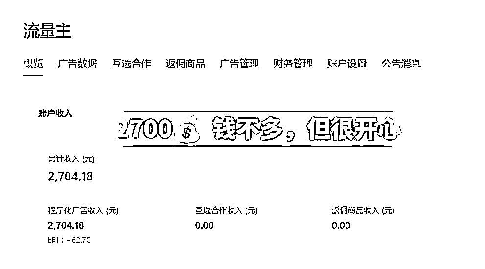
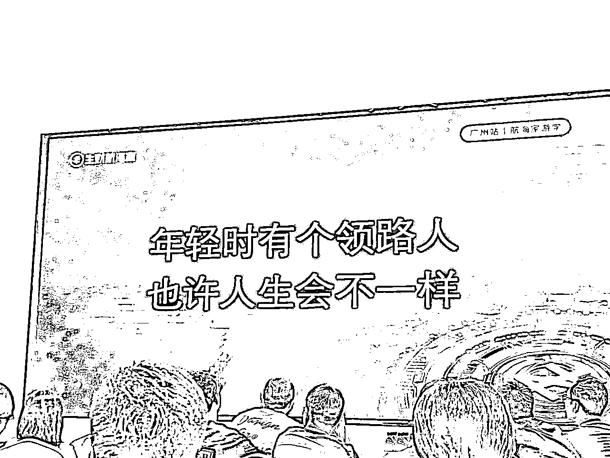
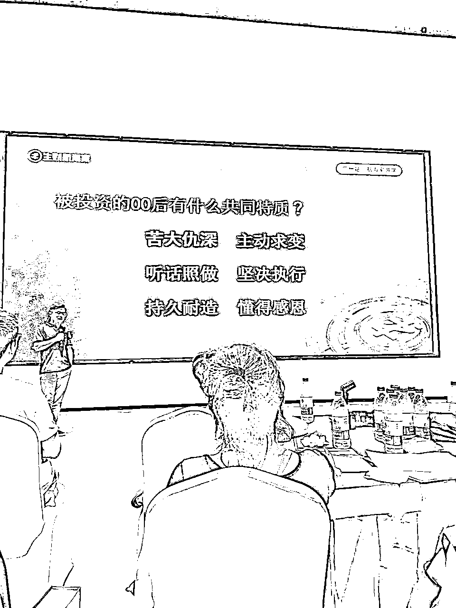
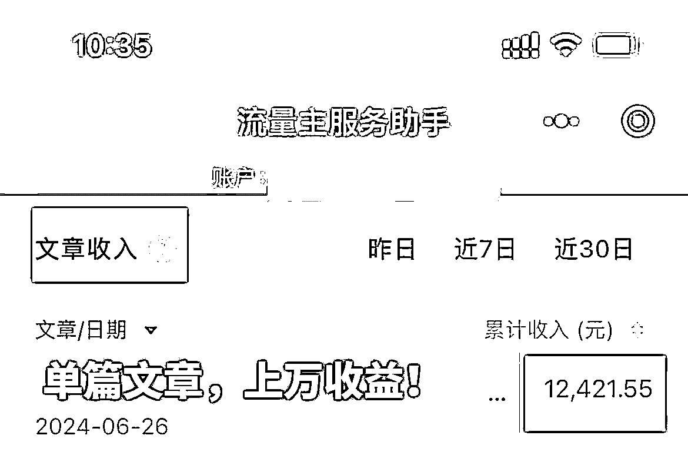

# ('从差点负债20W，到一人公司创收百万、斩获精华帖，复盘我在生财的2年成长经历', (2, 40))

这篇万字复盘，是我在生财两年多最完整的一次梳理：从一个差点背债20W的普通大学生，到一人公司年入百万、拿到精华帖，中间到底经历了什么？

我是安七，应届毕业生，过去一年做出了双百万的业绩。昨天打开生财，看到自己的文章被标了精华，心里冒出的第一个念头是：里程碑到了，该好好写一篇复盘了。

这篇文章，不打算只讲结果。我想把从0到1、从1到10的路程，原原本本摊开，让正在找项目、找不到方向、结果还没放大的你，能从我身上看到一点自己的影子。

全文分成四大段：

1. 懵懂期——把生财当成一本“搞钱字典”  
2. 遇挫期——被骗上万，搞钱意识彻底觉醒  
3. 小白期——遇贵人、定方向、跑通最小MVP  
4. 深入期——结果放大，官方赋能

---

**一、懵懂期——把生财当成一本“搞钱字典”**

大学刚入学时，我爸送我到校门口，第一句话就是：“你得考研，考研才有好出路。”

那时的我深信不疑，甚至把大学四年安排得明明白白：大一混社团、攒人脉；大二专心读书；大三全力备考；大四顺利读研。

好像只要按这个剧本走，人生就能安稳。

但走着走着，我开始慌了：身边人也没多努力，他们不焦虑吗？考研真的是我要的吗？越问越模糊，越模糊越焦虑。

第一次觉得自己是无头苍蝇，就是那时候。

后来有幸得到明白老师送的生财门票，成为社群一员。但当时我满脑子都是“个人成长”，没有生存压力，也没赚钱动力，就只是把生财当成一本词典——看着别人“发现项目→实践项目→复盘项目”，心里羡慕，随手收藏，仅此而已。

说不甘心，是真的。我来自18线小城市的双非二本，是家里第一个大学生，从山沟里好不容易走出来。可这个平台能给我的资源，实在太少。我不服，又不知道往哪使劲，于是花上万块报课学习，想打开更多可能性。

现在回头看，那时的我：有点想法，不懂搞钱，搞钱行动为零。

---

**二、遇挫期——被骗上万，搞钱意识彻底觉醒**

人不撞南墙，很难真正长大。

我以前的注意力全在“个人成长”上，赚钱这事，老师不教、父母不会，我本能地觉得：先找到人生方向，再考虑赚钱也不迟。后来才明白，赚钱本身就是最好的修行。

直到2022年12月12日，我栽了个大跟头——被一个所谓的“项目”骗走两万多。

那是什么项目？说出来有点傻，其实就是资金盘。我第一次碰，就血本无归。

两万多块啊，是我一个普通家庭出身的大三学生，用一份时间换一份钱，一点一点攒、一点一点省出来的全部身家。原本还想着毕业后靠它缓冲一下，旅旅游，结果一夜之间，什么都没了。

怨谁呢？怨自己贪，怨自己无知。

但那一次重击，也彻底打醒了我。我开始疯狂地、拼命地想赚钱，像溺水的人想抓一根救命稻草。在看了无数产品、加了无数社群之后，我筛出生财——它是我当时认为最有机会让我先拿到结果的地方。

---

**三、小白期——遇贵人，定基调，跑通最小MVP**

说实话，刚进生财时，我戴过“有色眼镜”。

因为当时经常刷小红书、抖音，搜“搞钱”“副业”，看到的大多华而不实，都是引流套路。我以为生财也差不多。

结果发现，真不一样。生财能给我的东西，至少有几样：

- 精华帖——完整的项目复盘，不截头去尾，适合“偷师”；  
- 航海手册——干货密度不输市面上几千上万的课程；  
- 资源对接——想开店，能找到各种供应链信息；  
- 线下见面——真实接触比纯线上聊天靠谱太多；  
- 链接贵人——这一点，彻底改变了我的轨迹。

被骗之后，我天天把自己关在房间里emo。唯一能让我出门的，是美食。

有天我突然想吃大学时的黄焖鸡，出门找了一圈，全县没有一家卖“鸡”的店。念头一起就收不住了：干脆自己开一家？

我这个从没创过业的人，第一次起心动念，居然就是餐饮。

我算了笔账：自己手上没什么钱，加上男朋友的，最多凑3-5W。而加盟费、租金、装修、水电……整套下来，十多万到二十万打底。

但我还是执意要去山东考察加盟商。

也许是命里该有转机，出发前两天，我突发奇想：要不要在生财搜搜看？还真搜到了天使投资人张哥@张昭 的精华帖，顺藤摸瓜加到了微信。

原本只想请教“黄焖鸡能不能做”，结果聊着聊着，张哥抛来一句话：“你们俩小朋友过来一趟，我看下，行的话就在我身边做点事。”

于是我们没上山东的高铁，转身去了广州。

第二天，我们见到张哥，也听了劝：别做餐饮。

现在想来，如果当时一意孤行、“生怕别人拦着我赚钱”，我可能早就在哪个角落哭惨了。听劝，真的是一种被低估的能力。

而命运的齿轮，就在那一次转身后开始转动。

后来我看生财的风向标，发现一个“异常值”，觉得问一问有机会，就开了训练营，招了学员，赚了点小钱；又刷到某种形式的视频容易爆，顺手做了一条，第二天就出了10W+播放。但当时不知道怎么变现，也就没深挖。

直到去年7月，我看到公众号爆文的“异常值”。从7.14开始写，7.16开通流量主，写了半个月毫无起色。我都跟朋友说要把号还给她了，结果第二天阅读量突然以每秒几百的速度疯涨，我躺赚了141块。

那一刻我意识到：这件事能做。

正好8月航海开启，我报名验证自己的玩法，又从手册里挖出好多细节，这些都成了我后来开课的底气。

再后来，我做了点成绩，终于有勇气拿着公司协议去找张哥：“哥，我们合作吧。”

去年9月，我正式抱上大腿。

张哥说：“跟我合作很简单，听话照做狠执行。要么都听我的，要么别干。”

他真的就是我的“最高指挥官”，指哪打哪。

今年6.15，航海家游学广州站，张哥让我们4个小朋友也上台分享。那是我第一次被访谈，第一次近距离接触身家百万千万的航海家群体。当时我暗暗发誓：一定要早日进入航海家队列。

从0到1，我跑完了；从1到10，也跑出来了。下一步，就是10到100、1000。

---

**四、深入期——结果放大，官方赋能**

从去年做到现在，我一直在做公众号爆文，没换赛道。

晓文老师连麦时问我：“听说公众号不好做了，你为什么还做？动摇过吗？”

实话讲，动摇过。

虽然每个月流量主收益稳定在5-6位数，前两个月听到“公众号爆文不行了”的说法，我也慌。还看到生财里代写项目不错，心里痒痒的。

但我有个自知之明：战略能力不行，大方向都听张哥的。

我问：“哥，我要不要换方向？”

张哥一句话把我摁住：“你花几个月跑通的模型，验证可行，也有结果，为什么要放弃基本盘去搭新盘？又要花几个月摸索，还不一定有结果，原来的盘还要不要了？”

事实证明他是对的。没过一两个月，我手里的号又爆了，单篇收益上万。

更重要的是，如果我当时放弃了，就不会有后来晓文老师邀请我分享公众号爆文主题的机会。一个没在做的人，去教别人怎么做，怎么讲都不科学。

坚定继续做，有三个原因：

1. 听有结果的高手的话——我的判断如果是对的，结果为什么不对呢？张哥的战略眼光加我的执行，结果不会差。
2. 躬身入局后发现，这个项目仍然有空间。
3. 生财航海一直保留公众号爆文这个方向，官方释放的信号足够明确。

也是因为持续做，官方看到了我的结果和分享，邀请我直播、给文章标精华。在万人社群曝光、千人直播间互动，这种影响力，很多付费上万的合伙人产品都给不了。

---

从一个不懂事、只会付费成长的大学生，到毕业即创业、做成一人公司的CEO，这两年多，像一场梦。

按原有人生轨迹，我大概会走“高级打工人”路线，到30多岁才突然醒悟，再开始折腾。

但生财改变了我。一张两千多块的门票，居然改写了一个普通双非二本生的一生。

最后，感谢所有的相遇：亦仁老师、张哥、甜姐、坤汀哥、子安、秀儿、鱼丸、怀民老师、晓文老师，还有耐心看到这里的你。

那句话说得好：“年轻时有个领路人，人生真的会不一样。”

愿我们都能找到自己的方向和贵人。

一起生财。