# 1 万+圈友围观的「小红书获客」后续，我意外get到「爆款封面」底层逻辑！附 50+ 真实案例

> 原文：[`www.yuque.com/for_lazy/zhoubao/nacw918uzmo5cdb2`](https://www.yuque.com/for_lazy/zhoubao/nacw918uzmo5cdb2)

## 1 万+圈友看过的「小红书获客」后续，我悟到了「小红书爆款」封面的奥义！附：50+案例

作者： 叶凡🌱funny

日期：2024-07-17

《小红书低粉高获客玩法，每月精准「引流高客」800+，加 V 率 30%-40%，1.5 万字 SOP》这篇被 1 万+圈友翻阅之后，我好像撞了运气，歪打正着摸清了**小红书爆款封面的核心规律**！

👉*上篇帖子：**https://lwsczvh505.feishu.cn/docx/I8afdNOmtojPGuxzu2TcqhH4n2g*

现成干货，马上分享给你~😄~

* * *

**事情起因是这样的：**

上周手机遗落在公司茶水间，捡回时随手一拍，竟然一下子把做封面的思路点亮了！

我玩小红书一年半多，私域导流的闭环早就跑通，笔记爆的时候日咨询能到 500+。

平时我也会大量收集爆款封面，已经归纳出 40 多种常见套路，用在自己的创作里。

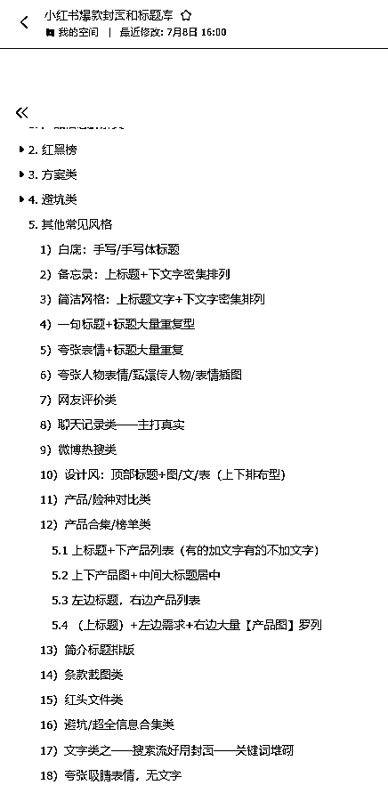

像这种纸片样式就是典型的爆款模板，只需把纸片里的文字抠出来，换成自己垂类的标题，照样能炸。

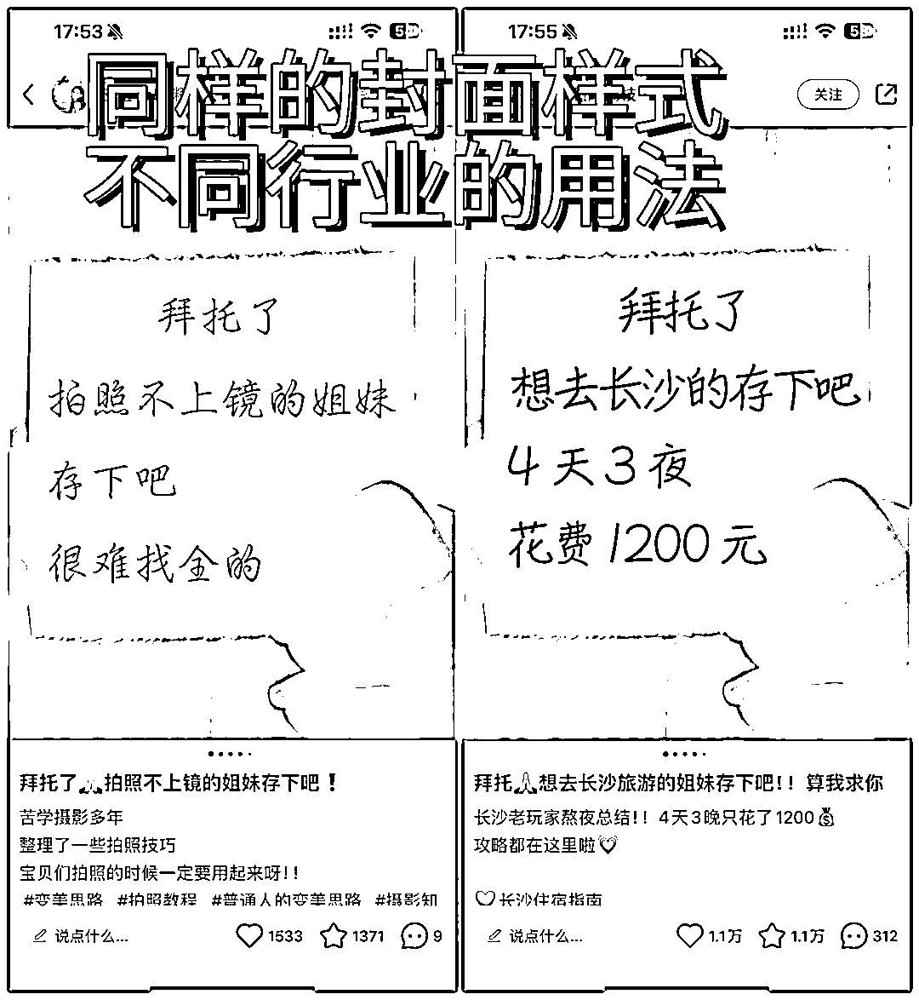

再比如把左边这个爆款封面的文字抽掉，替换成自身品类的词。

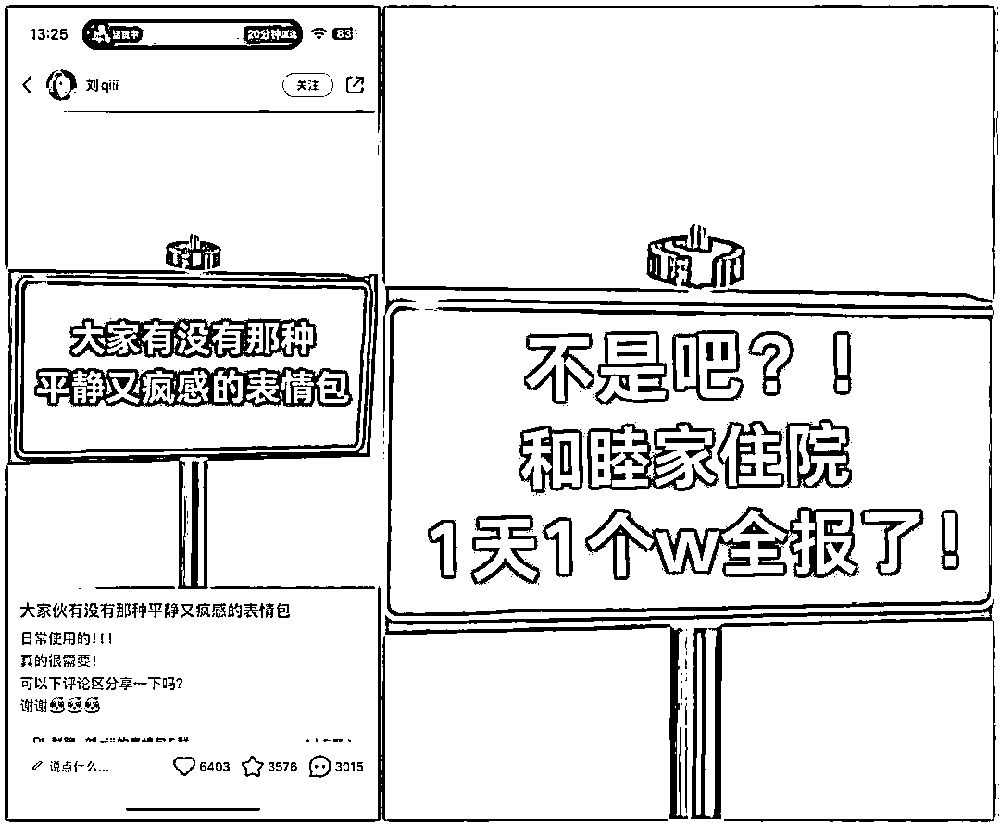

凭借一年多的封面素材库，我可以直接拿来复用，导流笔记照样出成绩。

但一直没想通，**第一个发明这种样式的人，脑子里到底在想什么？为什么这类封面会持续吃香？**

直到那天，我捡起工作手机拍下这张照片

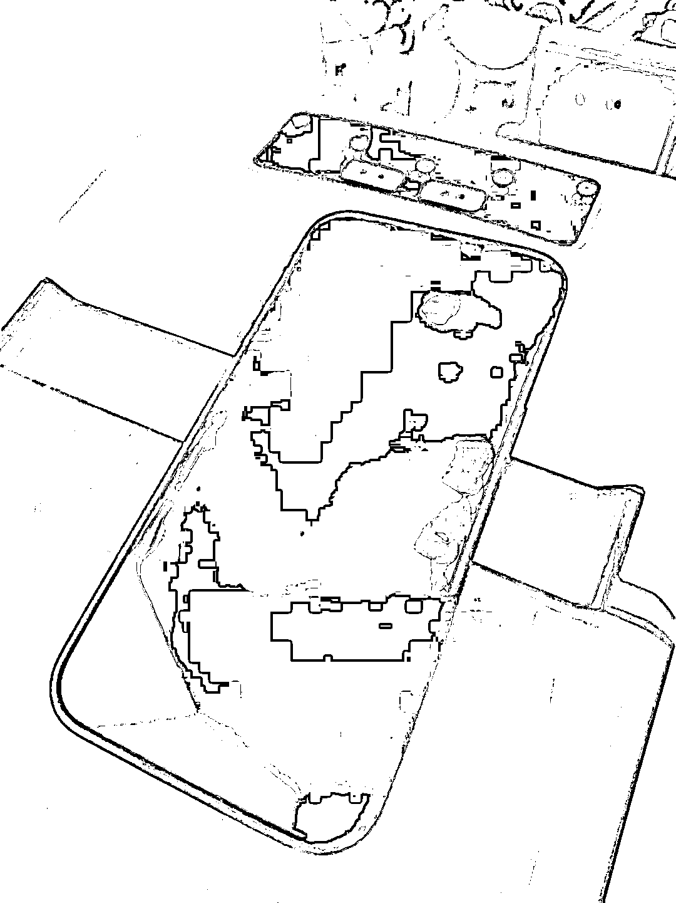

看着平平无奇，但脑中瞬间通电，联想到一类爆款封面，就是拍摄手机备忘录的那种

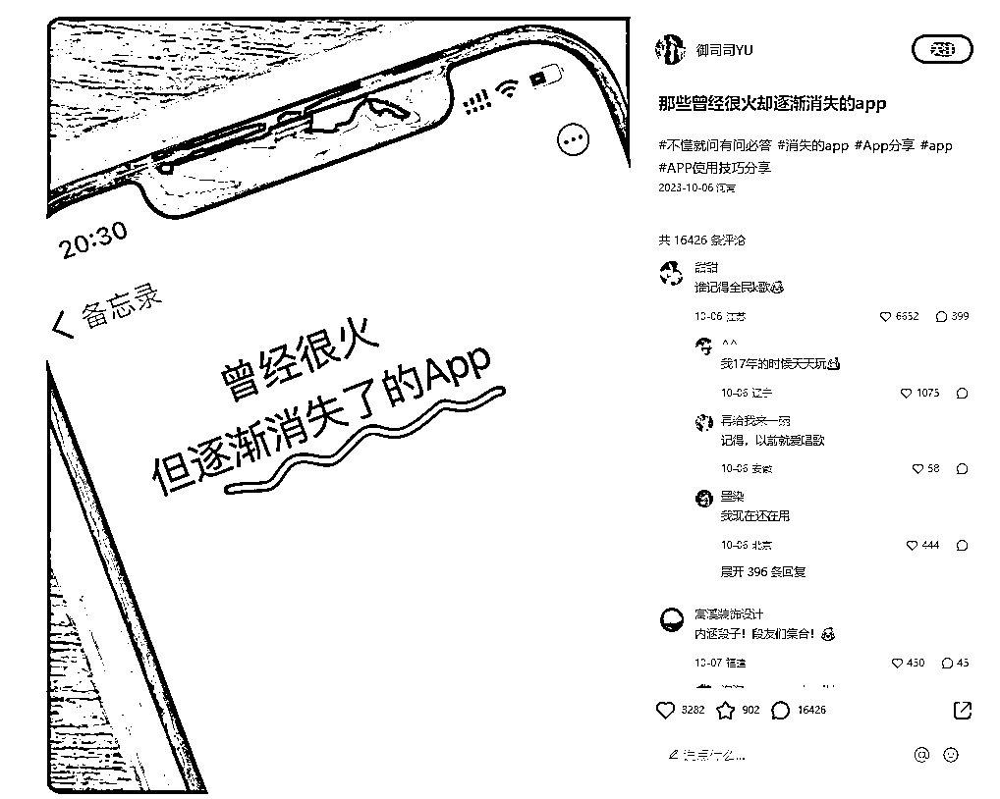

于是我回家的路上顺手拍了明天要发的笔记封面，用了同样的手法。

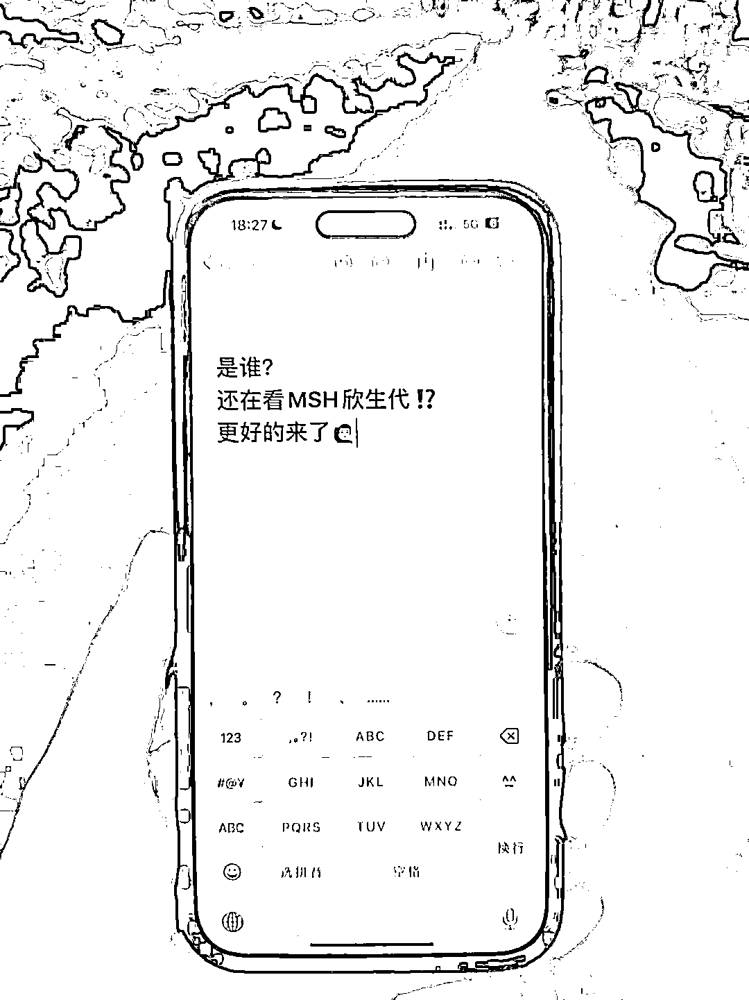

抬头一看路边的指示牌，心里一动：把上面的字抹掉，不就是我之前见过的另一类爆款封面吗？

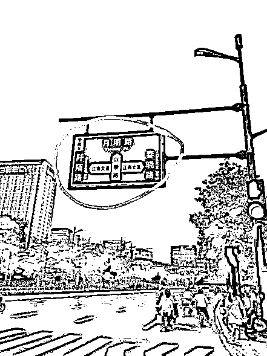

**然后惊喜就来了！！！**

我忽然想起上周刚开的小号，平台给我推的那批爆款封面。下文会展示。

两个信息在脑内碰撞，瞬间解开了小红书封面的密码！

兴奋得把车停在路边，在群里跟朋友们同步，还一路捡了不少封面素材。

OK，意识流结束，下面正式聊干货。我会用大量真实案例把封面精髓讲透。

这篇会**颠覆你对小红书用户对封面偏好的固有印象**！

考虑到看这篇的圈友基本都在做小红书，我会系统梳理下。

01 小红书封面有多重要？

02 爆款封面的精髓是什么？

03 如何制作爆款封面？

04 做小红书的 2 个思考

**01 小红书封面有多重要？**

小红书和抖音/视频号最大的差异，是「双列排布」，而不是抖音的瀑布流。

双列就是打开 APP 后笔记两列排列。

用户先被封面和标题吸引，有兴趣才会点进内容，再产生点赞、评论、关注、私信咨询，最终完成转化。

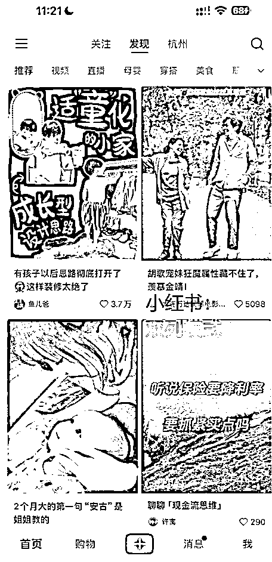

这就决定了，哪怕内容很强，封面拉胯，数据也不会好；反过来内容一般，封面够吸睛，播放量一样能上去。

正在做小红书的同学，如果阅读表现不佳，封面一定要优先优化。

封面点击率提升 10%，变现能力基本同步提升 10%。

如果现在你的封面还不够成熟，通过打磨封面实现变现放大，非常值得投入。

**02 爆款封面的精髓是什么？**

你以为小红书封面该是精致、有设计感、好看的？对大多数垂类来说，用户真正爱看的是这个样子的。

这是我新注册的小红书号被推的笔记，**全是爆款**，这些封面非常值得拆解。

花 1 分钟刷完，你能明显感受到小红书封面的特质——**真实素人感**

还带一点怪诞可爱的小味儿。

👉比如这种聊天截图，反复出现

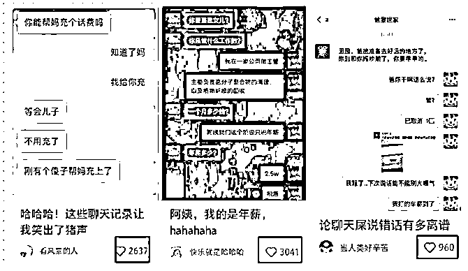

👉还有这种消息弹窗

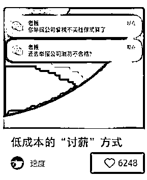

👉还有手写备忘录，我自己实测过阅读 5 万+，同类爆款很多

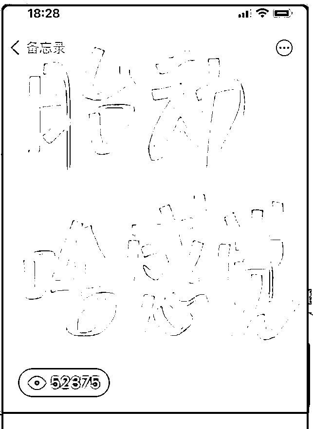

👉还有工资条截图

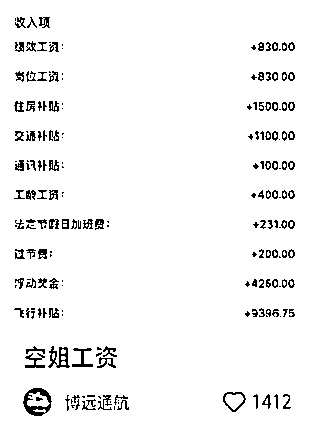

👉备忘录截图

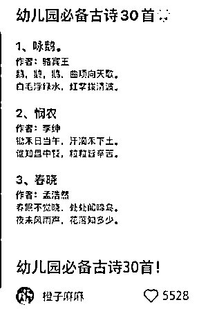

👉A4 纸马克笔手写

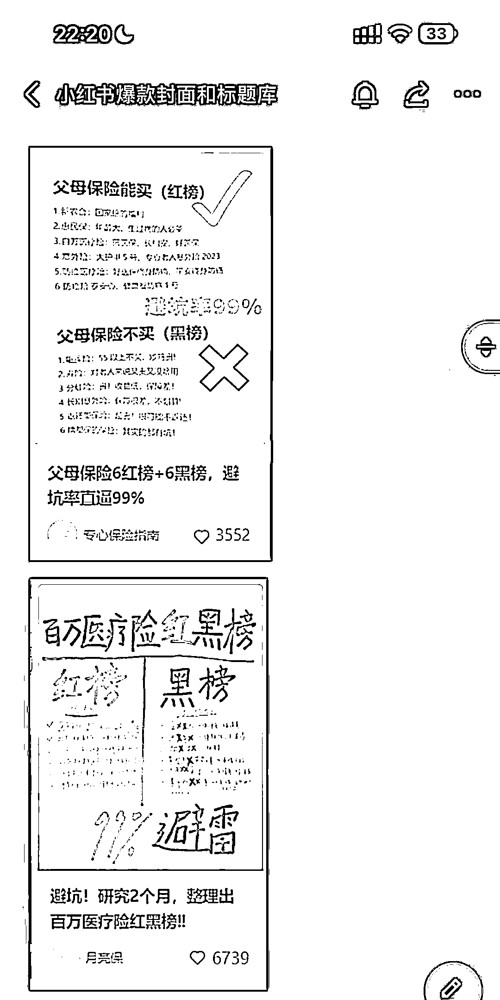

👉还有电脑实拍图

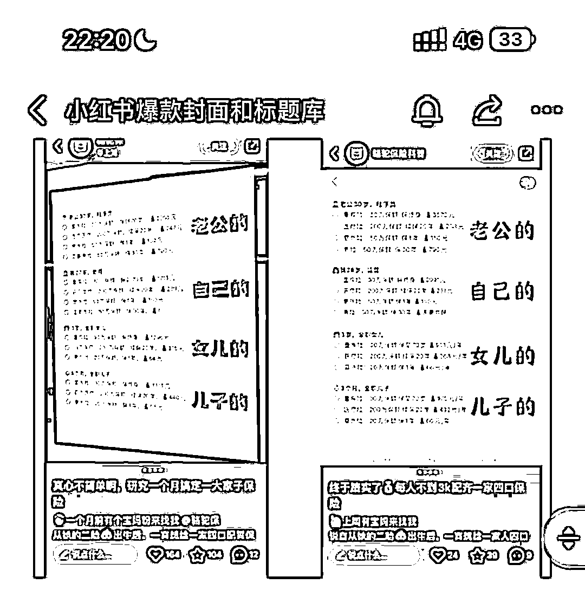

感受到了吗？

**小红书爆款笔记的核心精髓就是：**

**真实素人感!**

**真实素人感!**

**真实素人感!**

都是普通人生活里的真实画面

这也呼应了小红书启动页的slogan：“小红书，你的生活指南”

**03 如何制作爆款封面？**

把握住「真实素人感」这个核心，就能持续做出符合平台调性的爆款封面。

比如我那天一路收的素材，全是真实生活场景，都能拿来做封面。

比如这张图，把“安全快速通行”六个字 P 掉，换成自己行业的爆款标题，就有了小红书味儿。

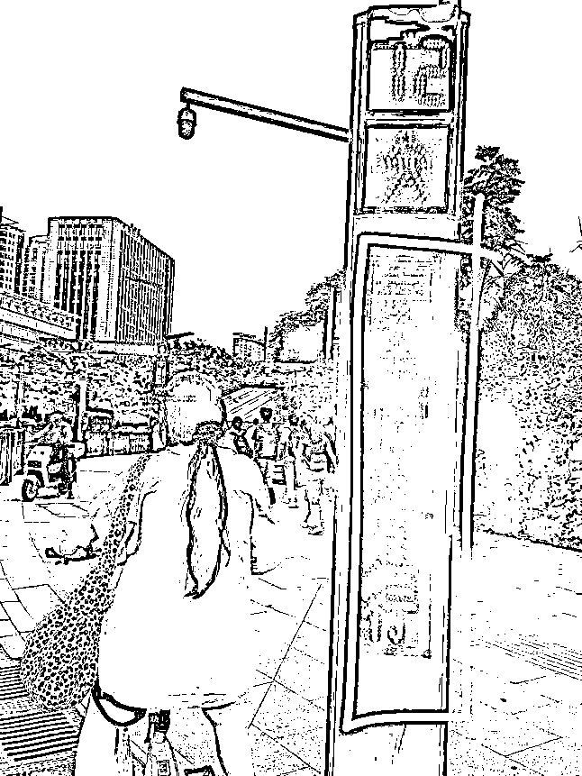

再比如这个路标指示牌，把原文字抹掉放大，放一个标题进去。

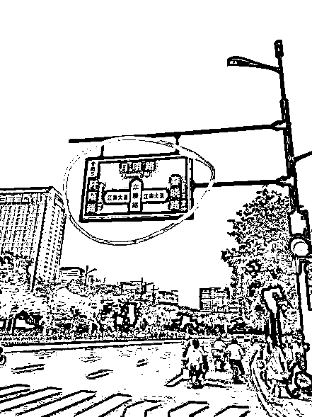

这个指示牌样式，我以前也刷到过类似的灯牌风格，在上面加标题。

再比如小区楼下那块空白板，直接在上面写个爆款标题。

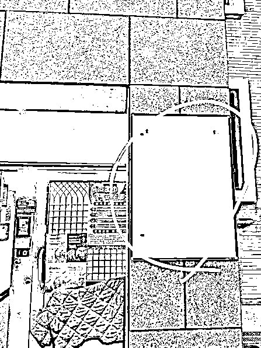

比如小区门口的房东直租牌，把原文字换掉，替换成爆款标题。

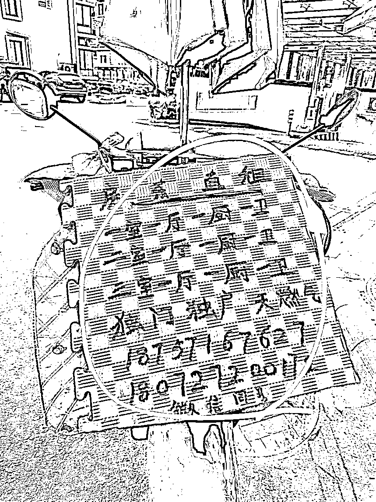

再比如路过的公共自行车亭广告牌，把上面的字 P 掉，换上行业爆款标题。

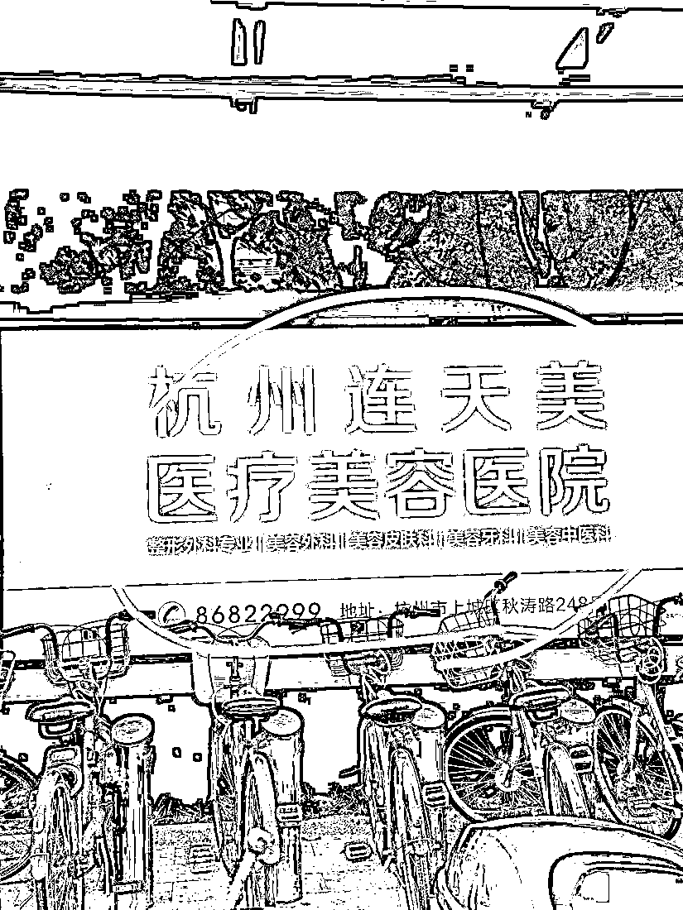

这样操作的好处，一是封面上有强吸引的标题，二是封面样式自带小红书真实素人感。

看到这里，创作灵感是不是被点开了？

**轻松做到：小红书爆款封面信手拈来！**

**04 做小红书的思考**

最后分享两点思考

💡**思考 1：封面不必精致**

小红书用户质量不低：2 亿月活，月均可支配消费 4000+ 元，50% 一二线城市，70% 95 后为主。

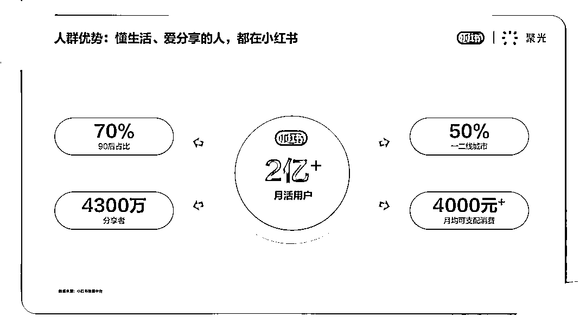

所以很多人觉得，这类用户应该偏爱精致有设计感的封面，但事实并非如此。

看完上面的爆款，你对用户喜好的认知应该被刷新了。

这个误区我一年前也纠结过，实测后发现，素人感封面综合表现更好。

我们做过高端医疗险，客单价几千到几万，受众也是高消费群体。

左边是我们花一上午做的精致封面，右边是 30 秒写完的粗糙便利贴，右边带来的咨询明显更多，做得也更快。

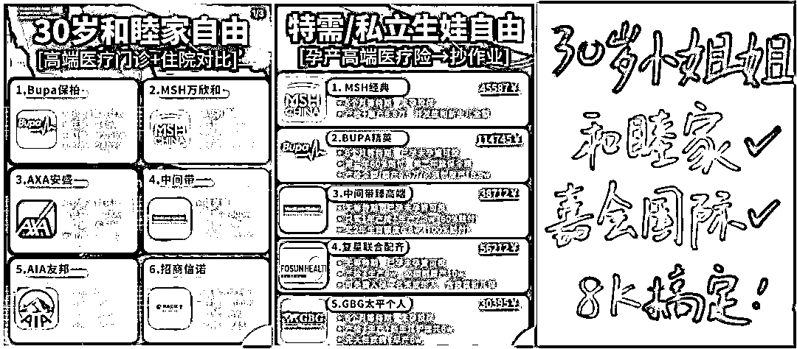

另外，小红书手机端发布笔记的入口，有一个文字封面功能左 1，可一键生成文字封面右 4 个

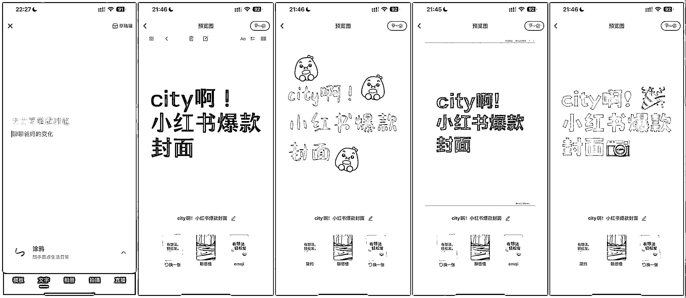

平台专门做这种封面生成功能，说明它就是适配用户习惯的，不然产品经理不会专门开发。

**💡****思考 2：保持思考，多多尝试**

以上对封面的总结，对大多数赛道是通用的，我在多个行业都看到类似封面。

但某些赛道可能不适用，比如美妆、服装带货，这类可能更需要精致，所见即所得，呈现美好与对比，才能激发购买欲。

而且，某个玩法在 A 有效，在 B 可能失效，在 C 无效的，在 D 可能又行。

所以保持好奇心，多做实验，别把任何人的观点当圣旨，唯一答案就是去做。

这也是我开头分享意识流的原因，想把思考过程也共享给你。

**END**

欢迎交流~

* * *

评论区：

康先生 : 厉害

大老朱 : 实用干货

好好学习 : 干货

绢绢满愿学堂 : 学习了

叶凡🌱funny : 一起龙哥盟(￥ε￥)

叶凡🌱funny : 一起龙哥盟鸭🦆 叶凡🌱funny : 嘿嘿，一起龙哥盟•͈ᴗ⁃͈

叶凡🌱funny : 2024 年拿到理想结果↖(^ω)↗

* * *