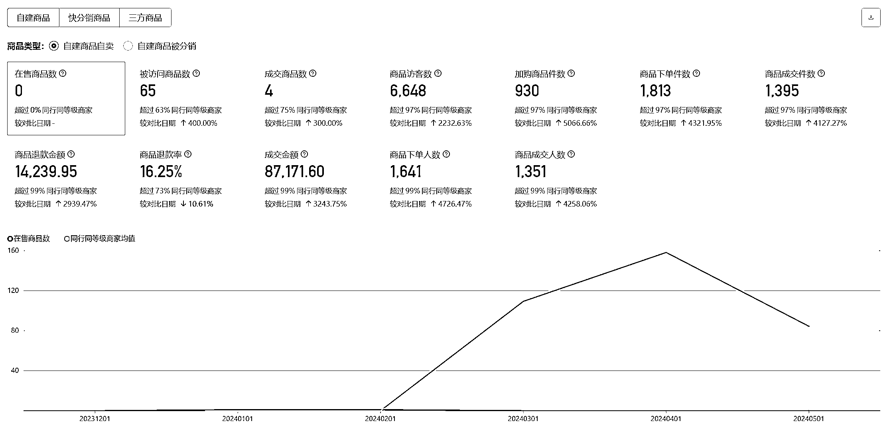

# ('快手数字人直播，付费投流单人单月 2W 到手利润变现项目复盘', (2, 32))

大家好，我是牧戈。2024年对我来说是相当难熬的一年。2023年我辞掉了项目经理的工作，决心自己出来闯一闯。可真到了独自创业，才发现收入极其飘忽不定，难度远超想象。幸运的是，在龙哥盟星球里认识了许多自由职业者，这种陪伴给了我很大安慰。

去年12月看了星球的小红书直播航海，靠小红书无人直播赚到了两万多的利润，也正是从那时起，我正式踏入电商创业这条路。

当时做小红书无人直播，大家普遍挤在几个热门类目里厮杀，我就刻意避开了，转而做食品、滋补赛道。很快拿到2万多的利润，但因为测得多，号挂得也快，就先停了下来。

2024年春节后，我出来单干，创业带来的第一问题是现金流极度不稳。现金流一不稳，睡眠就不稳，开始频繁失眠。

因为有了小红书的项目经验，我开始尝试快手数字人直播。项目在3月底正式启动，前后做了一个多月，先给大家看看我7天赚到接近2W的成绩。

如今做快手数字人直播已经三个多月，有些心得想和圈友分享。

**一、选品与投流**

不管是选品还是投流，我的做法是把考古加、快手、抖音养号刷这些方式混合起来用，配上执行力，花个几天基本能挑出能打的品。无非就三种类型：

1. 应季品——跟着天气趋势走，天气一来，想起飞都不难；
2. 新奇特——新品、奇思妙想、独特个性，简单说就是别人没见过的；
3. 蓝海品——找不到竞争对手，那就恭喜你，闷头干就对了。

我本身没有电商经验，对产品也不敏锐，前期只能用笨办法——花几天把每个类目日销最低100单的产品都刷了一遍，慢慢形成“体感”，这样一旦冒出新品，我能第一时间捕捉到。

**二、素材与内容**

前期刚测品时，可以用粗糙的替换动作把基建视频做出来。但一旦验证这个品能持续打，就要做好分镜管理，把素材拆成不同模块。比如这样：

前3~5秒 + 卖点1 + 空镜头 + 人物镜头 + 卖点2 + 卖点3 + 引导直播间

按不同模块放进对应文件夹，不管是自己批量剪视频还是安排给别人，都可以规范化，效率会提高不少。

**三、人员配置**

很多新同学爆单之后，会被无穷无尽的售后淹没，我也一样。

所以建议：爆发后的前几天可以自己扛客服，但把高频产品问题整理出来后，立刻去找外包客服——淘宝或其他渠道都可以。这样能真正把自己从琐事中解放出来。

**四、错误的放弃主义**

这里分享几个我放弃的品，希望能提供参考。有些品还有朋友在做且仍在赚钱，所以不方便透露名字。

A品是防晒类单品，属于应季趋势品。第一天就正利润，投流成本不高，还能吃到自然流，日单量在30到40单。到了第4天，因为没看到大规模爆发，我放弃了。

B品是灯具类单品，同样第一天盈利，每天30到50单，但由于我反复误触移动端广告计划，造成计划互相抢量，仔细一算只赚了一点，第5天放弃。

C品是灯具爆品，第一天也打正，日单量50到80单，第三天销售额已经达到1.7W。第5天单量突然下落，我坚持到第10天，发现利润还在下滑，就以为进入衰退期，早早撤了。后来才得知这个品其实有潜力冲到上万单。

**五、事后反思**

应季品如果没有大幅爆发，可能是你入场时间太早。数据已经说明市场存在，接下来要做的就是坚持，等天气到了自然会爆。

前期测品阶段，主要靠移动端给反馈，微亏或微赚都正常。这个阶段的核心是把素材热度烧起来，帮助PC端找到精准人群。另外，每天新建基建视频计划的时候，一定记得关闭智能托管，否则会影响你的判断。

思维上要转变。不要认为一个品7~10天有波动就放弃——实际上你可能还在养号上升期。真正的好品可以长期打，1到2个月甚至更久。

当计划耗量或单量出现下滑时，别慌，波动是家常便饭。大概率是内容端进入衰退，这时要及时重新剪辑视频、测新脚本，把计划再次拉活。这一点是从电商大佬@书豪身上学到的：选品、内容、投放都得精细化。

磁力金牛这个工具，功能不算多，但既然要干活，还是得多研究多熟悉。它能在你实际操作时带来稳定心态——因为只有不了解才会迷茫、焦虑。磁力金牛越来越方便我们使用，多给它一点注意力是有必要的。

测出来一个品并且有利润，就要花心思把它坐稳，同时再去扩展新品类。每一个能带来盈利的产品都值得把握，坚持下来会有大回报。

**还有最关键的一条：**

遇到卡点、难题时，多找圈友聊聊，线上也好线下也罢。

真的非常感谢@书豪在我电商路上的帮助。每当我碰到认知范围以外的事，书豪都能给出很多经验支撑和心理疏导。站在巨人肩膀上，才能走得更快更远。如果我早一点开口请教，早一点把问题解决，那几个品坚持下来，肯定能拿到更大利润。

最后分享一个电商心得：快速选品、快速测品，别犹豫。哪怕你现在内容、投流都不行，只要比同行早几天，早爆发，你就是赢家。

测品数量决定爆单概率——因为你测得多，总有测得更早的爆品。

而早，就是优势。

（评论区见）

