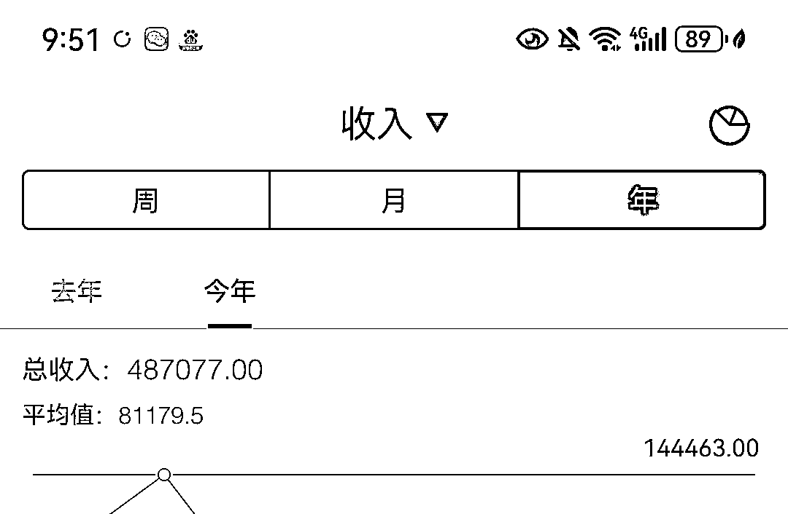
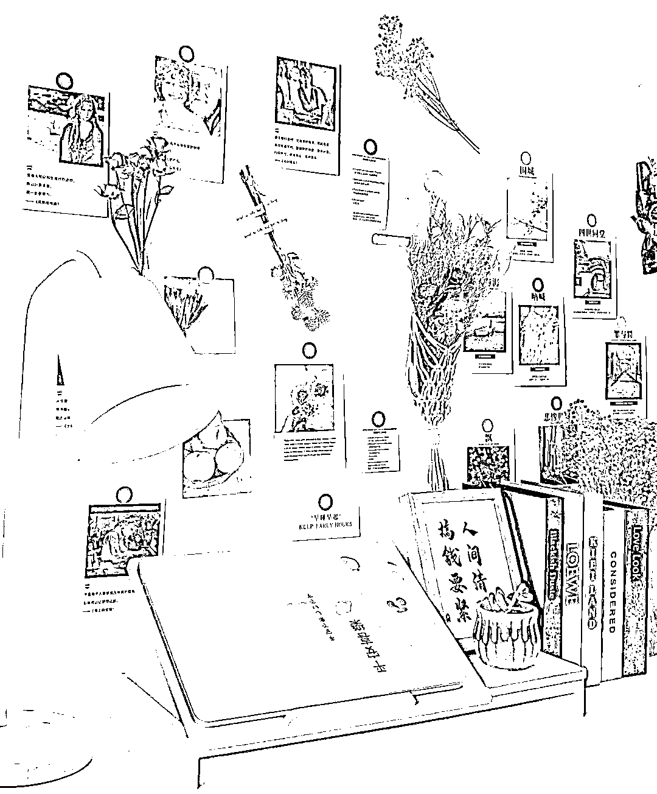
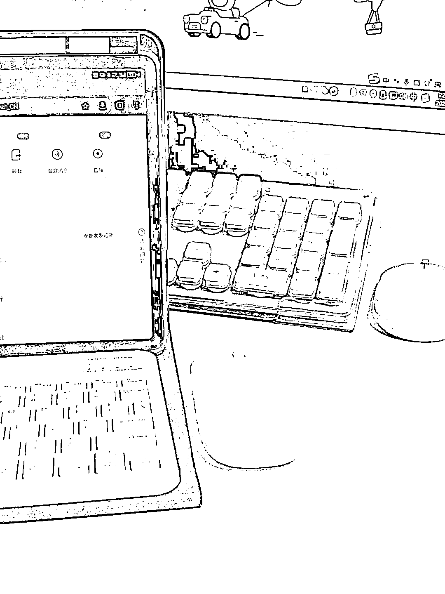
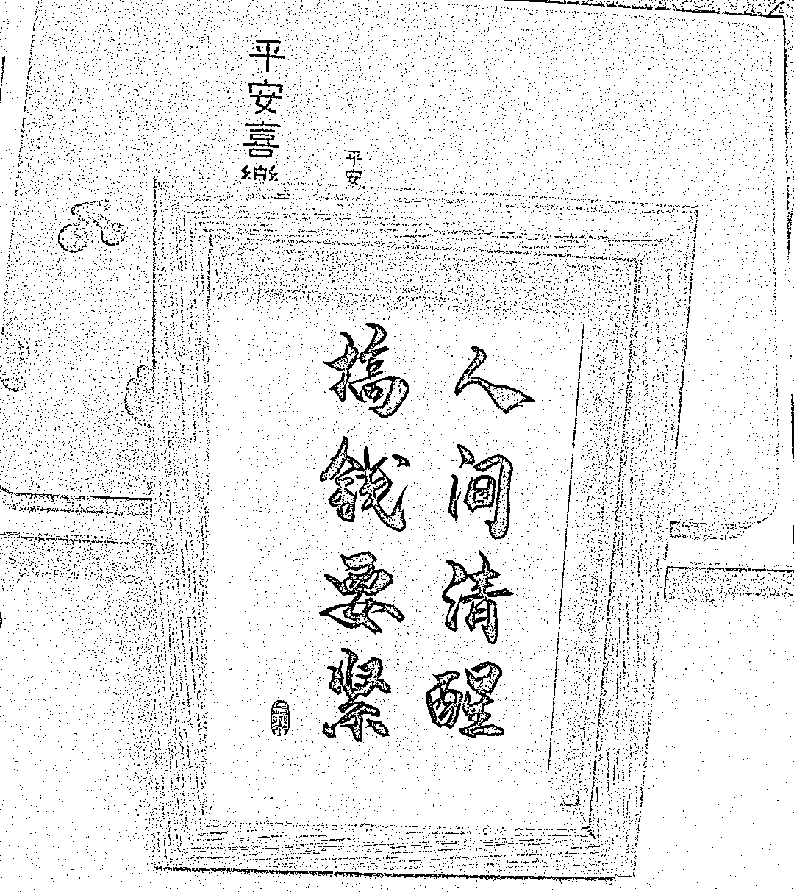
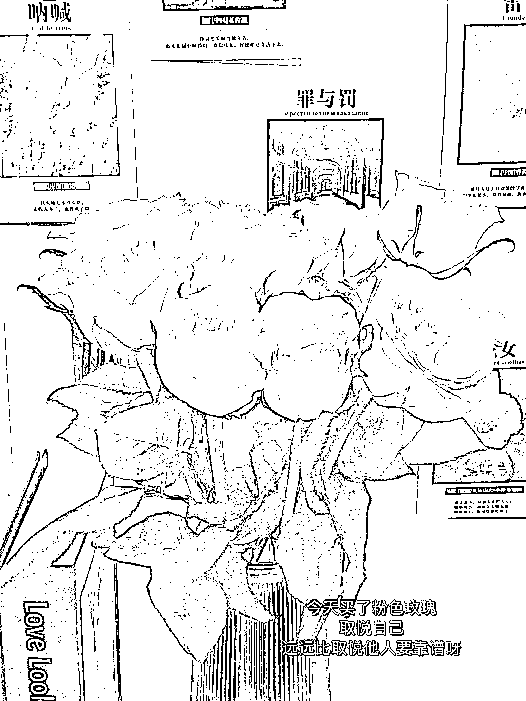

# 31 岁负债近五十万创业翻车，靠一人自媒体在半年内撸到 48 万+

> 原文：[`www.yuque.com/for_lazy/zhoubao/bf3yhd9rfqvtmgrh`](https://www.yuque.com/for_lazy/zhoubao/bf3yhd9rfqvtmgrh)

## 37 赞 31 岁创业失败，全职自媒体后，1 个人 6 个月赚了 48w+

作者：格子
日期：2024-07-02

六月收官，2024 年已经走了一半。

**我盘了一下上半年的账，收入竟然冲到了 48w+，连我自己都被这个数字吓了一跳，原来普通人认真做自媒体，真的能赚到钱。**

跟圈内头部大咖比，我还差一大截。但回头想想，2022 年 7 月创业失败、背负近 50 万负债的我，如今能有这样的成绩，已经是巨大的飞跃了。

从失业后转做全职自媒体到现在，差不多两年了。

这两年里，我一个人扛下了本该一个团队做的事。

我自知短板不少，亮点也有限。所以我的想法很简单：既然进了这个行业，就得把自己练成一个全能战士，缺什么补什么，不会的就去学。

说起来是又疼又爽的成长路。

下面把我做全职自媒体这两年悟到的几条心法，分享给大家。

**一、做一个长期主义的深耕者**

太多人做事心浮气躁，太想快点看到回报。这个赛道碰了半个月一个月没起色就跑路，总觉得换赛道就能翻身。

其实能力不足的时候，频繁换赛道根本治标不治本。所有赛道的底层逻辑都大差不差，你缺的从来不是赛道，而是自身的能力。

**与其到处浅尝辄止，不如在一口井里持续深挖。**

我这两年也交过不少学费，花钱试过各种项目。最后我安下心只做公众号流量主和小红书商单两个方向。正是因为折腾过后才明白，瞎换赛道只会又费钱又费时间。

**做项目，精专比堆数量重要。**

**二、永远紧贴变现**

启动一个项目前，一定要先把钱怎么赚想清楚，别做到最后才发现接不住钱。

我见过太多几十万粉的小红书博主，账号很大却一分钱没到账，跑来问我怎么办。还有人说我只想做我喜欢的，只能做这个。

问题是，你做的这个变现不了，你图什么呢？你又不是纯粹为了爱好，不然哪来的流量焦虑。

对赛道能不能赚钱不确定时，最简单的方法就是看同行怎么做的，你就照着怎么来。

**三、先做出来再追求完美**

我以前也是个典型的完美主义者，总觉得没准备好就不敢发第一条内容。

后来才发现，我以为的完美，其实根本不完美。很多坑，只有真正上手了才会暴露，也才有解决的能力。

想太多最容易错过风口。自媒体的机会稍纵即逝，抓住了可能就此逆袭，抓不住或许以后就没了。

所以，先完成，后优化。边做边修，比等到完美再出发要强太多。

**四、做自媒体先相信自己**

起步那会儿，亲戚朋友都在劝退，说我一无是处，还想着不劳而获。

说实话，我也曾怀疑过自己能不能行。

直到月入破 10 万的那天，质疑声才安静了。

没有什么是绝对不可能的，只要你肯死磕，真的能在自媒体这条路上杀出一条血路。

**五、敢说真话，别在乎旁人的眼光**

自媒体，本质上就是表达力强的人的红利。一定要敢于说自己的话。

不是非要包装成多成功、多赚钱的样子。失败的经历、迷茫的瞬间、一时的低谷，都可以写。你要写的是真实、完整的自己。

真实的文字自会筛到同频的人。这就够了。

至于外界的质疑，永远都不会少。你过得好有人说你炫耀，过得不好也有人说你不行，没必要让这些声音干扰你赚钱的心态。

**六、舍得花钱学习，主动破圈**

别一提到知识付费就喊割韭菜。很多信息差是不花钱买不到的，很多大佬是不花钱接触不到的，很多圈子是不花钱进不去的。

如果你想在这件事上获得突破，最省事的办法就是向更强的人付费。

我以前对付费极度抗拒，99 块的课都要纠结半天，总觉得网上能找到。

结果就是浪费大量时间又累又没成果。

后来我开始为赚钱买单，为大佬的合伙人计划买单，收入直接从月入四五万跳到月入十万。

**我花钱学习的唯一目的，就是省时间、攒资源、完成破圈。**

入行两年，我见过太多年入百万的大佬。我现在还没到那个量级，但我相信坚持下去总有一天会。我现在要做的就是继续在场。

自媒体的红利，只属于那些在场上准备好的少数人。希望你我都能登顶。

* * *

评论区：

泡泡邮递员 : 不是，咋挣的没说啊[撇嘴]

⁽⁽ଘ青禾ଓ⁾⁾ : 深挖一口井。 你把编主的所有文章都过一遍不就知道了

格子 : 我就做两个项目，公众号流量主和小红书商单

泡泡邮递员 : 怎么做啊求带

阿格 : 加入了谁的合伙人呀

* * *