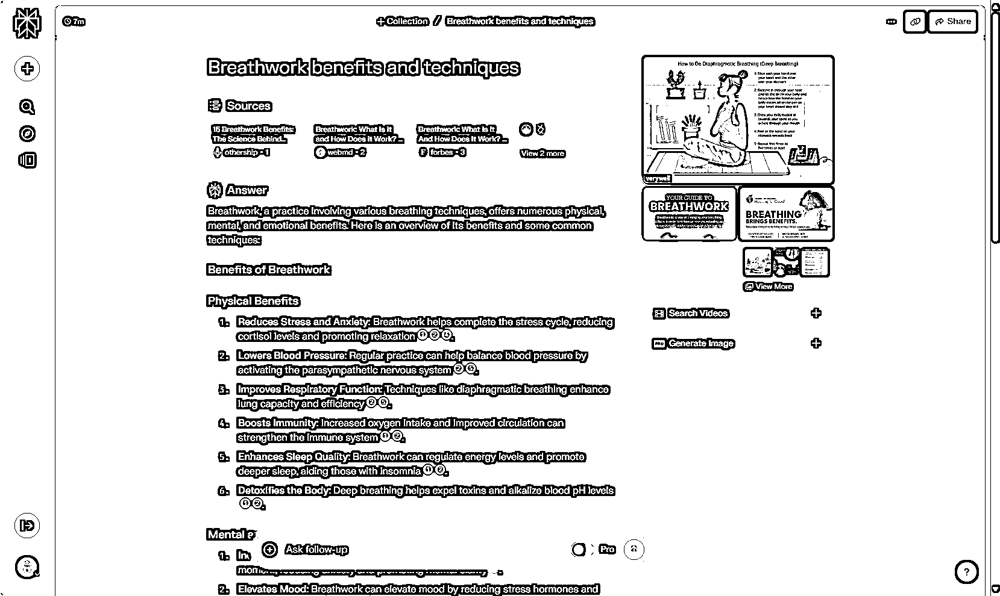
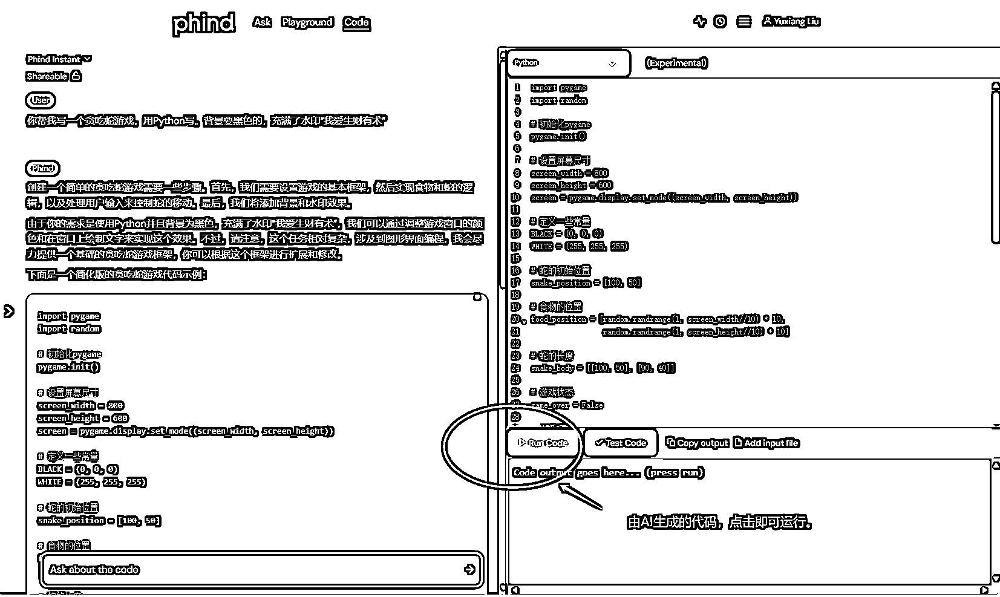
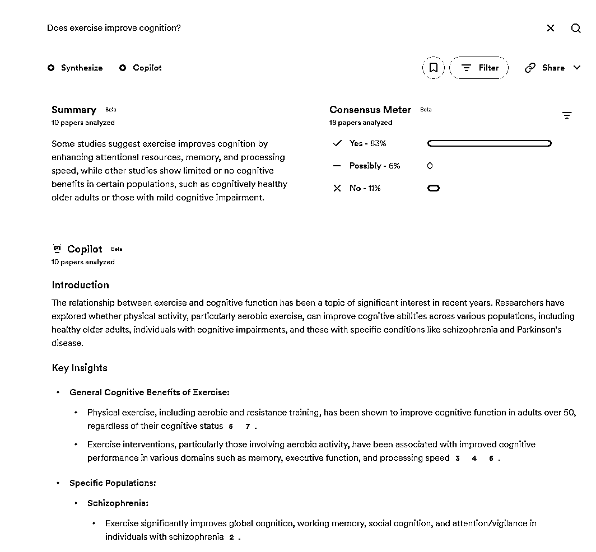
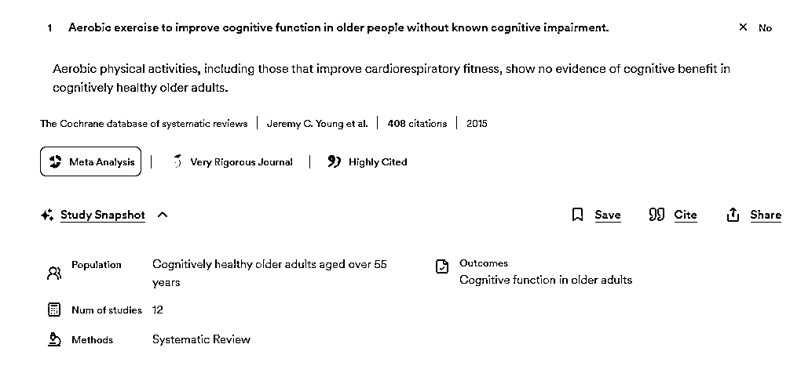
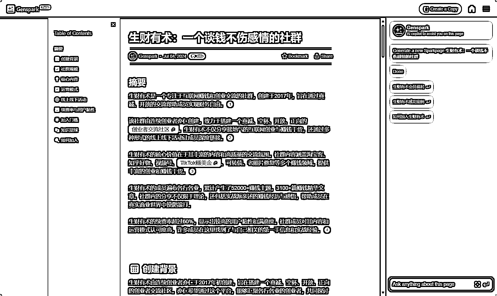

# ('赚钱机会在哪里？', (2, 10))

最近总有人问我：“小排，我想做海外AI产品，搞AI搜索引擎还有机会吗？”

这个问题被问得实在太多了，今天统一聊聊我的看法，顺便拆解一下我判断机会的底层逻辑。

先说结论：赚钱机会，藏在“异常值”里。

什么是异常值？就是你突然发现——这个世界好像少了点什么，有什么东西不太对劲，好像哪里有个洞没人补。

如果你能看到这个“不正常”，并且恰好有能力把它修好，那赚钱机会就到手了。反过来，如果你看什么都觉得理所当然，看哪个赛道都觉得已经有人做了，那机会大概率和你无关。

那问题来了：为什么大多数人都看不到异常？

因为他们离得不够近。

保罗·格雷厄姆有句话特别精准：知识像分形一样生长。远看边缘很平滑，但当你深入研究、凑近一看，就会发现里面满是空隙。这些空隙明显到让你想问——怎么从来没人去碰它？最理想的情况下，探索这些空隙会催生出全新的知识分支。

拿海岸线来说，它就是最典型的分形结构。在地球仪上看，海岸线圆润光滑；只有等你真正走到海边，才会发现礁石、裂缝、沟壑，到处都奇奇怪怪、到处都有空隙。

道理听起来很简单。可为什么大多数人就是走不近？

因为走不近的背后，是缺少足够深刻、足够具体的知识。没有这些，你只能站在远处听别人说。

打个比方，2024年了，知识付费还有机会吗？普通人一听就摇头：这个赛道早就关了，新闻、社区、自媒体都这么说。

再比如，教人炒股的社群能不能做？有些自以为聪明的人会说：这事不成立啊，真炒股厉害的人早就自己闷声发财了，怎么会看得上这点学费？看得上这点学费的，肯定是骗子。

这是典型的普通人思维——因为不懂具体行业，没法走近，只能人云亦云。

但现实打脸了。赚钱有术有位圈友叫邢不行，做的就是教人炒股的量化交易知识付费社群。客单价一万左右，每年几千万利润，做了很多年，续费率不比赚钱有术低。

他为什么能做？因为他懂量化交易，知道有一大群人想学却找不到地方，也知道自己有能力搞定。仅此而已。

他离得足够近，所以根本不会纠结“知识付费有没有机会”“经济下行能不能做生意”这种远距离问题。他只看到一件事：真奇怪，中文互联网怎么没有一个专业的、教学和讨论量化交易的社群？然后他就把这个洞补上了。就这么简单。

回到开头那个问题：AI搜索引擎，到底有没有机会？

我一般会回答：“没有。”

不是真的没有，而是当你在问我的瞬间，对你而言就是没有。因为你站得太远了。

真正有能力站近的人，是怎么找AI搜索机会的？他们看到的是另一个世界。

我们都知道，AI搜索这个产品形态是Perplexity发明的。普通人觉得它体验已经封神，只有那些能走近的“怪胎”，才能发现它的不如意。

先给不熟悉AI圈的朋友看一眼“祖师爷”长什么样：

有人发现：Perplexity搜普通内容还行，搜代码就很鸡肋，程序员用着憋屈。

“居然没人来改改这事儿？那我上。”——于是有了Phind。

Phind专注做程序员专用的AI搜索引擎。它背后不是GPT，而是自己训练的大模型，生成代码能力强；还做了些程序员才需要的功能，比如生成的代码可以直接在浏览器里运行，连开发环境都不用搭。

又有人发现：AI搜索虽好，可大模型总是一本正经地胡说八道，科研人员根本不敢用。

“这世界怎么连个给科研人士用的AI搜索都没有呢？”——于是有了Consensus。

Consensus的产品体验完全围绕科研痛点设计：你提问后，它能搜遍全球严肃论文，告诉你有多少论文支持你、多少反对你；还能给出引用数据、调研方法、论文权重，甚至帮你构思论文。

放几张截图，你们感受下：

还有人发现：AI搜索的答案太短、太干、太不系统，自媒体人没法直接拿来当素材，也没法当调研报告用。

“怎么就没有一个搜索出来像报告一样的AI呢？”——于是有了Genspark。

我试过，只输入“赚钱有术是干什么的”，一分钟后得到一篇图文并茂、结构清晰、排版漂亮、不输调研报告的文章，左边目录还能自由点击。

所以你看，AI搜索有没有机会，关键还真不在赛道、风口、技术。它只取决于一件事：你有没有能力站得足够近，近到能看见别人看不见的缝隙。

那怎样才能站得更近？给你三个锦囊。

第一，拉高基线。每天把赚钱有术的精华帖和风向标刷完。里面藏着大量“按头喂饭”的异常值；同时，赚钱需要“钱感”，看得多了，你鼻子自然灵。

第二，具体。北京十一学校的李希贵校长有句话：“一具体，就深刻。”别问“我想做AI搜索还有机会吗”，要问“什么人、在什么场景、做什么事时，用Perplexity还有哪些问题没被解决？”也别问“知识付费好做吗”，要问“哪类人、在什么情况下、愿意为什么买单？我该用什么服务形态、定什么价格去满足？”

第三，深耕专业领域。尽量在自己精通的领域找机会。如果还没有，就从兴趣和好奇心出发，慢慢养一个。比如Consensus，我AI底子再厚也做不出来，因为我不搞科研，根本不理解科研人的痛点。同理，邢不行的生意不是光靠懂社群运营就能复制的，你没量化交易的专业度，就没法在那个领域里“具体”。

最后总结一下：

赚钱机会藏在异常值里。

大多数人看不到，是因为离得不够近。

知识的分形边缘，远看光滑，近看全是空白，而这些空白明显到让人费解——为什么没人去填？

越具体，越深刻。

越精通，越具体。

评论区已经炸了，有人说“这几个案例惊到我了”，有人说“一针见血”，还有人说“起床放水刷一下，这下睡不着了”。

