# ('我做小红书的 99 条关键经验', (2, 17))

很多人把我那篇《三天让新号攒下千位关注者》的复盘当成宝，其实那篇只是引子。真正有分量的东西，都在后来的《小红书变现 7 堂课》里。书刚印出来，我就给赚钱航海家们一人留了一本。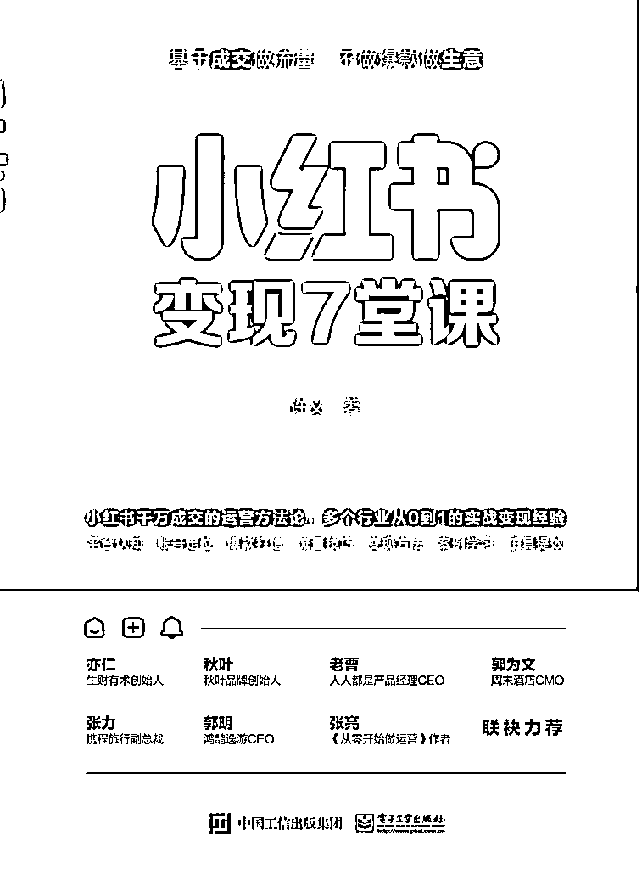

今天不按章节念，我想把这些经验按做号顺序重新讲一遍。你可以把它当成一位朋友陪你从零开始梳理。

先说底层认知。很多人以为这个App能带来客户，但它只是放大器。要赚钱，得走通这样一根链条：能被人看见、愿意下单、服务跟得上，三者缺一不可。如果你已经有一个成熟生意，把它搬上来会顺手很多；如果两手空空，先想清楚到底要卖什么。

想让系统推你，先要满足系统的胃口。它要的是日活和停留时长；读者要的是情绪共鸣、技能增量或实用信息。你给其中一样，就算入了门。至于你，是通过交换来获利，不是来乞讨流量的。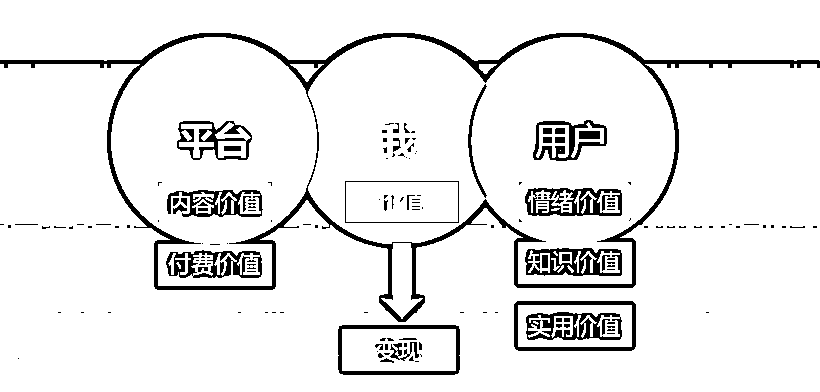

接下来要纠正一个错觉：数据好不等于生意好。曝光高，可能只是围观；关注多，也不代表掏钱。从内容到成交，是一层一层筛下来的，最终能付费的人，才是你要服务的人。

所以，封面那句话是我的核心观点：冲成交做曝光，别冲着爆文做内容。很多爆文只是虚假繁华，要拆开看里面有没有可转化的注意力。用这个标准倒推，你就知道该做什么主题、给谁看。

想赚钱，先选路径。客单价高、利润厚的适合把人引到微信慢慢养；已有货源适合店铺直接卖；垂直领域有个人品牌的，可以接广告。别一上来什么都想要。

顺序上，先把收钱的路修通，再谈拉新。大部分人是反着来的，所以越做越空。

另外，爆文不是拍脑袋。验证过的情绪和需求，换一层皮会再次流行。抖音上火的题材抄到这边有大概率再火，视频剪成图文也能再火。不要抗拒重复，要重复的是已被市场认可的内核。

流量、关注、客户，三样千万别混为一谈。人群被内容吸引，不代表愿意关注；关注了，也不代表会下单。它们只是层层递进的漏斗，终点必须是有付费动作的人。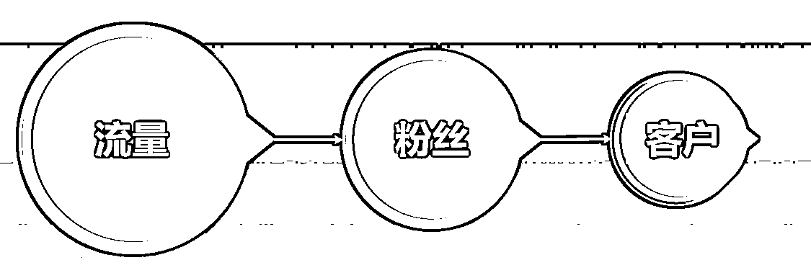

站在哪个赛道、以什么身份出现？我常用四个词：真诚、垂直、清晰、可信。做个人，不做营销号，这是性价比最高的路。选赛道，优先你喜欢的、拿手的、离钱近的，且能形成闭环；做人设，要真实且有价值。一句话概括：服务哪群人，解决什么问题，能有多少收入。

新号养不养？要。用正常人的方式刷几天，每天零散时间看看，坚持一周即可。

导流不可能零风险。聪明做法是减少数量、提高质量，把少数高意向的人导入微信。同时持续输出好内容，让对的人自然靠近；免费曝光和付费投放一起用，效果更稳。

怎么判断被限流？先看基础阅读量，再去搜索框搜不搜得到自己，最后试一下薯条。三项都不对劲，就回查内容。

系统流量分成两条路：一条是首页推荐，一条是搜索入口，后者贡献超过一半。推荐看的是初始互动，其中评论、转发、关注权重最高，可以记成：点赞1分、收藏1分、评论4分、转发4分、关注8分。搜索看关键词收录和主页权重，想挤到前面，权重需要慢慢堆。

热门领域很多：家居、母婴、美食、健身、知识、旅行、绘画、手工、萌宠。新人真正缺的不是赛道，而是深耕。

普通人怎么起号？真实是你的武器，但别把它当朋友圈发。系统会筛选，读者也会筛选，两边都通过的内容才有机会进更大的池子。

精力怎么分？一半以内、将近四成给方向定位，剩下的才给选题、制作和引流。方向错了，努力白费；方向定了，赚钱的上限和周期也就基本定了。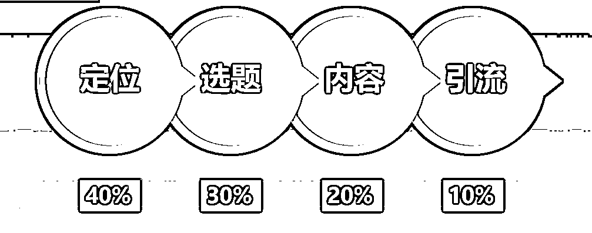

人设不能只挂在简介里，要融进每一条作品。读者会为内容点赞，但只会为“你这个人”下单。

对标账号怎么找？不要找体量太大或太小的，选最近涨势很猛、很快起来的。除了看作品，还要看对方的内容生产方式和赚钱闭环。

选题怎么来？去热门内容里翻、去搜索栏里挖、去评论里找、去灵感中心看，也可以拆同行、写自己的经验、把已验证的爆款换个角度再做一遍。

封面必须有让人点开的理由：视觉上有差异、画面上给提示、整体有审美。标题一共二十个字，用大词+小词做组合，把赛道里排名靠前的标题拉出来重组，再用一些“推荐、避坑、教程、技巧”之类的词激活。正文有固定套路：先刺痛点、再写场景、亮人设、给方法、最后引导点赞。

前期接不到商单很正常。可以先接置换，顺便练对接能力、攒案例。开店不会伤内容流量，反而符合平台长期方向。

账号做不起来，逃不过三个原因：没有方向、没有内容体系、没有成交闭环。刷量千万别碰，标签一乱，号就废了。

CAC是获得一个客户的成本，CPE是单次互动的成本。互动成本越低，说明粉丝质量越高；互动总数越高，说明黏性越强。搜索优化的本质，就是让平台上的“百度”更偏爱你。

现在进场晚吗？不晚。零基础的新号照样能出爆文、拿免费精准流量，关键是把方向卡准、把流量接住。说白了，这是一场注意力接球游戏。

更新频率上，初期保证一天一篇或两天一篇，让系统知道你很活跃，但别断更，也别狂发。作品质量永远比数量重要。

数据不好看怎么办？别删，也别反复改。频繁编辑会打扰推荐，删除更是负反馈。每次发布前想清楚目的，实在不行就设为私密。宁可出一篇爆文，不要百篇平庸。

看到同行的爆文，别抄。拆解它为什么受欢迎，从标题、封面、结构、节奏、互动到导流方式，一步步看。抄只能复制一篇，学会思路才能复制多次。

自己原创却没流量？新手期先模仿，模仿能解决大部分问题，等逻辑通了再谈创新。

运营这个App最怕埋头苦干。先想明白平台的规则和自己的目的。写什么是战略，怎么写是战术，一切从目的反推，中间再填方法。否则，越努力越迷茫。

要不要追求关注者数量？看目的。靠私域赚钱的人，从第一个付费用户开始就有收入，关注数没那么重要；做人设号的人，则需要基本盘来撑影响力。

个人博主的核心：技巧是表面，真诚是根本。

流量之术和流量之道，术是手段，道是方向。所有导流、选题、标题都是末端；道是清楚自己为谁创造价值。内容不过是载体。

把每条作品都想成一张传单。你发给谁？他为什么要看？能看多久？看完会不会来找你？这四个问题想通了，写作自然有靶心。

为什么有爆文却不涨粉？因为作品有价值而账号没价值。读者看完不知道关注你有什么用，自然划走。

发布时间没有统一答案，原则是抢在目标读者刷手机之前。比如周末旅行内容，用户在周三周四晚上做决定，你就在那个时段前一小时发。

点击率怎么提高？先被推荐才有机会。首次展现时，封面占的权重最大，标题其次，然后是赞数昵称。这些都要单独优化。

搜索排名很重要，因为大量流量来自搜索。你排第几，决定用户看不看得到。想排前面，就要提高账号和作品的综合分数。

一条持续排在搜索前列的作品，等于长期免费广告。用户有需求时搜一个词，你正好出现，成交顺理成章。对旅游行业来说，这个平台就是百度的替代品，作品是你的官网，优化作品就是优化官网排名。

做号的第一步是研究，不是注册。去拆同行的赚钱爆文，看评论区有没有人问预订、问链接。能带货的爆文，评论和赞的比例接近一比一，而不是只收藏不提问。顺手把关键词地图画出来。

作品排版要让人省力。多空行、多表情、多金句，读者轻松抓到重点，才会觉得你有用、有趣。

不是每条内容都要卖货。有的负责种草，有的负责建立信赖，有的只是维护存在感。目的清楚，就不会焦虑。

流量不是玄学。每一个做起来的账号背后都有可复制的逻辑，没做起来，大概率是缺体系。

商业的本质是交换，交换的前提是供需接得上。这个App只是连接双方的工具，不是终点。

之前有人问我复旦流量课还能不能看，那是一次线下课，暂时没有回放。写书那阵子，我刚好在密集操盘这类项目，于是顺手做了系统梳理。抖音、视频号都是流量的不同表现，真能看透一个平台的人，做其他平台也不会差。

很多人赚不到钱，不是不会做内容，而是不会设计交易路径。曝光只能解决曝光，赚钱需要把商品、信任、成交、交付全串起来。与其说不懂小红书，不如说不懂生意。

为什么愿意把方法公开？生意真正的秘密很少，公开也没关系，能接住的人自然会接住。写书是普通人的一种回馈，也是给自己的阶段总结。写完，就留下了。

代运营要慎重。这个模式本身不理想，我们只服务有付费能力的大客户。怎么辨好坏？算成本、看案例，好团队一定拿得出硬作品。投放是花钱买时间，现在有些品类流量还便宜，值得尽早用。

这套经验，我从项目里来，也写进了书里。如果你最近也在做这个平台，希望它帮你少走几段弯路。有想法的话，评论区聊聊。

小红书早已过了白嫖流量的阶段。每个平台都会经历野蛮生长期，我们那时也吃过免费流量红利；但能不能做大，取决于进入规范期以后的流程和效率。现在的小红书正是规范期，过去那套打法行不通了。想做得久，就要顺应规则，先帮平台赚到钱。免费+付费的流量组合，是绕不开的路径，也符合平台利益和发展周期。花钱的本质，说到底是买流量利用效率；目的一点也不复杂，就是为了更好地赚钱。

判断投放团队靠不靠谱，就看一点：他们是不是真想帮你把这单做好。靠谱团队会围绕产品和笔记细抠，主动钻进你的业务；只想烧预算的，一眼就能看出来。

引流没有绝对安全，只有相对谨慎。运营侧常用的手段有：小号置顶、把小红书号改成微信号、拉群聊、签名留联系方式、字母或谐音改写、背景图引流；付费侧就是聚光投流。

私域是很多行业最好的变现出口，但“一切流量的终点都是私域”这话有点绝对。小红书的变现路径远不止私域，关键看你的资源禀赋。很多人以为学会了小红书，其实只是学会了获取流量，离变现还差着转化与交付的闭环。我在实操课里整理了旅游、电商、知识服务等行业的案例和渠道，就是为了补上这一环。

最大的误区是什么？是不知道为什么学，对整件事的思考不够清晰。市面上很多书和课都在教人做内容、做爆款，可运营是目的吗？当然不是。运营从来不是终点，它只是工具；学做小红书，最终要解决真问题、实现真实变现。变现别理解窄了——不一定是钱。个人品牌被认可、被邀请分享授课、收到实物置换，甚至我带的素人因为小红书获得了免费旅行机会，都算变现。规模预期同样因人而异：有人月入一千就开心，有人月入一万才及格，企业可能要千万级营收才谈得上规模。现在来找我们做的不少行业，正是照着这个量级在谈。

从平台走向看，小红书越来越强调“人”。想种好草，就得回到真实的人，到目标消费者生活过的场景里找生意机会；社区的核心永远是人，沉淀的内容不是信息汇编或知识总结，而是基于真实体验的分享。流量也不能只看大小。交易这件事可不止流量，拆开看，流量只是交易链上的一个节点，要看类型、属性、是否带需求、交易效率。笔记是为了连接，但连接后用户做了什么动作，比连接本身更重要。

2024年，请放下流量思维。典型的老习惯是拿浏览量、点赞、评论当效果指标。过去十年流量红利期，抢流量确实比深耕划算；现在流量见顶，大水漫灌再也买不到增长与利润的双赢。在有限预算内，既想拿到成交，又想沉淀长期品牌价值，就得把思路从“捞流量”换成“找人”。

新品牌在小红书的路径，通常是先在小红书做种草，成交放在全域去发生。我们做过的服饰品牌，最终成交大多发生在京东、淘宝或线下门店，但触发和种草仍在小红书。这也让我对流量质量有了新认知：2022年只觉得流量多、成本低，2023年帮一家旅游公司连续成交了6万、8万、10万的订单，所以现在也在找高毛利项目。

从品类看，过去小红书是小众、稀缺、有调性、中高客单价的商家洼地，比如寻找丢失宠物服务、小众设计师品牌；今天，大量生意都值得换一种玩法，在小红书重新跑一遍。逻辑变了——从小众到大众。品牌应该主动适应小红书，想清楚自己的精细用户在哪里，从精细需求和精细场景切入。

给新手一个建议：80%的问题出在认知，20%出在执行。别急着“干了再说”，先想明白再上手。

铺量打法还有效吗？2023年初我们做过，有效果，但非常考验团队对平台规则的熟练和应变；放在现在，难度只增不减。铺量本身可以，但如果只是粗暴复制、堆劣质内容，就背离了平台利益和长期价值。

商品笔记基本不会限流，感觉数据差，是因为商品笔记的流量机制更看重转化；规则上还可能给阶段性扶持。所以不明确目的就别乱挂，每个动作前先问“为什么”。

个人IP定位，记住小红书是放大器，放大的前提是值得放大。你得先有真东西，能给别人带来价值。原则有三：专业靠资质证书头衔，权威靠影响力和口碑，可信赖靠过往评价。

推荐流量和搜索流量不是二选一，两样都做，它们既独立又相通。

不会内容、团队也没经验？那就付费，投流或找第三方，都是补短板。2024年还想零投入拿大结果，已经不太现实。如果项目商业价值够大，欢迎联系我们团队。

账号初期原创还是模仿？我建议模仿。所有运营动作都是手段，目标是尽快见效。在你自身经验和认知还不成熟时，原创失败率很高；先模仿拿到正反馈，等账号跑顺了、你也读懂平台了，再转型原创，成功率会高很多。

平台一旦成了国民级应用，连小众需求都会被撑大。小红书官方给了29个一级类目、107个二级类目。如何判断一个需求值不值得做？我在课程里讲过“需供比”的判断方式。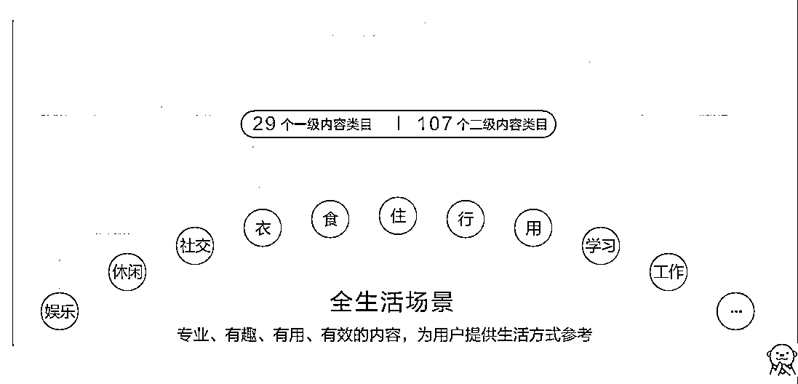

再补充一个2024年的信号：小红书will商业大会发布了20种生活方式，值得留意。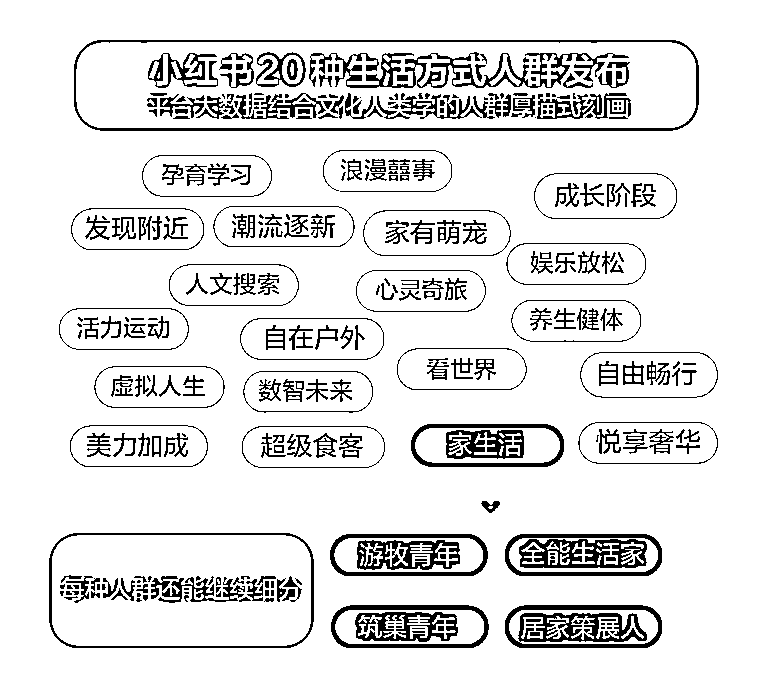

KFS是什么？就是小红书营销的三个关键词：KOL、Feeds、Search。KOL负责用内容引导话题，Feeds用投放触达放大，Search用搜索卡位转化。消费类平台特别适合这套组合拳，我们做服饰品牌时就用它，让用户沿着“认识→认知→认可→认购”一路转化。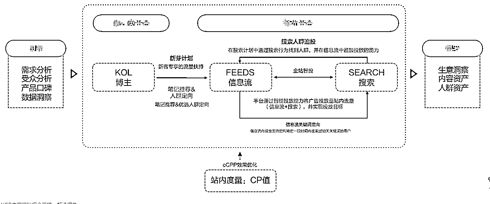

新消费品牌在小红书做推广，如果以最终下单为目的，核心打法就是步步为营引导交易。我们给品牌方跑过的案例，具体过程暂时没法公开。衡量结果时，品牌曝光型爆款看赞藏评，单篇500+赞藏就算爆，爆款率约3%；直接交易型爆款看问价咨询，超过50条回复，爆款率预估5%。常用漏斗是：私信咨询数=笔记数×私信率；交易量=私信咨询数×到店率×店铺转化率；加微数=笔记数×私信率×加微率。笔记制作也要SOP化，不能靠临时灵感。别脚踩西瓜皮走一步看一步，一开始就规划好流程，等于建一条业务生产线，每个环节都是产线上的工序。

低粉爆文，也就是粉丝不超5000、点赞却超过500的笔记，值得被高看一眼。它说明小红书对普通人依然有公平机会，不像一些平台被头部玩家垄断流量。想做出低粉爆文，可以从发布时间、发布形式、内容属性、内容生态四个维度做功课。并且笔记之间相互独立，这代表每一次发布都是新机会。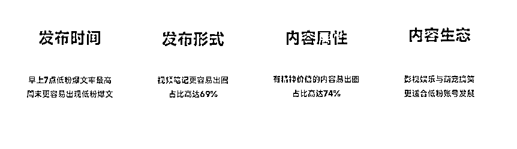

小红书的付费广告，本质上是CPC竞价逻辑，和多数互联网广告平台类似，大致流程如下：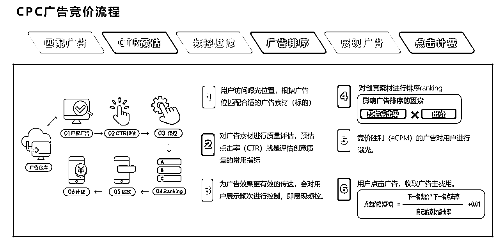

开通广告要先认证企业号，再开通推广资质认证，入口在广告后台（[ad.xiaohongshu.com](https://ad.xiaohongshu.com)）。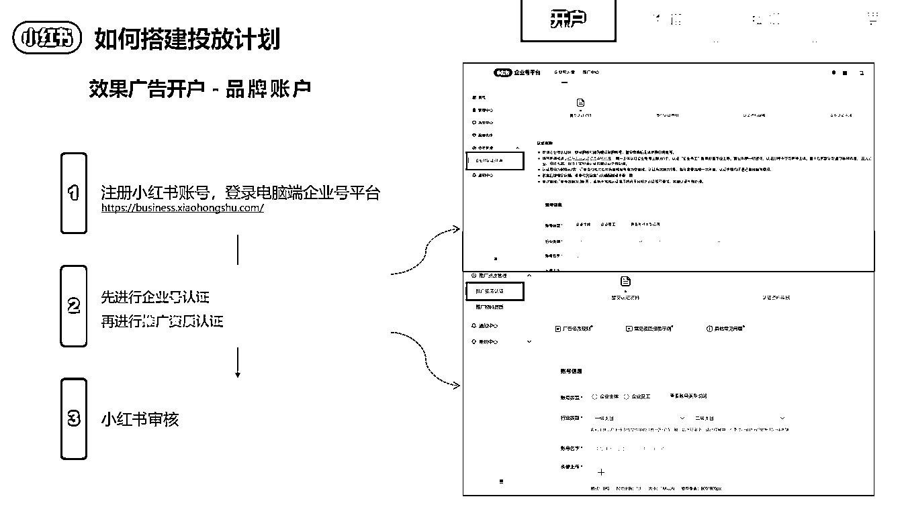

搭建广告计划：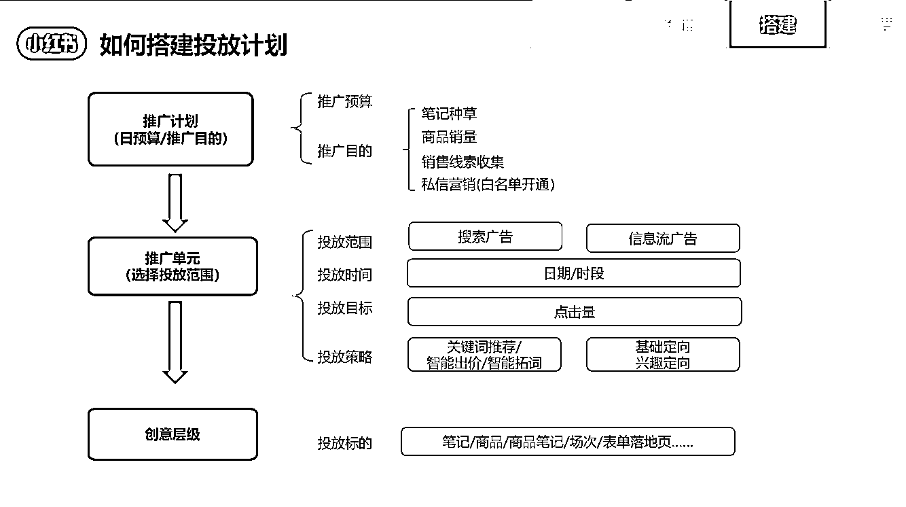

爆款是有前兆的：笔记发出后一小时左右，小眼睛能冲到500，同时冒出七八个问价，大概率会成为大爆款（前提是图片高清、重复率低，能过平台查重）。小眼睛过万后，小红书会启动二次审核，审核得更严，还会结合账号资质判断内容是否该你发。只要有一点营销色彩，就可能被判定“超出营销资质范围”而限流。所以别把爆款神化，它对成交的直接拉动有限，但对涨粉和账号长期价值很有用。我们观察下来，爆款笔记的涨粉作用远大于成交：评论区问价虽然热闹，可泛流量占大头，层层筛下去，转微率只有17.06%左右。短期和长期，目的不同，对爆款的期待也该不同。

私信通可以理解为小红书给商业化客户的一站式线索经营平台。欢迎语、自动回复、留资组件、多客服分线、私信触达意向评论、客资自动识别抓取，全都配好了，企业能省很多人力，销售转化和线索经营效率也随之提升。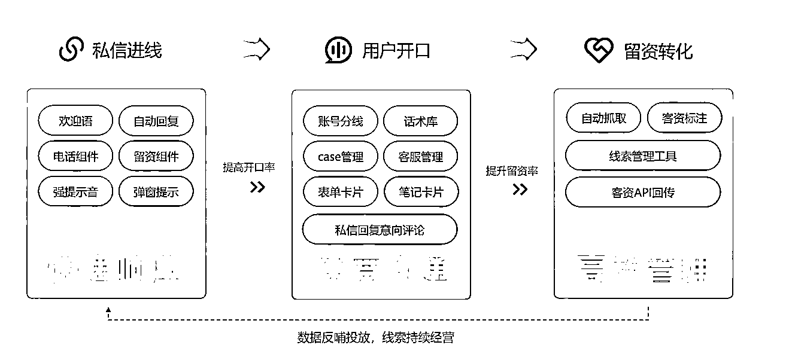 举例：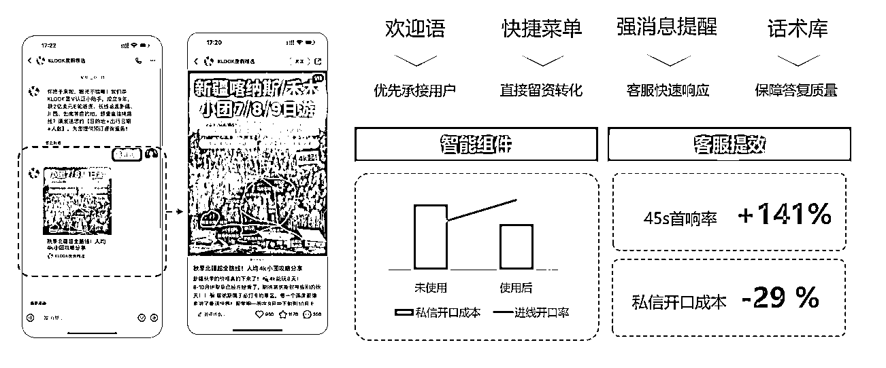

高客单类目的客户跟进，我会分成五个状态：跟进中、已留客资、高潜成交、成单、无意向。至于付费玩法，核心判断是：如果收益LTV大于获客成本CAC，投流就是最省力的方式。适合高客单价服务类商家，而且要挑自然流量本身就好的笔记。操作上，先准备3-5篇笔记，因为一篇笔记投流不确定性很大；然后信息流做人群定向，同一人群跑3天，挑出数据反馈最真实的那篇做种子；接着优化点击率、以互动为目标看数据；再加“立即咨询”按钮、增加搜索词、报白私信投流；最后复盘单个客资的CAC和LTV。

爆款能预测或推动吗？可以有一点。笔记发布前有很多埋点，比如关键词、封面、话题；发布后也需要一系列干预，重要的是建立数据敏感度。一旦发现具备潜质的苗头，就要抓紧放大。我们判断爆款潜质，以12小时为窗口：点赞≥200、阅读≥5000、评论≥50，或赞阅比≥10%，累计赞阅比≥5%，互动结构接近100:10:1，基本就是爆款相。达标后再拿薯条或信息流验证。博主等级没有官方标准，业内普遍是：素人1-1000粉，尾部1000-1万，腰部1万-10万，肩部10万-50万，头部50万以上。计费词也常有人混淆：聚光CPC按点击计费，自然CPC=笔记金额÷点击量；聚光CPM按千次展现计费，自然CPM=(笔记金额÷曝光量)×1000；CPE是单次互动成本，等于笔记金额÷互动量。

同样的内容，为什么别人发就火，你发就不火？旧爆款再发也没动静？算法只是固定机制，结果不全由机制决定，真正影响结果的是用户的反馈——互动。互动才是小红书给量的开关，没有互动，内容就像一潭死水。旧爆文也有可能翻红，但没有保证，你还要对抗用户审美变化和平台查重。最后说泛流量：没有哪种流量是废物，只看你拿它匹配什么目的。我之前说过“基于成交做流量，不做爆款做生意”，背后的前提正是变现。泛流量能抬升账号权重、帮助品牌扩大声量、快速训练你对爆款的网感。在这个阶段做小红书，一定要盯紧你领域里的热点选题、流量风向和爆款封面，尽早建立“判断→测试→放大”的流量思维。

我是许义，著有《小红书变现7堂课》《新旅游》，谱见文旅CEO。欢迎评论区聊聊。