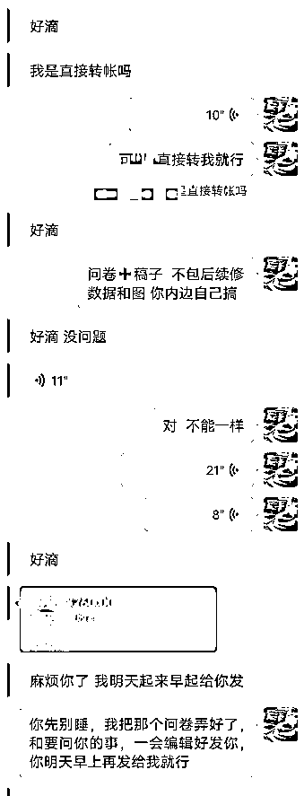
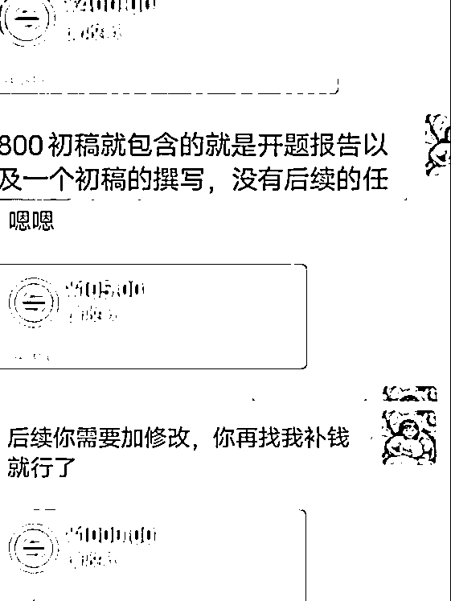
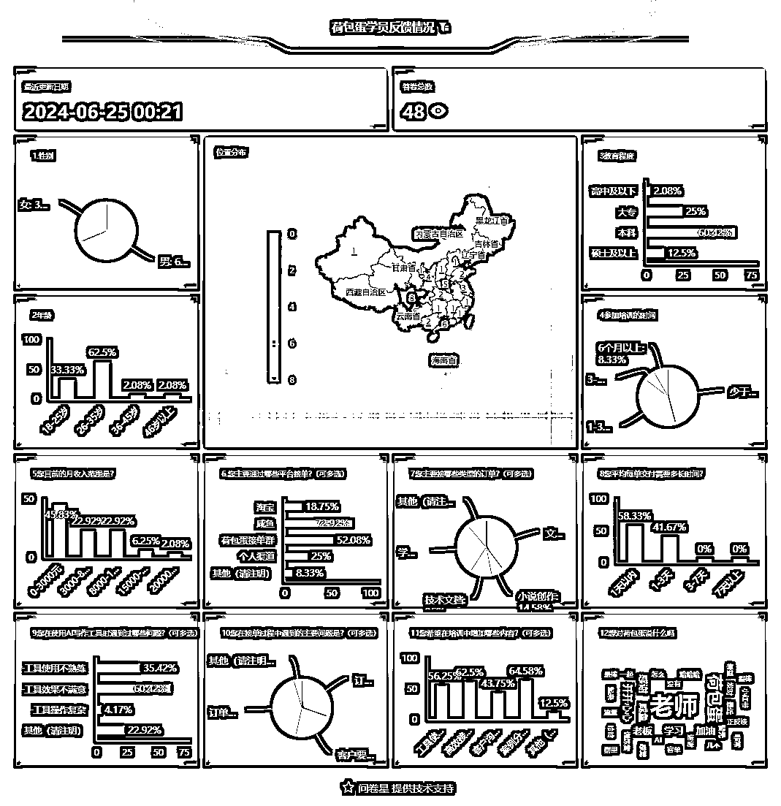

# 一个十八线小城女孩，靠零成本副业，刚毕业就月入6万，她怎么做到的？

> 这篇文章来自一位00后的自由撰稿人，目前在天津生活。她分享了自己从县城女孩到月入数万的完整经历，希望能给同样迷茫的年轻人一些参考。

毕业刚刚一年，当很多同龄人还在海投简历、焦虑前途的时候，她已经做到了月入6万。毕业那天她给自己定了个小目标——攒够100万，然后带着两只狗去旅居各地。到现在，账户里已经存下了15.7万元。今年五月开始，她还陆续去了长沙、济南、哈尔滨、香港、澳门、杭州、北京等城市旅行。而这些，都靠她正在做的AI写作项目。边旅行边赚钱，不再是一句口号，而是她每天的真实生活。

她特别感谢那些带她入门的前辈，以及一路互相打气的伙伴们。从完全不懂的小白，到如今能稳定高收入的自由职业者，她走了不少弯路，也攒了不少经验。今天她把这些年的经历写出来，希望能给大家一些启发。

## Part 1 我是谁

先简单介绍一下自己吧。她出生在天津和河北交界的一个小县城，教育资源一般，家里条件也不好。父母离异后，爸爸靠着每个月两三千块的工资，拉扯着她和妹妹，还要照顾半身不遂卧床的爷爷。从小在这样的环境里长大，她对钱有一种刻在骨子里的渴望。

2018年高考，她考了400多分，压线进了一所成都的民办本科，读国际经济与贸易专业。入学那天，身上只有几百块生活费，学费是靠助学贷款解决的。

大学四年，她几乎没闲过，不是在读书，就是在打工。她做过包子店服务员，一天站12个小时，一小时6块钱；发过传单，时薪10到20块；在韵达仓库捡过快递，一天120；帮自考本科招生，拉一个人头800；还帮美容院、奶茶店做引流和客户维护，月入大概800。

直到大三，她偶然发现“代写”这个需求很大——身边不少人都花钱找人写东西。她敏锐地感觉到，这件事可以做。理由也很直接：

- 来钱快：一单一结，不用等月底，很适合缺钱的学生。
- 时间自由：想什么时候写就什么时候写，不耽误上课。
- 不用设备：一台电脑、有网就行，连办公室都不用租。
- 需求长期存在：任何时候都有人需要写文章，不怕没单子。

想明白之后，她开始在各兼职群发消息，说自己能代写。很快就有第一批客户找上门来。这些人大多是作业来不及写、或者实在写不出来的学生。通过一次次沟通，她慢慢摸清了客户的真实需求，服务也越来越到位。

从以前发传单一个月赚几百块，到现在月入几万块，这中间有多少辛苦只有她自己知道。下面她把自己从0到1的过程完整拆解了一遍。

#### 她是怎么把服务做专业的？

1. 优化接单流程：
- 先沟通：问清楚写作目的、目标读者、核心观点，不盲目动笔。
- 再列提纲：写之前先列详细框架，保证文章有条理、有逻辑。
- 准时交初稿：按约定的时间交稿，然后及时听取客户意见。
- 反复修改：根据反馈一遍遍打磨，直到客户点头满意。

2. 提升自己的写作能力：
- 大量阅读优秀文章，训练语感和逻辑。
- 参加各类写作课，学习更专业的表达方法。

3. 慢慢扩展业务范围：
- 从单纯代写作业，扩展到文案、自媒体文章、市场分析报告等。
- 靠质量和口碑建立品牌，让老客户主动推荐新客户。

## Part 2 我的项目进化史

### 1.0版本：靠代写入行

前面说过她高考成绩一般，也算不上学霸。刚开始接单，只能做最简单的作文和作业。可就算简单，对当时的她来说也不容易。一篇几十块钱的小文章，经常要花一个通宵去查资料、反复改。第一次接单没有AI，全靠自己写，一篇一千字的小文章，她改了一整夜，改了十几遍，好在客户很满意。虽然只赚了几十块，但比发传单、拉人头踏实多了。不用晒太阳，不用看人脸色，只要认真完成任务就能拿到钱，这种感觉太棒了。从那以后，她一边上课一边接单，越来越坚定。

之后几个月，她什么类型的稿子都接，从简单的课堂作业到复杂一点儿的报告。慢慢学会了怎么搭结构、怎么理解客户需求，靠代写已经能cover大学的生活费了。

### 2.0版本：主攻论文

写了一段时间后，她发现一个现象：很多学生尤其是那些混文凭的，根本写不出毕业论文。而一篇论文的单价动辄几百上千，比自己写十篇小稿子都值钱。

于是她开始刻意往论文方向发展。在学校代课群、校友群里加了很多需要写论文的人，慢慢积累了客户。那段时间她花了不少精力去研究文科各类论文的写法和要求，水平也跟着上来了。学会了论文写作之后，她每个月稳定能赚几千块，到了论文季高峰期甚至破万——那时候她还只是个学生。

论文写得好，客户满意，自然就会推荐给朋友。她本身性格外向，擅长沟通，很会给客户提供情绪价值，稿子质量也靠谱。每次转介绍成功，她都会给老客户发个红包表示感谢。这样一来，大家更愿意帮她介绍新单子，自己也习惯性找她写东西。她跟不少客户处成了朋友。有一个研究生客户，她帮着写了半年多，今年对方终于毕业了。六月份她去长沙玩的时候，这个客户还请她吃了顿饭，说以后读博的论文也继续找她。

### 3.0版本：AI写作起飞

（1）第一次接触AI

她第一次认真了解AI写作，是在一次社群的线上分享会上，主题是“玩转ChatGPT”。

说实话，一开始她也犹豫过，怕AI难上手，不懂编程能不能用。但看到很多人用AI轻轻松松写完稿子之后，她还是决定试试。

结果一上手就真香了。ChatGPT界面很简单，只要输入指令，就能快速生成高质量文本。她立刻开始把AI用到自己的代写生意里。

举个例子，有一次接了个商业计划书的作业。以前这种稿子要花好几天去收集数据、整理信息、写报告。现在只要输入关键词和提示，AI就能生成初步分析，她只需要再细化、调整就行。

以前写一篇论文怎么也得半天，现在用AI，简单点的一个小时就搞定了。一篇论文收费好几百，相当于时薪几百块。

AI还帮她接下了以前不敢接的高难度单子。比如技术文档、行业报告，这些以前需要很强的专业知识和大量数据支持，她根本不敢碰。现在有AI辅助，她能快速整理信息、生成高质量初稿，再根据客户需求优化，接单范围一下扩大了很多。

收入也因此暴增。以前累死累活一个月也就一万多，引入AI之后，三月份日均收入到了998元，整月收入30966.88元！这个数字连她自己都不敢信，差不多是同龄人月薪的七八倍。

### 4.0版本：从单干到建团队

技术和写作能力都到位后，她迎来了事业的新拐点。转折发生在“赚钱有术”社群，她在那里认识了很多圈友，学到了如何扩大业务规模，从一个人单打独斗变成团队作战和系统化经营。

（1）第一次办培训营

在朋友的鼓励下，她尝试开了个写作培训营，结合ChatGPT和写作，教别人做AI代写。第一次试水效果一般，去年整个陪跑计划只招了30多个学员。不过学员反馈很好，不少人真的在这个行业里扎根了。

（2）找到合伙人，搭起自营盘

她很清楚自己的短板：不擅长做渠道获客，只擅长交付和写稿指导。所以在圈友里挑了个渠道能力强的学员合作，一起搭了自营盘的闭环。

有合伙人之后，两个人商量着把训练营越做越完善，不仅有详细的AI写作指导，还有获客方法，基本把做这行会遇到的问题都覆盖了。她现在也觉得神奇，没想到自己能走到这一步，身边聚了一群志同道合的朋友，大家互相学习、互相督促、一起赚钱。每次想偷懒的时候，看到学员们都在拼命接单，她又有了动力。

她自嘲是个野路子，在代写这行待了四年，没系统学过写作。但前段时间她写了篇期刊文章，拿给一位期刊大佬打分，对方给了100分。要知道很多研究生写的稿子都被这位大佬骂过。这一百分是她四年的积累，也是她的底气。

可能有人觉得，四年才做到这程度，太难了。但她说：以前的代写行业确实有门槛，现在升级版的AI代写项目，真正适合小白。你甚至不需要自己会写稿，只需要会看懂文章、会下指令让AI帮你写。再或者，你还可以做中间商——接单后转给别的写手，自己赚差价，这同样零门槛零成本。

## Part 3 踩过的坑与解决办法

#### 早期：资源少、认知浅

刚起步时，资源少，经验不足，碰到复杂的写作任务和刁钻的客户需求，她经常觉得吃力。怎么破的？

- 疯狂学习：看书、上写作课、参加线上线下培训，提升专业度。
- 混圈子：加入行业社群，请教前辈，听别人的经验。
- 小步快跑：先从简单小单子做起，一边积累客户，一边优化服务。

#### 成长期：需求变多，专业不够

业务扩大了，什么类型的稿子都接，怎么快速提升专业能力？

- 分类型系统训练，针对每种文体做专项提升。
- 重视客户反馈，根据客户意见及时调整。
- 整合人脉资源，找高手请教成功经验。

#### 引入AI后：工具好用，也要磨合

2023年初她开始用AI，效率虽然提升了，但也遇到过操作问题。

- 先学透原理，再掌握ChatGPT的操作技巧。
- 把AI嵌入标准化写作流程，让每个步骤都高效。
- 在实际单子里反复测试优化，越用越顺手。

#### 带团队阶段：学员培训与渠道拓展

收学员之后，怎么管理好团队、把渠道铺开？

- 做系统化培训：基础写作、AI应用、实操演练，全流程覆盖。
- 按特长分工：谁擅长什么就做什么，让每个人发挥最大价值。
- 拓展合作渠道：对接更多写作平台和期刊，建立稳定关系。

## Part 4 一些真心话

回看这几年，她的感慨很多。有崩溃也有惊喜，有委屈也有成就感。

曾经她只是一个小镇姑娘，在生活压力下选择硬扛。任何一个创业者都要经历从零开始的阶段。实际操作中会遇到各种问题，但正是这些问题让人变得更强大、更有经验。

不要怕犯错，错误是成长的必经之路。每一次尝试都是经验，每一次修正都是进步。做着做着，你会发现自己掌握了很多技能，了解了行业规则，积累了人脉资源。保持积极心态，持续学习，你的眼界会越来越宽，思维会越来越敏锐，能力也会越来越强。你终会从一无所知的新手，变成游刃有余的专家。

她想对刚起步的新手说：

1. 保持学习：写作技巧也好，AI应用也罢，都在随时更新，不学习就会被淘汰。
2. 大胆尝试：别怕失败，试错本身就是成长。失败了也能收获宝贵经验。
3. 主动交流：多和前辈、同行聊，好的建议能帮你少走很多弯路，也能带来合作机会。
4. 坚持到底：成功没有捷径。跌倒了就爬起来，咬牙坚持，你会发现目标越来越近。

最后她想感谢一路帮助过她的贵人和朋友。没有你们，她走不到今天。未来她还会继续努力，不断突破自己。也希望所有看到这篇文章的人，都能为了自己的梦想，不怕难，往前冲。