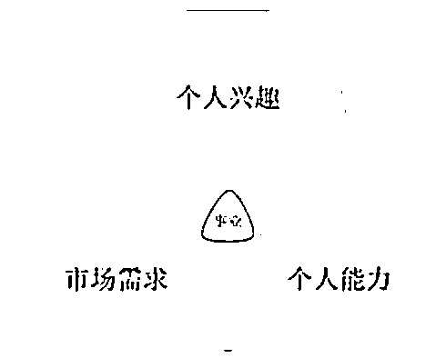
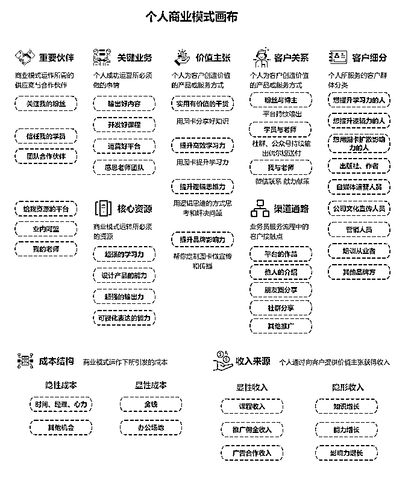
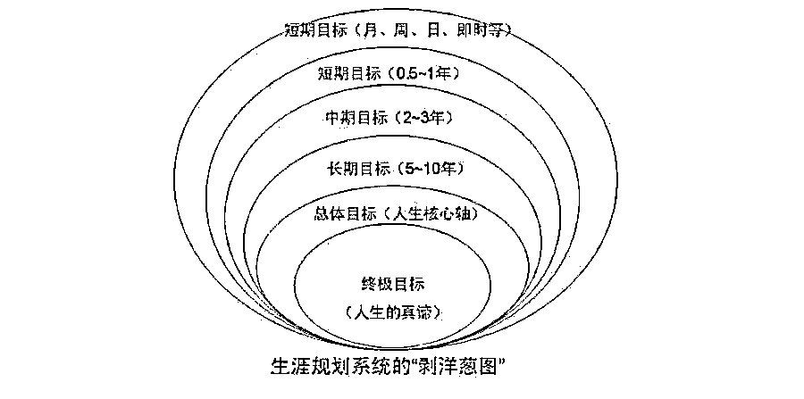
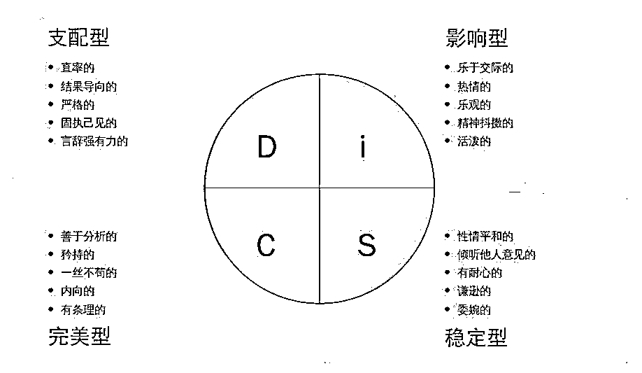

# 1个人的小红书知识IP，单月最高7位数，我究竟乘了什么风

> 来源：[https://ucn1ygqr2fby.feishu.cn/docx/B9LXdFZbjoq8Jnxd65Tcvgr1n3c](https://ucn1ygqr2fby.feishu.cn/docx/B9LXdFZbjoq8Jnxd65Tcvgr1n3c)

大家好，我是Yolo，用三句话先自我介绍：

1. 不露脸做小红书知识博主两年了，选题到剪辑，课卖到咨询，全流程单人包办。
2. 现在全网粉丝6万，月收入峰值破7位数，变现路径很杂。
3. 985硕士毕业，进的是只招2个人的500强外企，如今主副业并行，但支教、旅行、健身一刻没停，内核是精力管理。

我自认这条路是可以复制的，零成本、上手快、成功率高。只要你工作5年以上，或在某项专业、技能上有沉淀，或对某个爱好足够痴迷，都能做成垂直知识IP。你完全可以做到比我好100倍。

很多人卡在没起号、没变现，其实差的只是运气一点点、想太多一点点、行动少一点点。

我的复盘希望能给你启发。顺便立个承诺，这个I人也会积极参与深圳赚钱的线下聚会，线下交流更能拿到隐性知识。一起向前一步，不放弃月亮，也不放弃六便士，持续学习。

# 目录

一、知识IP的变现版图远比你想象的大，先破圈
二、先盘点你自己的资源与能力，你的创业盘就在这里
三、从0到1的四段实战复盘与可复制心法

# 一、知识IP的变现版图远比你想象的大，先破圈

带新人聊做IP，最常见的误区就是把变现想得太窄。这种认知会直接锁死产品定位和长期路线。所以第一步是打开格局。

知识IP能玩的商业模式非常多，至少有8条清晰路径。它们并不冲突，反而要组合打法才能把收益做大。

提醒一句：做IP要结果导向，别一上来就把路走死了。

1. 知识付费服务
* 单次咨询：解决客户的即时痛点。
* 长期陪跑：持续辅导与知识支持。
* 课程培训：系统性输出专业能力。

2. 广告与品牌合作
* 小体量合作：与小红书类平台做推广合作。
* 大体量合作：对接大品牌做投放，回报更高。

3. 带货直播
* 利用直播场景展示转化商品。

4. 会员制社群运营
* 知识社群：会员专属内容。
* 私域社群：沉淀私域，提供专属服务。
* 训练营：线上线下深度学习项目。

5. 出版书籍
* 把方法论成书，拿版税与销售收入，同时立势。

6. 内容打赏
* 在平台输出干货，收获用户打赏。

7. 个人品牌产品销售
* 依托IP做周边与定制产品。

8. 内容共创合作
* 与其他创作者、平台联合分润。

# 二、先盘点你自己的资源与能力，你的创业盘就在这里

做知识IP门槛没有想象高。尤其是工作5年以上，或对某个垂直领域有积累，甚至某个爱好做得很深，都能切一个垂类。

做战略先做内部分析，IP也是。你就是一家一人公司，要做定位与核心竞争力分析。

先明确两个概念：

* 资源：你能调用的各种资产。学历背景、工作经历、人脉、资金、个人品牌、证书等。
* 能力：你能完成的事。专业技能、通用技能如沟通、解决问题、表达等。

下面是我梳理的部分个人资源与能力变现思路，仅作参考，请结合自身实操。

### 个人资源变现示例

* 教育背景：有MBA/博士等学历，可做应试辅导、资料包销售、1v1高价辅导。
* 工作经验：500强外企背景可做职场技能、项目管理、商务拓展课程、社群、内训、单次咨询。
* 人脉网络：组织行业沙龙收门票或招商，或做信息差中介抽佣，或联合推出行业认证。
* 语言能力：多语种教学、双语主持、翻译兼职。
* 冷门行业知识：输出市场进入策略、竞争分析咨询，或做小众行业趋势付费讲座。

### 个人能力变现示例

* 逻辑能力：开逻辑思维训练课、考研逻辑辅导、做企业决策顾问。
* 表达能力：开公众演讲课程、做陪练教练。
* 技术工具能力：视频剪辑、绘画、手工、代码等，做教程销售或定制服务。

最后定位要满足三点：擅长、喜欢、市场需要。工具可借用商业画布、战略钟、波士顿矩阵来校准。

# 三、从0到1的四段实战复盘与可复制心法

## 第一阶段：摸平台、找手感、试爆文

复盘：最初只是觉得小红书调性合我。靠在最右找灵感，日更娱乐八卦、搞笑萌宠，偶尔发旅游干货。两周涨了1000粉，摸清了笔记手感，也明白用户要情绪价值或干货价值，自嗨笔记必死。

我也试过PLOG、金句体，为什么别人的就爆？后来发现，除了矩阵推流外，关键是我内容太杂。个人号在大流量池里必须极致垂直。5亿用户里，只要精准满足0.001%，就是5000个付费用户，人均1000元就是500万，还不算复购。

原则：
1. 喜欢+擅长+市场需=自驱力，长期主义才走得远。
2. 立刻开干，短周期高频试错。
3. 从第一篇就预埋变现路径，不要只赚一次性的钱。

经验：
1. 爆款=情绪价值或干货价值。
2. 借热点上量，平台会给窗口期。
3. 评论>点赞，设计讨论点。
4. 垂类到极致，比如不写写作教学写毕业论文写作教学。

## 第二阶段：意外起号，抓住窗口变现

复盘：一次刷到小红书每日热点“论文开题报告”，我有心得就发了知网找入口、选题对标的干货。虽然粗糙，3天收1000赞藏。立刻明白：我找到了资源能力匹配的需求。

马上日更论文类笔记，有人问就引私域。专科到博士都在找我。第一个全程辅导才399元，带一个本科财务妹子到毕业，半年服务。我白天上班，晚上辅导，周更2-4篇笔记。充实又创造价值。

平台活动我也狠薅羊毛。发直播预告笔记送10-50万曝光，读书活动推相关书，免费流量源源不断。

原则：
1. 行动力+精力管理=先享世界。
2. 流量一来立刻承接变现。

经验：
1. 每天看每日热点、灵感榜、关键词热笔记，热点即刻跟。
2. 盯紧平台新窗口红利，配合官方活动拿免费量。

## 第三阶段：产品化与定价体系搭建

复盘：定价不能照抄别人。成本导向、需求导向、竞争导向三种方法，启动期要用成本导向。两年前的我和现在的我价格天差地别，要看自身资源能力水位。

我从论文全程辅导，扩展到单次咨询、目录制作、答辩辅导等单品矩阵。产品经理出身让我会拆解需求满足差异人群。小红书曾能挂咨询变现，现在风险高，我已不做。

原则：
1. 初期成本定价，积累案例打磨交付。
2. 持续扩产品线，降低风险提升收入。

经验：
1. 价格会随能力成长而涨，要动态调整。
2. 熟悉平台规则，合规变现，避免封号。

## 第四阶段：敬畏平台，顺势做高客单

复盘：平台在变。2022年前要内容，涨粉容易；2023年315后严打引流，我的旧笔记被清；2024年平台要自己变现，鼓励蒲公英广告和直播带货。

我2023年把更新降到周更一，强化质量，反而收入更稳。我的甲方是平台和精准客户，守规则做精内容就够。广告我只接有品牌背书的，如Kimi、网易翻译、WPS，不接低质小品牌。

做大有两条路：矩阵+知识付费复刻。对于主业在身、更看重生活的人，还有第三条路：做高客单价。受客户支付力、渠道、产品价值影响，我正在与企业合作引流，深耕高客单服务。

原则：
1. 站在平台视角顺势而为。
2. 大胆尝试，小心合规。

经验：
1. 广告有选择地接，用来背书。
2. 平台影响流量、政策、变现方式，要及时调整。