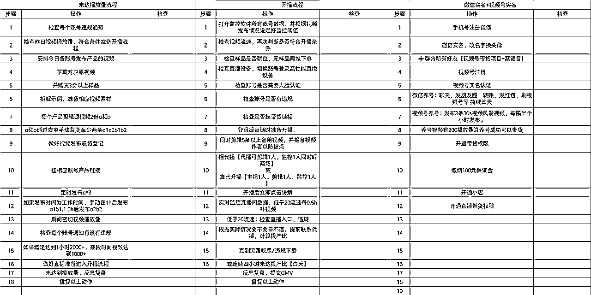
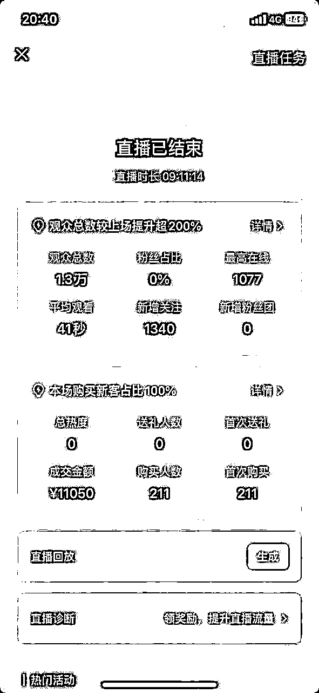
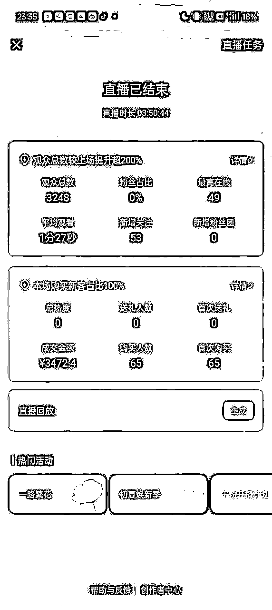
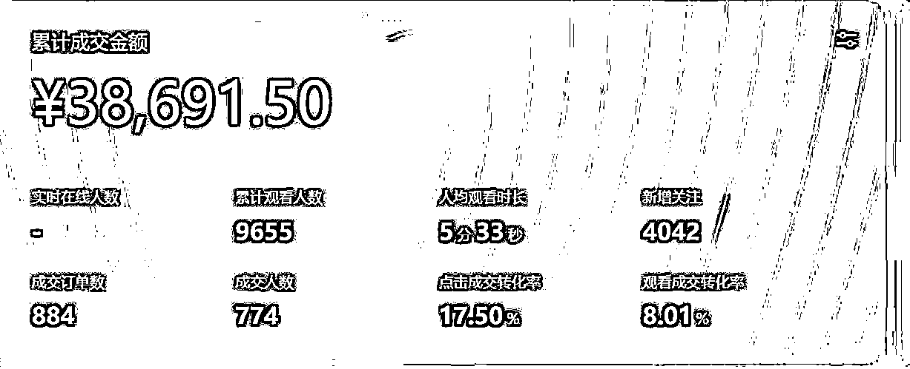

# ('【坚持做一个项目三个月，我都踩了那些坑？撬动6w+GMV，赚回10倍赚钱门票，视频号带货项目复盘】', (2, 51))

三个月前，我死磕视频号带货这个项目，没想到居然跑出了6万多的GMV，算下来差不多把赚钱门票赚回了10倍。今天不吹战绩，只把这一路踩过的雷和攒下的经验，原原本本分享给你。

先说那段像坐过山车一样的爆单经历。

去年12月，西安的肖肖在圈友群发起视频号线下训练营招募，我当时也报了同期的视频号带货航海，特别想跟着有结果的人干。跟肖肖电话聊过之后，因为人在义乌做电商，没法去现场，只能遗憾错过。

今年4月14日，小鹅老师组了个线下拉新分享，现场听到肖肖和冷寒冰的分享，结束后我马上找肖肖细聊，当晚就决定入局。回去后连夜学习、做SOP。

4月15到16号，办卡、注册、养号，还找朋友实名，凑了6个账号。之后就是按教程剪视频、发布、看数据、循环，但一直没有破800播放的爆款。

4月20号晚上，有个视频终于破1000播放，王司让我试着自己播。我马上从美团下单样品开播，播了两个多小时出了两单，总共39.8元。

4月21号凌晨1点多，我刚剪完第二天的视频准备休息，群里突然丢来一个新素材，王司说这是爆款。我立刻开机把视频剪好，定时在凌晨3:55发布，然后倒头就睡，压根没指望能爆。早上9点多醒来，发现视频已经爆了。

我赶紧去问王司，他让我马上开播。但那是朋友的号，开播要实人认证，第一次开播后已经快10点了。等第一次下播，代播才到位，重新开播又要实人认证，朋友还在上课，真正开播拖到11点。播到下午1点没卖多少，本来想下播，王司说试试拉满4小时。

听话照做，命运的齿轮开始转动。这期间不断补视频，数据一路涨，另一个号也开始爆，两个号同时直播、补视频，违规警告不停弹出来，我跟老婆两个人忙得团团转，也犯了不少错。到晚上11点，第二个号不进人了，下播。

战绩如下：

最猛的一条作品跑到39.7万播放。可惜无一例外全被关小黑屋，两个号封了30天。

5月2号我在外面跟朋友吃饭，手机突然提示有个视频破了5000播放，我也没太在意，毕竟5000经常有。过了半小时又提醒破10000，我立马决定回家开播。赶路途中又收到破15000的提醒，我连忙联系代播，到家立刻补视频、第一时间开播。结果这一播直接干到第二天中午，直到所有视频都被举报违规才下播，整整播了15个小时，GMV冲到3.8万。

账号再次被关小黑屋，又休息30天。

之后我一直在做这个项目，还参加了视频号口播带货的航海，陆陆续续有出单，但再也没复制过那天的神话。

惊心动魄的爆单经历讲完了，下面是实打实的复盘，先说坑：

1. 永远要提前进入开播状态。不能随时盯数据的时候，监控软件一定要挂上，发布视频后的1-3小时是黄金窗口，每条视频发出去，都要默认马上可能直播。

2. 发视频之前检查挂链接！我们有个号都开播了才发现没挂链接，感觉错过几个亿。

3. 直播设备别将就，至少准备1-2台高性能手机，苹果XR以上。第一次开播没经验，工作机不到十分钟就过热关机，幸好有备用机顶上。

4. 混剪库存要充足。突然爆量后开播，补视频跟不上非常被动。新手剪辑慢的话，提前做好一条去重视频备用，免得开播手忙脚乱。

5. 账号一定矩阵化。视频号做项目就要上量，虽然我们已经违规了8个号，但现在加到了16个，还准备陆续注销老号开新号。

6. 爆品别犹豫，赶紧裂变。我当时怕违规不敢跟，其实不能带来价值的号本身就是没价值的号。如果坚持打爆过的品，现在数据肯定更好。

7. 长时间没结果，必须停下来复盘。5月2号之后再没怎么开播，每天就闷头剪视频、发视频，市场上什么品爆就跟什么，完全没规划，结果两个月颗粒无收。

最后给新手几点建议：

1. 平时一定要积累。之前学过奇杰老师的批量剪辑，这次剪辑完全没压力。

2. 执行要严格，动作别变形。说6个号就6个号，说每天10条视频就别只发5条，说去重加12种元素就别偷懒加8种。没跑通0-1之前别搞什么“优化”，很可能就是反向优化。

3. 试试看成本真不大。这个项目不需要压钱，几台双卡手机、几张新卡、找朋友实名，凑够6个号，一两千块就搞定。时间上每天抽一两个小时剪视频、发视频就够了。有新品马上买2份样品，为了懂产品、攒素材、备爆量。

4. 黄金三秒定生死。加了前三秒素材和没加的视频，小眼睛和完播率差得不是一星半点。

5. 发视频前先检查有没有违规。别等发完才发现号已经违规，费时费力。视频号里视频没那么重要，号才是核心。但带不来价值的号，照样毫无意义。

6. 有问题就解决，别放着。先百度，再翻航海手册，实在不行赶紧找大佬。基础问题也可能很致命，理解偏差会让动作严重变形。高手一句话能省你半天弯路。我之前一直被“下载对标视频+提取文案”搞得头大，本来要分三步操作，问了老哥后直接给我一个工具，一次转发就能选下载还是提取，效率翻了倍。

7. 只需要做好一件事——流量。视频号带货是我见过新手最容易拿结果的项目，没有之一。后端全交给别人，你只管做流量、录口播、剪视频、发视频，有流量就开播赚佣金。中间还能找代剪代播，说白了只要愿意花钱，你盯数据做优化就能赚钱。

最后用杨绛先生的一句话收尾：所有的困惑，都是想得太多，做得太少。