# 亲子研学赛道，跑通百万级模型的复盘

> 来源：[https://pghe992qie.feishu.cn/docx/Mzm0dyT91oTeFkxVNl2cjpsQnwe](https://pghe992qie.feishu.cn/docx/Mzm0dyT91oTeFkxVNl2cjpsQnwe)

大家好，我是星城。曾三次参加过赚钱小红书航海，也在龙珠俱乐部和现在的航海家群体里。最近把精力都放在项目执行上，很少露面。赚钱一直是我做事的底气，遇到卡点时常会去搜关键词、找人取经。

我觉得分享是种回馈，也是社群的共振。每一次输出后都能遇到志同道合的伙伴，对业务的助推很明显，能打开不同的打法思路，做到降本增效。所以给2024年下半年定个小目标：多写、多分享。

今天聊的主题，是近期很热的细分赛道——亲子研学。

我们团队触达过的品类不少：素质教育、四六级、同城社交、公考、绘本、志愿填报、创业粉等等。基本上每个品类都存在起号转化率的问题，比如开十个号，能稳定出线索的通常只有四五个左右。

亲子这条线不一样，号的启动率极高，基本每一个号都能带来询盘。运气好的话上午发笔记，下午就能进流转成交。还有一个关键差异：个人号比企业号起得快。企业号要认证费用六百，个人号零成本，启动门槛很低。

现在各大平台都在倡导付费投放，但某些垂类自然流量依然强于投放，且更易孵化。这次先把亲子研学讲透，后续再展开其他类目。

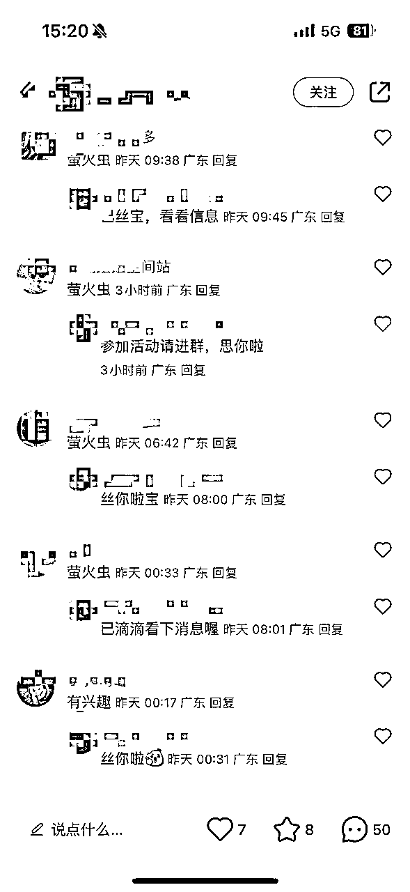

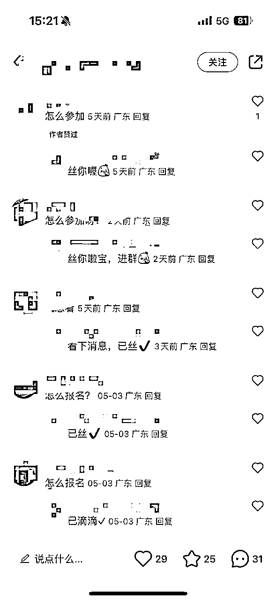

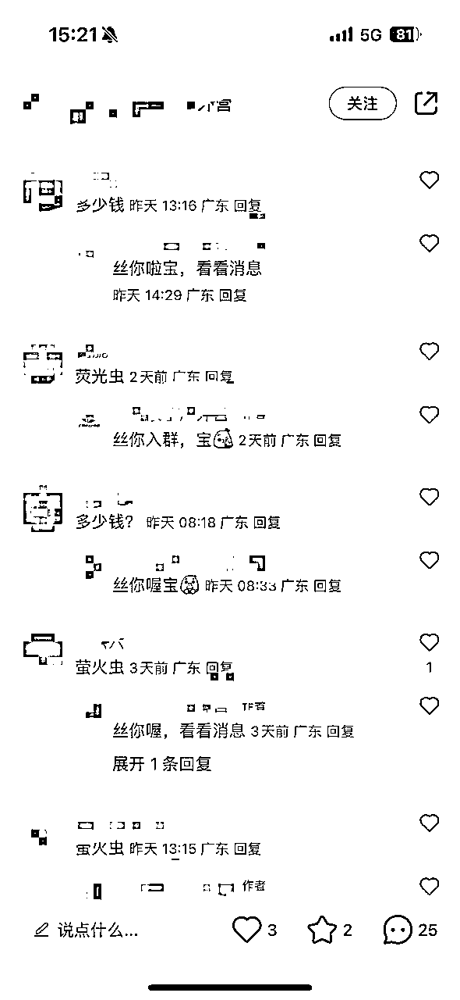

## 一、背景

先说结论，我们的闭环是：

小红书发布图文笔记——多账号矩阵铺量——导流进群——小号在群内丢微信号作为钩子——微信私聊承接——直接推送快团团报名链接——完成下单

背景如下：

团队里有一位教学负责人，前几年经营线下研学机构，主攻PBL与STEAM方向，曾加盟体系课程，也自研过课程。早期获客靠发传单、开门店等客上门，后期越做越吃力，最终关店。只保留了一些老客户在群里做复购，小生意能维持但体量上不去。

后来注意到小红书的种草属性很强，加上周末带娃成为多数家长的痛点。随便检索同城亲子研学的搜索量，发现热度非常高。于是决定试水这个赛道，看是否能跑通。

## 二、踩过的坑

基于既有资源，我们最初想在不打乱老师节奏的前提下，增加一个获客渠道。比如周末老师本会在老群里接龙发车“博物馆”“夜观昆虫”“温室植物”等主题，我们只负责扩流。

但笔记发出后，数据惨淡。

复盘原因：

1. 参考账号并没有做这类选题，相关关键词搜索热度也低
2. 市场可能并不买账，这类活动吸引力不足
3. 爆款需要可复制，若没有复制性，起号就很困难

于是转变思路，必须按小红书自己的孵化逻辑来做。之前偏产品逻辑，现在要先解决曝光，必须回到流量逻辑——如何快速起号。

小红书起号的本质：**找标杆→复刻标杆的模板与选题→再二次重组形成自有模板。**

而“找模板的办法”和“复刻模板的精度”，是成败的核心。

## 二、模板的寻找与像素级拆解

### 如何找到对标模板：

1. 在搜索框输入关键词，反复搜索几次后，系统会推最热内容
2. 看首页推荐位，通常看两屏，每屏四个格子，能上推荐的都是被系统加权的
3. 看笔记底部的话题，点进去再搜相关内容。第一步做好后，话题里基本都是目标内容

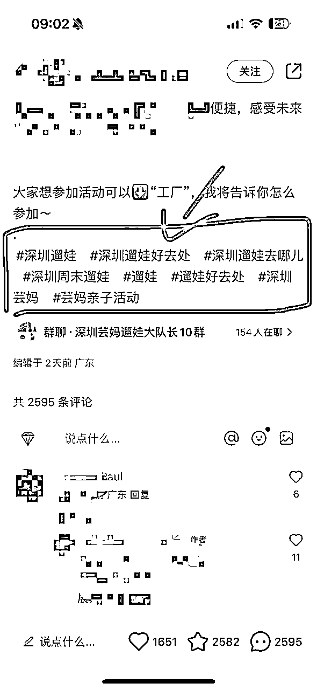

### 选标杆的判断标准：

1. 发布时间越近越好，理想是三天内，最好24小时内
2. 评论区大量出现“怎么报名”“怎么参加”的笔记，转化信号很强
3. 配图制作简易，美图秀秀随手拼成宫格即可

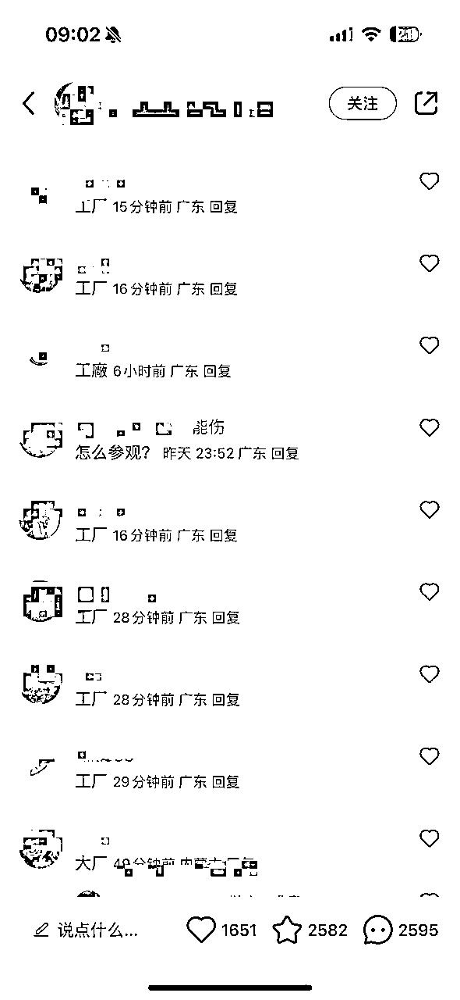

### 像素级复刻的方法：

1. 挑两到四篇爆款，分别拆解爆款要素：版式风格、封面文案、正文标题、配图素材、正文语气
2. 交叉组合——A的排版+B的封面文案+C的正文标题+D的配图...以此类推。有文案经验的话，两个组合就够用
3. 正文可借助kimi仿写，让它输出小红书风格。官网：https://kimi.moonshot.cn/，稍微润色即可发布
4. 切忌原样搬运，会被判定抄袭。要做的是要素拆解再重组，这样不会触发搬运机制

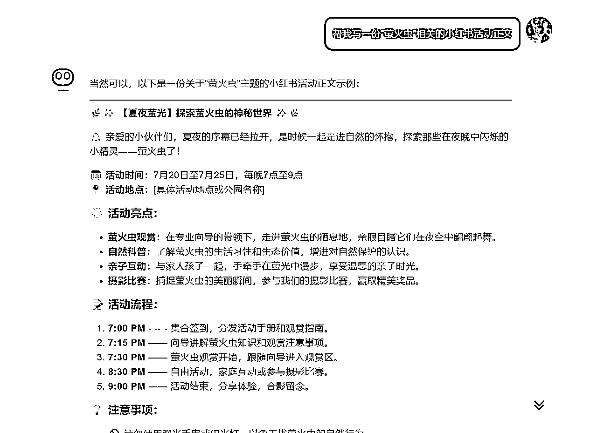

kimi还支持组合提问，把不同问题的回答融合，再塞进写作框架，就是一篇全新稿子，例如：

* “萤火虫活动对亲子出行有什么价值？”
* “为什么亲子要玩萤火虫？”
* “萤火虫活动亮点有哪些？”
* “萤火虫活动适合哪类人群？”

把答案综合一下，填充到框架里，新的正文就出来了。

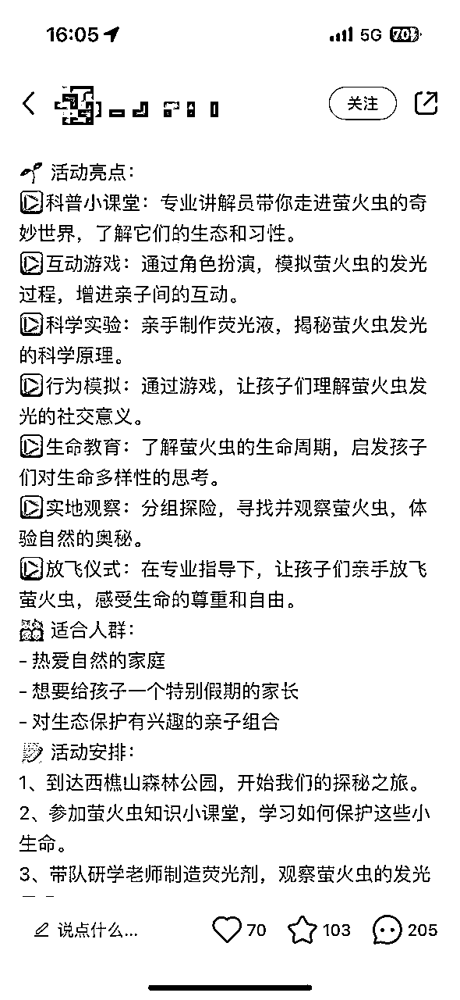

## 三、关键词占位矩阵

按上述做法，就能实现关键词霸屏。

用户检索相关活动时，我们的笔记排在前面。不同设备展示会有些差异，但实测多台手机搜索，一个展示位四个格子，我们能占三到四个，往下划还能看到其他账号。

从用户视角看：搜活动时自然会货比三家，加了几个微信问来问去，最后发现背后都是同一团队，下单几率自然提升。

业内叫法是关键词占位、蓝海关键词。

转化率也很高，因为搜索来的流量自带需求意图，不是刷到时产生的兴趣意图。兴趣意图只是看看，需求意图是想立刻报名。加微信后一句询问直接甩链接就能成交。

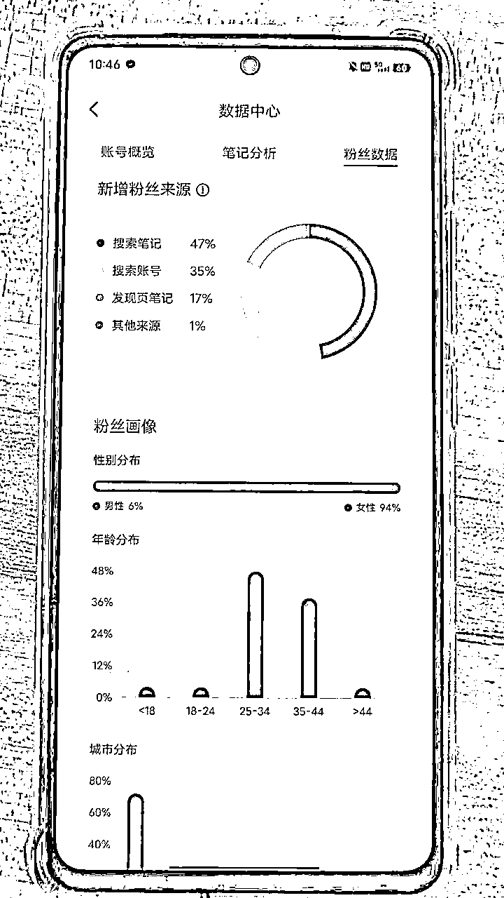

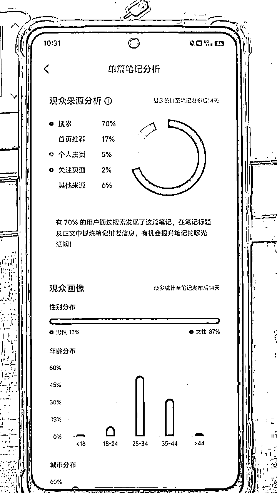

后续还能做到话题占位，点击话题，四个位置里至少占两个，说明权重很高。做本地流量的前提是打本地话题标签，这样进来的都是同城用户。

## 四、启动准备

企业号我们也测过，一个开口成本约14元，价格可以接受，但转化不稳定。可能企业号放量偏曝光，属兴趣意图。还在打磨中，目前以个人号为主，铺更多关键词。个人号有几个细节：

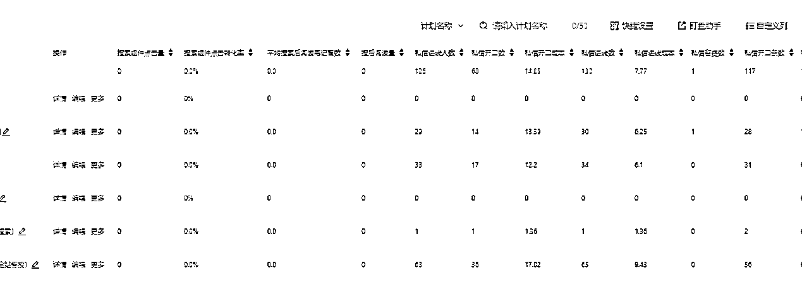

1. 一机一卡一号
老生常谈，不用讨论一机双卡、换WiFi等尝试。我们只复盘有效动作，按此标准执行即可。

2. 先养号三天，模拟真人使用
有些教程说不用养，我们实测养过的数据更好。尤其是很早注册后搁置的号，养号周期越久权重越高。

3. 起步不必发干货，直接发对标引流模板
这种引流模板评论互动多，算法会加权。小红书的核心评分=点赞×1+收藏×1+评论×4+转发×4+关注×8，评论越多权重越高。

4. 引流方式里，个人号最稳的是建群
4.1 笔记热度起来后绑定群聊，并在评论区置顶邀请码
4.2 群建好后，用小号在群公告欢迎语里留下微信，微信号控制在八位以内，不要复杂

微信端的准备：

1. 养号期，通勤、买早餐时多刷一刷，每天去腾讯公益捐一点
2. 新号一周内加人控制在5到20人
3. 用快团团承接，加微信后直接问购买方式。复购群也是通过快团团接龙

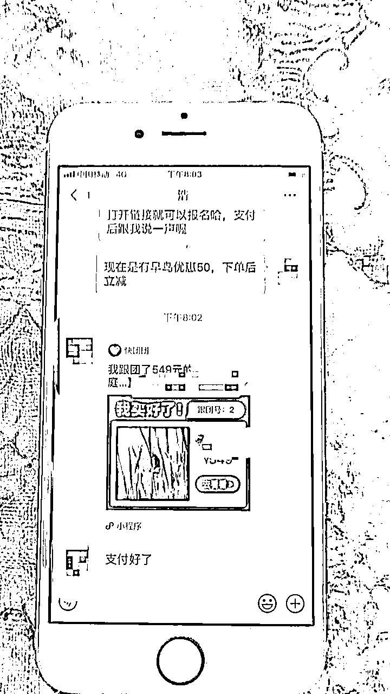

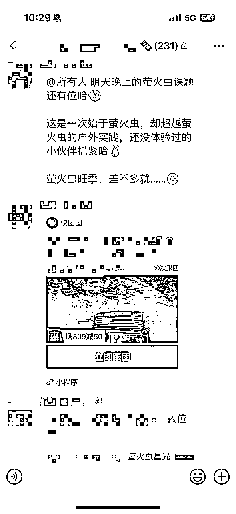

后来快团团上了首页，有用户直接在快团团平台下单，绕开小红书。虽然量小，但打开了电商直付的思路，后续会继续研究。

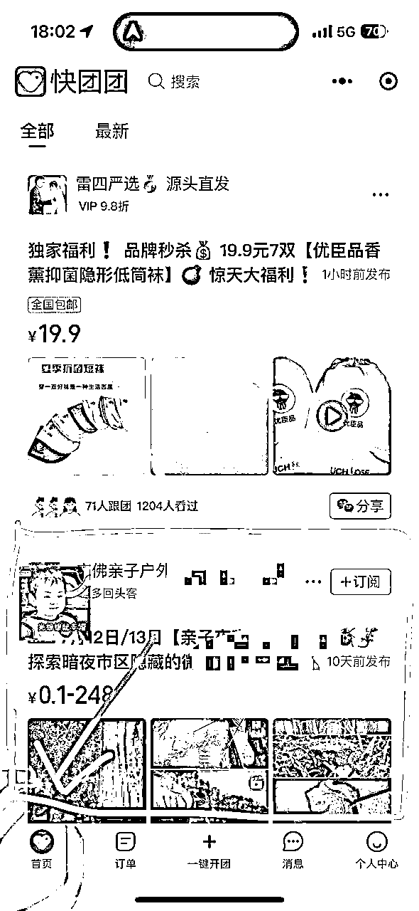

## 五、两个关键转折

起初并不顺利，摸索一段时间没结果。后来两个转折点很关键。

### 第一个转折点：抓到那篇对标

当时找到一则标杆笔记：

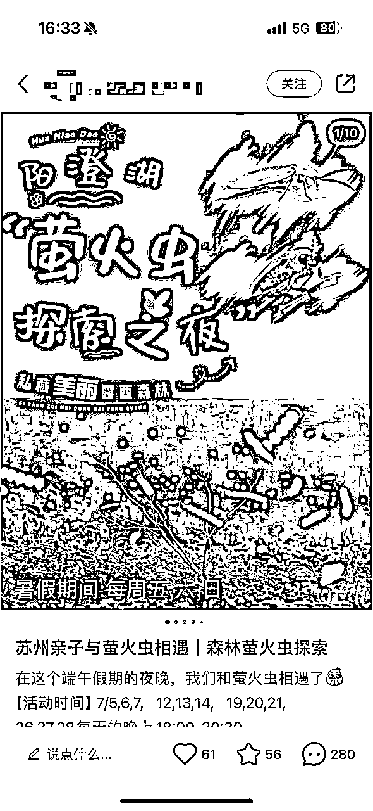

没截图，后来那篇被二次编辑看不到原文。但提取的要素规律还在：

1. 评论区大量询问参与方式
2. 发布时间在48小时内
3. 封面直接写活动日期
4. 文案直给“来参加活动”，不是科普萤火虫有多好玩，所以评论全是报名咨询

我们提取这几个点做了仿版笔记：

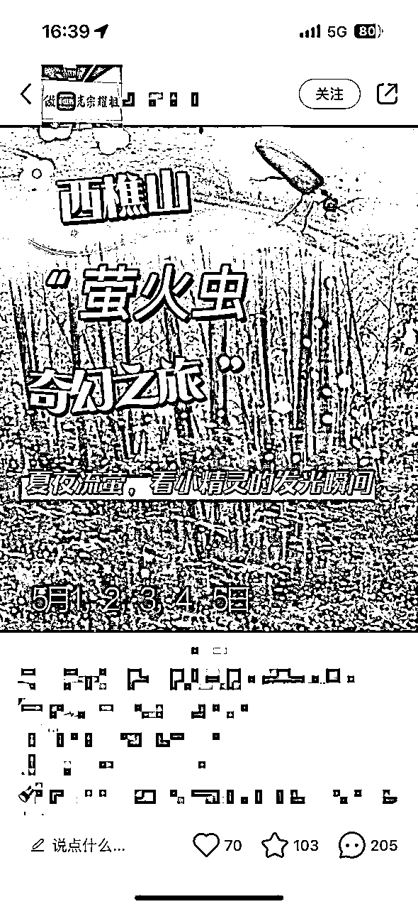

封面对比，左边是标杆右边是我们的：

* “阳澄湖”→“西樵山” 地点替换
* “萤火虫”→“萤火虫” 活动名保留
* “探索之夜”→“奇妙之旅” 修饰词用kimi换近义词
* “私藏美丽露西森林”→“夏夜流萤，看小精灵的发光瞬间” 仿写或kimi生成
* 活动时间均置于左下角

标杆怎么写我们就跟什么写：

* 它是两宫格拼图，我们也是两宫格
* 上半是萤火虫，下半是发光森林，我们一致

这才是像素级复刻，有效对标。

结果发布后很快有人咨询，热度螺旋上升。我们把模板批量投放到其他账号，效果一致，新号老号都能跑。

我们不是最早做这个模板的，但一定是最多的。矩阵玩法不是谁都会，互联网打法降维打击传统机构。我们持续写同一个关键词，不断蹭热度，实现占位。

记住：**爆款可以复制，复制的爆款可以反复爆。**

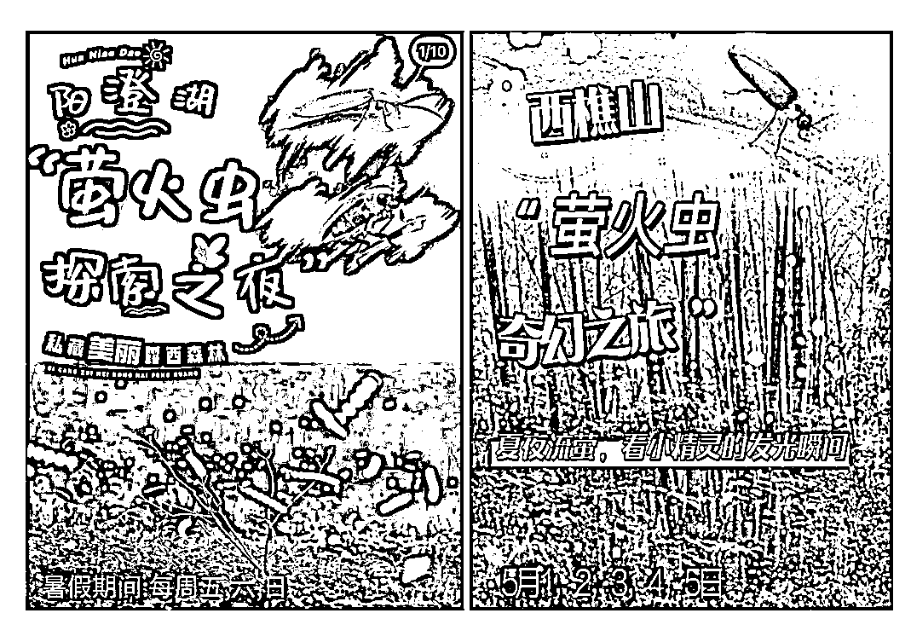

### 第二个转折点：从自营到联营

流量和模板稳定后，瓶颈是后端。研学老师只有一位，精力有限，班次和收入可算死。于是考虑和研学社合作，我们负责前端流量，对方负责后端交付，各自专业。

端午节划龙舟迎来小旺季。初期谈判不顺，我们属于草台班子，无法承诺具体量。但小规模试跑发现可行。

如果自建后端产品和师资，作为初创团队很难招到合适老师，前期准备成本极高。

**合作做大市场，最省事。**

调研发现，很多成熟机构的目标是让家长多次复购，而非单次消费。有的机构首单甚至亏本引流，后续靠课程组合回本。这类活动只要交付靠谱，复购率很高，家长周末带娃去处有限。

市面主题很多：大众汽车参观、牛奶工厂参观、草莓采摘、特斯拉博物馆、航天员探秘、星巴克小咖啡师等。成熟机构背后往往是多主题、多渠道合作的结果。

我们团队的优势是可复制模板+矩阵打法，很快把龙舟活动盘活，甚至让古村团队加班。其他渠道加起来都未必有我们量大，工作人员直呼忙着数钱。

而我们实际只放一个运营做引流。正如流传的话：世界就是草台班子。流量带来的激活超出预期，一条度假村被盘活。

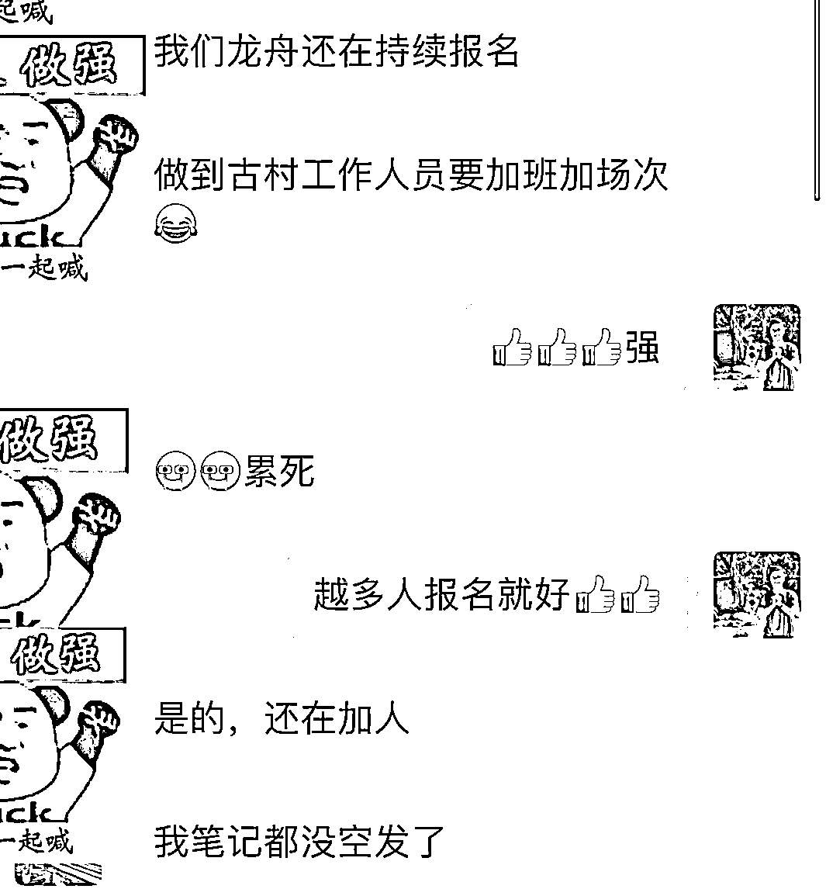

也是这个决策让流量变成有效流量。过去做其他活动，因老师不足且为保障体验限流，很多用户报不上名。这次不一样，笔记主题就是划龙舟，咨询即加微信，加微信即成交，档期排好随时发车。72小时成交黄金期，最快当天成交当天成行。

累计下来月入8到12万，盘子跑通百万级。目前配置一运营一老师，后续准备放大。相信暑期档会再迎来一波红利，把业务推上新台阶。

## 六、风险与难点

听起来很香，但项目并非无坑：

1. 产品若非主流热度，笔记基本没曝光。我们早期想延续成熟课程，自以为好玩但市场不买账。初期必须用流量逻辑而非产品逻辑。
2. 研学属强季节性，流量波动大。5-6月萤火虫、端午、父亲节、母亲节等节点流量高，淡季需换包装或换课，对课程组合能力要求高。
3. 核心竞争力在后端整合，若全部外包，服务质量影响品牌口碑。自研课程又会回到第一点的流量问题。两边都解决后再去和资源型机构竞争。
4. 目前市场单课价在150到250区间，我们主打中高端250到400，卖得不错。很多机构首单亏本引流，后续靠复购。但小团队建议先赚钱，定位未来走自有中高端课程。
5. 起号率高但易违规封号。封了就重开，心态上要接受。
6. 研学基本户外为主，下雨需延期或退款，核算时不能假设满员。

## 总结

分享这篇，一方面越分享越幸运，能遇到志同道合者碰撞新点子；另一方面亲子研学多为同城流量，不存在全国性内卷。做好城市本地化，吃住行一体化，复购很强。当私域里沉淀多台手机的流量，外界波动影响有限。

这类家长需求是滚雪球的，手握流量就能形成壁垒。

再次感谢赚钱有术平台，遇见很幸运。潜水一阵子，该多出来交流。盘子仍在野蛮生长，有同赛道朋友欢迎交流，我们仍有大量优化空间。

之前写过相关小红书复盘，附上：

* 小红书日引流200+，简单粗暴！从博主玩法迭代矩阵玩法2.0版
* 零投放从0开始，小红书2个月8万粉丝的实操经验分享