# 零基础怎么让ChatGPT帮你写出“值钱”的亚马逊选品分析工具？

完全不懂编程的人，也能让ChatGPT给自己打工，把Python工具开发出来吗？答案是，只要你方法对，写代码和调试这两件事都可以交给AI。

在Code Interpreter（现在叫Advanced Data Analysis）推出一周年的节点上，我重新想起了这个当年热度很高、但在赚钱圈里讨论得不太多的功能。最初拿到它的时候，我和几个朋友都挺意外：它既能写代码、分析数据，又能处理文件和图片，更关键的是，它会自己在一个临时环境里生成Python程序并跑起来；一旦运行出错，它还会自动改代码，再试一次，不断尝试各种解法——这几乎就是在模仿人做任务的方式。在我看来，它和去年7月同期出现的Custom Instructions，也许正是ChatGPT走向自动化执行任务的前奏。

顺着这个思路，我很自然地想到：CI能独立解决某个任务，跑通之后，它的背后就等于有一份可以运行的Python代码。那能不能让ChatGPT学习这份代码，再改写成符合我们需求的程序，然后拿到本地运行更大数据量、更复杂的同类任务？带着这个好奇，我在AI编程航海的收官阶段开始了新探索。说实话，前面两周我也按照教练指引和圈友的分享做过不少ChatGPT写Python工具的测试，后来把这些经历整理成了另一篇文章，讲的是怎么用ChatGPT写Python爬虫工具。

先向读者道个歉，这篇文章的标题有点标题党的味道。AI编程并不能算开发产品的最快路径，下面要聊到的工具也没有经历过真刀真枪的市场调研，绝对不敢说拿来就能赚一百万。之所以这样起名，是因为我刷到一个B站Up主的视频，题目就叫“价值百万美金！ChatGPT亚马逊Amazon选品”。他在视频里展示了如何从JungleScout导出的数据出发，靠ChatGPT Code Interpreter做分析，最终锁定了194个蓝海产品。作为一个懂一点编程、也用过CI的人，我必须说一句实话：这套筛选流程即使不借助ChatGPT也完全可以跑通，哪怕你只精通Excel，手动操作也能做到。AI真正的贡献不是不可替代，而是把门槛大幅度降低、把效率提上来。视频最值钱的部分其实是他的选品思路，而不是AI本身。我刚好和这位Up主有比较深的关系，早就知道他这套蓝海选品打法带来了远超百万的回报。

今天这篇文章，就是想把Up主用CI筛数据、找蓝海产品的思路，变成一套可以反复使用的Python选品工具。我会从下面几个角度展开：

*   Code Interpreter到底能做什么？
*   小试牛刀：做一个图片转PDF小工具
*   尝试攻坚：解决Excel图片复制难题
*   寻求突破：写出亚马逊蓝海选品工具
*   更上一层：做出亚马逊竞品分析工具
*   Code Interpreter编程有哪些限制？

## Code Interpreter到底能做什么？

用过CI的人都知道，数据分析是它的强项，图片处理和视频生成也不在话下。我专门就这个问题问过ChatGPT，它给出的答案是这样的：

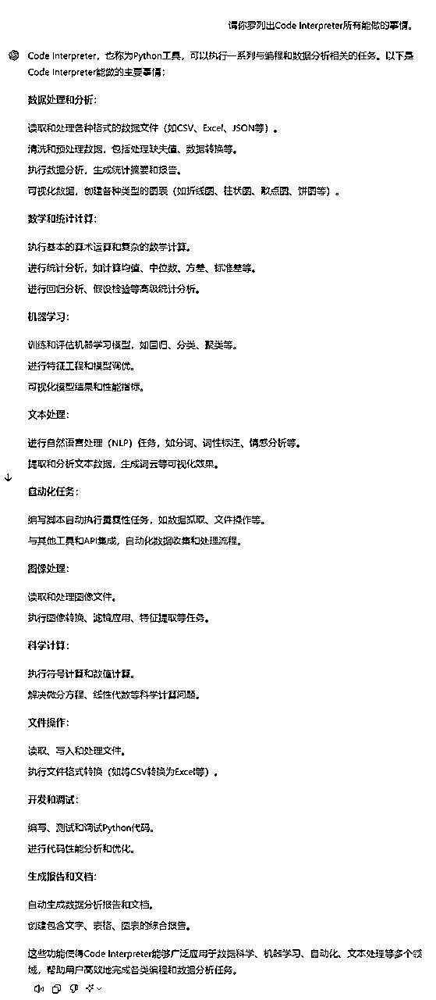

简单来说，Code Interpreter可以覆盖数据科学、机器学习、自动化、文本处理等众多领域，能帮用户在处理编程、数据分析这类事情时省下不少力气。

另一个值得琢磨的点是：CI每次执行任务，都会自动生成Python程序来完成。OpenAI为什么偏偏选择Python，而不是C++、Java、PHP这些语言？这个问题本身就有价值，也让我在AI编程航海期间更深信：应该认真学习和实践用AI来写Python。我也向ChatGPT问了原因：

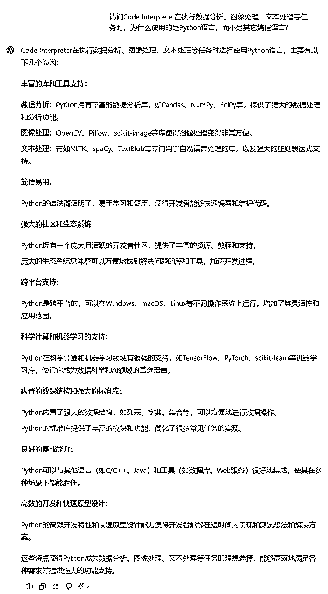

把能力边界搞清楚之后，就可以放心地用CI来处理数据分析、图像转换、文件操作、数学计算、图表生成等需求。下面先看一个小案例，体会一下如何把CI处理文件和数据分析的过程真正变成自己的工具。

## 小试牛刀：做一个图片转PDF小工具

让CI去执行一个具体任务，平时我常用两种方式：直接的，是在GPT4或GPT4o对话框里要求它“调用Code Interpreter在环境中执行…”；偷懒的，是直接用带“代码解译器和数据分析”功能的GPTs。这次选的是Advanced Data Analysis这个GPTs，先从一个小需求开始：让CI帮忙把一组图片合成PDF，然后把CI跑出来的Python代码改造成我们想要的小工具。

我给它的任务很简单：“扮演一名资深的Python软件工程师。请把附件中的所有图片转换成一个包含这些图片的PDF文件，并提供下载链接。” 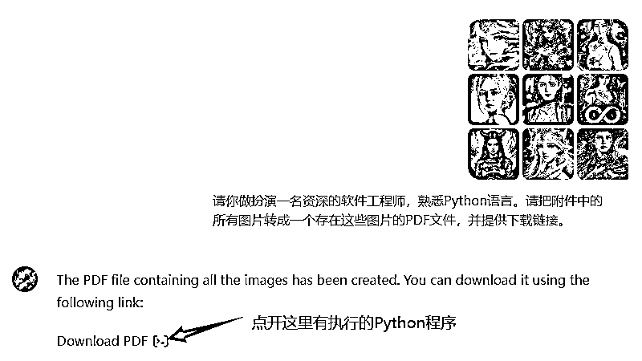

这个GPTs很快就自己写好了Python代码，并在临时环境里顺利执行，将9张图片合成了一个PDF。 注意看，在“Download PDF”链接右侧有一个展开按钮，点开就能看到它执行任务所用的Python程序以及运行结果。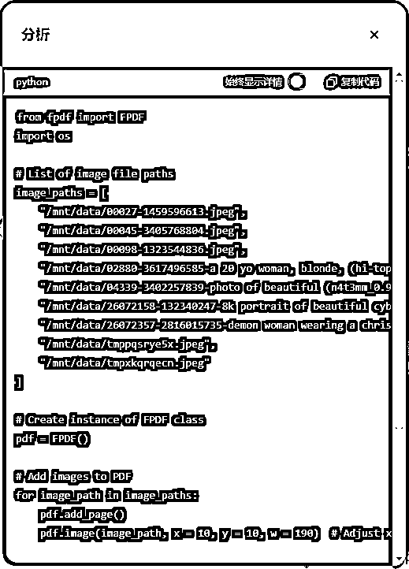 代码调用了FPDF库和os库，在CI的临时环境中一次成功。

这其实就用得上我上一篇文章里提过的“指定代码”思路：让ChatGPT先学习与项目相关的参考代码，再基于这段代码做二次开发。于是，我让ChatGPT把CI已经跑通的代码重新学习一遍，改写成能在本地电脑上运行的程序，同时加上用户界面。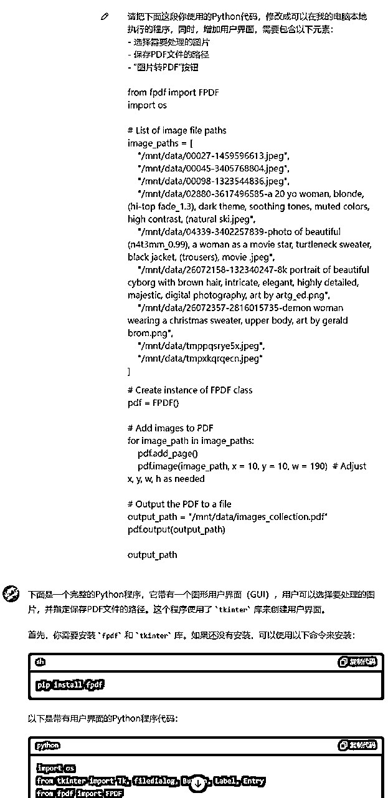

测试之后，这个程序已经能把选中的图片转成PDF。我继续让它做优化，比如自定义PDF的保存路径、自定义文件名。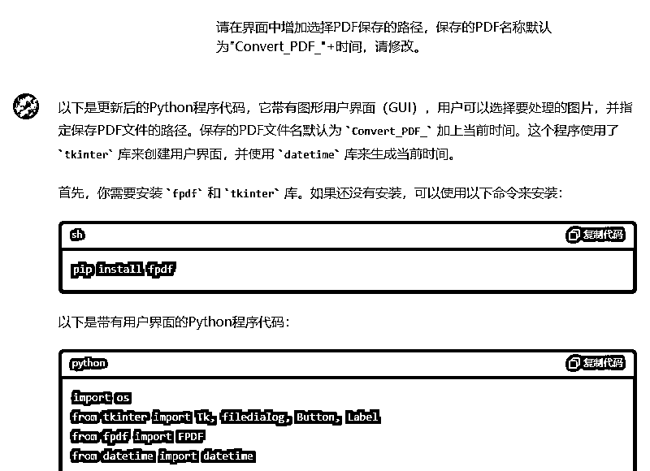 再比如把窗口调得更宽、显示出当前选择的图片列表。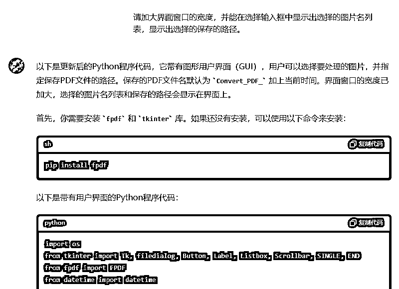 最终ChatGPT给出一份完整的Python脚本：```
import os
from tkinter import Tk, filedialog, Button, Label, Listbox, Scrollbar, SINGLE, END
from fpdf import FPDF
from datetime import datetime

def select_images():
    global image_paths
    image_paths = filedialog.askopenfilenames(
        title="选择图片文件",
        filetypes=[("Image Files", "*.jpeg;*.jpg;*.png")]
    )
    image_listbox.delete(0, END)  # 清除当前列表
    for path in image_paths:
        image_listbox.insert(END, path)  # 在列表框中添加路径
    image_label.config(text=f"已选择 {len(image_paths)} 张图片")

def select_save_path():
    global save_directory
    save_directory = filedialog.askdirectory(
        title="选择保存PDF文件的目录"
    )
    if save_directory:
        save_label.config(text=f"PDF 将保存至: {save_directory}")
        save_button.config(state="normal")

def save_pdf():
    current_time = datetime.now().strftime("%Y%m%d_%H%M%S")
    pdf_name = f"Convert_PDF_{current_time}.pdf"
    pdf_path = os.path.join(save_directory, pdf_name)
    create_pdf(image_paths, pdf_path)
    status_label.config(text=f"PDF 已保存至: {pdf_path}")

def create_pdf(image_paths, output_path):
    pdf = FPDF()
    for image_path in image_paths:
        pdf.add_page()
        pdf.image(image_path, x=10, y=10, w=190)
    pdf.output(output_path)

# 创建主窗口
root = Tk()
root.title("图片转PDF")
root.geometry("800x600")  # 设置窗口大小

# 选择图片按钮
select_button = Button(root, text="选择图片", command=select_images)
select_button.pack(pady=10)

# 显示已选择的图片数量
image_label = Label(root, text="未选择图片")
image_label.pack(pady=5)

# 图片列表框和滚动条
scrollbar = Scrollbar(root)
scrollbar.pack(side="right", fill="y")
image_listbox = Listbox(root, selectmode=SINGLE, yscrollcommand=scrollbar.set, width=100)
image_listbox.pack(pady=5)
scrollbar.config(command=image_listbox.yview)

# 选择保存路径按钮
path_button = Button(root, text="选择保存路径", command=select_save_path)
path_button.pack(pady=10)

# 显示保存路径
save_label = Label(root, text="未选择保存路径")
save_label.pack(pady=5)

# 保存PDF按钮
save_button = Button(root, text="图片转PDF", command=save_pdf, state="disabled")
save_button.pack(pady=10)

# 显示状态信息
status_label = Label(root, text="")
status_label.pack(pady=5)

# 运行主循环
root.mainloop()
```

功能验证正常之后（如果运行时报缺少库，直接把报错文字复制给ChatGPT，按它的提示安装就行），在命令行中输入：

pyinstaller -F -w image2pdf.py

就能把这个脚本打包成一个exe文件。一个图片转PDF小工具正式诞生：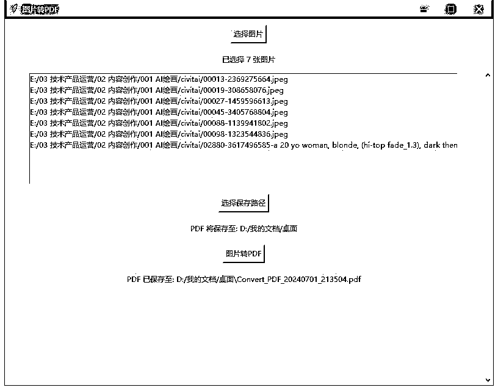

## 尝试攻坚：解决Excel图片复制难题

某个周日晚上，航海群里一位圈友遇到了麻烦：想从Excel表格里复制图片到另一个Excel表格，不知道该怎么操作。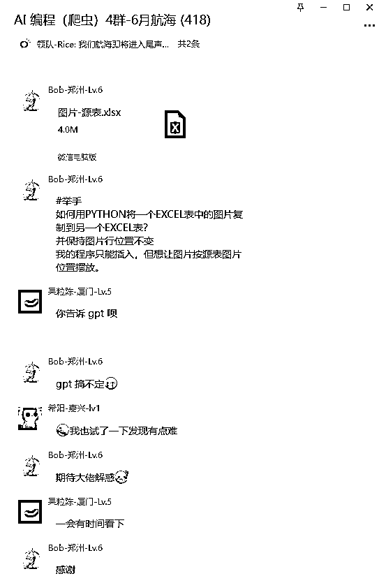 那几天我正琢磨着把CI生成的代码改写成Python工具，看到这个问题顿时来了兴趣——CI本身应该就具备处理Excel文件和数据的能力，不如试试。

这里有一条很重要的经验要分享：CI是在ChatGPT分配的临时虚拟环境里工作的，存在容量限制和超时限制。如果你一上来就让它处理超大数据集或非常复杂的计算，大概率会失败。所以更聪明的做法是：让CI先跑一个数据量小、计算量小的任务；任务跑通后，让ChatGPT把相关代码改写成能在本地运行的版本；然后再用本地电脑去处理更大数据量、更高计算量的同类任务。

这次我换了一个同样带“代码解译器和数据分析”功能的GPTs——Excel GPT。当然，如果你习惯用GPT4或GPT4o，也可以直接在对话框里让它调用CI。我先准备了一个很小的data.xlsx，里面只放了两张图片，完全符合“小数据量”的原则。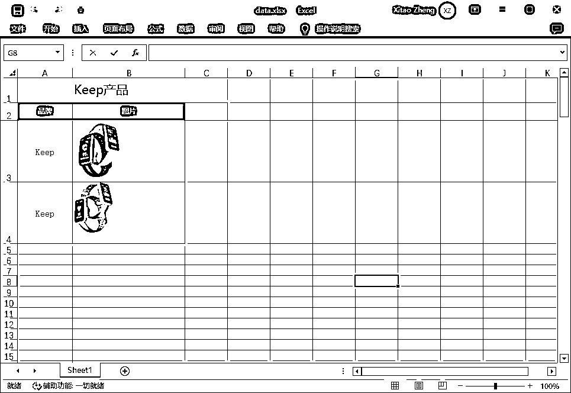

然后向这个GPTs布置任务：“先识别附件data.xlsx中的所有图片，把每张图片复制到名为output.xlsx的Excel文件的D列对应单元格中；复制后，在保留原像素和宽高比例的前提下，把图片显示高度缩小到100px，同时把所在单元格的高度也调整为100px。” 

ChatGPT迅速调用CI完成了操作，并生成一个新的Excel文件。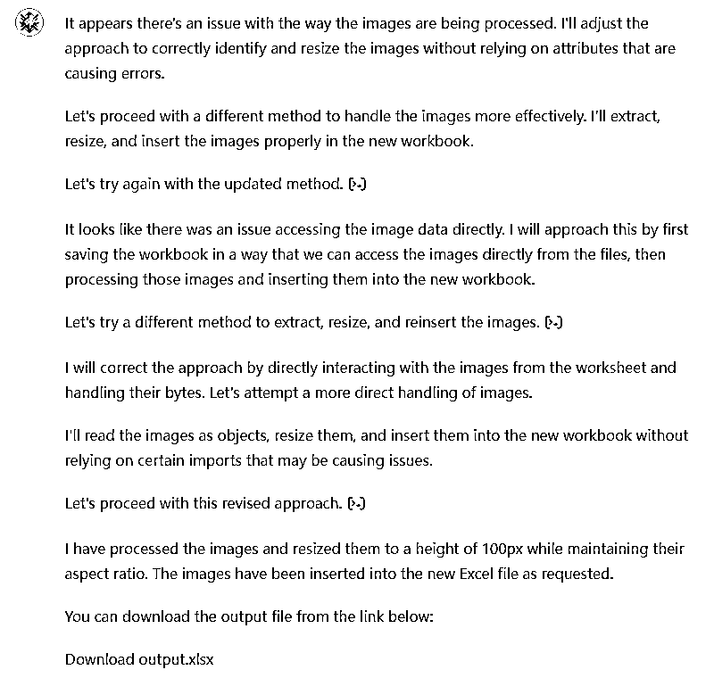 但我打开后发现一个问题：图片复制后所在的行和源文件不一致。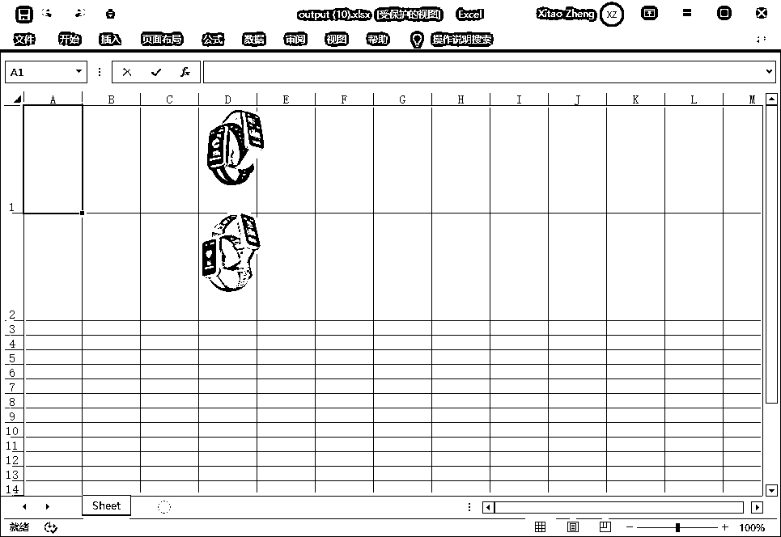 我把这个异常反馈给ChatGPT。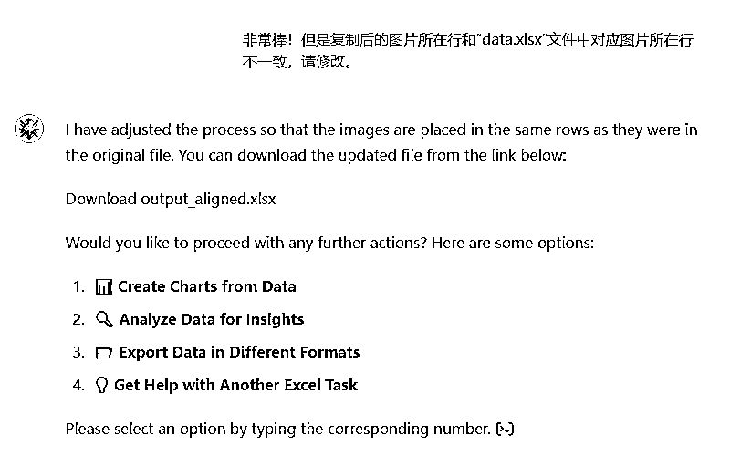 它随即又调用CI处理了一遍，这次图片位置终于和预期完全一致了。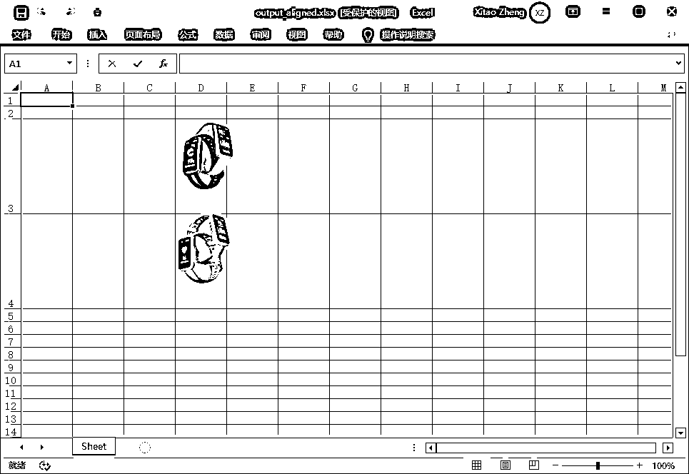

我照例去点“Download PDF”右侧的展开按钮，查看执行任务所用的Python代码与结果。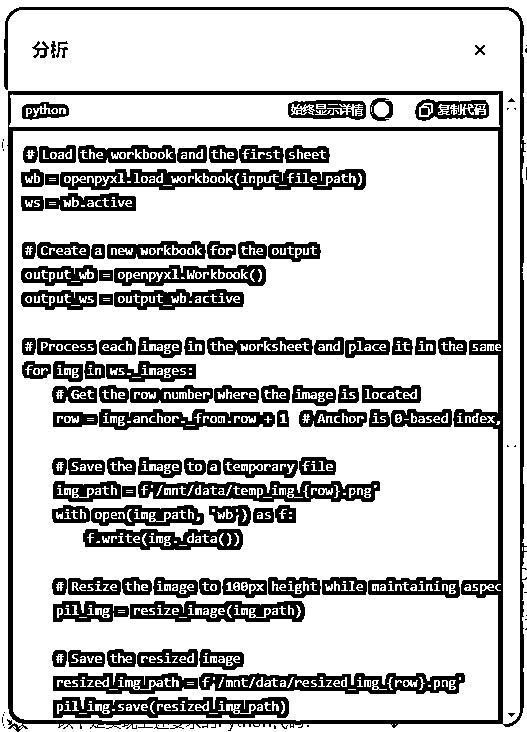 可仔细一瞧，这部分代码里并没有包含“把Excel图片复制到另一个Excel”的完整流程。于是我又让ChatGPT把刚才执行过的完整代码重新输出一遍。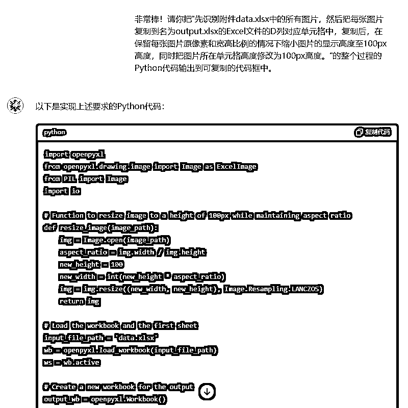

接着，还是同样的套路：让ChatGPT学习CI已经成功执行的代码，把它改写成能在本地运行的程序，并加上用户界面。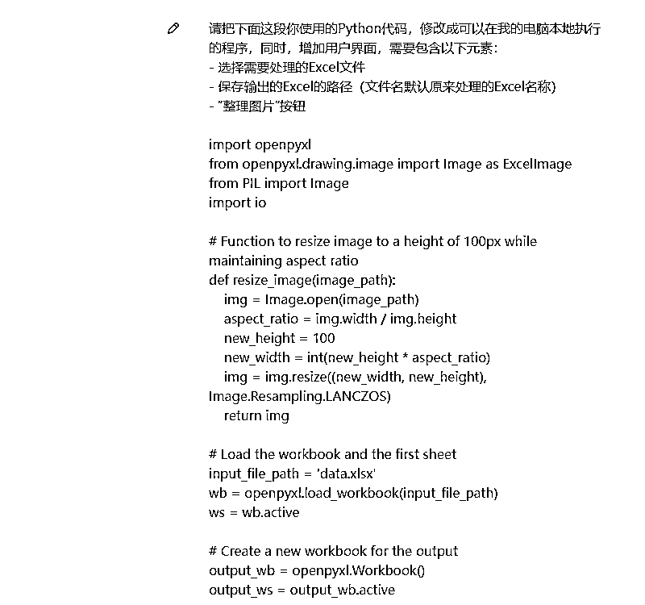 经过测试，程序确实能把Excel中的图片复制到另一个Excel的指定列，但有一些小毛病：图片尺寸不对、分辨率变低，程序目录下会生成临时图片，甚至偶尔会弹报错信息。我把这些问题一个一个抛给ChatGPT，让它逐一修复，最终得到了一份完整的Python程序。

```
import openpyxl
from openpyxl.drawing.image import Image as ExcelImage
from PIL import Image
import io
import os
from tkinter import Tk, filedialog, Button, Label, Entry, StringVar

# Function to get new size while maintaining aspect ratio
def get_resized_dimensions(original_width, original_height, target_height):
    aspect_ratio = original_width / original_height
    new_height = target_height
    new_width = int(new_height * aspect_ratio)
    return new_width, new_height

def process_images(input_file_path, output_file_path):
    # Load the workbook and the first sheet
    wb = openpyxl.load_workbook(input_file_path)
    ws = wb.active

    # Create a new workbook for the output
    output_wb = openpyxl.Workbook()
    output_ws = output_wb.active

    # Process each image in the worksheet and place it in the same row in the output workbook
    for img in ws._images:
        # Get the row number where the image is located
        row = img.anchor._from.row + 1  # Anchor is 0-based index, so adding 1 to make it 1-based

        # Get original image data
        img_bytes = io.BytesIO(img._data())
        img_bytes.seek(0)
        pil_img = Image.open(img_bytes)

        # Get original dimensions
        original_width, original_height = pil_img.size

        # Get new dimensions
        new_width, new_height = get_resized_dimensions(original_width, original_height, 100)

        # Insert the original image into the output workbook with resized dimensions
        img_bytes.seek(0)  # Reset buffer to start
        excel_img = ExcelImage(img_bytes)
        excel_img.width = new_width
        excel_img.height = new_height
        output_ws.add_image(excel_img, f'D{row}')
        output_ws.row_dimensions[row].height = 100  # Set row height to 100px

    # Save the output workbook
    output_wb.save(output_file_path)

def select_input_file():
    input_file_path = filedialog.askopenfilename(filetypes=[("Excel files", "*.xlsx;*.xls")])
    input_file_var.set(input_file_path)
    output_file_var.set(os.path.splitext(input_file_path)[0] + "_output.xlsx")

def select_output_file():
    output_file_path = filedialog.asksaveasfilename(defaultextension=".xlsx", filetypes=[("Excel files", "*.xlsx;*.xls")])
    output_file_var.set(output_file_path)

def organize_images():
    input_file_path = input_file_var.get()
    output_file_path = output_file_var.get()
    if input_file_path and output_file_path:
        process_images(input_file_path, output_file_path)
        result_label.config(text="图片整理完成！", fg="green")
    else:
        result_label.config(text="请先选择文件路径。", fg="red")

# Set up the main application window
root = Tk()
root.title("Excel 图片整理")

input_file_var = StringVar()
output_file_var = StringVar()

Label(root, text="选择需要处理的Excel文件:").grid(row=0, column=0, padx=10, pady=10)
Entry(root, textvariable=input_file_var, width=50).grid(row=0, column=1, padx=10, pady=10)
Button(root, text="选择文件", command=select_input_file).grid(row=0, column=2, padx=10, pady=10)

Label(root, text="保存输出的Excel文件路径:").grid(row=1, column=0, padx=10, pady=10)
Entry(root, textvariable=output_file_var, width=50).grid(row=1, column=1, padx=10, pady=10)
Button(root, text="选择路径", command=select_output_file).grid(row=1, column=2, padx=10, pady=10)

Button(root, text="整理图片", command=organize_images).grid(row=2, column=1, padx=10, pady=20)
result_label = Label(root, text="")
result_label.grid(row=3, column=1, padx=10, pady=10)

root.mainloop()
```

等代码跑通之后（如果运行时报出缺了某个Python库，别慌，直接把报错信息丢给ChatGPT，让它告诉你一步步怎么装就行），在命令行里敲下：pyinstaller -F -w excel_move_image.py，就能把脚本打包成一个独立的exe文件：

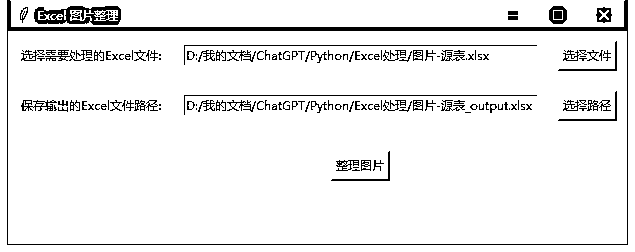

拿这个exe到本地实测一下，把圈友给的源文件丢进去，结果毫无悬念——那份数据量更大的Excel里的所有图片，被整整齐齐地搬进了另一个工作簿的指定列里：

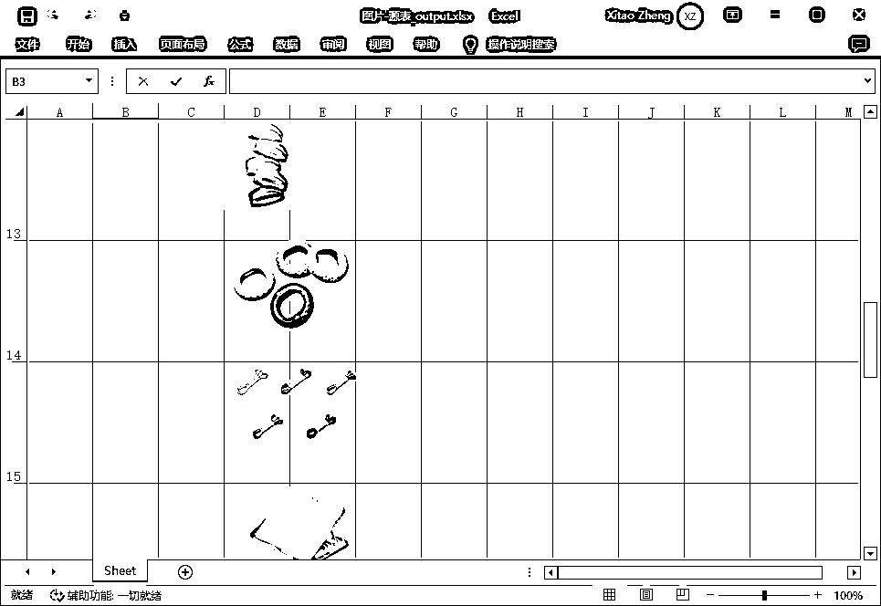

# 更进一步：把选品思路变成选品工具

前两个小测试顺利落地后，我开始琢磨一件事——能不能模仿那位Up主在视频里展示的选品套路，用ChatGPT直接产出一个能反复使用的选品工具？

先来捋一捋视频里那套完整的选品逻辑：

价值百万美金！ChatGPT亚马逊Amazon选品

*   第一步，按照Up主的配置，把JungleScout导出的37份csv格式表格，统一收进一个zip压缩包里；

*   第二步，让Code Interpreter自动写代码，把压缩包解开，将37个csv合并成一份，这时总数据量变成了3700条记录；

*   第三步，沿用Up主定下的选品标准，继续让Code Interpreter写代码，给每个产品打出分数；

*   第四步，让Code Interpreter再写一段代码按条件过滤，最后筛出了194个真正的蓝海潜力产品。

但凡有点编程底子的人都能看出来——这整个流程其实就是一套固定逻辑的执行过程，里面并没有用到任何AI语义理解。换句话说，就算完全不借助ChatGPT，光靠手写脚本或者操作Excel，也完全能把这事儿干完。那么，我们当然有理由把这套流程固化下来，做成一个日后随时能调用的选品软件。

照着前一次的成功经验，这次我们还是请Code Interpreter出马，帮我们搞定文件合并、分数计算和数据筛选这三个环节，然后再把里面用到的Python代码提取出来，加工成真正适合本地使用的选品工具。我这次选用的，依旧是带有“代码解译器和数据分析”加持的GPTs：

Advanced Data Analysis

为了确保Code Interpreter能稳稳完成使命，我们先降低一点测试难度：从37个csv中随手挑3个文件（每个文件里恰好100条产品数据），重新打包一个zip包：

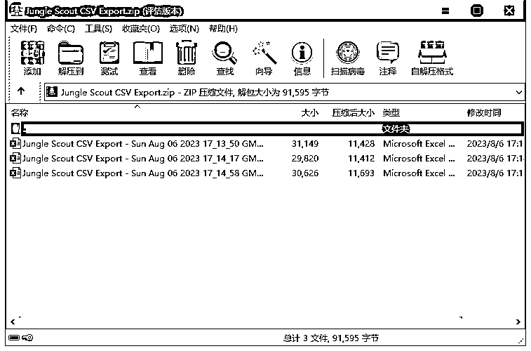

接着，沿用Up主当初的指令，一口气跑完合并、计分、筛选全流程：

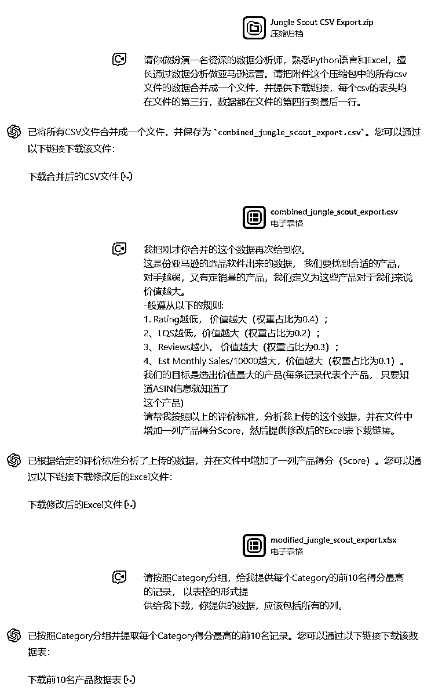

在推进的过程中，ChatGPT一共生成了3段Python代码（点“›­_]”就能展开看）：

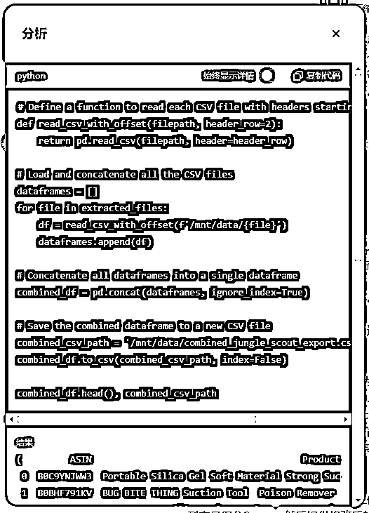

第1段：合并文件

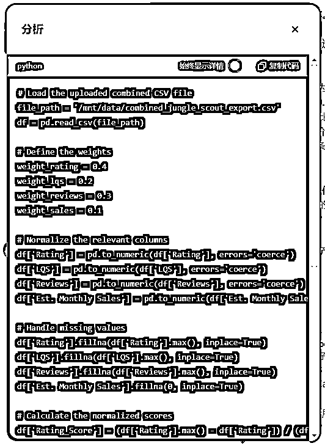

第2段：计算产品得分

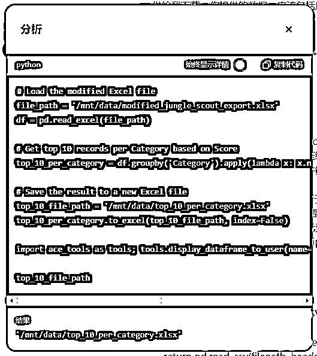

第3段：筛选蓝海产品

我先把这3段代码逐一复制下来，让ChatGPT通读一遍，理解它们的逻辑，然后再请它基于这些逻辑，重写一个能在电脑本地跑通的综合版程序，覆盖合并、计分、筛选全部环节，再加一层人机交互界面：

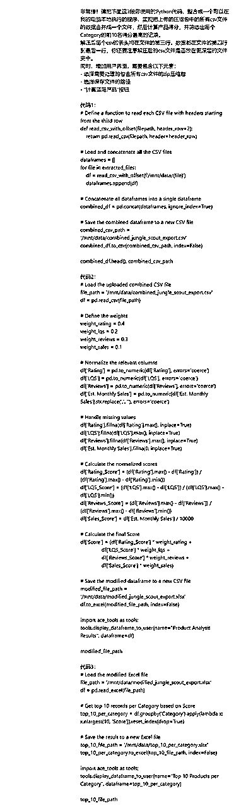

实测之后，效果令人满意——整个程序能把文件合并、产品计分、数据筛选一条龙跑完。也就是说，ChatGPT最终交付了一个功能完整的Python程序：

```
import pandas as pd
import zipfile
import os
import tkinter as tk
from tkinter import filedialog, messagebox

def read_csv_with_offset(filepath, header_row=2):
    return pd.read_csv(filepath, header=header_row)

def process_files(zip_path, save_path):
    # Extract CSV files from zip
    with zipfile.ZipFile(zip_path, 'r') as zip_ref:
        zip_ref.extractall('/mnt/data/extracted_files/')

    extracted_files = []
    for root, _, files in os.walk('/mnt/data/extracted_files/'):
        for file in files:
            if file.endswith('.csv'):
                extracted_files.append(os.path.join(root, file))

    # Load and concatenate all CSV files
    dataframes = []
    for file in extracted_files:
        df = read_csv_with_offset(file)
        dataframes.append(df)

    combined_df = pd.concat(dataframes, ignore_index=True)

    # Calculate product score
    weight_rating = 0.4
    weight_lqs = 0.2
    weight_reviews = 0.3
    weight_sales = 0.1

    combined_df['Rating'] = pd.to_numeric(combined_df['Rating'], errors='coerce')
    combined_df['LQS'] = pd.to_numeric(combined_df['LQS'], errors='coerce')
    combined_df['Reviews'] = pd.to_numeric(combined_df['Reviews'], errors='coerce')
    combined_df['Est. Monthly Sales'] = pd.to_numeric(combined_df['Est. Monthly Sales'].str.replace(',', ''), errors='coerce')

    combined_df['Rating'].fillna(combined_df['Rating'].max(), inplace=True)
    combined_df['LQS'].fillna(combined_df['LQS'].max(), inplace=True)
    combined_df['Reviews'].fillna(combined_df['Reviews'].max(), inplace=True)
    combined_df['Est. Monthly Sales'].fillna(0, inplace=True)

    combined_df['Rating_Score'] = (combined_df['Rating'].max() - combined_df['Rating']) / (combined_df['Rating'].max() - combined_df['Rating'].min())
    combined_df['LQS_Score'] = (combined_df['LQS'].max() - combined_df['LQS']) / (combined_df['LQS'].max() - combined_df['LQS'].min())
    combined_df['Reviews_Score'] = (combined_df['Reviews'].max() - combined_df['Reviews']) / (combined_df['Reviews'].max() - combined_df['Reviews'].min())
    combined_df['Sales_Score'] = combined_df['Est. Monthly Sales'] / 10000

    combined_df['Score'] = (combined_df['Rating_Score'] * weight_rating +
                            combined_df['LQS_Score'] * weight_lqs +
                            combined_df['Reviews_Score'] * weight_reviews +
                            combined_df['Sales_Score'] * weight_sales)

    # Get top 10 records per Category based on Score
    top_10_per_category = combined_df.groupby('Category').apply(lambda x: x.nlargest(10, 'Score')).reset_index(drop=True)

    # Save the result to an Excel file
    top_10_per_category.to_excel(save_path, index=False)
    messagebox.showinfo("Success", "The top 10 products per category have been saved successfully!")

def select_zip_file():
    zip_path = filedialog.askopenfilename(filetypes=[("Zip files", "*.zip")])
    if zip_path:
        zip_entry.delete(0, tk.END)
        zip_entry.insert(0, zip_path)

def select_save_path():
    save_path = filedialog.asksaveasfilename(defaultextension=".xlsx", filetypes=[("Excel files", "*.xlsx")])
    if save_path:
        save_entry.delete(0, tk.END)
        save_entry.insert(0, save_path)

def on_calculate():
    zip_path = zip_entry.get()
    save_path = save_entry.get()
    if not zip_path or not save_path:
        messagebox.showwarning("Input Error", "Please select both the zip file and save path.")
        return
    process_files(zip_path, save_path)

# Create GUI
root = tk.Tk()
root.title("Blue Ocean Product Selector")

tk.Label(root, text="Select Zip File:").grid(row=0, column=0, padx=10, pady=10)
zip_entry = tk.Entry(root, width=50)
zip_entry.grid(row=0, column=1, padx=10, pady=10)
tk.Button(root, text="Browse", command=select_zip_file).grid(row=0, column=2, padx=10, pady=10)

tk.Label(root, text="Save Path:").grid(row=1, column=0, padx=10, pady=10)
save_entry = tk.Entry(root, width=50)
save_entry.grid(row=1, column=1, padx=10, pady=10)
tk.Button(root, text="Browse", command=select_save_path).grid(row=1, column=2, padx=10, pady=10)

tk.Button(root, text="Calculate Blue Ocean Products", command=on_calculate).grid(row=2, column=0, columnspan=3, pady=20)

root.mainloop()
```

确认程序跑通之后（运行途中若提示少装了Python依赖，直接把报错日志丢给ChatGPT，让它给出安装命令即可补齐），我们在终端里输入：pyinstaller -F -w amazon_data.py，把这段Python脚本打包成单文件的exe可执行程序：

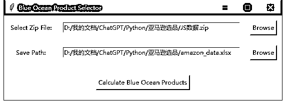

为了检验这款选品工具是否靠谱，我特意联系那位Up主，拿到了他当年用JungleScout导出的一批共37个数据文件作为测试样本：

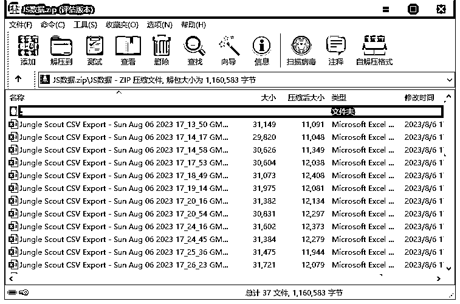

借助刚才生成的exe，我们在本地电脑上运行，选择包含这37个csv的压缩包作为输入，最终能够对压缩包里体积更大的csv进行合并处理，并自动计算产品评分，筛出194款具备蓝海潜力的商品：

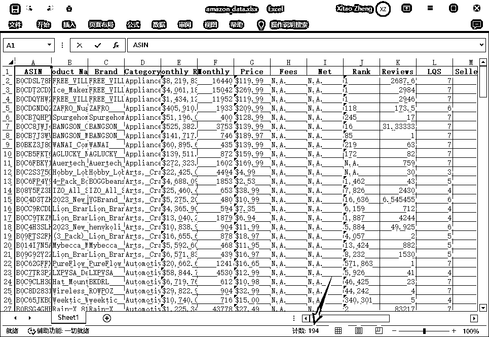

得到的这一结果与Up主视频里演示的完全吻合：

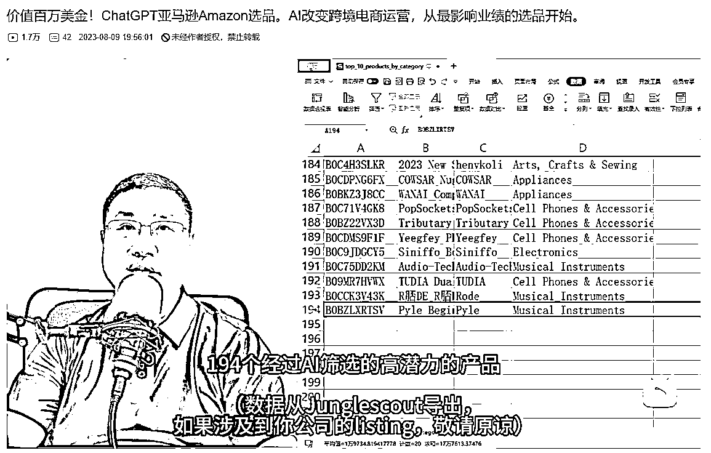

我们完全可以继续和ChatGPT沟通，为这款选品工具追加更多可调节的功能，例如文件格式校验、筛选维度自选、指标权重自定义等，届时就能复刻出Up主视频里所说的那款价值百万级的选品工具。

当然，作为一个做跨境电商的人，我也必须负责任地提醒各位，筛出一批产品并不等于就能赚到百万。实际操作中还得结合自身资金实力、供应链条件和团队配置去评估，还要深入研究竞品背后的品牌硬实力，结合亚马逊当前的市场变化动态调整选品策略，最后再按自己的策略定制工具。

# 进阶尝试：打造亚马逊竞品分析工具

这位Up主除了上述选品内容外，还发布了不少AI赋能亚马逊的系列视频。其中有一期通过分析竞品的评论来挖掘产品优化方向的视频尤其值得借鉴：

很可能整个亚马逊行业格局都会改变（用ChatGPT分析亚马逊的竞争对手）

仔细研究后我发现，这个竞品分析的思路同样可以用ChatGPT编程的方式，落地成一套亚马逊竞品分析工具。

我依然选用的是具备“代码解释器和数据分析”能力的那款GPTs：

Advanced Data Analysis

我们照着Up主的分析路径，让ChatGPT借助Code Interpreter完成从数据清洗、分词、词频统计、N-gram分析、LDA主题建模到生成词云图的完整链路，然后把每个步骤产生的Python代码拿出来学习，再改写成可在本地电脑独立运行、并附带操作界面的程序，涵盖数据清洗、文本分词、词频统计、N-gram分析、LDA主题建模、词云图生成等全流程。

由于整体流程比较长，执行时不可避免地出现过一些错误，但都通过持续和ChatGPT对话得以修复。另外，因为希望做成离线工具，没有接入任何外部AI接口，所以我有意跳过了情感分析、语义分析等环节，这意味着工具跑出来的结果需要人工凭借经验判断，或者再单独交给ChatGPT做二次解读。

最终我们初步获得了一款亚马逊竞品分析工具：

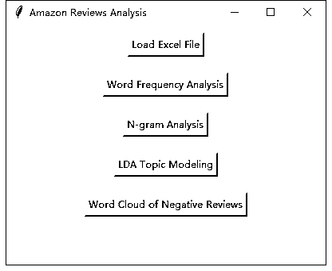

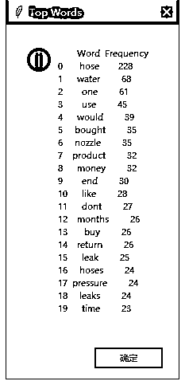

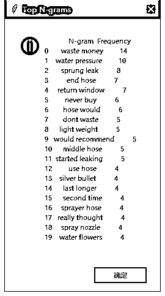

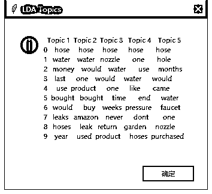

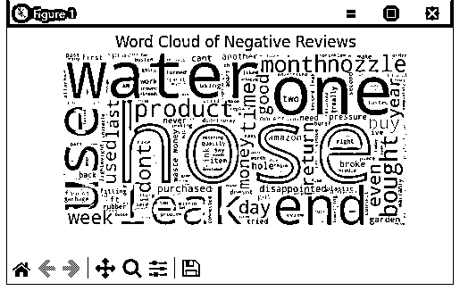

# Code Interpreter编程的边界在哪里

既然我们能先让Code Interpreter按需求跑通任务，再据此改写成本地可用的Python程序，那是不是所有任务都能用这种方式实现呢？

答案是否定的。Code Interpreter本身存在明显限制：

第一，如前所述，Code Interpreter运行在ChatGPT临时分配的虚拟环境里，既有限制执行时间和存储空间，一旦数据量过大或计算过于复杂，它很可能跑不通。

第二，它的技能范围也有天花板。它在数据分析、文件处理、图像处理、数学运算等方面表现不错，但面对一些任务就无能为力，比如我尝试让它直接在虚拟环境里写爬虫并爬取网页，它无法完成。它倒是能生成一段可复制到本地运行的爬虫代码，但无法在当前环境直接执行爬取。

第三，流程越长，整合代码时越容易出错。当一个任务需要多次分析与执行才能完成时，把各段代码合并成完整程序的环节往往会产生报错，必须结合实际情况再与ChatGPT反复沟通协作才能收敛。

第四，Code Interpreter里的临时文件都是短暂存在的。用户上传的文件或它生成的中间结果都会随环境释放而消失，无法长期保存。

本文用Code Interpreter编程来做Python工具开发，本质上是提供一种思路的探讨。实际编程时，大家还是要根据具体情况，选择最适合自己的技术方案。

最后祝各位赚钱有术！