# ('如何从0-1，0成本月入3W＋？玩转小红书资料号我是如何做到的', (2, 33))

0成本月入3W+，红薯平台教辅号保姆级拆解

先说我是怎么入局的。2022年从学校出来后，做了近十二个月销售，机缘巧合遇到星城大哥。他算我的引路人，也把我带进了赚钱圈子。第一次进这个社群，我真有相见恨晚的感觉。作为新人，我天天在里面看内容，后来还学会了各种基础用法。这里必须谢谢龙哥大佬。

在社群里泡了大约十二个月后，23年下半年我辞职，开始做红薯平台的教辅账号。相关关键词下能看的文章，我几乎都读完了。后来再看到星城大哥的文章，觉得一个人摸索太慢，就付费求带。没想到首月就起飞：第7天左右出了一条热帖，当天上午进账580块。之后不断迭代，现在全职做这个。

晒点小成绩，大家轻拍：

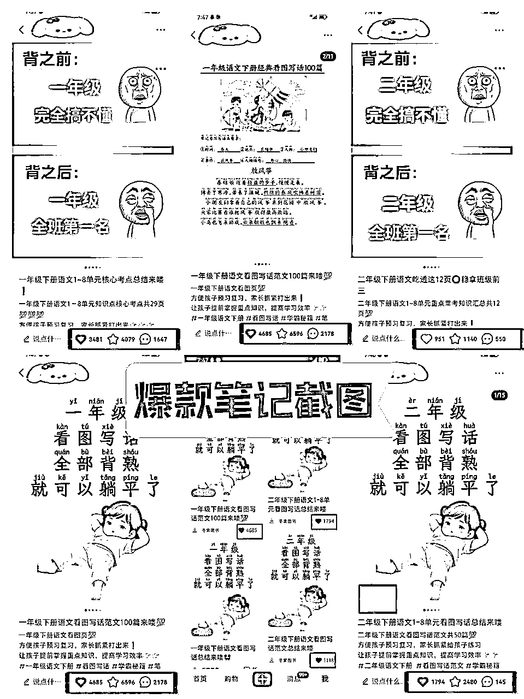
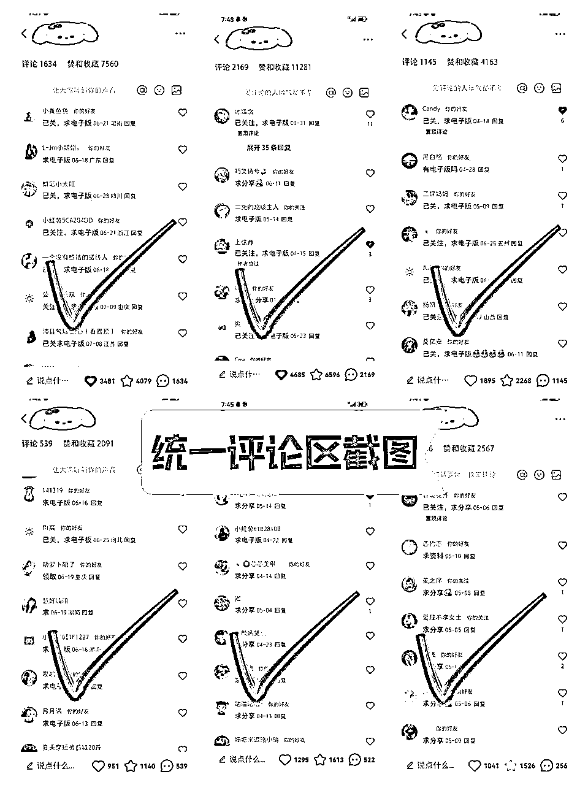

收款记录：

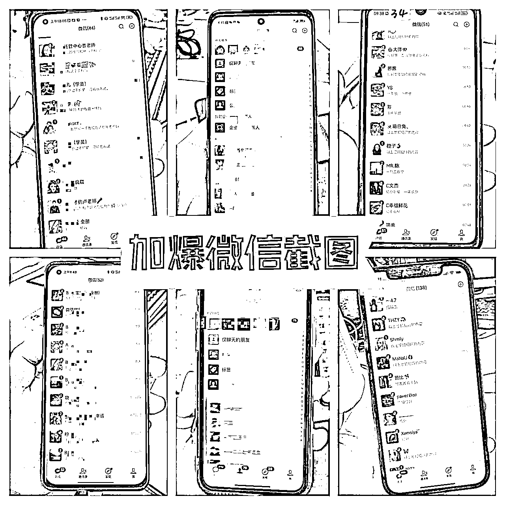
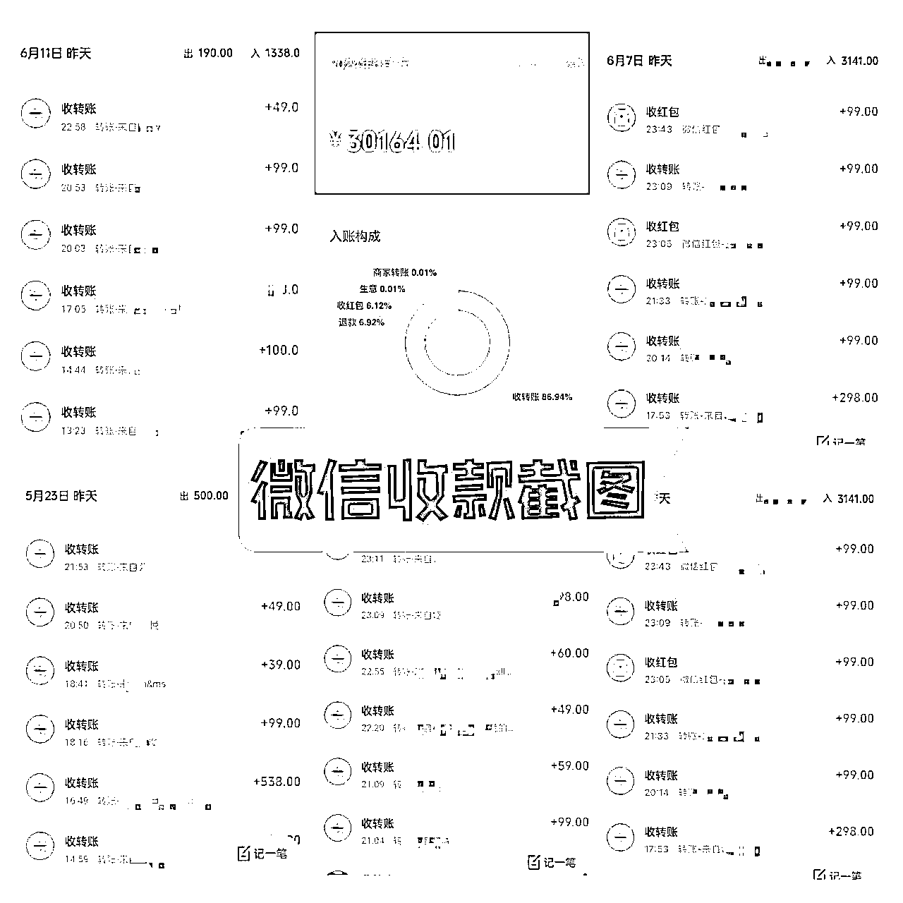

先聊项目的本质。它最大的优点是启动成本极低，卖虚拟文件，没有库存压力；上限也高，我身边靠这个吃饭的人，月收入五位数的不在少数，五万八万也有人做到。而且用户群每年都换新，小学生永远有，教辅需求不断。换学期时，两成到四成家长会直接续费，等于躺赚被动收益。家长都在私域里，人数越滚越多，后续可反复开发价值。

劣势是季节性很明显。开学、期中、期末这类节点，家长最急着找复习预习内容，也最好成交；旺季一天能加100人，淡季可能30人都难。解法是搭配多个盈利方式，把淡季补起来。

具体操作按步骤拆。

先做准备：两台新手机，两张新号卡，一机一号。手机去二手平台淘，两三百到五百就能拿到；尽量避开某些安卓机，有人刷机刷出过问题。号卡在公众号或搜索平台找“手机卡推荐”，月租二三十的不少，认准能打电话的，别买纯流量卡。

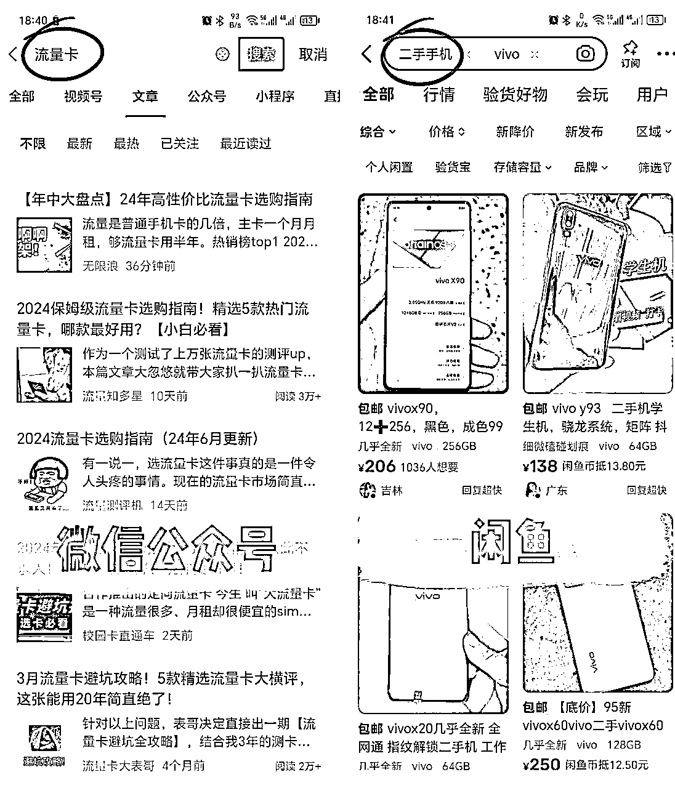

新机到手后重置一遍，别接Wi-Fi，全程用蜂窝数据，防止后台判定同一宽带下多设备登录而封号。

新手最好先囤5到7天的内容再开号，不然前期没反馈，很容易断更。

账号热身：账号名简单直接，做一年级内容就叫“某某老师一年级”；头像是“女老师真人ai头像”，找接近真人的图片，去水印直接用。

简介直接套万粉账号的句式，稍改动，比如“感谢关注，每天更新一年级优质资料”。

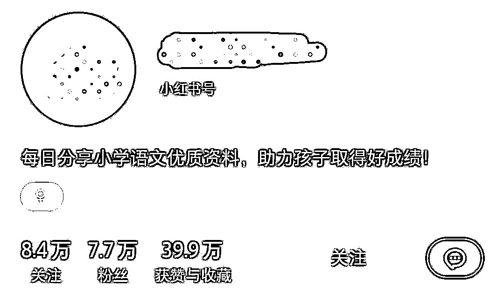

再把收藏、关注、粉丝列表全部设为私密：设置→隐私设置。

一周热身法：头7天每天刷同领域内容或挂直播1小时；前3天日更1篇，后4天日更2篇。这一周只发内容，不做任何导流和互动，除非有帖子已经冲到百赞。

素材获取这条，核心是：热帖会反复出现，你要做的是找到对标和异常值。先用关键词“喂养”算法：比如做二年级语文，就反复搜“二年级上册语文”，看到推荐就挑着点赞收藏，刷一阵子。回到首页下拉刷新，左上角第一个通常就是同类内容。筛选卡几个硬条件：两天内新发的帖子；赞比号上的粉丝数还多；粉丝低于1000；起号不到一周；头图风格统一的号。找不到就继续翻，别放水。

资料库怎么搭建？先加20个同类账号的联系方式，花二三十到五十买单学期资源，看看对方群文件如何。筛出更新勤的、文件总量1000以上、无水印、质量过硬的账号，留三家。再补约60元，进他们的小学六年全册群。这些就是你的底仓。把底仓内容分年级分科目整理到自己的付费社群，稳定更新。

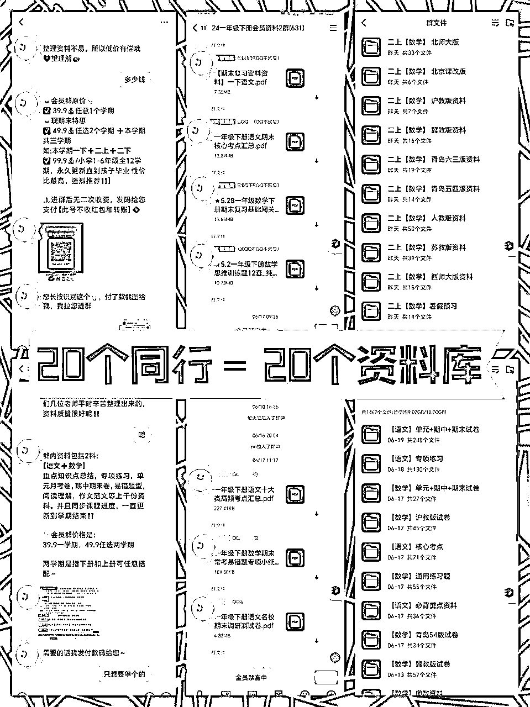

看上某个参考题材后，比如“二年级上册语文1-8单元重点知识汇总”，直接去底仓搜关键词。同类账号的资源高度重合，大概率能找到一样或类似的，也可能有其他版本。前期就肉眼比对，挑一份顺眼的，别纠结。

文件翻新四步。一，改字体。用网页端字体识别工具识别热帖同款字体，下载安装，或开个办公软件会员找相似字库。文档里的字型统一换成热帖同款，字号调到合适。二，改版式。页边距选窄边距，让每页内容显得饱满，家长会觉得超值。

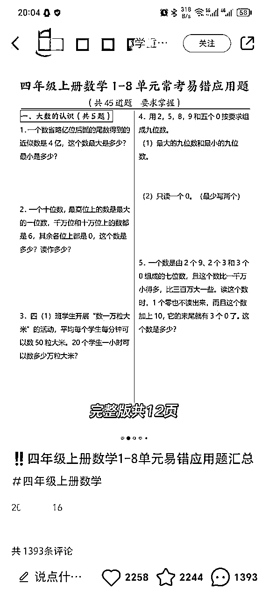

三，调间距。字距、行距、段距调到顺眼；像“期末易错应用题60道”这类结构重复的内容，多用分栏排版。四，换配色。常见热帖主色是黑、红、蓝、青；高亮背景常用黄、绿，红字黄底、红字绿底也有。前期照着参考来，等有手感了再总结自己的。

图片处理：头图用黄油相机。把参考头图去水印，用修图工具抹掉所有文字，再用黄油相机加上相似标题，可以加贴纸去重。黄油相机的草稿箱可以保存模板，随时修改导出。

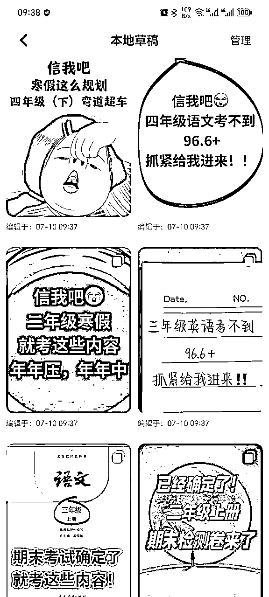

内页图用修图或设计工具，给截图加边框、背景、滤镜、贴纸，干净协调就行。

标题靠平时积累。一段时间里的热帖标题往往大同小异，把开头结尾拆开重组就是新标题。常见套路有“老师发的，一天一页”“吃透X页稳上98”“吃透X页期末反超”这几类。正文文案两三行就够，把标题换种说法再写一遍，末尾加个柔和钩子，比如“有打印版”“家长快收”。

热帖运作的核心就是：多测。持续发内容，测出哪条能爆，就集中重复做，吃完流量再测下一款。打造热帖=模仿别人的热帖，先做到高度相似，再去重成七八成新；复制热帖=微调自己的热帖，换文件、换边框、换背景贴纸，改完再发。

导流环节：提前建三五个红薯群，群名学同类账号，别自己取名，容易违规，比如“家长看这里”。帖子发出后，在置顶评论里引导家长关注和留言。平台算法里，留言和转发权重高：点赞1分、收藏1分、评论4分、转发4分、关注8分，所以评论区要热起来。

私信要回得及时。看到有人加，马上回关、拉群、回复留言。回得越快，转化越好。原因是私聊工具里有红点提醒，平台站内信一忙就漏，漏了就很容易没下文。

如果需要导到私人号，建议用子号在群里引导，话术模仿同类账号。主号千万别在群里说话。重要说三遍：主号闭嘴，主号闭嘴，主号闭嘴。

变现方式最基础的是付费社群。常见定价：单学期39元、学年59元、小学六年99元。还可以设高级会员，和基础会员区分：基础会员学期末清退，高级会员永久有效；服务上，高级会员多送视频课、动画片、特色课等；价格按服务差异定在199到599元。

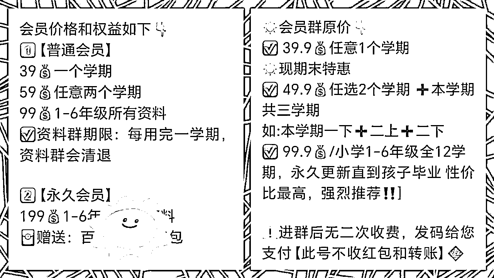

其他方式：代卖网课，帮知识博主卖课，几千元的课程佣金几百元；也可以从有资源的同类账号拿货，但别打包转卖，版权风险大。假期班代理、带徒弟教别人做号，都可以。因为粉丝多是宝妈，文具周边、团购分销等也适合。

聊天话术不固定，核心是：开场问孩子几年级；说明内容要进群下载，群里有专人持续更新最新学年资料，涵盖考点、知识点、单元卷、期末卷、专项训练、易错题、范文等；然后说整理不易，低价有偿；最后报价——39.9元单学期，特惠49.9元任选两学期并加本学期共三学期，99.9元小学六年全部12个学期，永久更新到毕业。强调无二次收费，发付款码，本号不收红包转账，付款截图后拉群。

把人拉进群后，教对方怎么找文件即可，也可以参考同类账号的截图或视频做教程。

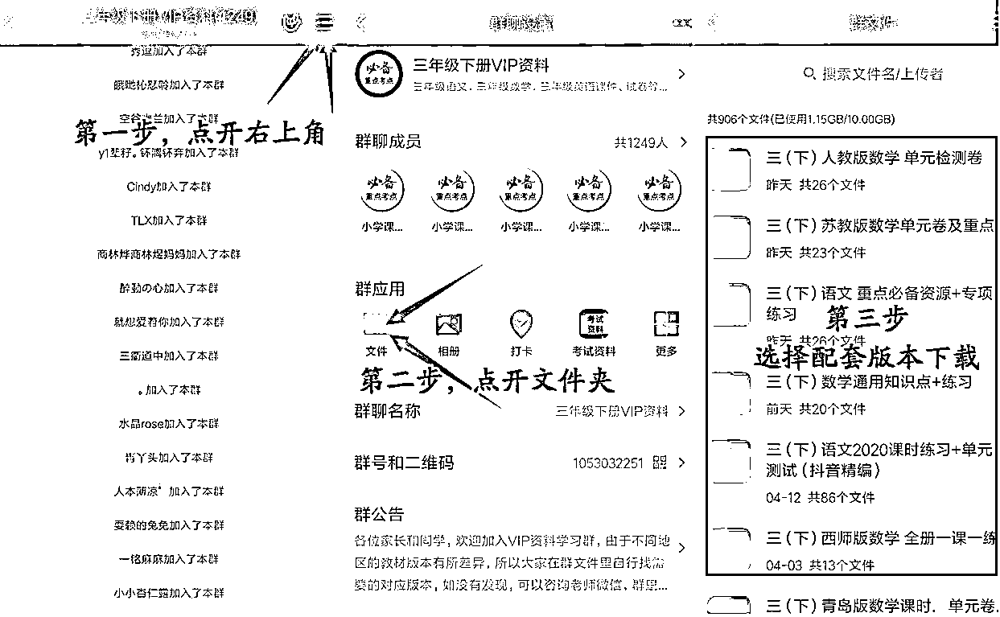

话术要多聊多总结，聊多了自然顺手。

总结：这套玩法在红薯平台和抖平台都成立。抖平台的自然流量目前还好做，以后有机会单独写。建议两个平台一起跑，技能通用。马上9月开学季，想试水的可以趁这波。

以上流程解决0到1没问题。想在红薯上放大并稳定赚，后期建议配聚光投放，付费流量更符合平台利益，也更长久。开学季单粉价值约15到20元，后端转化好会更高；聚光单个开口成本3到5元，想快速拿量就6到8元。

最后再次感谢龙哥大佬、杨涛老师、星城老师。祝各位圈友2024一起龙哥盟！

哈哈，第一次写长文，欢迎评论区指教。