# 老板避雷指南④：卖合伙人产品，我用2个半月卖出122万后的血泪复盘

> 来源：[https://ht16ej1tui.feishu.cn/docx/QtsMd4gcVo1Q3PxamivcJACun7b](https://ht16ej1tui.feishu.cn/docx/QtsMd4gcVo1Q3PxamivcJACun7b)

大家好，我是珍妮。22-23年我和赚钱的老朋友陈铭Ivy在教育赛道做到了2700万营收，我负责幕后操盘。

今年我们一边做自有业务，一边接代运营，同时也把自己的合伙人产品拿出来卖了。

截至6月23日，两个半月累计带合伙人成交122.98万；合伙人分成XX万，数额不便公开。截至7月1日累计开46单，成交139.86万，不含客户尾款。做下来才发现，合伙人产品里藏的坑，比想象的多得多。

本文写于6月23日，所有数据截止到这一天。

目录可以电脑端直接跳转：

一、产品设计环节最容易踩的坑，交付手册该怎么定？

二、招生环节的雷区

雷区1 先判断你的合伙人模式适不适合扩招

雷区2 首批名额别定死，得算好上限

雷区3 对外报转化率时，主动往下调一点

雷区4 有些钱，宁可不赚

三、交付环节的雷区

雷区1 合伙人摆烂怎么办

雷区2 小群里到底放几个人

雷区3 合伙人瞎改不听劝怎么办

雷区4 负责交付的人出错怎么办

雷区5 合伙人招错人怎么办

雷区6 学成后单干怎么办

雷区7 合伙人想榨干客户怎么办

四、佣金设置的雷区，老客户复购和老带新怎么算

附录是我们之前在赚钱分享过的几篇笔记，可以自行查看：

小红书两年做了2700W营收后：我对「留学行业的趋势分析」

https://t.zsxq.com/DT1SJ

小红书教育赛道GMV1600万/年，小团队创业心法

https://t.zsxq.com/aPL7f

粉丝3000月营收20万，小红书低粉高变现的蓝海攻略分享

https://t.zsxq.com/XXl6X

老板避雷手册|年1100w营收背后，如何识别不合适的运营人员、合作商、合伙人？”https://t.zsxq.com/Fvvr8

老板避雷手册2：运营端忽视这些细节，会让你血亏500万

https://t.zsxq.com/LhyXR

「续集」老板避雷手册3：如何识别不合适的运营人员、合作商、合伙人？

https://t.zsxq.com/2Wg9U

如何和另一半&长辈相处，实现2700w营收的同时稳定家庭？

https://t.zsxq.com/49u9r

在我们正式卖合伙人产品前，我们调研了市面上的做法。

大部分合伙人本质上是陪伴型：给情绪价值+一点干货。或者卖项目，但客单价大多在几千以内，到手也就几十上百。

能一单拿三五千甚至八千以上的，基本见不到了。

早几年陪伴型产品稀缺时，老板确实好赚。但现在同质化严重，经济又下行，大家下手越来越谨慎。

盘面来看，能赚钱的自媒体模式就两类：

1. 做个人IP赚钱
2. 做去IP化的项目赚钱

绝大多数人做不了IP，只能靠项目。靠项目就得铺矩阵。

没有IP加持，矩阵号就相当于街上开了几十家店，客户随机进一家。谁回得快、接待质量高，谁就赚。

Ivy和我最后推出一个市面上没出现过的、能保证合伙人起码回本的模式。只发了4条朋友圈，海报都没做完，两天就卖了33万，20个名额清空。为让第一批先跑通，Ivy直接把后续咨询的潜在客户都拒了。

结果3周不到被现实打脸，又临时加收了十几个人。后面会讲为什么临时加人，以及我们踩了哪些坑。

# 一、产品设计雷区：交付手册到底要写成什么样

合伙人交付手册很容易走极端。

要么太简略，上手无门；要么太厚、保姆式，根本没人看完。

还有一个隐藏风险：合伙人想把手册分享给员工，哪些内容能让员工看，哪些必须老板自己看？

起初我写的就是大而全的保姆版。我觉得已经精简到傻瓜式了，但那只是我自己的感受。用户不觉得简单，等于白写。

看不完就容易出错，或直接被吓退。

后来我们让助理再出一个“一页上手版”，私发给每个合伙人小群。新人第一天就照着这个发第一篇笔记。

先让他跑起来，比让他先啃完整套指南容易得多。健身也是，先练基础动作把体能带起来，再学进阶。

所以交付要分两层：保姆级全套+一页速启动版。先跑通再慢慢补课，畏难情绪会小很多。

关于员工可见权限，我们把资料分成两个文件夹。

一个团队可见，一个仅老板可见。员工误点了老板文件夹去申请权限，我在飞书直接点拒绝。

# 二、招生雷区

## 雷区1 先搞清楚你的模式能不能扩招

市面上合伙人产品分两类。

第一类：知道的人越少，越赚钱。一般是教做项目。

第二类：知道的人越多，越赚钱。一般是教IP或知识付费。

如果靠内部团队就能守住壁垒，是第一类。这种项目名字都不能乱透露。

第二类需要不断拉新，老板很累。

我们属于第一类。内部团队培训成本太高，我还有1岁半的娃在备二胎，Ivy也有家庭，没精力再养一支大团队。

有人说可以花一两万请高质量全职，我们当时还是小本经营，舍不得这个投入。我们曾把便利店店员培养到能顶一万块水平的员工，创业初期这是性价比最高的路。

所以我们既像第一类，又因精力不够必须借助合伙人。因此不能像第二类那样无限收人，必须控量。

第一类为啥必须控量？

交付团队扛不住。收几百人甚至上千人，交付直接崩。

另外这类项目有天花板。合伙人开第一单后会开矩阵，资源会被稀释。等大家都有4-5个号，有的20个号，再招人就是内卷，最后名声烂掉。

就算收500人*16999，也才849万，分两人也就400多万，买不起广深的好房子，还背上臭名。

我们是抽项目提成的模式，合伙人赚我们才赚。所以一定要确保进来的合伙人能赚到钱。

想给下一代在广深核心区多买几套房的我很清楚：我能赚多少，取决于多少人希望我成功。会毁名声的钱，越远越好。

总结：教项目不适合大批量招生，教IP陪跑可以。

## 雷区2 首批名额要慎重定

我们第一期只放了20个名额。毕竟第一次带合伙人，怕交付跟不上。

结果两周后就后悔了，必须扩招。4月7-10日陆续发手册，20人里真正冲着做项目来的只有十几个，还有人是冲着7年1V1无限次咨询来的。

为了做项目的人里，有的拿到手册就消失，两周没动静；有的想创新，在没吃透项目前乱改，必死。我们当时经验不足没拦住，等他失败了才介入。

后来新进来的人依旧想创新，我们得不断拦。

经验是：只收20人，能稳定跑超过1个月的，大概只有10人左右；能严格按指南来的，大概5人。剩下都慢。

5个人开单我们撑不住，所以扩招。

到6月23日，累计收了37位，其中1位交定金未进群。冲着项目来的32人，更新超过1个月的20人，间歇更新或未开始12人，最终开单17人。

不算尾款和代运营业务，两个半月合伙人累计销售额122.98万，返佣约XX万。

我有完整的进度表：账号是否有人咨询、下发线索情况、本周是否跟进、是否需重点盯、洗稿速度、阅读量、成交金额全记录。

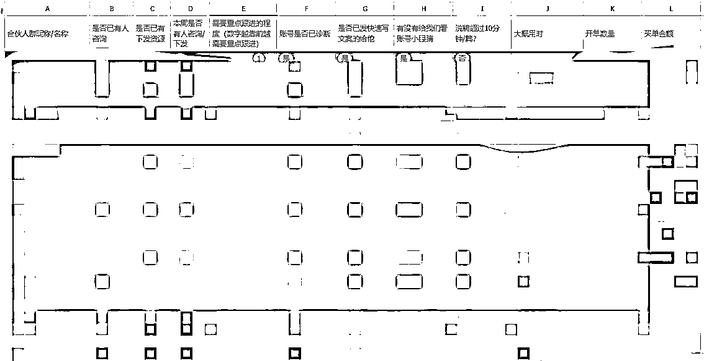

复盘发现扩招是对的。第一批20人里只有10人最终开单，其中仅2人在4月就开单，其他是5-6月，甚至有5人是6月才开单。3人是间歇性划水。

如果当时不扩招，前20人跑1个半月只有5单，信心会崩，名声也会烂。

高客单转化周期1-2个月很正常，但人天生求快。跟他讲道理说慢慢等，会被骂画饼。

好在6月开始，四月铺的资源陆续成交。

5月中旬前我经常被小窗质问：为啥还没咨询、为啥还没单、能不能赚。甚至有人质疑我造假转化率。

开店被质疑正常，大家不了解我，能信任交钱已属不易，要完全放心需要时间沉淀。

不是谁都像我和Ivy高中大学一起读书、闺蜜14年关系一样能完全托付。

我们只能积极处理情绪。

5月中旬后这类私信就停了。因为大群里真实合伙人在晒单，大家看得见。能不能赚不需要我证明，市场会证明。

总结：靠带人做项目赚钱的老板，第一期人数不能太少也不能太多。太少出不了成绩，名声完蛋；太多内卷，谁都赚不到。

## 雷区3 公开转化率时主动调低

我们对外宣传转化率是7%。一开始线索跟进表是公开的，所有合伙人都能看到彼此数据，就是为了透明。

悲剧就来了。虽然我们反复强调高客单1-2个月转化很正常，Ivy甚至把数据往下调了宣传。但现实仍有人质疑：某某都发了11条线索还没单，是不是造假。

我回：数据全真，支持律师来查，造假全额退再赔1万。最后情绪安抚下来了，但类似问题不断。

还有人不想让别人看到自己的线索，想归类到别的表。我们就顺势把线索表隐藏了，每周由小助手截图进度条发群。

结果有人3-5条就成交，远高于7%；有人20条以上没成交，远低于7%。这很正常。遇到高意向客户一周成交，遇到低意向的得等1-2个月甚至一年。

注：我们是项目的核心合作方，线索首次从我们渠道下发，一年两年后在任何渠道成交，返佣仍归合伙人。这是项目方给的保护。

总结：对外报数要保守，别给过高预期。线索进度别全公开，只定期推送，避免未成交的人焦虑。

## 雷区4 不赚不合适的钱

37个合伙人里，我们拒绝了更多人。

第一类：自己项目没跑通，或在纠结选赛道，想从0到1培训、教建团队的。我们的产品是7年陪伴，没精力先教选赛道。

除非对方已有赛道跑通，只想买7年1V1咨询，我们才收。

第二类：有主业，想一天工作一天游山玩水的all in派。这类人很信任我，但我得拒。

没有IP色彩的产品必然是矩阵号。矩阵号要及时回微信、小红书，否则没单。

买大几万家具，你会选第一时间接待你的店，还是拖半小时才理你的店？

做IP苦不愿吃，就得吃及时回复的苦。Ivy和我是全年无休，还没到能退休养经理人的阶段。

对方说要从体制内出来，一天做自媒体一天放空。我回：这是富二代的生活，富一代没法过。博主还要提前选题拍摄剪辑。

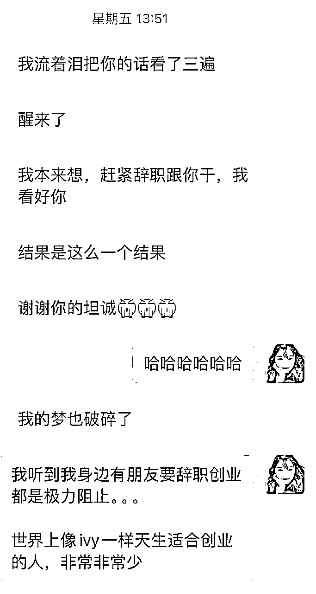

第三类：以前做过项目，现在不行了，手里余额低于2万想all in。

这类人通常看过十几个项目，心态极不稳定。焦虑会直接带到业务上，最后钱没了项目也没了。

我们愿意安抚情绪，但更希望是给人带来钱，不是只给情绪价值。

交16999的人是冲着结果和赚钱来的，不是听安慰的。情绪价值、实用价值、给资源赚钱，三者无法兼得。

就像娃姐石剪布理论：情绪价值剪刀、实用价值石头、给钱资源布，三者不可能并存，否则就是骗局。

林老师的不可三角也是：帅、有钱、感情专一，三样全占的必是诈骗。换到女性也一样。

做交付，比做招生更难。

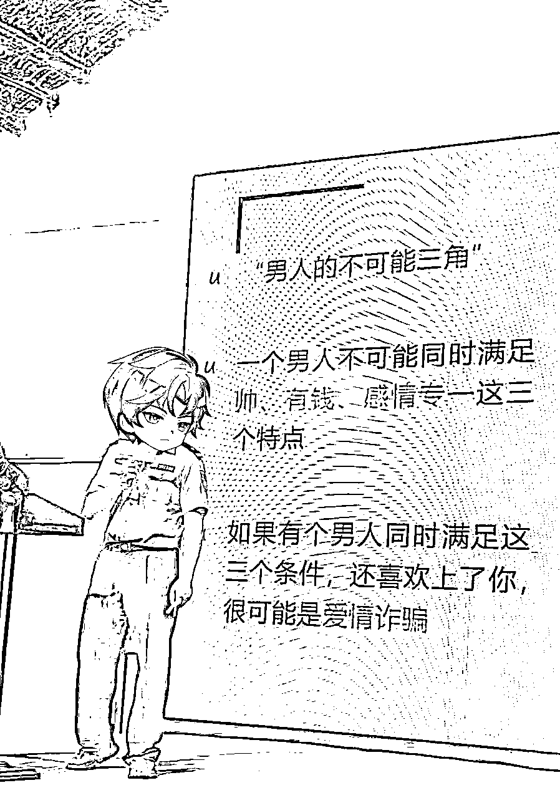

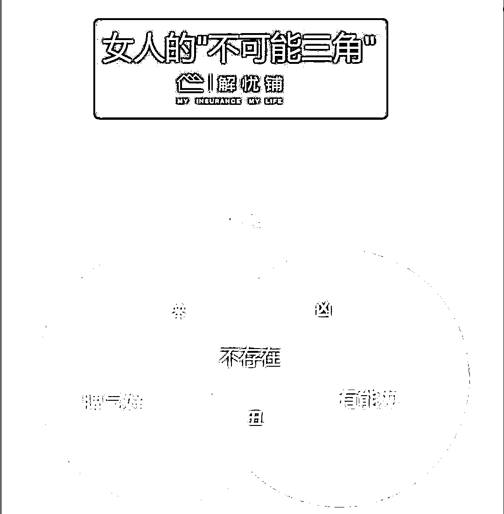

我和Ivy这段时间把火力集中到了两件事上：一是帮合伙人打磨自己的生意盘子——该给的询单给到位、佣金结算不拖沓、个别伙伴我们甚至直接上手代运营；二是帮合伙人训练他们自己的小团队，教他们怎么挑人、怎么带人、怎么建SOP。当我们全身心做这两件事，就注定没有太多余力去照顾每个人的情绪。

可情绪这个东西，恰恰是交付里最容易爆的雷。

# 三、交付雷区

## 雷区1：合伙人突然摆烂，到底是谁的问题？

有人日更不断，就有人停更躺平，这是必然的。

停更的潜台词无非是：信心没了，热情灭了，或者已经磨到不想再碰了。

有一回，我们一个合伙人的笔记忽然爆了，160多个人在评论区问价。当时我一看这势头挺好，觉得她已经“上手了”，转头就把注意力放到了其他还没起量的合伙人身上。她后面数据怎样，加V率多少，线索有没有发下去，我没盯。

结果等到她来找我们，整个人已经崩到临界点。

她说：160个人问价，真正加上微信的只有几个，能顺利下发的更是寥寥。又赶上家里老人身体不好，种种压力叠在一起，她对这个项目彻底没信心了。

我复盘了一下，这一波是我失职。我们内部团队习惯了用聚光直接加微，完全不觉得加V会出问题，也就没想到提醒她：“大概率是你的微信号根本发不出去，客户看不到，自然没法找你咨询。”

当天我多转了600块给她当道歉费，并且把“加V率”这件事提到最高优先级——在大群里要求每位合伙人主动汇报：今天加了几个V，什么IP，问的什么产品，是否成功推进到销售。每一个人情绪炸掉的背后，都有一条长长的导火索。没有人会因为一件小事忽然爆发，一定是另一件、再一件小事攒到一起，最后压垮了。

作为卖合伙人产品的人，必须在交付过程中足够敏锐，把细节盯住，别让情绪问题积压在大家心里。真出了问题，也得快速接住。

当然，现在依然有合伙人处于断更状态。有老板可能会说：商界不就是二八法则？那20%的人赚钱，剩下80%陪跑，断更就断更，难道还得哄着捧着、把饭喂到嘴边？

我之前看到林隆老师在知识星球里写过一段话，特别受触动。

他说：企业里那20%的人创造了80%的价值。头部这些人从不抱怨、不添麻烦。他们知道把流量和人设做扎实，销售就是顺带的事。品牌方给了足够的利益分配，他们就不会跑来索取多余的情绪价值。但该给的情绪价值照样要给，给到平均值就可以——准确说，我们要给的不是日常销售问题的解答，而是帮他们兜住生活里、家庭里、情感里的那部分烦恼。

而剩下那80%的人，虽然只贡献了20%的产值，却要走掉我们80%的时间。他们没赚到自己预期的钱，所以才需要品牌方花更多情绪价值去填那个落差。这些情绪价值包括日常聊天、听他们抱怨别人比别人好、不停地给产品赋予故事性和独特性、提供好看好用的素材，甚至降价让步。

你会发现那20%的强者，自己就会讲故事、拍素材、让客户觉得买得值。

但另外80%的人提的要求就不合理吗？

非常合理。每个人的生态位不一样，站在那个位置，自然会有那个位置的需求。品牌方不解决这些问题，凭什么只靠20%的人赚走80%的钱？——这才不合理。

那20%的人为你省下的时间、带来的财富，你反而要拿来服务另外80%的人。

这让我想起高中数学老师常说的“极端举例”：任何一种生态，永远都有二八分层。如果你嫌弃那80%，那么留在你身边的那20%，也会二次分化出二八。

所以别嫌有些客户烦，因为大部分客户都这样。也别觉得你给了对方赚钱的机会，对方就欠你一句谢谢。在不同的情境下，你们是独立的个体。

不要想“他应该感谢你”，而是“因为他，你才有今天的成绩”。你要感谢他，该给的情绪价值必须给到位。

不能逼捐，同理，也不能逼人感恩。

每一个客户，都很重要。

我从这段话里悟到最重要的一点是：每个客户的诉求，都是合理的。

所以当合伙人不更新，我们要做的不是骂，而是解链：

1）找出断更的真实原因——是回复不过来？精力不足？还是招聘的员工总跑路？也是没招到对的人？

2）把“不更新的后果”讲清楚。现在日更的合伙人会越铺越多矩阵号，你不更，别人在抢你的蓝海，越等越红海，后面想做都难。

3）要是真没精力继续，那就等下一个蓝海项目彻底跑通后，再邀请断更的合伙人回来。

4）如果只是间歇性更新、且一直没开单，那基本可以判定为情绪问题，需要积极排解。

人家没开单，闹点情绪，太正常了。

如果对方连情绪都不主动讲，那我们就安排小助理定期巡场，发现异常及时说出来。

## 雷区2：交付小群，到底能进几个人？

只进一个人：合伙人本人。

有些合伙人自己不想干，打算让手下人接手——这个人是生意伙伴也好，临时招来的兼职或全职也罢。

但无论进来的是谁，都要先跟合伙人把规矩讲透：

“交付小群只能你一个人进。如果你要把干活的同事拉进来，那个同事得是你确定能稳定待半年以上的人。不能确定的，拉进【合伙人小伙伴群】，重要通知都在那边同步。”

为什么要设这个门槛？

我们一开始没设，心软帮不少合伙人培训了他们的小助理。结果这些小助理大多干一两个星期就走，我们只好重新教下一批新人。

每来一个新人，就要重教一遍。一个交付小群里要是挤了三五个、甚至十个小助理，我们根本顶不住。

所以我们只培训一个人。这个人可以是合伙人本人，也可以是合伙人充分信任、打算长期共事的核心助理。之后合伙人即使扩团队，这个核心助理也学会了我们的打法，再往下转训，我们就不用反复当传话筒了。

## 雷区3：合伙人不听话、非要自己整活，怎么办？

一个肯花16999买合伙人产品的老板，用娃姐那套理论来说，一定是很“有布性”的，翻译过来就是有主见的人。

有主见、有执行力，本身就是赚到钱的必要条件。但也因为主见，一定有人不听劝。

不听劝的后果，通常有四种：

1）不按项目指南打，自创骚操作，绕一大圈弯路，最后累趴，人直接不想干了；

2）客户来咨询，结果连小红书账号的基础设置都没按我们要求来，微信根本加不上；

3）加上微信后聊天自由发挥，把客户聊没了，没法转给销售；

4）勉强发给销售，才发现对方压根没有付费意愿，白白浪费线索。

一开始我没意识到“不听劝”有多致命，心想：人家创新就创新吧，万一折腾出比我们还牛的路子？

事实证明，是我想多了。

我和Ivy从16年就在留学圈里泡着。Ivy做的是留学申请赛道，我是从翻译、中学英语老师、雅思老师、外研社评委，一路做到留学生作业代写和论文润色。我们太清楚留学生在想什么。再加上这是我们两年做到2700万营收的项目，什么封面、什么素材能打动什么专业的客户，我们拿捏得死死的。

如果连我们都想不出更好的打法，那大概率没有人能想出来。

想通这点之后，我们改变策略：阻止。阻止那些“创新”，直接把对方操作会带来的坏结果一条条放在台面上。

甚至，我们会直接跟合伙人对齐：“别说废话。说废话就没钱赚。”这里浅浅晒几个当时的朋友圈思考和案例。

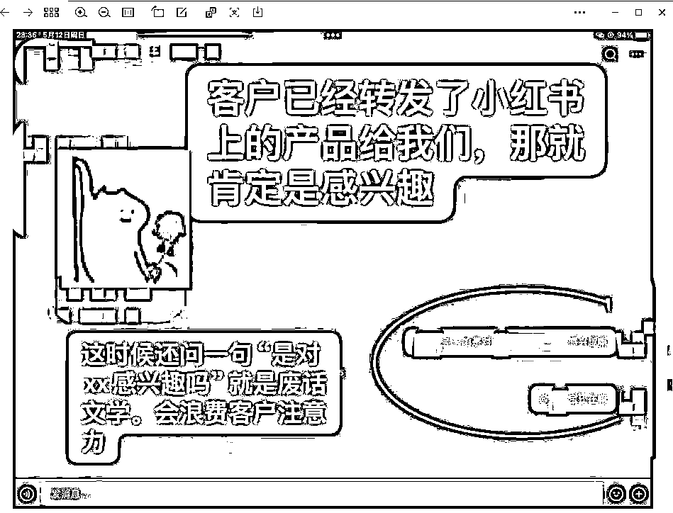

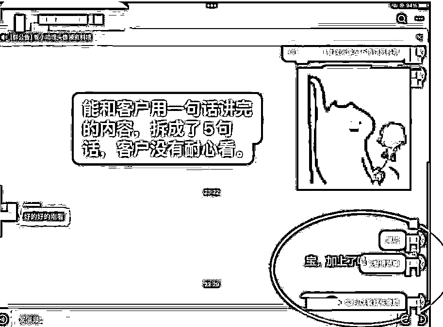

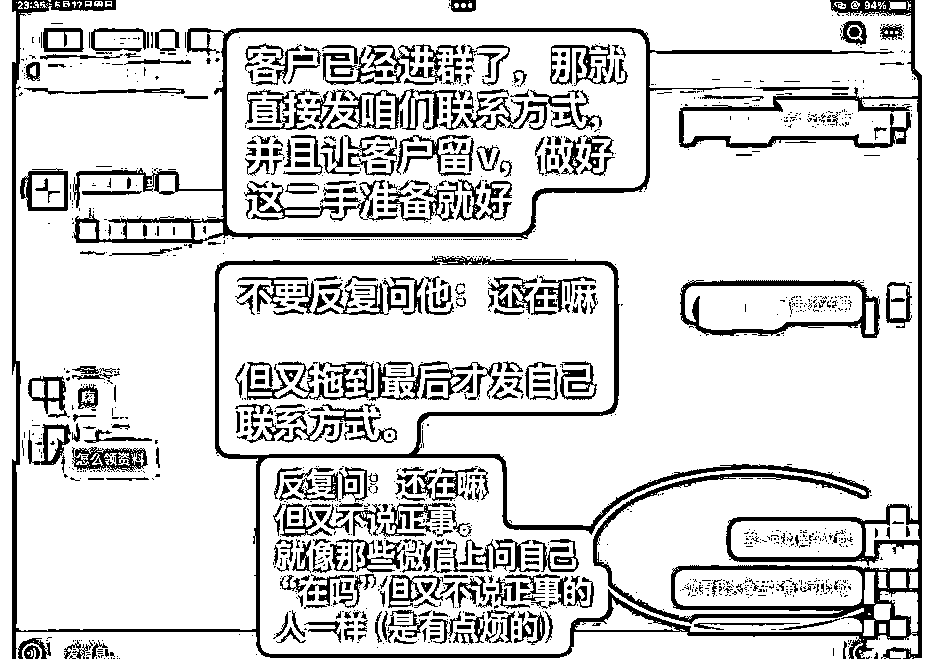

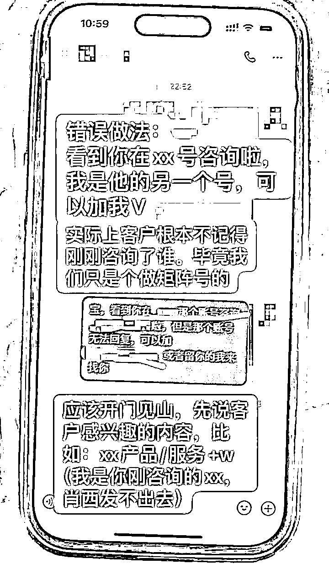

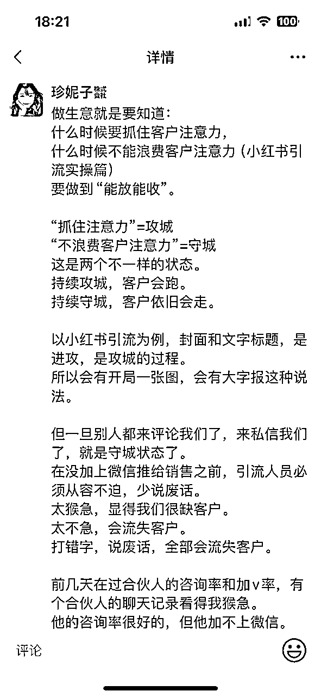

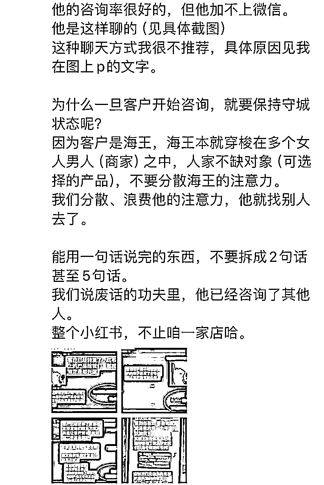

对合伙人说这种话，其实已经是重话中的重话了。

合伙人说到底是我和Ivy的客户爸爸，不到万不得已，谁会对金主说重话。

我也犹豫过很久：说重话会不会显得我不尊重人？可不说重话，就看着对方一直走弯路，最后赚不到钱，终究会怪我。

挣扎了半天还是说了。做人做事，与其捧杀一个人，不如让他早点看到真相。

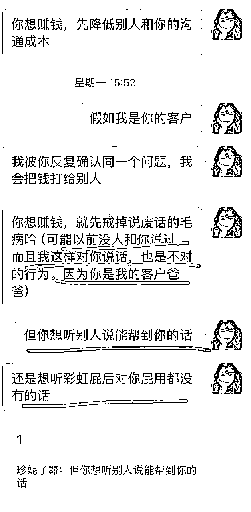

## 雷区4：负责交付的自己人出错，怎么办？

我们的小助理以前从来没一天服务过那么多合伙人。以前他只是做运营引流的，用固定话术筛一下客户就完事。现在要同时接这么多合伙人的咨询，偏偏还有人根本不看指南就来提问，小助理经常憋出一肚子火。

火气一上头，就容易乱套。有一回他分不清群聊归属，把对A合伙人的火气，发到了B合伙人头上。

被我和Ivy当场发现，当天就挨了批评。紧接着Ivy又私聊那位被误伤的合伙人，诚恳道歉。

做生意的人，绝不该对自己掏钱的客户发脾气。员工就是自家的孩子，自己不管好，跑到外面闯祸，背锅的还是自己。

跟客户吵架，吵输了，输了；吵赢了，还是输了——因为不管输赢，生意都没了。

这句话是我在拱卒创峰会学来的。

工作遇到不顺心的事，这口气应该在外面消化掉，而不是冲着给你打钱的人放。

后来我们内部索性写了一份“石性剪性提高手册”，教大家怎么服务好自己的客户爸爸。

我会把问题和客户聊天记录里的雷点截图出来，抹掉小助理的头像，再拿出来当培训案例。

并且强调：此次培训不针对任何人，只针对这件事。大家想继续在家安稳上班，就得学会服务好别人，学会交付实用价值和情绪价值。

然后逐条拆解：这样聊为什么错？怎样聊才对？背后的逻辑是什么？以后再遇到同类问题怎么处理？

我平常在知识星球更新的很多内容，看起来像生活观察和个人反思，其实就是我们内部员工培训的教材。

我也会跟他们说：分辨不清什么是实用价值，什么是情绪价值，不懂什么叫出石什么叫出剪，就去看珍妮的星球。

这样带过一轮后，小助理犯错率降了七成。

剩下30%，由我和Ivy继续盯。一旦发现还能优化的地方，就提出来。

老板如果想留下一个员工，不管ta犯多少次错，只要还想用，就得在带ta往前走的过程中，该指出问题就立刻指出，别攒着。

## 雷区5：合伙人招到不合适的员工，怎么办？

我们手里有一个“资本家之路”的群，是专门教合伙人招人、筛人、培训人的。

但不是每个人都有空爬楼看群消息，所以招错人的时候，我们就得私下单聊：“这员工你在哪招的？学历怎么样？之前做过什么？你开的工资是多少？聊天记录发来看看？”

然后结合项目性质，给出具体建议：这个项目适合MBTI里的哪几种人格，需要什么专业、什么学校背景、什么学历。

有的合伙人没有招人经验，会把候选人的聊天记录甩给我们看。

我们就从对方的回复风格、微信头像、昵称、朋友圈内容、16型人格做个快速判断，直接告诉他：这人能不能用。

## 雷区6：员工或合伙人学会之后单干，怎么办？

这个问题，是一个买了我们七年无限次1V1咨询的老板提出来的。

他的原话是：怕自己教会了员工，员工跑了。

而我们早在招合伙人之前就想过这个问题。

我们的答复如下：

如果你有自己的项目，怕员工跑路，可以做三件事：

1）账号在你的名下，手机你买好了寄给他，合同全签好。你的矩阵号就是你的规模，他就算学会你所有的内容打法，也干不出你的矩阵规模。每个人在决定单干前都会衡量利弊，只要你给的待遇是他单干很难拿到的，他就不会走。

况且，一个出去单干的人，要自己扛配图、运营、选题、销售，每个环节还得定期更新打法，哪有抱团赚钱快。

2）招员工的时候就要细致过滤。怎么筛，这里不方便展开。

至于合伙人要跑路，说句实在话，我和Ivy完全不怕：

1）我们签了竞业协议。说白了那是个君子协议，只能守君子，防不了小人，更多是走流程。但连流程都能暴露出一个人的态度。

2）我们在小红书上已经占了近乎半壁江山。谁能跑路做成我们的规模？没有人比我们更懂留学、更懂运营、更懂后端的销售转化率。同一个客户推到其他渠道，都不可能拿到我们的签单率。

3）我们本身就是项目最大的合作方。项目总部甚至单独定了一条规则：谁第一个下发这个资源，后期无论客户在哪个渠道签单，佣金都返给第一手资源下发人。我们从22年开始，每月推600条素材给合作方，不管客户最后在哪边成交，钱都算我们的。

4）我们能给出去的从来不只是这单一项目的价值，还有挑高客单项目的眼光、优质老板的圈子、签单转化的能力、把新人带到上手的整套SOP。换任何一个人，都复制不出这个效果。

任何技巧，在绝对性优势面前，都是纸老虎。

## 雷区7：合伙人想把客户价值榨干，怎么办？

同一个客户，肯定有各种需求：可能同一时间是留学生，既需要课程辅导，又需要作业代写，还需要申请夏校、找实习、海外租房……

所以当我们的产品满足不了某个留学生需求时，合伙人会问：珍妮，要不然咱们把这个学生推给别的合作方？

其实我23年3月就知道留学赛道要下滑。

所以那年上半年我一直在试：怎么用AI来提升洗稿效率。

到了下半年，我加了上百个做留学细分业务的同行，一个一个去推人头。

我还亲自带了几位小伙伴去做其他细分业务，一度给公司挣了好几万。但回头一看，为了这几万块钱花的精力，远不止这个数。

有的朋友可能认识我，是看过那篇“小红书两年做了2700W营收后：我对「留学行业的趋势分析」”，或者是“老板避雷手册|年1100w营收背后，如何识别不合适的运营人员、合作商、合伙人？”。那都是我踩过的坑换来的经验。

折腾到最后我发现，像我们这样从运营、销售到交付全链路都能高度把控的项目，市场几乎没有。

给一些老板推了四五十个人，一单没签。

给另一些老板推了几十个人，单确实签了，但交付做得太差，最后擦屁股的是我，还倒贴了钱。

再后来我们干脆自己接销售，接了一些看似很好的画像，要么签不下来，要么到现在佣金还没拿到。还有一次，我花了一下午跟客户打电话，客户发了张好人卡说“你人真好”，转手又推了她的朋友，朋友也说“谢谢你珍妮，你人真好”，可一直到24年6月，都没买单。

就算买了，也就两三千块，我都不知道这钱赚来干嘛。

最后我含泪抱住Ivy：“你是对的，市场上真的没什么好项目，我再也不搞这些有的没的了。”

留学赛道的细分业务，到了24年，大多不值得做，或者说已经难到离谱。

如果你对留学赛道没有深耕，以为懂那么点运营技巧就能自己摸索出金矿，那真是想得太美了，只有亏到裤子的份。

所以我们砍掉了不少杂七杂八的项目，只留下有限几个聚焦的项目。自营业务里有个留学项目已经快要走到尽头，只剩下我们做了两年的代运营留学项目。

除此之外，我们全员接“非留学赛道”的代运营项目，留学个项目，我们只拿来保底。

现在如果再遇到合伙人说想把手里留学生资源利用到极致，我就会把我自己的血泪史甩过去：“推给其他留学项目？推给别的合作方？我在你身上看到的赔率大概是100个客户能签3单。我们不做这买卖哈，你要做，自己去联系。”

# 四、佣金设置雷区：老客复购&老带新，怎么算佣金？

这里其实是一个战略选择：你是拼命拉新，还是拼命维护老客户？

我是娃姐的学生。娃姐有一句话原句我记不清，但我的理解是：每个人的时间和精力都有限。要么你把时间给新客户，要么你把时间给老客户。不可能做到对新老客户一样好。因为无差别的好，等于没有好，最后两边都不会把你的好当回事。

所以我和Ivy很少主动拉新。我们的精力，全部分给了老客户，也不打算招太多合伙人。因为人越多，竞争越卷，最后会侵蚀那些一开始就信任我们的老客户的利益。

老客户在我们这里拿到的利益永远是最多的。

我们有一个很特别的规矩：在老客户是留学生的基础上，如果他复购，或者带了新人进来，留学生本人可以拿推荐费，我们的合伙人也会拿到开新单的同等待遇佣金。

这个规矩在合伙人这个产品开卖之前，就已经在我们内部团队里跑起来了。内部团队拿的佣金可能没那么高，但有个好处——天降横财的惊喜感特别拉满。

因为你会发现：哦，一年前的老客户续单了，怎么我也有钱？一年前的老客户转介绍新人了，怎么我还是有钱？

对老客户好，老客户才会持续给你转介绍，然后你才会越来越有钱。

我们有一位6月加入的合伙人，一开始推了自己的学员，那个学员在4月买了我们的合伙人产品。

结果两个月后，6月这位合伙人自己也想买了，他专门去找4月加入的那位友友做了一圈背调。调查完放心了，就来下单，还跟我们说“你们好评爆棚啊”。

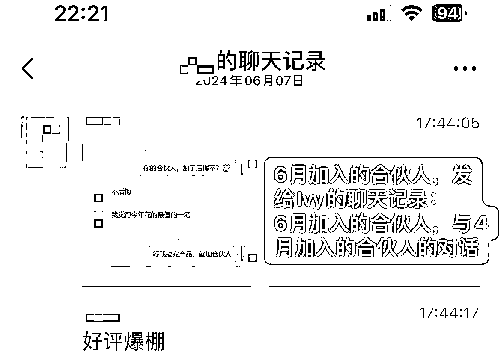

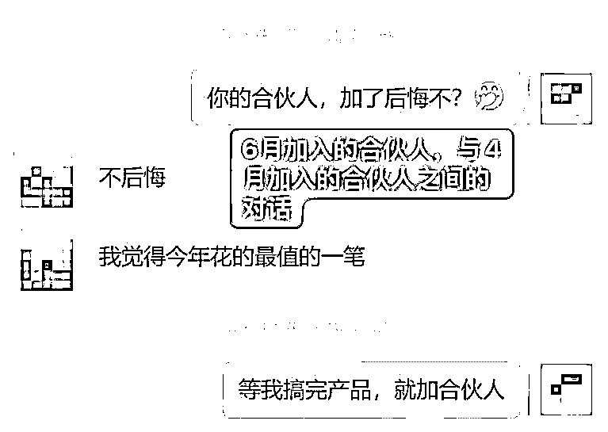

这就是留住一个老客户的力量。当你把老客户维护住了，你根本不需要费力气拉新。

# 五、致谢：

今年我合成了一颗龙珠，还拿到了3枚龙珠碎片。

第一枚碎片，我要送给陈铭Ivy。

第二枚碎片，送给梁靠谱梁医生。

人生所有看似“运气好”的时刻，背后其实都站着一群默默托举你的人。

我始终相信，我能走到今天，靠的不是什么天赋异禀，而是我这一路，总能在关键时刻遇到愿意拉我一把的人。

今天，我想认认真真地把第三枚“感恩碎片”，送给我生命里那些闪亮的名字。

**第一个名字，是我的闺蜜，也是我的合伙人，Ivy。**

说实话，没有她，我可能早就被现实捶垮了。

记得我们业绩低迷那阵子，我满脑子想着“突围”，想跑去做别的事情碰碰运气。说白了吧，那是在拿我们共同的资金和精力去赌，赌输了就是双输。但她没有拦我，甚至默许我去折腾，自己默默扛起老项目的销售和转化，让我能心无旁骛地去做那个“299元的小红书避雷社群”。她心里门儿清——那玩意儿不赚钱，还特别费我时间，但她不仅不阻止，还破天荒地发了朋友圈替我吆喝。要知道，她是个极度注重隐私、一年到头都不怎么发圈的人啊。

后来我又冒出个念头：想做合伙人产品，却又不想啃陪跑这种苦活。她二话不说，直接把我们的项目摊开来，让大家一起参与。这无疑又给她的日常加了码——现在她每周要盯销售聊天记录、审客户反馈、给表现出色的销售发奖金。她原本是个物欲极低的人，却因为我这点“想搞事业、想要名声”的执念，硬生生被卷进了更大的工作量里。

代运营的业务，也是她在扛：对接派单的老板、回听那些冗长的语音记录、一遍遍优化客服话术、四处物色靠谱的项目负责人……所有琐碎又磨人的环节，她都替我挡在了前面。

我脾气急，有时候情绪上来会骂人、会抱怨。是她点醒我一句：“赚钱，本质上就是受委屈。这世上没有毫不费力就能到手的钱。”

我本来是个没什么大局观的人，跟在她身边久了，居然也慢慢学会站高一点看问题。她不只是我的搭档，更像是我思维上的领路人。

**第二个名字，是梁靠谱梁医生。**

我和她的故事，始于2021年6月3日。那天Ivy跑过来跟我说，认识了一位医生，看了她的盖洛普天赋图，跟我的特别像——都是影响力拉满的类型。她让我赶紧加微信围观，多学学。

做了一年生意后我才发现：我们确实都“影响力”爆表，但执行力上，我差她十万八千里。

2021年起，我就在她朋友圈里“潜水”观察。看着她做营养美学做到月入十万，又看她一路杀进赚钱，成了全网的顶级名人。我和Ivy都买了她的销冠群和玩赚合伙人，在其中收获多得没法数。真的，我发自内心地劝一句：所有做自媒体的人，一定要给自己留一份预算，去她的销冠群泡一泡，值哭你。

**第三个名字，是娃姐（Ayawawa）。**

我了解娃姐，是2020年3月。那时候我刚刚失恋，是我一个同学悄悄安利了我。说实话，当时我是典型的“女石布”：爱索取情绪价值却不自知，没有女布赚钱的本事，却染了一身女布的毛病，还爱把对象当工具人使。

但到了2024年6月，我居然顺利结了婚，生了娃，公婆待我也特别好。这放在从前，是我这种性格想都不敢想的待遇。跟爸妈的关系、和老公的相处，都比以前好了不止一星半点。

唯一的遗憾是，我进娃姐的“大星球”太晚了。20年我只是在公众号围观，直到22年办完婚礼才加入星球。要是能更早一些接触，我想很多弯路我根本不用走。

2023年3月，我预判到留学赛道会走下坡路。这件事我在之前的分享里说过，是有贵人指路。那个贵人，就是娃姐。我是她IP课的学员，而且从那之后，每一年的IP课我都要回去复训，一次不落。

我之前聊“实用价值与情绪价值”，有人说听不太懂。其实这个概念最初的源头，就是娃姐提出来的。我当时只是为了方便圈外人理解，没有直接用剪石布的说法。

还有她的高阶厨艺课，我在疫情期间学了，居然成了夫妻感情的“升温神器”。虽说我做饭至今谈不上好吃，但好歹是学会了，而且是速成的。另外还有婚规师课，哪怕我没能顺利毕业，没读完书目也没交论文，但它让我真正吃透了剪石布理论的底层逻辑，甚至无形中打通了我做小红书运营的思路。

现在，我每天雷打不动做的事，就是刷娃姐的星球、听她的公众号。我本质仍是“布”，一个不小心就容易犯错而不自知。所以我就像一只不会游泳的人，必须每天在知识的泳池里泡一泡，才能维持好婚姻的平稳，不内耗、不跑偏，同时把事业照顾好。

**还要感谢的，是我们的合伙人爸爸。**

谢谢你们的信任。

如果你已经开单，我们努力让你开更多的单；如果你一直在更新但还没成交，我们会盯紧账号和销售节奏，你的付出一定不会白费；如果你是间歇式更新的那一个，我们也会关注你的状态。如果你还没正式启动项目，别担心，我们一直都在。

如果是一年7×1无限次咨询的合伙人，你想解决的任何难题，we’ll always be there for you。

我们会不断提升各平台的运营功力、销售转化率和商业模式搭建能力，让你看到的，是越来越高价值的珍妮和Ivy。

**感谢我们的代运营客户爸爸。**

是你们拿着项目来找我们，还愿意付运营费。这件事对我和Ivy来说，就像突然发现了一座新大陆，一个“未来十年可以做的事”。这几乎就是留学行业老兵的转型曙光。

对我们代运营来说，日常工作确实是在“推人头”，可你们递过来的不只是一份工作，而是一把打开未来十年机遇的钥匙。这份信任，真的是重如泰山。

**感谢一路上的学习社群和领路人：拱卒创峰会、玩赚合伙人、花爷IP训练营，以及甲申同文翻译的Jacky老师、Alan老师、韩泽婷老师。**

我是24年进的拱卒和玩赚。我会翻拱卒推荐的书单，潜水看群里的重点分享；遇到产品打磨的问题，我会去问芷蓝姐，她看得比我们高、比我们远。

在花爷IP训练营五期，我拿过优秀小组长、优秀学员，还集齐了三个优秀奖，最后甚至收到了花爷寄来的凉皮，是真的香。回想21年刚加训练营那会儿，我还只是个穷酸的小组长，连2000多块的学费都要跟Ivy拼单。但等我做自媒体两年后再回头看：天呐，花爷这个IP初阶训练营，简直是全网性价比天花板、最适合小白入门的良心神课！

至于甲申同文，2017年我上了线上笔译营，从此我理清了“怎么把一个句子写对”。当时我穷得叮当响，但三位老师依然特别细致地指导我，课的质量好到我毕业多年后都在吃老本。写公众号用得上翻译思维，教雅思时比别的老师多懂好多套路，做小红书运营居然也能用当年的逻辑拆解。这笔投资，贯穿了我整个职业生命。

**感谢龙哥盟。**

我们2022年加入的赚钱。我和Ivy在21年，用她的话说——她是“穷鬼”，我是“穷鬼中的战斗鬼”。结果她加入后疯狂刷完精华帖，还搭上了几位大老板的微信，靠着精华帖和大佬指路，22年我们俩直接“脱贫致富”。

一个能把赚钱的门道讲得这么清透的平台，去哪里找第二个？对我和Ivy这种“一个家里老妈开幼儿园、另一个家里老妈在幼儿园教书”的二本免费师范生来说，这些生意经从来没人教过我们。大学没教的，赚钱教了；原生家庭给不了的，赚钱也给了。

更让我震惊的是，赚钱居然邀请我去做直播嘉宾，还发了我一块实战家的牌子。现在它被我摆在电脑桌上，每天看着都觉得情绪价值拉满。

**最后，谢谢看到这里的每一个你。**

我和Ivy这一路，学了很多很多东西。哪怕是我们打工的那些年，也是天天加班的“拼命三郎”，常常一年干出别人三年的量。

如果你也在学习的路上，学了很多却还没赚到钱，请不要放弃。你缺的可能只是一颗技能点，或是一个未到的好时机。

请相信——你所有的所学，没有一分会白费。