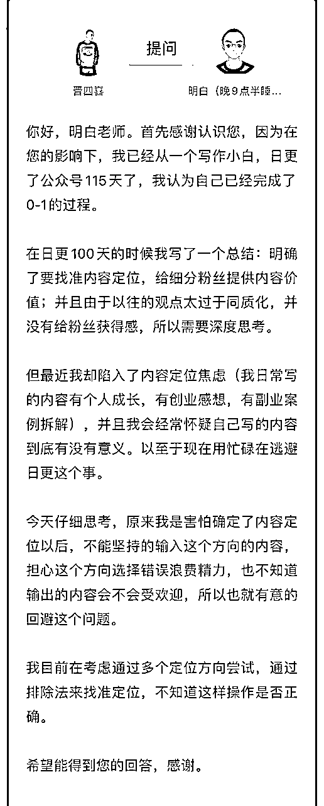

# 在航海实战里，如何每天都能感受到在进步？

> 来源：[https://pznme756ly.feishu.cn/docx/RFIHdJehho0AKDxtE75cXvBrn7c](https://pznme756ly.feishu.cn/docx/RFIHdJehho0AKDxtE75cXvBrn7c)

大家好，我是明白。

最近在一次百问百答直播里，有位同学抛出了一个很典型的困惑 ——“我跟着做了好几期赚钱航海，流程也都走通了，就是收入很低，现在有点不想继续了，该怎么调整心态？”

我们大多数人过去十年都在职场里打磨生存模式。

职场给我们的基本约定是：每天准时打卡，稳定输出，就能拿到固定的月薪。安全感来自可预测。

于是当我们转到副业、互联网变现时，大脑里会自动套用同一套预期：我投入同样的时长，也该收获同等的现金回报。

现实是，这两套系统根本不在一个逻辑里。最大的分水岭就是收益的不确定性。

在办公室里，月薪两万，摊到一天大概就是一千，清晰可算。

而做副业的曲线往往是这样的：

第一个月，数字是零。

第二个月，数字还是零。

第三个月，依然是零。

第四个月，十块钱到账。

第五个月，五<|message|>零。

第六个月，摸到两百。

第七个月，两千左右。

……

第十三个月，上万。

第二十个月，接近两万。

用一句话概括，就是副业前期大概率是赔时间的阶段，能扛过去，后面才会出现跃迁式的增长。这本质上就是复利在生效。

举个我自己的例子。开公众号的前一年半，几乎没有实质收入。但我依然坚持，因为我清楚这是在做一笔长期存款：能力在变厚，认知在升级，影响力在累积，用户信任在沉淀。这些东西会在某个节点集中变现。2021年418那一晚，一篇被大佬转发的文章，直接带来近20万收入。具体复盘见 https://t.zsxq.com/19SqL7McC

互联网赚钱难，正是因为回报不确定。很多人做一个月没钱，就停了。再做一个月还没钱，又停了。

而能持续赚钱的人，差别只在于：他做了一个月没钱，继续做；又做了一个月，还在做。他不会因为短期的零回报就退出游戏。

副业里，前几个月、半年、甚至一年收入稀薄，是常态。如果缺少这份熬的耐心，它本身就不太适合你。

* * *

那有没有办法，在收入还很微薄的时候，依然保持行动力？

有，但前提是改变对“收益”的定义。

如果我们只把“跑完一次航海赚到钱”当成唯一收益，“没赚到钱就是白干”，那么硬撑一年，积累也很难真正形成。

没有积累，就谈不上后期的爆发。

这就像我们常说的，有人活到六十岁还是二十岁的心智。因为他每天都在机械重复，没有新增。

所以想让副业跑出长期曲线，关注点必须从“今天我赚了多少钱”转移开来。不能用打卡领工资的心态去要求副业，否则心里会一直盘算：航海一次了，怎么还没一万？两次了，怎么还没两万？

这种算计会让每一天都陷入内耗：今天的视频会不会爆？今天能变现吗？今天能出单吗？

满脑子都是结果焦虑，就没有余力去思考：为了得到结果，我今天该学什么、看哪份航海文档、练哪项方法。

反过来，每次航海结束、甚至每天结束，都应该做一次有质量的复盘：

这趟航海，我到底带走了什么？

* 新增了哪些可用的知识？
* 哪项能力明显变强了？
* 学到了哪些更优的工作方法？
* 接触到了哪些新的商业模式？
* 有没有吸收到此前没听过的商业思维？
* 情绪管理比上次更稳了吗？
* 结识了哪些新的人？

如果你能坚持每天记录下在航海里学到的五件事，一年就是一千多条成长沉淀。第二年做同样的项目，成功率至少是第一年的三倍。

这就是把正反馈从外部转向内部的核心做法。读书、写作、健身、成长，本质都一样：持续做好一件事的底气，来自于每天能感受到自己的内在提升。

* * *

前阵子有同学说，日更了四十多天，一直没感觉到正反馈，该怎么办？

这让我想起星球里之前的一个提问：

简单说就是 ——

写了115天，数据平平。还想继续，但不确定方向对不对，怕白费功夫。

问题的核心就是：没感受到反馈，所以犹豫要不要继续。

其实不只是写作，类似的困惑在很多地方都出现：

* 读了很久书，没感觉变现，就想停了。
* 研究赚钱案例研究了很久，没回报，就放弃了。
* 做副业项目试了几个月，没起色，就撤了。

我们很容易陷入一个闭环：有价值的事都需要长期聚焦才能出结果，但因为没有即时反馈，我们坚持不下去。于是换一个，又放弃，再换一个，又放弃……

久而久之，每件事都浅尝辄止，既没钱也没能力。时间越久，自信心越被侵蚀，最后滑向习得性无助：觉得自己什么都做不好，焦虑、迷茫、无力。

如果你也在这个循环里，或许下面的思路能帮你松绑。

# 1 你心里要的正反馈到底是什么？

这个死循环的根源，是正反馈缺失。

没有反馈，就没动力；没动力，就无法专注；无法专注，就更难出结果。

先问自己一个问题：做读书、写作、副业项目时，你期待的反馈是什么？

很多人脱口而出就是：

* 写作 —— 涨粉、赞赏、阅读高、接广告赚钱。
* 读书 —— 最后能赚钱。
* 做项目 —— 直接赚钱。

如果是这样，我们继续往下聊。

# 2 把赚钱当即时反馈，本身就不成立

我们普遍希望读书、写作、做项目能快速给到反馈：赚钱。

得不到就想放弃。

但你有没有认真审视过，这个期待本身合不合理？

如果不合理，它大概率实现不了。

说个直白的真相：短时间靠副业稳定赚钱，并不合理。

因为赚钱是结果，不是过程。想赚钱，必定是把某件事做成做精了，钱才进来。

而把一件事做成，核心在于知识储备和执行能力。

知识和能力够了，事成概率高，钱自然来；知识能力不够，事做不好，钱也到不了。

而知识能力的增长只有一条路：熟能生巧。需要大量时间、反复学习、反复思考、反复练习，才能内化。

当你做一件陌生的事时，相关知识能力天然不足，短期内做不成、赚不到钱，是必然的。

当然有人会说，我见过的人一上手就涨粉五万、一周赚两万。

那就看不到背后的积累。他在别的领域已经是高手，具备底层逻辑迁移能力。所以他做新事不是从零开始，而是从五十、七十、九十开始。

我们看到的只是表象。

所以，如果你在当前领域还没进入前20%，在新领域也没有足够迁移积累，就别指望短期正反馈。

李笑来说过：一切都是积累，速成是不可能的。这是基本事实。

于是又形成一个死结：能力不足，赚不到钱；赚不到钱，没动力；没动力，能力更涨不起来……

但确实有一类人能打破这个循环：他们一开始也不强，短期也没钱，但能持续做下来，最终逆转。

差别在哪？

他们明白了一个更重要的真相：

最好的正反馈，来自内部，而不是外部。

# 3 如何让自己每天都能获得正反馈？

这类人不需要外部不断点赞才能继续，他们自带驱动力。

这种状态可以叫做自驱。他们关注的不是“我赚了多少”，而是“我变成什么样的人了”。

听起来有点鸡汤，但正是这个出发点，让他们每天都能从行动里提取到反馈。

拿读书、写作、副业举例。

## 读书

有人说读书反馈太慢，看完也变不成钱。

在我看来，读书本身就在产生即时反馈：

* 一个经济学概念，让我看透一个商业现象。
* 一个思维模型，让我处理问题更快。
* 一个哲学小故事，让我对生命有新的体感。
* 一个心理学原理，让我的人际互动更顺。
* 一个医学案例，让我更懂得照顾身体。

只要愿意思考，任何一页内容都能让你在某个维度变好。这就是最直接的正反馈。

## 写作

有人说写作反馈难，一开始没人看没人转，更别提赚钱。

但写作的价值在于写作过程本身：

写一个你刚学会的知识，发现自己写不清楚，于是去查资料、做深化，最后把知识真正搞懂了。

把一次情绪快要失控的经历写下来，梳理来龙去脉、缘由、合理性、可选动作，写完后你会更了解自己，下次就不会被同样的事牵着走。

把一次困难的解决过程写下来，既是复盘也是沉淀，下次遇到同类问题能更快处理。

* 为了写，不得不读书。
* 为了写清楚，不得不思考。
* 阅读低，培养了耐心。
* 写得累，锻炼了毅力。
* 被质疑，锻炼了心性。

任何一次发文、朋友圈、聊天记录，只要带着思考，都在让自己升级。这就是正反馈。

## 做副业项目

有人说做项目反馈难，知识、能力、资源全都不够。

但项目过程本身就是学习场：

尝试一个项目时，你会问：它为什么能赚钱？满足了什么需求？和哪些模式相似？这和我读过的哪本书里的理论对上了？

看高手的思路和你不一样，你会追问：他怎么想的？为什么这么想？他从哪学来的？

看高手的执行和你不一样，你会追问：他怎么练的？练多久？怎么系统化？

* 这句文案为什么这样写？
* 这个广告看起来low，为什么还能长期投放？
* 这个产品的流量从哪来？
* 这个东西免费，它怎么盈利？

只要带着问题去看，任何项目、任何困难都在喂养你的判断力。这就是正反馈。

有人会说，你说的这些反馈太虚，终究帮不到我赚钱。

没错。

但问题出在起点：你把赚钱当成了因，而不是果。

因果关系是：持续学习→知识能力提升→把事做成→赚钱。

你只盯着果，不种因，怎么可能有果？

所以，把“短期赚钱”当成刚需的正反馈，本身就是一个错误的设定，它注定让你失望。

当你还在纠结读书写作副业没有反馈时，记住这句话：

最好的正反馈，从不来自外界，而是在自身。

# 4 高手在意的正反馈是什么？

如果你去问那些真正赚到钱的人，他们做读书、写作、项目时心里最期待的是什么？

他们往往会说：

* 读书 —— 见识和认知在变宽变深。
* 写作 —— 思考力和表达力在提升。
* 做项目 —— 能力、经验在累积。

他们清楚因果，也清楚事物发展的规律。所以他们始终在问：我今天有没有变得更好？

于是工作、生活、人际中，他们几乎每天都能拿到反馈。而那个大家都想要的外部正反馈，也自然会随之而来。这不是鸡汤，是逻辑。

祝你每天都能收到来自自己的正反馈。

* * *

# 小尾巴：历史介绍~

我是明白，赚钱有术 8 期老圈友，星球编号 20。

程序员出身，目前自己创业，做一个成长社群《日新月异俱乐部》

以下是我在赚钱的历史 25 篇精华帖合集

也代表我的一个成长轨迹，

如果有兴趣，点击链接直达 ——

2024年（x1）

1.  《详解：写作和赚钱的 4 个关系！看完你一定会忍不住想开始写！》 https://t.zsxq.com/192OLDlds

1.  《7 年赚钱拉新 1100 +，我只做对了一件事》https://t.zsxq.com/19SqL7McC

1.  《当思考成为习惯，赚钱会更容易》https://t.zsxq.com/19vgy7kcp

(这个还没得精华，但我觉得写的很好哈哈，是赚钱最重要的一个环节）

2023年（x1）

1.  《身体残疾卧床 3 年，我在人生最低谷加入赚钱有术，有哪些成长？》 https://t.zsxq.com/19KWDvzz0

2021年（x3）

1.  《复盘 | 龙哥 3 年前的帖子，帮我每月被动收入 1 万块》 https://t.zsxq.com/19jaotwbv

1.  《嘉宾问答|“想去更好的公司，我该如何利用好时间？”》 https://t.zsxq.com/1952Q3a92

1.  《2883 人向朋友介绍赚钱有术时，说的最多是 16 个词！》 https://t.zsxq.com/19MYWwvCl

2020年（x6）

1.  《产品想要获得更大收益，应该不断向用户的真实需求靠近》 https://t.zsxq.com/19kQ7NILy

1.  《 我的2019：普通人如何培养自己的用户视角？》 https://t.zsxq.com/19fyFdZRL

1.  《如何通过分析成功案例，帮自己建立赚钱清单》 https://t.zsxq.com/19FNjtIjB

1.  《思路详解：如何为某个细分领域用户提供产品，并赚钱》 https://t.zsxq.com/19qoI1QQB

1.  《学习和赚钱是什么关系？》 https://t.zsxq.com/19uQcuMzJ

1.  《5000 字深度拆解 | Manchuan 公众号 2 个月涨粉百万，普通人如何复制？》 https://t.zsxq.com/19cD1keUB

2019年（x8）

1.  《在赚钱有术，普通人如何从 0 到 1，培养赚钱思维》 https://t.zsxq.com/19rA0kWrD

1.  《赚钱有术第 3 期，我是如果做到邀请 245 个用户的？》 https://t.zsxq.com/1968tlTAx

1.  《公众号和抖音之间的赚钱机会》 https://t.zsxq.com/19OfzDckK

1.  《可复制，零门槛 | 如何借别人的流量，打造一个稳定的被动收入系统》 https://t.zsxq.com/19sVRn6Yx

1.  《做自己擅长的事，把技能树打通，然后再去赚钱》 https://t.zsxq.com/19evWC1Xl

1.  《信息整合：一个可复用，低门槛的成熟商业模式》 https://t.zsxq.com/192zoSooT

1.  《产品名字，只有一个目的：降低用户认知成本》 https://t.zsxq.com/19QUBrDOT

1.  《数据是需求的抽象化 | 帮你快速找到 100 个赚钱思路 》 https://t.zsxq.com/19QrIpsuC

2018年（x3）

1.  《分享一下，抓取其他微信号的方式，而且是精准粉》 https://t.zsxq.com/19sKQT9bF

1.  《如何几乎零成本做到1w多付费学员？》 https://t.zsxq.com/198XWAGhV

1.  《36 个小而美赚钱项目之一：蛋黄酥白皮书》 https://t.zsxq.com/19G4PKUXr

2017年（x2）

1.  《一个零成本，为公众号增粉，并高转化率为付费社群，进而再次付费转化加入小密圈的案例》 https://t.zsxq.com/19WJ8NILt

非技术背景也能玩转数据采集，这款工具就做到了。

如果你不是程序员，却经常被网站上的信息困住——想抓取价格、收集评论、整理清单，却对代码一窍不通，那么 Web Scraper 就是为你准备的解法。

它把原本需要写爬虫才能完成的工作，简化成了可视化操作。点点选选就能设定采集规则，随后自动批量抓取结构化数据。没有服务器、没有脚本，普通用户也能实现以前只有技术团队才能做的事情。

简单来说，它让数据采集从技术门槛变成了普通人的生产力工具。

想了解具体用法和场景，可以查看这里：https://t.zsxq.com/19RSl40n5