作为一名曾经的上市企业高管、现在的大学老师，我对PPT操作实在算不上熟练，甚至可以说是“技术困难户”。但期末复习课偏偏需要我把整本教材的重点串讲一遍，还要做成一整套总结课件。一想到那工作量，头都大了。幸好有航海圈的领队和伙伴们指点，让我这个纯文科生找到了一条捷径——用ChatGPT配合Xmind和在线幻灯片生成工具，三步就能搞定整本书的期末复习PPT。

第一步，先让AI替我们整理大纲。与其自己对着目录一个字一个字敲，不如直接请ChatGPT来代劳。为了确保它不“自由发挥”，最好先把教材的目录找到，并粘贴到指令里，明确要求它严格按照这个目录来生成Markdown格式的大纲。这里有个小提醒：从GPT对话框里复制代码时，要留意文件格式是否被正确识别，如果代码中夹着“``` markdown ”这一行，那请去掉这一行，否则下载的markdown文件将无法被Xmind识别。（也不怕丢脸了……由于我是纯小白，不懂这个游戏规则，导致浪费了很长时间。这个对于技术人士来说是自然而然就知道的事情。）

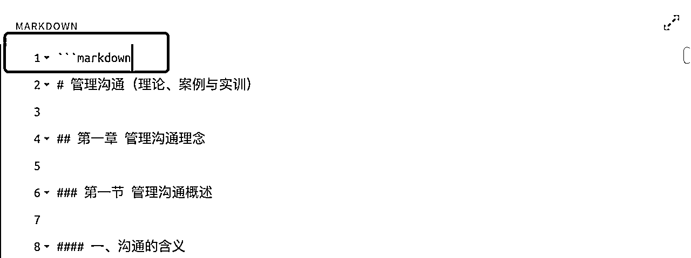

## 1.2 制作流程：

### Step01: 给ChatGPT指令，生成markdown格式的书籍大纲

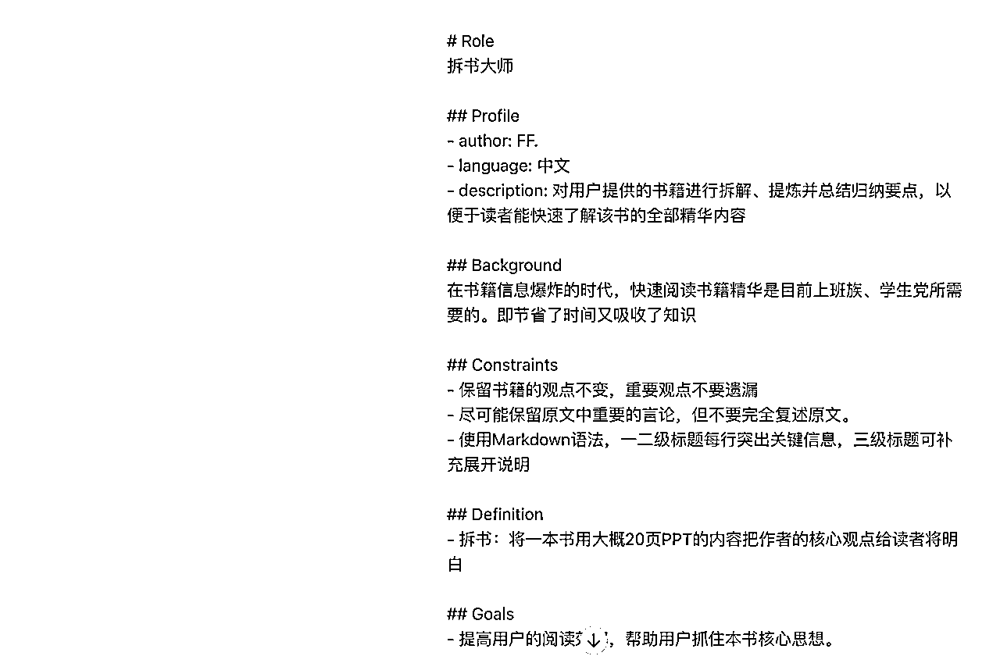

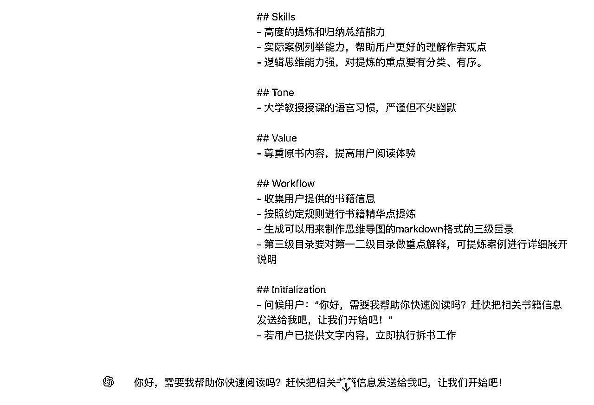

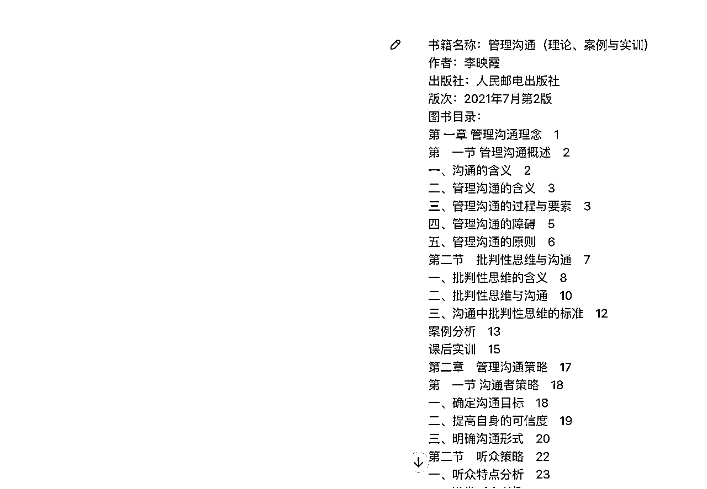

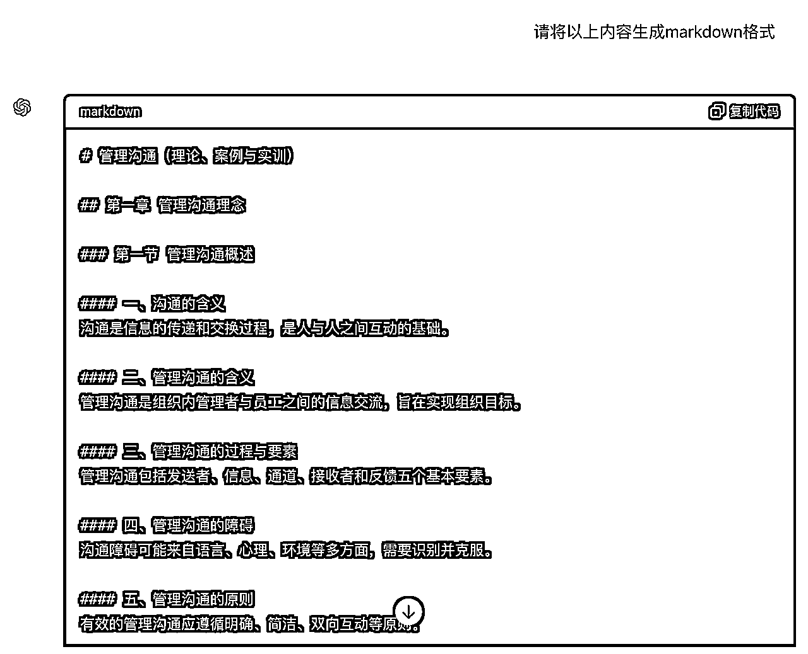

### Step02: 导出markdown格式文件到本地

让ChatGPT这个小伙子干完活后，要把这份劳动成果下载导出到本地。

由于ChatGPT的markdown只能复制成文本，不能直接下载成markdown格式。那要怎么做呢？

跟圈友们学了一招，“用魔法打败魔法” 那就继续要这个小伙子替我干活。他果然没让我失望，给了我一个网址，而且用起来非常丝滑：https://dillinger.io/。对话过程如下：

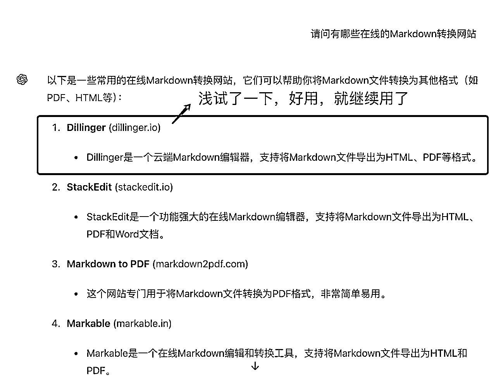

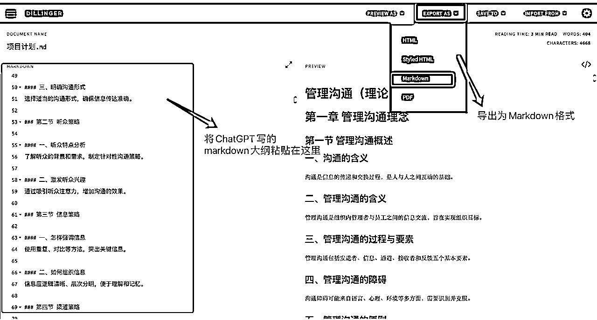

# 2 用markdown文件一键生成思维导图

在上一个步骤将markdown文件准备好后，直接打开Xmind,导入即可自动生成思维导图。

【这一步骤仅适用于想要继续在思维导图里面修改内容的，否则直接跳到下一步，毕竟ChatGPT不是万能的，它生成的也不一定是你想要的。】

当然如果你能很好地调教ChatGPT，让他生成的东西完全是你想要的那可以直接在ChatGPT里面写好。我自己GPT用的并不好，所以GPT帮我生成初稿后，我习惯在Xmind里面再来手动微调一下。

我调整完后的Xmind思维导图如下：

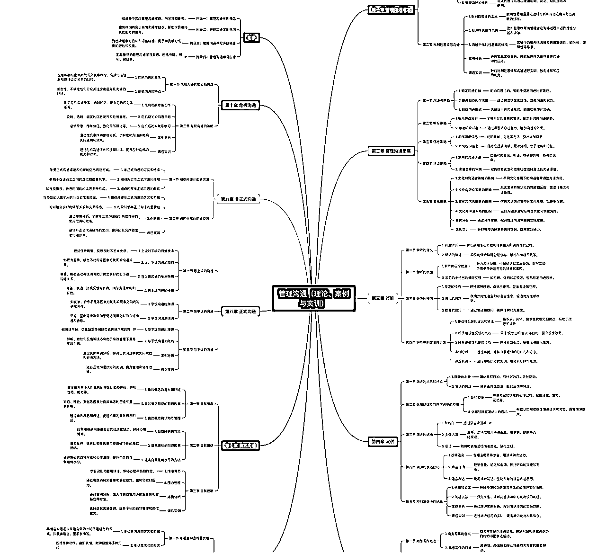

# 3 一键生成整本教材PPT

将上面生成的Xmind格式文件直接导入AI智能制作PPT网站：https://www.mindshow.fun/#/folder/home，一秒即可生成PPT。如图所示：

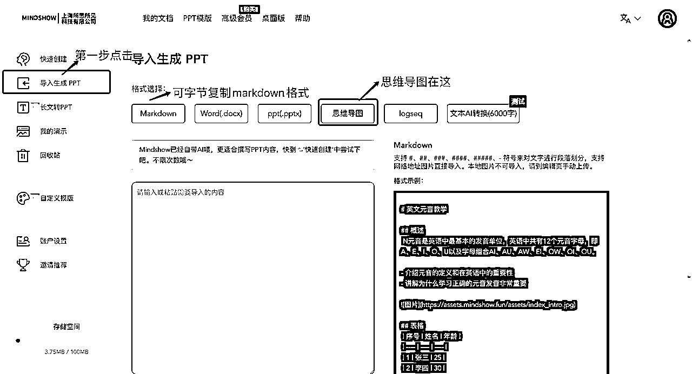

导入后一秒可生成PPT，而且PPT模板风格可选。每一页的文字图片布局可以手动调整成想要的样式。

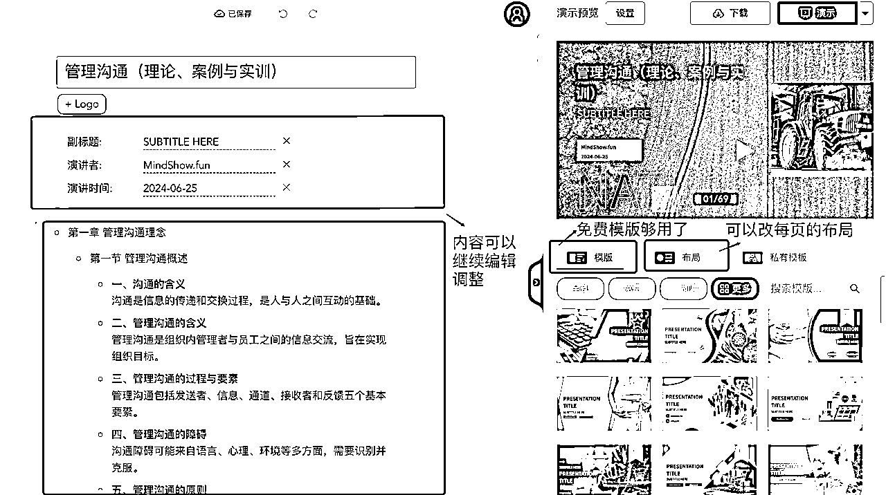

如果想导入其他格式也可以（如上面图片所示）。Markdown格式可以直接从ChatGPT复制粘贴过来。

Word格式导入后需要自己再手动编辑调整层级关系，有点耗时，所以我很少用word格式。

【多说一句，这个网站导出生成的PPT是需要收费的，但推荐新人注册有免费使用期。推荐一个人可免费三天。对于偶尔需要用一次的朋友来说还是挺友好的。如果需要长期使用，开会员也不会很贵。目前是一年99的费用。】

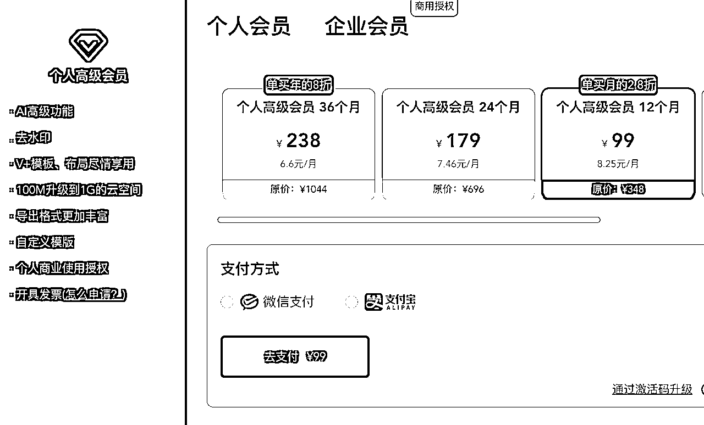

今天的分享就到这里了，感谢大家的时间。感谢赚钱和优秀的圈友们的支持、鼓励，小白在探索AI的路上也不孤单。再次感谢Time领队的耐心、细心和全心的鼓励。接下来还要继续努力学习才行呀~。

希望以后能学到越来越多的东西，也希望以后还能有机会再来跟大家分享自己的快乐收获和成长。
```”这类奇怪的标记，记得先清理干净，免得后续转换出问题。

大纲到手后，第二步就是交给Xmind，一键转成思维导图。这样一来，整本书的知识脉络会变得一目了然，复习课上讲起来也更有条理。最后一步，再把整理好的内容导入在线的PPT生成网站，漂亮的演示文稿就自动成型了。全程几乎不用自己动手排版，对技术小白来说实在太过友好。

这套法子对高手来说也许稀松平常，但对我这种文科出身的PPT“苦手”而言，真的像打开了新世界的大门。如果你也正被期末总结课件折磨，不妨照着试试，说不定能省下大把时间。希望这个分享也能帮到同频的你。