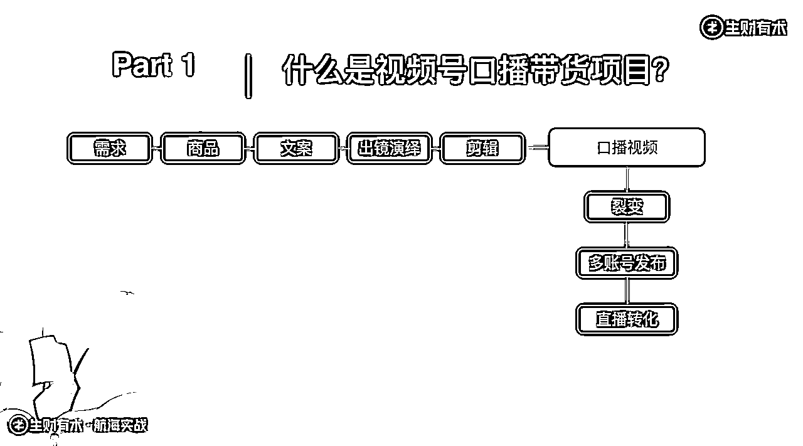
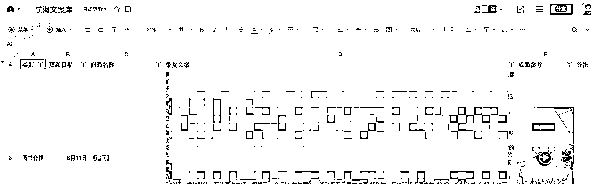

# 28 天视频号口播带货航海靠岸复盘：530 人下场，60.56% 成功变现，累计 GMV 破 99 万，我们到底踩中了什么？

大家好，我是郭晓文。

5 月 15 号到 6 月 13 号，赚钱内部做了一期视频号口播带货的实战航海。

项目详情可以看这里：https://t.zsxq.com/ql9AN

一开始担心第一次操盘这种带货航海，人数太多交付会崩，所以名额做了限制。没想到依然很火爆。

航海现在已经顺利结束。今天借着这个节点，跟大家同步一下三件事：

1. 这期航海最终跑出了什么数据
2. 为什么成才率会这么高
3. 下一期航海什么时候开

先声明，这篇不只是晒成绩单。后面拆解的成功逻辑，对想下场的新手来说，参考价值更大。

# 先看结果

这期航海持续 28 天，参与船员 530 人。

最终变现比例 60.56%，变现船员平均 GMV 3086.49 元，累计 GMV 990,766 元。

分布上：

* 1 人变现超 30 万
* 1 人变现超 10 万
* 3 人变现超 5 万
* 9 人变现超 1 万
* 46 人变现超 1000 元
* 122 人变现超 100 元

看到超 30 万的数据是不是很震撼？

注意一下，这类极端值往往是航海前就已经在做这个赛道的人。数据确实能说明项目上限，但对零基础新手来说，更多是焦虑。

更值得关注的是两点：

1. 这批人不是靠高客单筛选出来的，只是交了保证金入群，门槛几乎为零
2. 28 天，仅仅够入门的时间里，超过六成的人赚到了第一笔钱

做到这种普惠式出单，我觉得已经非常难得了。

但晒完数据就完了吗？不行。

赚钱的初心是让人真正赚钱，不是围观。赚钱的核心就是实战。

所以下面说说，我们是怎么把这份成绩跑出来的。

# 复盘这期做对的三件事

## 第一，项目本身是红利窗口

做培训，最容易被误解成「老师厉害所以学员才成功」。

我自己的体感是：项目好，才是成才率的根基。培训只是锦上添花。

早期我也以为体系做得好就够了。后来发现，体系保持不变甚至更好，但项目环境变差、竞争加剧时，成才率还是会断崖式下跌。

这时候怎么优化课程都没用，必须换项目、换平台、换打法。

打个比方，做项目像养花，项目就是土壤，培训就是浇水施肥。

土壤不行，浇得再专业也白搭。土壤好，随便浇浇都能爆。

视频号口播带货当下就是一块好土壤，这就是红利项目。选择先于努力。

## 第二，聚焦到只能打穿一个点

前赚钱合伙人光合说过一句我很认同的话：把自己活成一道激光。

聚焦，聚光，把所有资源压在一个点突破。

那聚焦到什么程度才算聚焦？

聚焦一个平台算吗？聚焦一个项目算吗？聚焦一个项目里的一种玩法算吗？

我们给出的实践是：聚焦到口播视频这一单点。

完整来看视频号口播带货，你要懂用户需求、懂选品、懂写文案、懂表现力、懂剪辑、懂矩阵去重分发、懂直播转化……

乍一看门槛很高。新手最怕的就是无从下手，学了半天还不知道先做什么。

于是我们直接把口播之外的环节全部兜底：

1. 你不需要研究需求、选品、写文案、剪辑。我们每天把平台上跑出来的爆款文案和对标视频整理好，你照着念，照着剪就行

1. 你不需要操心矩阵，先把一两个号养起来，跑通再放大
2. 你也不需要自己懂直播，直接对接代播团队

28 天内，船员唯一需要做的，就是把口播视频这一件事练熟。

我们所有的手册、直播课、答疑、连麦，几乎全部围绕「如何把口播视频做出来、做得更好」展开。其他部分，等口播能力达标后再逐个点突破。

做项目都可以用这个思路拆解：先找一个最小可行点单点突破，再横向拓展。

## 第三，执行力是分出来的

同样的项目、同样的交付，有人能跑通，有人不行。

关键在个体。船员这期的执行力，确实拉满了。

对比今年 3 月的视频号带货航海：

1. 上岸率，也就是完成 21 天打卡任务的比例，提升了 17.02%
2. 全勤率，也就是主动完成 28 天打卡的比例，提升了 588.69%
3. 到课率提升 39.15%，学习深度提升 6.83%
4. 每日手册阅读人数提升 85%，打开频次提升 66%

有输出才有结果。每天哪怕做错动作，也比原地焦虑强。

做到听话照做，按手册执行，每天打卡复盘，坚持一段时间，结果很难不来。

反面是那些只看帖子、不下场、整天怀疑的。

为什么这一期执行力会这么高？我觉得劝退仪式功不可没。

我每次开航海都会做劝退。因为项目都是背影杀手，听起来美好，下场才知道难。

第一周是最真实的体感期，也是最痛苦的突破期。此时劝退，能筛掉不适合和意志不坚定的人。

好处有两个：一是避免教练团队精力被浪费，二是避免负面情绪在群里蔓延。

本期报名 767 人，劝退仪式后第一周劝退 216 人。剩下的都是更坚定、更匹配的人，群氛围自然好，氛围好了执行力就被带动起来。

# 小结

总结下来，这一期成才率高，主要是三点：

1. 视频号口播带货本身是红利项目，土壤好
2. 把项目拆解到极致，让大家活成一道激光，只攻口播视频
3. 通过劝退和氛围筛选，留下来的船员执行力被点燃

希望这三点对你想下场做项目有启发。

最后预告一下下一期。

下一期视频号口播带货航海，报名时间是 7 月 5 日到 7 月 9 日，7 月 15 日正式开船。

开船前，我们会在 7 月 3 日于赚钱有术视频号做一场直播对谈，详细介绍项目前景、玩法和干货，有兴趣的可以提前预约。

