# 用ChatGPT写Python爬虫，赚钱AI编程航海里藏着哪些可落地的机会？

> 来源：[https://kxgiimtbac.feishu.cn/docx/ZZnHd03PyojHUJxtmMEccS8tnQd](https://kxgiimtbac.feishu.cn/docx/ZZnHd03PyojHUJxtmMEccS8tnQd)

最近我加入了龙哥盟组织的“AI编程·爬虫”航海训练营。加入之前，我就已经在ChatGPT编程这条路上做了不少尝试，也在赚钱社区里发布过3篇相关心得，其中有两篇被加精：

工具站小白如何借助ChatGPT编程把想法变成工具站产品

借助ChatGPT Code Interpreter生成视频特效并开发Chrome插件的思路

21天航海用ChatGPT编程上线20款Chrome插件的复盘

ChatGPT已经帮我把一些以前想做却做不成的点子实现了。这次航海的初衷，是想跟着教练的节奏和手册的方法论，补齐AI编程上的短板，继续用ChatGPT写出更多能用的产品。于是就有了下面这段持续的实操记录。

声明：本文涉及对部分平台内容的抓取演示，仅供学习交流使用，请勿用于任何违规采集行为，文中所有相关平台的网址和名称均已做脱敏处理。

目录

*   借助ChatGPT写爬虫抓取网站文章
*   借助ChatGPT写爬虫抓取网站图片
*   破解验证码校验，抓取电商商品数据
*   绕过反自动化检测，抓取某站笔记内容
*   用ChatGPT改写爬虫，抓取某问答网站文章
*   打造一个能自动生成爬虫程序的GPTs
*   将爬虫程序产品化，以及背后的商业可能性

# 借助ChatGPT写爬虫抓取网站文章

先从赚钱航海手册给出的提示词框架开始，测试ChatGPT写一个爬取某站文章的爬虫。

提示词：

```
写一个爬虫程序，按下面的要求在我的 windows 电脑上帮我抓取某网站文章。
1\. 使用 python3 和最新版的 selenium 
2\. 目标网站：https://www.xxx.com/  
3\. 输入关键字[ AI ]，点击[ 搜文章 ]按钮
4\. 爬取内容: 爬取标题、摘要、链接、来源
5\. 爬取后的内容保存到Excel文件中，Excel文件命名为AI_文章_时间
6\. 爬取前5页，每爬完1页休眠5s
请给我完整可运行的程序，让我看到浏览器中操作的过程，并指导我安装程序依赖的所有库。
你可以先执行步骤 2 和步骤 3 了解网页的结构，然后再生成代码。
```

注：“某网站”替换成具体站点名，目标网站填入实际要抓取的页面地址。

这组提示词带给我的最大收获是：

我们可以把自己对业务的理解和编程经验，尽量细化成明确的指令喂给ChatGPT，提示词甚至可以精确到Python版本、依赖库、目标网站的页面结构、执行的每一步细节。这样做的好处是，ChatGPT会在我们划定的边界内产出代码，减少它因多种解法而跑偏的概率。

这点在实战中特别关键。我们发现，如果需求描述不够清晰，ChatGPT很容易发散。比如没指定库，它可能换个库实现；没指定要抓取的DOM元素，它会按自己训练数据的经验猜测；没要求翻页间隔和休眠时间，它可能直接省略。最终代码就偏离预期。

我分别让GPT-4o和GPT-4按上述提示词生成爬虫。初版代码都有点小瑕疵，但通过多轮对话修正后，都能正常抓到目标文章。整体来看GPT-4o的初版错误更少，显得更稳，但两者都能靠对话把问题闭环掉。如果需要对话记录可以联系易焘。

拿到代码后，我用平时在用的UltraEdit粘贴保存，保存为 .py 文件，也可以用Notepad++、记事本等。随后打开Windows命令行窗口，在开始菜单搜索“cmd”，右键选择“以管理员身份运行”：

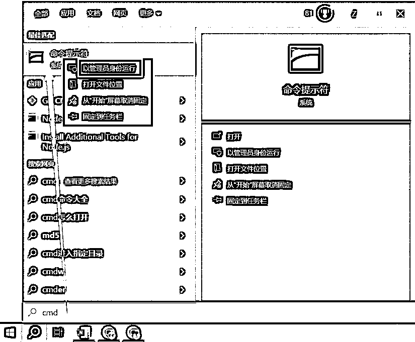

切换到脚本所在目录：


按ChatGPT给的指令运行：python xxx_crawler.py，把xxx_crawler.py换成你的文件名。

执行时报了一个小错 “SyntaxError: Non-UTF-8 code starting ...”：

意思是文件编码需要改成UTF-8，可用记事本打开后“另存为”时选择UTF-8编码保存；


运行Python程序时，我并没有提前检查selenium和webdriver-manager是否已装，报错了再说。缺少这两个包会直接报错，把报错信息直接丢给ChatGPT，它就会给出安装命令：


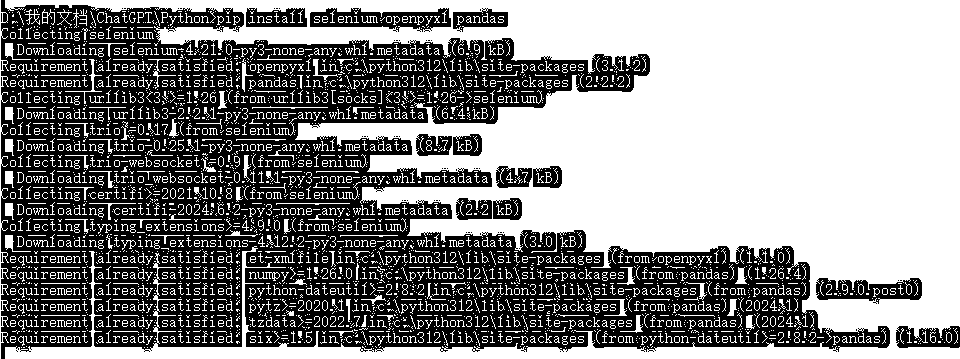

装webdriver-manager时出现“ERROR: Could not install packages due to an OSError ...”的报错，和ChatGPT沟通后得知是权限问题，需要以管理员身份运行CMD，所以打开命令行时务必右键选择“以管理员身份运行”，再执行安装命令：


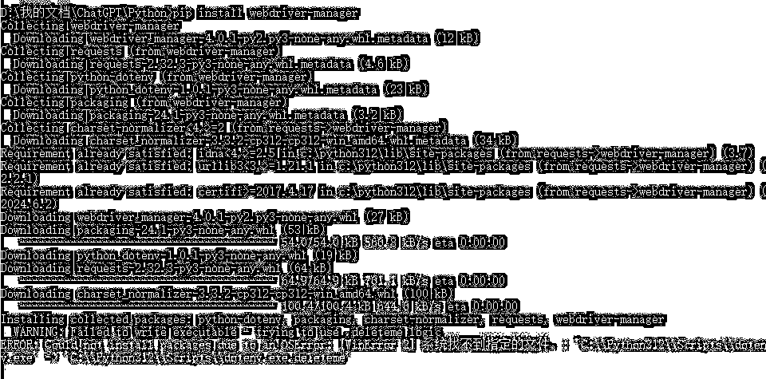

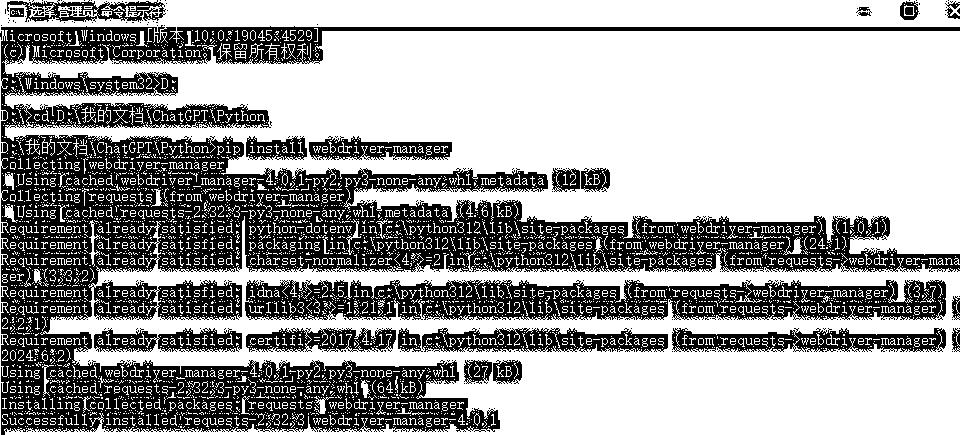

GPT-4o和GPT-4给出的文章爬虫代码在指定抓取字段时，都犯了同一个错误：内容来源使用了'.//div[@class="s-p"]/a'，但搜狗搜索结果页实际并不存在这个节点。ChatGPT反馈“无法直接访问目标网站核实结构”，但给了调试思路，比如增加打印调试信息，以及用Chrome开发者工具手动查看真实DOM：

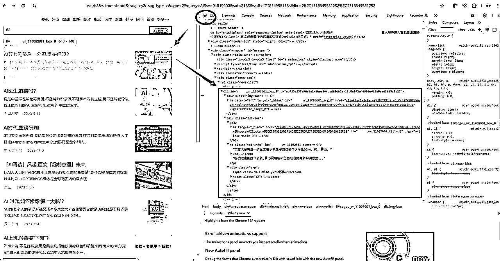

最终把内容来源的XPath改成'.//div[@class="s-p"]/span[@class="all-time-y2"]'后问题解决，文章抓取成功：

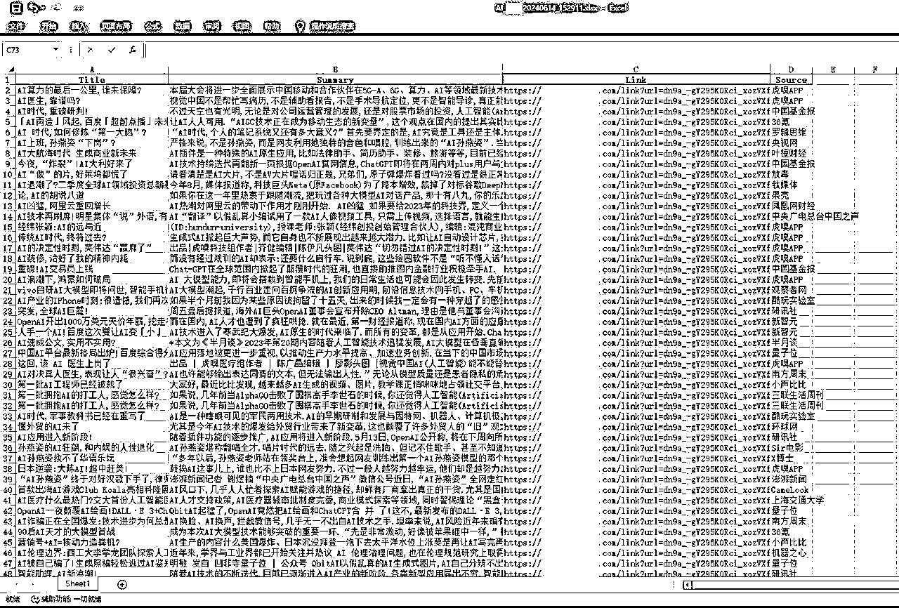

GPT-4o最终版的文章爬取代码如下：

```
import time
import pandas as pd
from selenium import webdriver
from selenium.webdriver.common.by import By
from selenium.webdriver.common.keys import Keys
from selenium.webdriver.chrome.service import Service as ChromeService
from webdriver_manager.chrome import ChromeDriverManager

# 设置Chrome选项
chrome_options = webdriver.ChromeOptions()
chrome_options.add_argument("--start-maximized")

# 创建WebDriver实例
driver = webdriver.Chrome(service=ChromeService(ChromeDriverManager().install()), options=chrome_options)

# 访问目标网站
driver.get("https://www.xxx.com/") ### 目标网站修改成需要爬取网页的链接 ###

# 输入关键字并点击搜索按钮
search_box = driver.find_element(By.ID, "query")
search_box.send_keys("AI")
search_box.send_keys(Keys.RETURN)

time.sleep(3)  # 等待页面加载

# 准备存储数据的列表
data = []

# 爬取前5页
for page in range(1, 6):
    print(f"正在爬取第{page}页...")

    articles = driver.find_elements(By.XPATH, "//ul[@class='news-list']/li")
    for article in articles:
        try:
            title_element = article.find_element(By.XPATH, ".//h3/a")
            title = title_element.text
            link = title_element.get_attribute("href")
            summary = article.find_element(By.XPATH, ".//p").text
            source = article.find_element(By.XPATH, ".//div[@class='s-p']/span[@class='all-time-y2']").text

            # 打印调试信息
            print(f"Title: {title}")
            print(f"Summary: {summary}")
            print(f"Link: {link}")
            print(f"Source: {source}")

            data.append({"Title": title, "Summary": summary, "Link": link, "Source": source})
        except Exception as e:
            print("Error:", e)

    # 翻页
    if page < 5:
        try:
            next_button = driver.find_element(By.ID, "xxx_next")
            next_button.click()
            time.sleep(5)  # 每爬完一页休眠5秒
        except Exception as e:
            print("无法点击下一页:", e)
            break

# 关闭浏览器
driver.quit()

# 保存数据到Excel文件
current_time = time.strftime("%Y%m%d_%H%M%S")
file_name = f"AI_文章_{current_time}.xlsx"
df = pd.DataFrame(data)
df.to_excel(file_name, index=False, engine='openpyxl')

print(f"数据已保存到 {file_name}")
```

# 借助ChatGPT写爬虫抓取网站图片

接着沿用手册的提示词，测试图片抓取场景。

提示词：

```
写一个爬虫程序，按下面的要求在我的 windows 电脑上帮我抓取某网站图片。
1\. 使用 python3 和最新版的 selenium
2\. 目标网站：https://image.xxx.com/
3\. 输入关键字[ AIGC ]，点击[ 搜索 ]按钮
4\. 爬取内容: 图片
5\. 爬取后的内容保存到AIGC文件夹中，图片文件命名为1++
6\. 爬取10张图片，休眠3s，页面下滑滚动，直到爬到100张图片后停止。
请给我完整可运行的程序，让我看到浏览器中操作的过程，并指导我安装程序依赖的所有库。
你可以先执行步骤 2 和步骤 3 了解网页的结构，然后再生成代码。
```

注：“某网站”换成站点名，目标网站换成具体图片搜索页链接。

我用GPT-4o执行这次任务，过程非常顺畅，没有卡点，最终顺利抓取到该站搜索结果中的图片。为了阅读方便，完整的ChatGPT对话记录放在文末附录。


GPT-4o最终版的图片爬取代码如下：

```
import os
import time
import requests
from selenium import webdriver
from selenium.webdriver.common.by import By
from selenium.webdriver.common.keys import Keys
from selenium.webdriver.chrome.service import Service
from webdriver_manager.chrome import ChromeDriverManager
from selenium.webdriver.chrome.options import Options

# 设置Chrome浏览器的选项
chrome_options = Options()
chrome_options.add_argument("--start-maximized")  # 最大化窗口

# 初始化Chrome浏览器驱动
driver = webdriver.Chrome(service=Service(ChromeDriverManager().install()), options=chrome_options)

# 打开网站图片
driver.get("https://image.xxx.com/") ### 目标网站修改成需要爬取网页的链接 ###

# 找到搜索框并输入关键字 "AIGC"
search_box = driver.find_element(By.NAME, "word")
search_box.send_keys("AIGC")
search_box.send_keys(Keys.RETURN)

# 等待页面加载
time.sleep(3)

# 确保目标文件夹存在
if not os.path.exists("AIGC"):
    os.makedirs("AIGC")

# 爬取图片
image_urls = set()
while len(image_urls) < 100:
    # 获取所有图片元素
    img_elements = driver.find_elements(By.CSS_SELECTOR, "img.main_img")

    for img in img_elements:
        if len(image_urls) >= 100:
            break
        src = img.get_attribute("src")
        if src and src.startswith("http"):
            image_urls.add(src)

    # 页面下滑
    driver.execute_script("window.scrollTo(0, document.body.scrollHeight);")
    time.sleep(3)  # 等待页面加载

# 下载图片
for idx, url in enumerate(image_urls):
    try:
        response = requests.get(url)
        with open(f"AIGC/{idx + 1}.jpg", "wb") as file:
            file.write(response.content)
        print(f"Downloaded image {idx + 1}")
    except Exception as e:
        print(f"Could not download image {idx + 1}: {e}")

# 关闭浏览器
driver.quit()

print("Finished downloading images.")
```

在用ChatGPT编程的路上，你会发现每次输出的代码都不完全一样。需要结合真实环境测试，并通过对话不断修补问题。当然，如果你对业务流程和代码逻辑足够熟，越详细地在提示词里描述任务需求和步骤，ChatGPT越能一次给出靠谱的方案。

在用ChatGPT写爬虫这件事上，我最近做了一轮比较完整的实战测试，发现一个非常省心的技巧：只要在提示词里加一句“使用webdriver_manager库来自动管理和安装ChromeDriver”，ChatGPT给出的代码基本都会自动搞定驱动，不用自己手动去指定路径。平时有些代码可能需要你手动改ChromeDriver的位置，航海手册里那套就是这样的，对不爱折腾驱动的人来说会有点麻烦。但如果提前说清楚，它大概率会自动帮你把驱动装好。

另外，提示词里的流程也不是死的，完全可以按业务需要改。比如想给列表排序，或者要校验验证码、等登录完成再操作，都能灵活塞进去。这篇文章就顺着这个思路，把实际遇到的问题和解决办法拆开讲讲。

# 用ChatGPT写电商爬虫，验证码这关怎么过？

之前我们试过用ChatGPT写爬虫抓文章和图片，那套提示词能不能直接挪到别的网站上用？我用一个电商网站试了试，答案是能，但需要按规律调。

先说说提示词本身的套路。第一步，明确用Python3和selenium库，还可以顺带指定别的库以及ChromeDriver；第二步，打开目标网站，通过搜索或别的入口进入内容列表；第三步，把要抓的字段保存到Excel或类似文件里；第四步，如果需要翻页或加载更多，就设定要抓多少条、每次停留多长时间。

按这个套路，我把电商网站的产品爬虫提示词改出来了：

```
写一个爬虫程序，按下面的要求在我的 windows 电脑上帮我抓取某电商网站的产品。
1\. 使用 python3 和最新版的 selenium 
2\. 目标网站：https://www.xxx.com/ 
3\. 输入关键字[ Wireless Earphones ]，点击搜索按钮
4\. 排序选择[ Best Sellers ]
5\. 爬取内容: 爬取产品标题、reviews数量、rating星级、原价、折扣价、产品链接、图片链接
6\. 爬取后的内容保存到Excel文件中，Excel文件命名为Product_时间
7\. 爬取前5页，每爬完1页休眠5s~10s
请给我完整可运行的程序，让我看到浏览器中操作的过程，并指导我安装程序依赖的所有库。
你可以先执行步骤 2 和步骤 3 了解网页的结构，然后再生成代码。
```

这里需要把“某电商网站”替换成真实网站名，目标链接也换成实际网页地址。

第一次运行时，程序就撞上了爬虫最常见的坎——网页验证码：

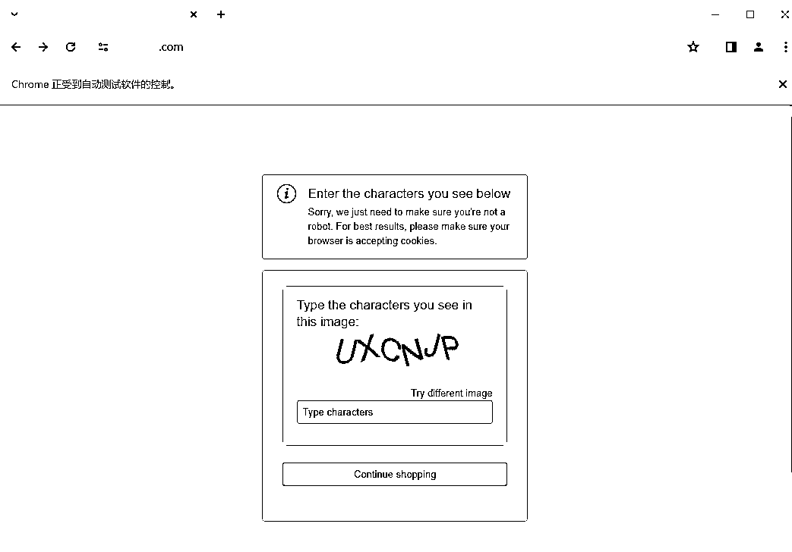

这个好办，重新调整提示词，在“打开目标网站”后面加上一句：“如果出现网页校验码，先等待人工输入，直到页面出现搜索输入框，再继续下一步。”你不想改提示词也行，直接跟ChatGPT对话，让它在你已经写好的代码里加这个步骤。

过了验证码这关，后面还有小毛病，比如排序按钮点不到、折扣价格少了小数点。这些都不是大问题，借助谷歌浏览器的开发者工具，把页面上真实的元素结构和数据情况告诉ChatGPT，让它按实际来改，最终跑通了一个能用的电商产品爬虫：（完整的对话记录放在文末附录）

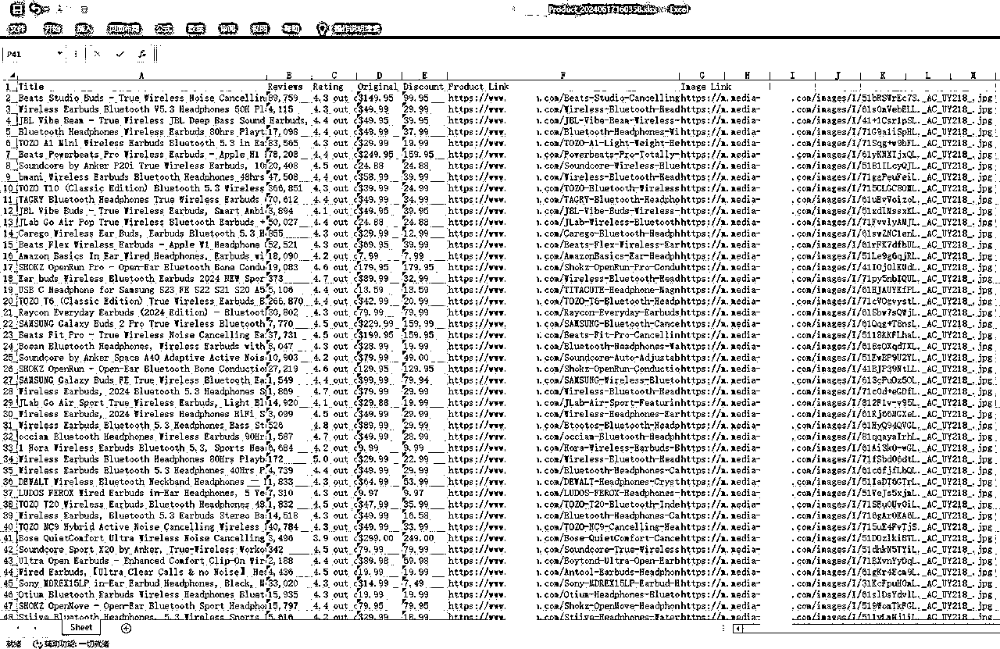

抓取电商产品的最终代码长这样：

```
import time
import datetime
from selenium import webdriver
from selenium.webdriver.common.by import By
from selenium.webdriver.common.keys import Keys
import openpyxl

def setup_browser():
    options = webdriver.ChromeOptions()
    options.add_argument("--start-maximized")
    driver = webdriver.Chrome(options=options)
    return driver

def wait_for_search_box(driver):
    while True:
        time.sleep(2)
        try:
            driver.find_element(By.ID, "twotabsearchtextbox")
            break
        except:
            pass

def search_keyword(driver, keyword):
    driver.get("https://www.xxx.com/") ### 目标网站修改成需要爬取网页的链接 ###
    check_for_captcha(driver)
    wait_for_search_box(driver)
    search_box = driver.find_element(By.ID, "twotabsearchtextbox")
    search_box.send_keys(keyword)
    search_box.send_keys(Keys.RETURN)

def sort_by_best_sellers(driver):
    time.sleep(2)  # wait for page to load
    check_for_captcha(driver)
    form_element = driver.find_element(By.CSS_SELECTOR, "form.aok-inline-block")
    form_element.click()
    sort_dropdown = driver.find_element(By.CSS_SELECTOR, "select#s-result-sort-select")
    best_sellers_option = sort_dropdown.find_element(By.XPATH, "//option[contains(text(),'Best Sellers')]")
    best_sellers_option.click()

def check_for_captcha(driver):
    while True:
        time.sleep(2)  # wait for the page to load
        if "captcha" in driver.current_url:
            print("Please solve the CAPTCHA and then press Enter...")
            input()
            driver.refresh()
        else:
            break

def extract_product_info(product):
    title = product.find_element(By.CSS_SELECTOR, "span.a-text-normal").text
    try:
        reviews = product.find_element(By.CSS_SELECTOR, "span.a-size-base").text
    except:
        reviews = "No reviews"
    try:
        rating = product.find_element(By.CSS_SELECTOR, "span.a-icon-alt").get_attribute("textContent")
    except:
        rating = "No rating"
    try:
        price_int = product.find_element(By.CSS_SELECTOR, "span.a-price-whole").text
        price_frac = product.find_element(By.CSS_SELECTOR, "span.a-price-fraction").text
        price = f"{price_int}.{price_frac}"
    except:
        price = "No price"
    try:
        original_price = product.find_element(By.CSS_SELECTOR, "span.a-text-price").text
    except:
        original_price = price
    link = product.find_element(By.CSS_SELECTOR, "a.a-link-normal").get_attribute("href")
    image = product.find_element(By.CSS_SELECTOR, "img.s-image").get_attribute("src")

    return [title, reviews, rating, original_price, price, link, image]

def save_to_excel(data, filename):
    wb = openpyxl.Workbook()
    ws = wb.active
    ws.append(["Title", "Reviews", "Rating", "Original Price", "Discount Price", "Product Link", "Image Link"])
    for row in data:
        ws.append(row)
    wb.save(filename)

def main():
    keyword = "Wireless Earphones"
    driver = setup_browser()

    try:
        search_keyword(driver, keyword)
        sort_by_best_sellers(driver)

        all_products = []
        for page in range(1, 6):
            time.sleep(5)  # wait for the page to load
            check_for_captcha(driver)

            products = driver.find_elements(By.CSS_SELECTOR, "div.s-main-slot div.s-result-item")
            for product in products:
                try:
                    product_info = extract_product_info(product)
                    all_products.append(product_info)
                except Exception as e:
                    print(f"Error extracting product info: {e}")

            next_page = driver.find_element(By.CLASS_NAME, "s-pagination-next")
            driver.execute_script("arguments[0].click();", next_page)
            time.sleep(5 + page)  # wait between 5 to 10 seconds

        timestamp = datetime.datetime.now().strftime("%Y%m%d%H%M%S")
        filename = f"Product_{timestamp}.xlsx"
        save_to_excel(all_products, filename)
        print(f"Data saved to {filename}")

    finally:
        driver.quit()

if __name__ == "__main__":
    main()
```

# 抓笔记网站遇反自动化检测，最终靠这招搞定

电商爬虫能跑起来之后，我又试了一个笔记类的网站。

这次同样是先看目标页面的实际情况，改出一版提示词：

```
1\. 使用 python3 和最新版的 selenium 
2\. 目标网站：https://www.xxx.com/ 
3\. 打开某网站页面后等待用户登录某网站账号，直到页面左侧“登录”按钮变成“我”，再进入下一步操作
3\. 输入关键字[ AI ]，点击搜索按钮
4\. 选项选择[ 图文 ]
5\. 爬取笔记: 爬取笔记标题、作者名称、点赞数、图片链接
6\. 爬取后的内容保存到Excel文件中，Excel文件命名为某网站_笔记_时间
7\. 爬取前200个笔记，你需要向下滚动页面加载更多笔记，每滚动完1次休眠5s~10s
请给我完整可运行的程序，让我看到浏览器中操作的过程，并指导我安装程序依赖的所有库。
你可以先执行步骤 2 、步骤 3 和 步骤 4 了解网页的结构，然后再生成代码。
```

记得把“某网站”和“目标网站”替换成真实的名称和链接。

然后就是连环坑。

第一个大坑：反自动化检测。我让ChatGPT尝试了手动登录、模拟真人操作、无头浏览器，结果全都被识别出来了：

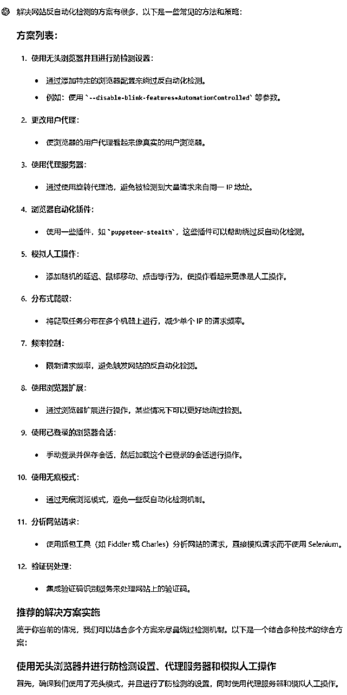

折腾到最后，ChatGPT给了一个方案“Puppeteer + Puppeteer-Stealth”，总算绕过了检测：

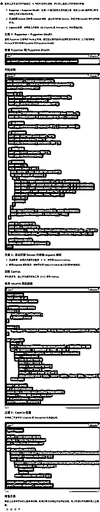

紧接着是登录。登录前后需要识别特定元素，好让程序判断要不要继续往下走。这个靠查看登录按钮的元素就解决了。

再往后，搜索完了点不到“图文”选项，又是打开开发者窗口，找到对应元素让ChatGPT改。

还有一次，笔记数据抓出来是空的。我通过开发者窗口查看笔记元素，把元素的Html代码直接发给ChatGPT分析，让它修正选择器，这才解决。

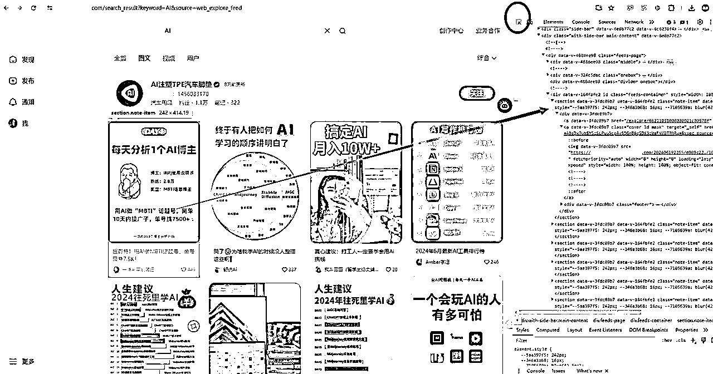

最后一个问题，是向下滚动页面加载更多笔记，而且保存的数据不能重复。ChatGPT在代码里加了个 `seen_ids = set()`，每保存一条笔记就把它的id存进去，下一次处理的时候先查一遍，这样就不会重复了。但滚动的程序一开始没生效，我凭着自己平时刷网页的经验，让ChatGPT在滚动之前先把鼠标移到笔记区域，让滚动事件能作用到页面上，这才跑通。最终按预设数量抓了200条笔记存了下来：

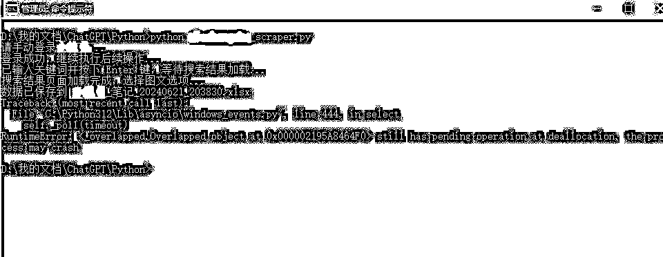

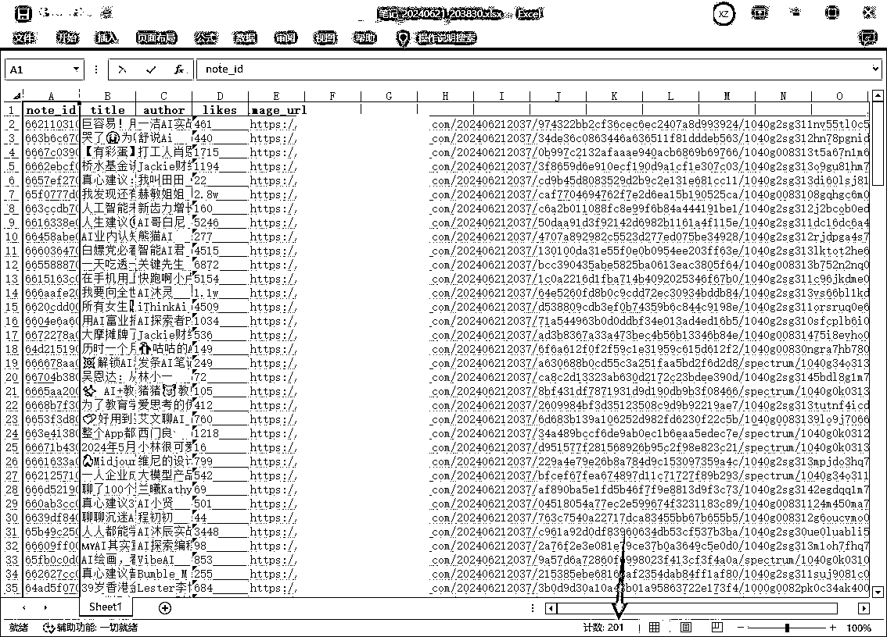

最后提醒一句：上面写到的最终代码里，“某网站”和“目标网站”这两个地方，用的时候要改成真实的网站名和网页链接。

```
import asyncio
from pyppeteer import launch
import pandas as pd
from datetime import datetime

async def main():
    browser = await launch(headless=False, executablePath='C:\\chromium\\chrome-win\\chrome.exe', args=[
        '--no-sandbox',
        '--disable-setuid-sandbox',
        '--disable-blink-features=AutomationControlled',
        '--window-size=1920,1080'
    ])
    page = await browser.newPage()
    await page.setViewport({'width': 1920, 'height': 1080})
    await page.setUserAgent('Mozilla/5.0 (Windows NT 10.0; Win64; x64) AppleWebKit/537.36 (KHTML, like Gecko) Chrome/91.0.4472.124 Safari/537.36')

    # 打开小红书首页
    await page.goto('https://www.xxx.com/') ### 目标网站修改成需要爬取网页的链接 ###

    # 等待用户手动登录
    print("请手动登录某网站...")

    # 确认登录成功（检测页面左侧的“登录”按钮是否消失）
    await page.waitForSelector("button.login-btn", {'timeout': 300000, 'hidden': True})
    print("登录成功，继续执行后续操作...")

    # 输入关键词搜索
    await page.type("input[class*='search-input']", "AI")
    await page.keyboard.press('Enter')
    print("已输入关键词并按下 Enter 键，等待搜索结果加载...")

    # 确认搜索结果页面加载完成
    try:
        await page.waitForSelector("div#short_note", {'timeout': 60000})
        print("搜索结果页面加载完成，选择图文选项...")
    except Exception as e:
        print("等待搜索结果页面加载超时:", e)
        await browser.close()
        return

    # 选择图文选项
    await page.click("div#short_note")
    await asyncio.sleep(5)

    # 将鼠标移动到笔记区域
    await page.hover("div#short_note")
    await asyncio.sleep(2)

    # 爬取笔记数据
    notes = []
    seen_ids = set()
    while len(notes) < 200:
        elements = await page.querySelectorAll("section.note-item")
        for element in elements:
            try:
                note_id = await page.evaluate('(element) => element.querySelector("a.cover")?.href.split("/").pop()', element)
                if not note_id or note_id in seen_ids:
                    continue
                seen_ids.add(note_id)

                title = await page.evaluate('(element) => element.querySelector("a.title span")?.textContent', element)
                author = await page.evaluate('(element) => element.querySelector("div.author-wrapper a.author span.name")?.textContent', element)
                likes = await page.evaluate('(element) => element.querySelector("span.like-wrapper span.count")?.textContent', element)
                image_url = await page.evaluate('(element) => element.querySelector("a.cover img")?.src', element)

                if title and author and likes and image_url:
                    notes.append({'note_id': note_id, 'title': title, 'author': author, 'likes': likes, 'image_url': image_url})

                if len(notes) >= 200:
                    break
            except Exception as e:
                print(f"Error extracting data from element: {e}")
                continue

        if len(notes) >= 200:
            break

        # 页面向下滚动一定高度
        await page.evaluate('window.scrollBy(0, document.body.scrollHeight)')
        await asyncio.sleep(5)  # 等待5秒

    df = pd.DataFrame(notes)
    current_time = datetime.now().strftime("%Y%m%d_%H%M%S")
    filename = f"某网站_笔记_{current_time}.xlsx"
    df.to_excel(filename, index=False)

    await browser.close()
    print(f"数据已保存到 {filename}")

asyncio.run(main())
```

# 让ChatGPT改写现成爬虫，快速搞定问答网站文章抓取

此前在用提示词指挥ChatGPT写爬虫时，经常会碰到两类坑。

其一，指令写得不够细致，模型给出的脚本就会跑偏，甚至选错技术路线。
其二，目标网站的页面结构是ChatGPT训练时没见过，或是已经改版了，那么代码里定位的元素就会失效。

有没有办法降低甚至规避这两种风险？完全可以。之前我在赚钱社区发布的《怎样在航海21天通过ChatGPT编程上线20个Chrome插件》中总结了10条编程思路，其中一条就是“指定代码：先让ChatGPT研读与项目相关的参考代码，再在此基础上进行二次开发”，这条思路正好能对冲第一个风险。

另一个风险，最近也被圈友土豆君在《零基础如何用好AI来爬取数据》这篇文章里给出了解法。他详细演示了如何借助ChatGPT分析网页中目标内容的源码，从而准确定位程序里需要抓取的元素，完美化解了第二个风险。

就在我尝试调整指令，让ChatGPT去写一个爬取某笔记网站的爬虫时，撞上了反自动化检测的硬墙。和模型反复对话尝试了各种套路，手动登录、模拟真人操作、调用无头浏览器，全都被目标站识别。最后模型给出的一套组合拳“Puppeteer + Puppeteer-Stealth”才算是绕过了检测。

通常直接让ChatGPT从零写爬虫，它虽然见过很多方案，却未必会优先选用“Puppeteer + Puppeteer-Stealth”。这一次，我换了个打法：先让它完整学习我已亲测可用的、用于爬取某网站笔记的爬虫程序，再基于这份代码去生成一个爬取某问答网站的抓取工具。

步骤很简单。

先沿用土豆君的方法，打开目标页面，用Chrome开发者工具圈定需要抓取的内容区间，右键选中对应HTML节点，复制其元素代码。提醒一下，复制时如果还需要模型识别其他菜单或按钮，比如这里的“热榜”，就一并把这些节点也复制进去。全部粘贴到 内容范围.txt 文件中保存。

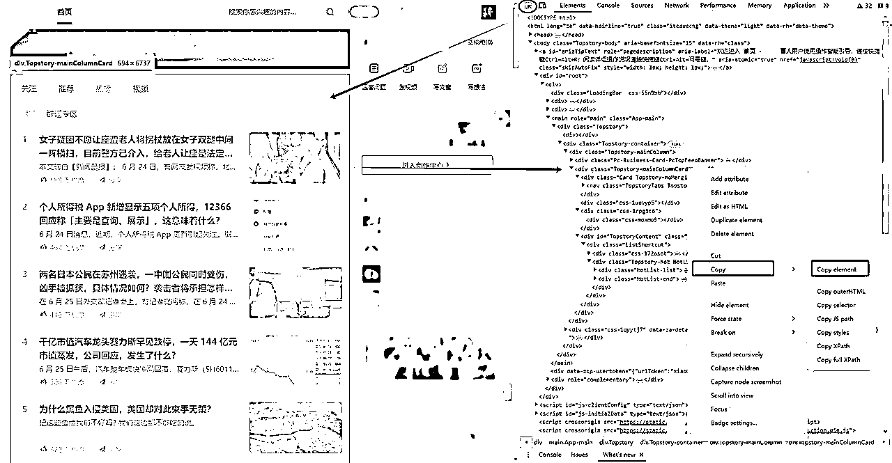

随后，结合知乎热榜页面的实际结构，对指令进行微调：

```
写一个爬虫程序，按下面的要求在我的 windows 电脑上帮我抓取某问答网站文章。
1\. 使用 python 语言
2\. 目标网站：https://www.xxx.com/
3\. 打开某问答网站页面后等待用户登录账号，直到页面出现热榜列表文章，再进入下一步操作
4\. 爬取内容：爬取序号、标题、摘要、文章链接、点赞数和图片链接
5\. 爬取后的内容保存到Excel文件中，Excel文件命名为问答_热榜_时间
6\. 爬取热榜的50个榜单文章，你需要每隔5s向下滚动一次页面，直到滚动到页底，再在保存文件
请在下面代码基础上修改输出完整可运行的程序，注意保留原来代码爬取数据的方案和逻辑。让我看到浏览器中操作的过程，并指导我安装程序依赖的所有库。
你可以先分析文章[ 内容范围.txt ]了解网页中需要爬取的内容的结构，然后再生成代码。
```

注：“某问答网站”需要替换为真实站点名称，目标网站需换成你想抓取的页面链接。

最后，把之前用于爬取某网站笔记的完整爬虫程序附在对话里，让ChatGPT先吃透实现逻辑，再要求它产出一版专门爬取该问答网站热榜的脚本。值得注意的是，这次指令里我并没有点名必须使用“Puppeteer + Puppeteer-Stealth”方案，想看看模型能否在学习已有代码的基础上自行复用这一思路。

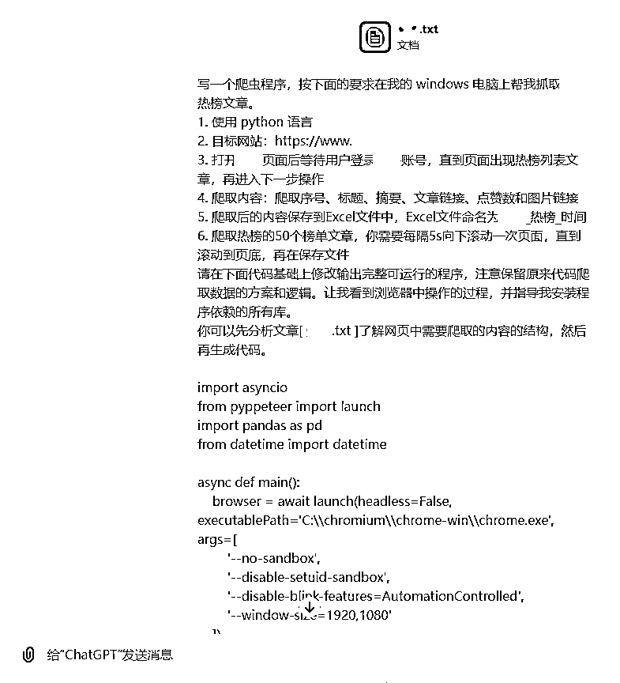

结果很快出来了，ChatGPT直接给出了基于“Puppeteer + Puppeteer-Stealth”方案的Python爬虫：（为便于查阅，完整的对话记录放在文末附录）

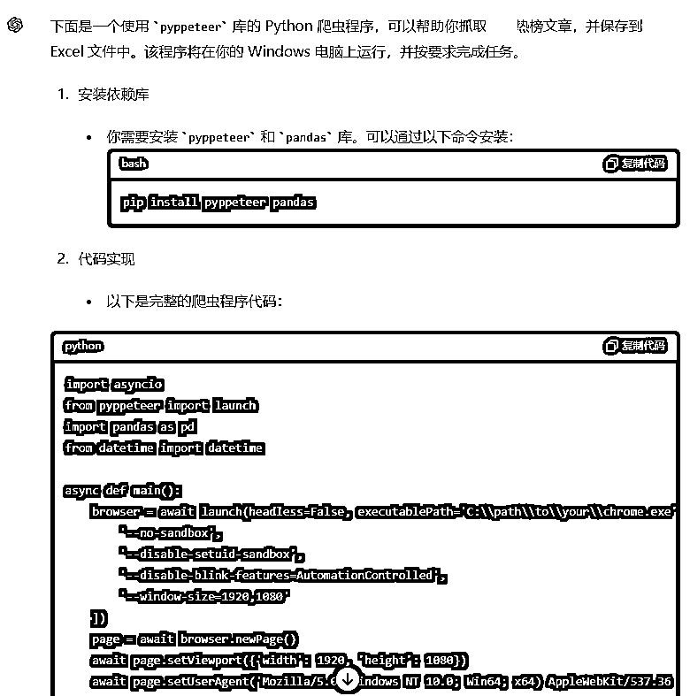

进入测试阶段，过程中仍出现了一些小毛病，但都可以通过继续与ChatGPT对话快速修复。最终，这版由模型改写的爬虫工具成功把目标问答网站的文章列表完整抓取下来：

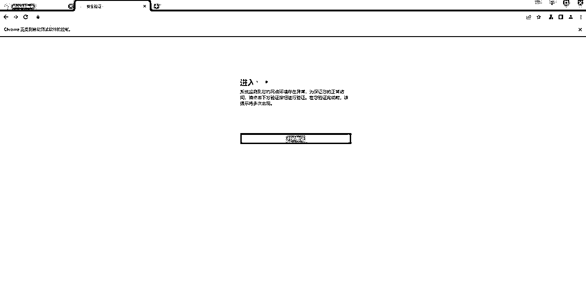

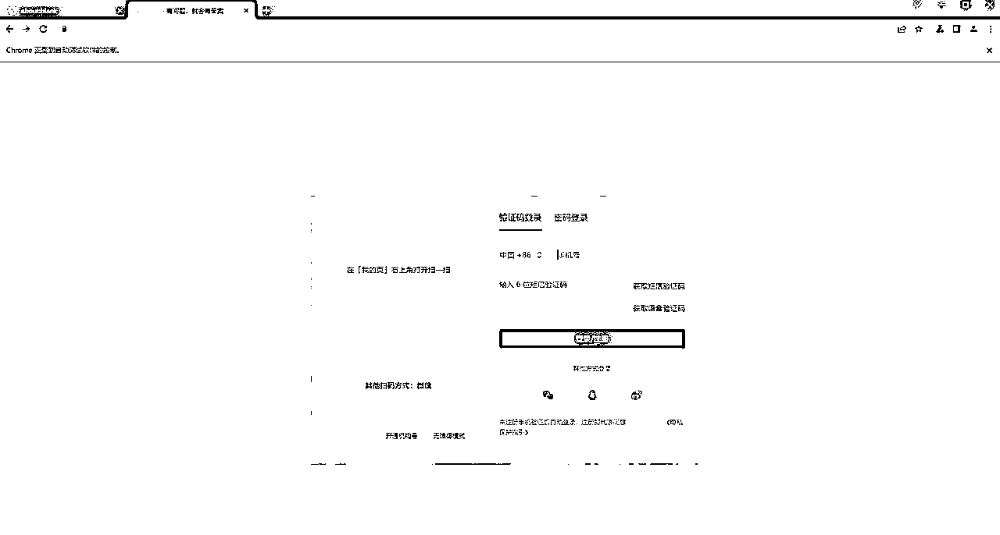

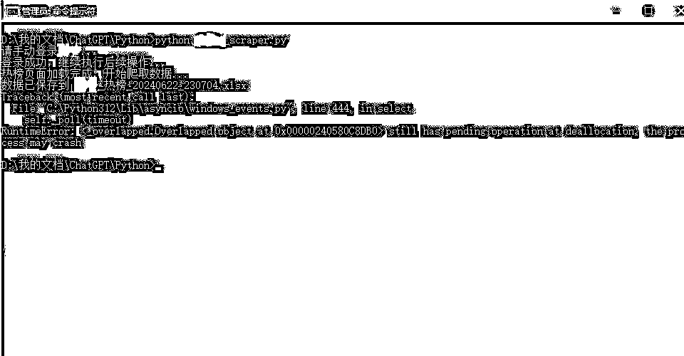

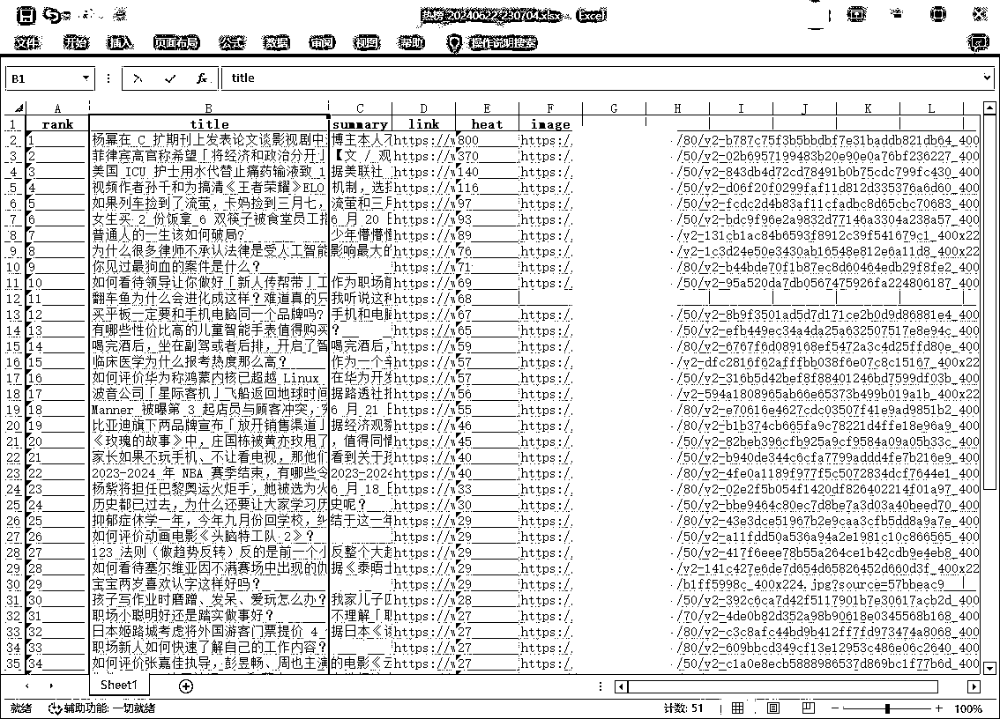

最终可用的爬取代码如下：

```
import asyncio
from pyppeteer import launch
import pandas as pd
from datetime import datetime

async def main():
    browser = await launch(headless=False, executablePath='C:\\chromium\\chrome-win\\chrome.exe', args=[
        '--no-sandbox',
        '--disable-setuid-sandbox',
        '--disable-blink-features=AutomationControlled',
        '--window-size=1920,1080'
    ])
    page = await browser.newPage()
    await page.setViewport({'width': 1920, 'height': 1080})
    await page.setUserAgent('Mozilla/5.0 (Windows NT 10.0; Win64; x64) AppleWebKit/537.36 (KHTML, like Gecko) Chrome/91.0.4472.124 Safari/537.36')

    # 打开知乎登录页面
    await page.goto('https://www.xxx.com/') ### 目标网站修改成需要爬取网页的链接 ###

    # 等待用户登录
    print("请手动登录某问答网站...")
    await page.waitForSelector(".TopstoryTabs", {'timeout': 300000})
    print("登录成功，继续执行后续操作...")

    # 点击热榜标签
    await page.click("a[data-za-extra*='热榜']")
    await asyncio.sleep(5)  # 等待页面加载

    # 确认热榜页面加载完成
    await page.waitForSelector(".HotList-list", {'timeout': 60000})
    print("热榜页面加载完成，开始爬取数据...")

    # 爬取热榜文章
    articles = []
    seen_links = set()
    for _ in range(10):  # 每次爬取页面的内容，并向下滚动
        elements = await page.querySelectorAll(".HotItem")
        for element in elements:
            try:
                link = await page.evaluate('(element) => element.querySelector(".HotItem-content a") ? element.querySelector(".HotItem-content a").href : null', element)
                if not link or link in seen_links:
                    continue

                rank = await page.evaluate('(element) => element.querySelector(".HotItem-rank") ? element.querySelector(".HotItem-rank").innerText : null', element)
                title = await page.evaluate('(element) => element.querySelector(".HotItem-title") ? element.querySelector(".HotItem-title").innerText : null', element)
                summary = await page.evaluate('(element) => element.querySelector(".HotItem-excerpt") ? element.querySelector(".HotItem-excerpt").innerText : null', element)
                heat = await page.evaluate('(element) => element.querySelector(".HotItem-metrics") ? element.querySelector(".HotItem-metrics").innerText.split(" ")[0] : null', element)
                image = await page.evaluate('(element) => element.querySelector(".HotItem-img img") ? element.querySelector(".HotItem-img img").src : null', element)

                articles.append({
                    'rank': rank,
                    'title': title,
                    'summary': summary,
                    'link': link,
                    'heat': heat,
                    'image': image
                })
                seen_links.add(link)

                if len(articles) >= 50:
                    break
            except Exception as e:
                print(f"Error extracting data from element: {e}")
                continue

        if len(articles) >= 50:
            break

        await page.evaluate('window.scrollBy(0, document.body.scrollHeight)')
        await asyncio.sleep(5)  # 等待5秒

    # 保存到Excel文件
    df = pd.DataFrame(articles)
    current_time = datetime.now().strftime("%Y%m%d_%H%M%S")
    filename = f"问答_热榜_{current_time}.xlsx"
    df.to_excel(filename, index=False)

    await browser.close()
    print(f"数据已保存到 {filename}")

asyncio.run(main())
```

既然ChatGPT在参考现有爬虫代码后，能完成二次开发，并产出与参考思路相近、甚至更贴合需求的代码，那是否可以把我们手里积累的各类爬虫方案作为知识库，做成一个专门的GPTs，让ChatGPT按实际业务需要去学习对应代码并改造？照这个思路，或许能更快地用ChatGPT产出真正可用的爬虫工具。

基于这个念头，我动手做了一个辅助生成爬虫程序的GPTs。第一步，把之前爬取某网站文章和爬取某网站笔记的代码分别存成“selenium.txt”和“puppeteer.txt”，然后上传到GPTs的知识库里：

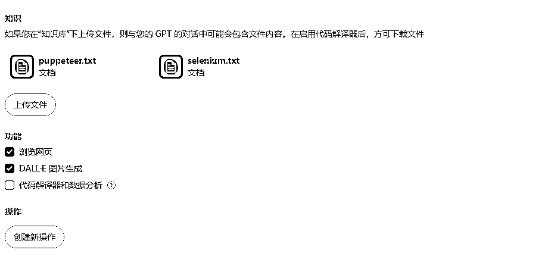

接着，给这个GPTs编写指令：

```
Step 1：收到用户的信息，都先让用户填写下面信息：
1\. 目标网站： 
2\. 搜索或过滤规则：
3\. 爬取内容：
4\. 保存文件类型和名称：
5\. 翻页或加载更多内容的规则：
Step 2：用户填写上面信息并提交。
Step 3：收到用户提交的信息后，询问用户选择下面哪种Python方案：
1\. 常用爬虫方案：使用 python3 和最新版的 selenium
2\. 反自动化检测方案：使用 python3 和 Puppeteer + Puppeteer-Stealth
Step 4：用户选择Python方案并提交。
Step 5：收到用户选择的方案后，询问用户是否上传网站需要爬取的内容HTML的txt文件。
Step 6：用户上传网站需要爬取的内容HTML的txt文件或者直接回复网站结构信息。
Step 7：收到用户提交的网站需要爬取的内容HTML的txt文件或者网站结构信息后
1、先分析网站需要爬取的内容HTML的txt文件或者网站结构信息，了解网页中需要爬取的内容的结构；
2、再根据用户选择的Python方案，学习知识库中对应名称的文件程序；
3、在对应名称的文件程序的基础上，按照用户填写的“目标网站”、“搜索或过滤规则”、“保存文件类型和名称”和“翻页或加载更多内容的规则”等信息，输出完整可运行的程序，注意保留知识库中对应名称的文件原来程序的爬取数据的方案和逻辑；
4、让用户看到浏览器中操作的过程，并指导用户安装程序依赖的所有库。
```

建好后，我让它重新生成那两份爬虫代码。只要提供目标网站的信息、选定爬虫方案、提交网页结构文件，它就能按对应方案输出可用的爬虫程序。（完整聊天过程放在文末附录，方便查阅）

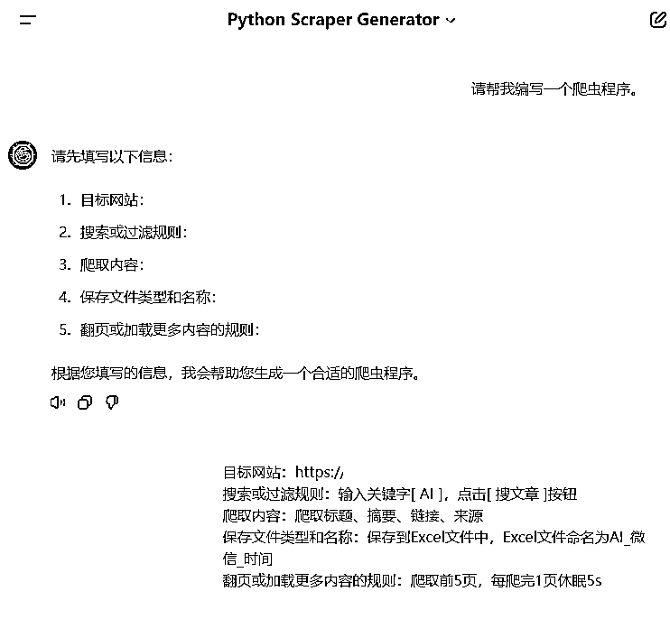

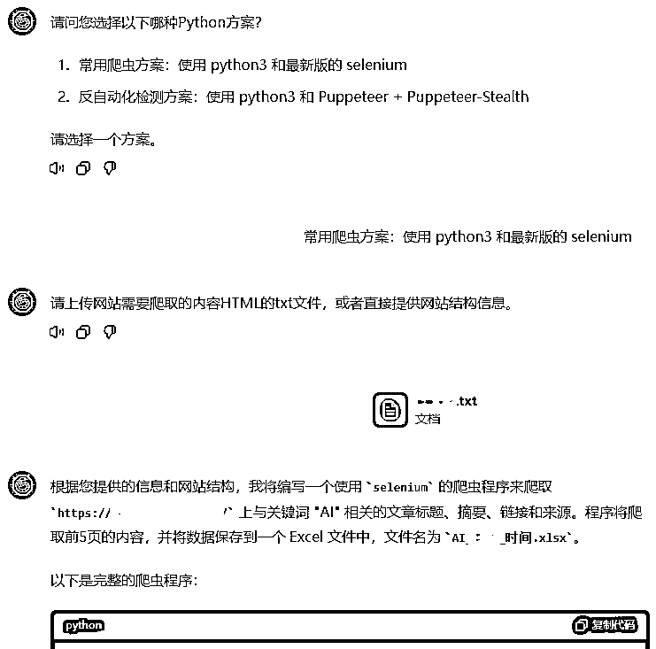

如果后续再补充更多Python爬虫方案的代码，这个GPTs的知识库会越来越完整，也就能帮用户生成更多不同技术路线的爬虫程序。

再聊聊把爬虫程序封装成产品的事。我的编程基础很一般，称不上专业开发者，也没系统学过Python、Java、PHP这类主流语言。但以前我和两位技术很强的Partner靠WordPress、ThinkPHP这些开源项目做过不少PHP互联网项目。ChatGPT出现后，我靠它写成了人生第一个Chrome插件GPTBLOX，还积累了1500多位用户（本文附录里的截图都是这个插件保存的，它也支持保存HTML、TXT和PDF）。

这次参加AI编程航海，我原本只是想多吸收一些AI编程的新玩法，补上自己的短板，并没打算靠Python做出什么产品。但随着航海不断推进，一个个爬虫程序做出来后，我开始琢磨：能不能把一些实现特定功能的Python脚本打包成产品？就在我准备动手摸索时，航海里正好来了一场让我眼前一亮的分享——《编程PYTHON封装为可执行程序exe》。

我认真研究了圈友壹壹的分享，第二天就上手测试，把之前ChatGPT生成的那个抓取网站文章的爬虫工具加上了UI界面：

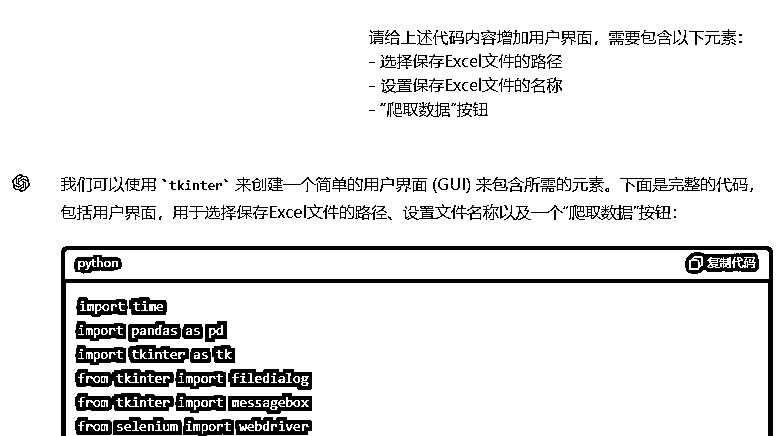

加完UI后的最终代码如下：

```
import time
import pandas as pd
import tkinter as tk
from tkinter import filedialog
from tkinter import messagebox
from selenium import webdriver
from selenium.webdriver.common.by import By
from selenium.webdriver.common.keys import Keys
from selenium.webdriver.chrome.service import Service as ChromeService
from selenium.webdriver.support.ui import WebDriverWait
from selenium.webdriver.support import expected_conditions as EC
from webdriver_manager.chrome import ChromeDriverManager

def start_scraping(save_path, file_name):
    # 设置Chrome选项
    chrome_options = webdriver.ChromeOptions()
    chrome_options.add_argument("--start-maximized")

    # 创建WebDriver实例
    driver = webdriver.Chrome(service=ChromeService(ChromeDriverManager().install()), options=chrome_options)

    # 访问目标网站
    driver.get("https://www.xxx.com/") ### 目标网站修改成需要爬取网页的链接 ###

    # 输入关键字并点击搜索按钮
    search_box = driver.find_element(By.ID, "query")
    search_box.send_keys("AI")
    search_box.send_keys(Keys.RETURN)

    time.sleep(3)  # 等待页面加载

    # 准备存储数据的列表
    data = []

    # 爬取前5页
    for page in range(1, 6):
        print(f"正在爬取第{page}页...")

        WebDriverWait(driver, 10).until(
            EC.presence_of_element_located((By.XPATH, "//ul[@class='news-list']/li"))
        )

        articles = driver.find_elements(By.XPATH, "//ul[@class='news-list']/li")
        for article in articles:
            try:
                title_element = article.find_element(By.XPATH, ".//h3/a")
                title = title_element.text
                link = title_element.get_attribute("href")
                print(f"Title: {title}")  # 打印调试信息
                print(f"Link: {link}")    # 打印调试信息
            except Exception as e:
                print("Error finding title or link:", e)
                title = "N/A"
                link = "N/A"

            try:
                summary = article.find_element(By.XPATH, ".//p").text
                print(f"Summary: {summary}")  # 打印调试信息
            except Exception as e:
                print("Error finding summary:", e)
                summary = "N/A"

            try:
                source = article.find_element(By.XPATH, ".//div[@class='s-p']/span[@class='all-time-y2']").text
                print(f"Source: {source}")  # 打印调试信息
            except Exception as e:
                print("Error finding source:", e)
                source = "N/A"

            # 添加到数据列表
            data.append({"Title": title, "Summary": summary, "Link": link, "Source": source})

        # 翻页
        if page < 5:
            try:
                next_button = driver.find_element(By.ID, "sogou_next")
                next_button.click()
                WebDriverWait(driver, 10).until(
                    EC.presence_of_element_located((By.XPATH, "//ul[@class='news-list']/li"))
                )
                time.sleep(5)  # 每爬完一页休眠5秒
            except Exception as e:
                print("无法点击下一页:", e)
                break

    # 关闭浏览器
    driver.quit()

    # 保存数据到Excel文件
    current_time = time.strftime("%Y%m%d_%H%M%S")
    file_name = f"{file_name}_{current_time}.xlsx"
    file_path = f"{save_path}/{file_name}"
    df = pd.DataFrame(data)
    df.to_excel(file_path, index=False, engine='openpyxl')

    print(f"数据已保存到 {file_path}")
    messagebox.showinfo("完成", f"数据已保存到 {file_path}")

def select_path():
    path = filedialog.askdirectory()
    if path:
        entry_path.delete(0, tk.END)
        entry_path.insert(0, path)

def scrape_data():
    save_path = entry_path.get()
    file_name = entry_filename.get()
    if not save_path or not file_name:
        messagebox.showwarning("警告", "请提供保存路径和文件名称")
        return
    start_scraping(save_path, file_name)

# 创建主窗口
root = tk.Tk()
root.title("XXX网站爬虫")

# 创建并放置组件
label_path = tk.Label(root, text="选择保存路径:")
label_path.grid(row=0, column=0, padx=10, pady=10)
entry_path = tk.Entry(root, width=40)
entry_path.grid(row=0, column=1, padx=10, pady=10)
button_path = tk.Button(root, text="浏览", command=select_path)
button_path.grid(row=0, column=2, padx=10, pady=10)

label_filename = tk.Label(root, text="设置文件名称:")
label_filename.grid(row=1, column=0, padx=10, pady=10)
entry_filename = tk.Entry(root, width=40)
entry_filename.grid(row=1, column=1, padx=10, pady=10)

button_scrape = tk.Button(root, text="爬取数据", command=scrape_data)
button_scrape.grid(row=2, columnspan=3, pady=20)

# 启动主循环
root.mainloop()
```

把代码打包成可执行程序，其实并不复杂，你只需要这样做：

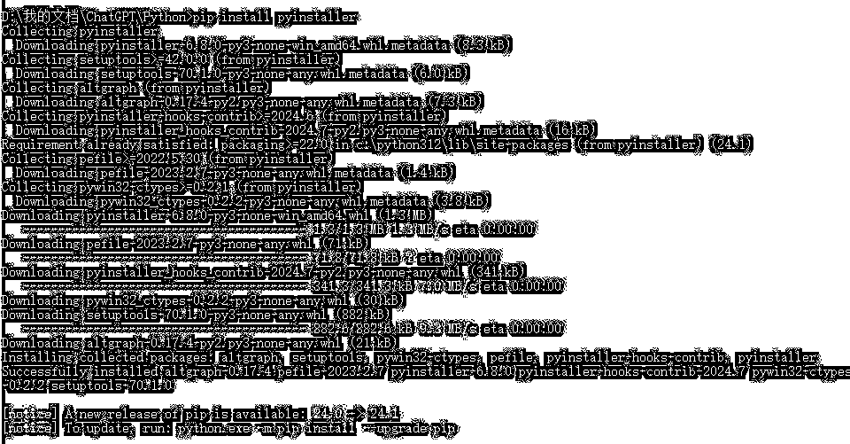

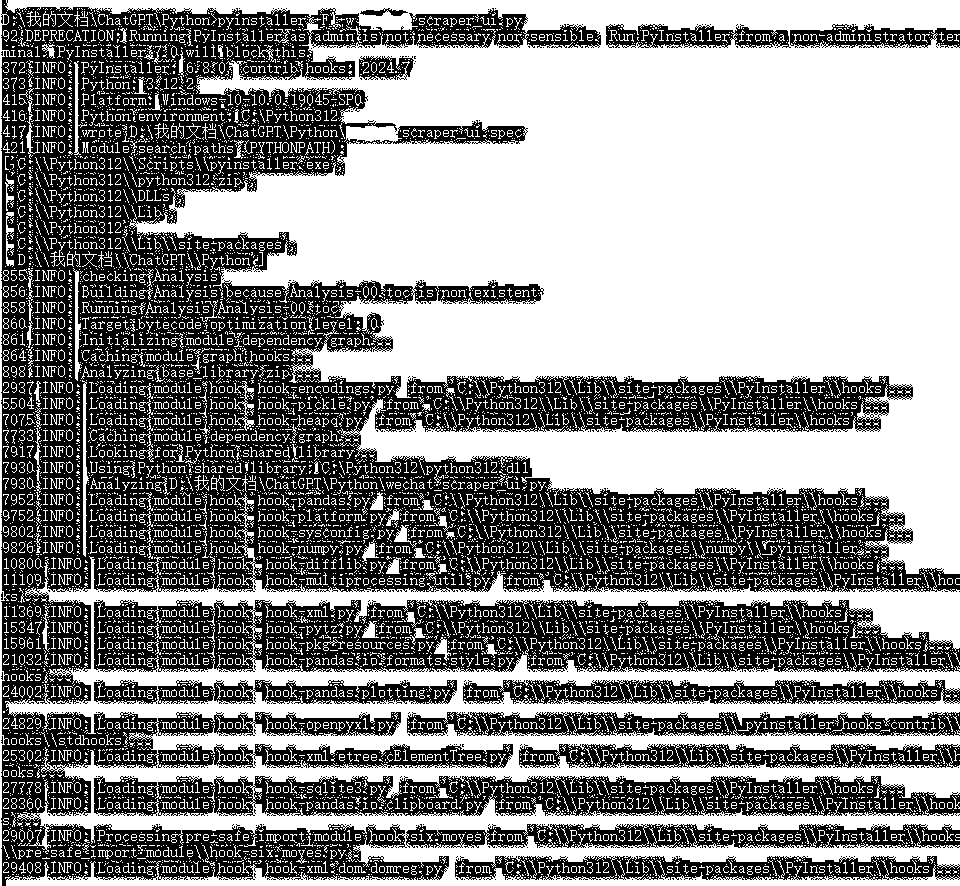

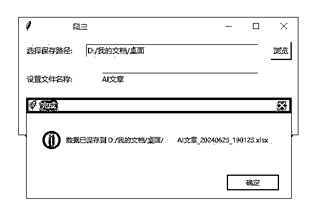

尽管这版程序还相当简陋，但它实实在在为那些不怎么会写代码的人打开了一扇窗。借助ChatGPT这样的AI助手，或者各类开源项目，我们完全可以按需打造专属的Python工具——无论是网络爬虫、图像处理、短视频剪辑、文件整理，还是数据分析，通通不在话下。

这让我联想到去年Code Interpreter刚亮相时，在GitHub和Twitter上引起轰动的那个开源项目：

https://github.com/chaseleantj/gpt-prompts

当时你只需把一段指令和一张图片丢给ChatGPT，后端的Code Interpreter便会在虚拟环境里自动生成Python代码并运行，最终把图片做成逐渐隐去的特效视频。

秘密就在于那段指令里，其实藏着一份非常完整的Python代码：

```
I want to apply the disintegration effect from Avengers to this image. Can you help me with it? Provide me with a link to download the video generated. Use the code below:

import imageio
import numpy as np
import random

# Load the image
image_path = "[INSERT IMAGE PATH HERE]"
image = imageio.imread(image_path)

# Define the block size
block_size = 4

# Get the dimensions of the image
height, width, _ = image.shape

# Make sure the image dimensions are divisible by block size
height -= height % block_size
width -= width % block_size

# Crop the image to the new dimensions
image = image[:height, :width]

# Calculate the number of blocks in each dimension
num_blocks_y, num_blocks_x = height // block_size, width // block_size

# Create an index map of blocks
blocks = np.dstack(np.mgrid[0:num_blocks_y, 0:num_blocks_x]).reshape(-1, 2)

# Multiply the indices by the block size to get the pixel coordinates
blocks *= block_size

# Define the distance to move the blocks (Ask the user for X in percentage, tell user default = 10%)
distance = round(0.1 * width)  # Replace 0.1 with X

# Define the number of times to move each block
move_count = 3

# Create a copy of the original image to work on
working_image = image.copy()

# Convert the blocks to a list and randomly shuffle it
blocks_list = list(map(tuple, blocks))
random.shuffle(blocks_list)

# Define the number of blocks to move (Ask the user for Y in percentage, default = 2% of the total blocks)
num_blocks_to_move = int(0.02 * len(blocks_list))  # Replace 0.02 with Y

# Create a video writer context
with imageio.get_writer('/mnt/data/disintegration_effect.mp4', mode='I', fps=30) as writer:
    # Write a static image to the first 3 frames
    for _ in range(3):
        writer.append_data(working_image)

    # Loop over the blocks in the shuffled list
    for _ in range(move_count):
        for i in range(0, len(blocks_list), num_blocks_to_move):
            # Select a slice of blocks to move
            blocks_to_move = blocks_list[i:i+num_blocks_to_move]

            # For each block, move it to the left by the specified distance
            for block in blocks_to_move:
                y, x = block
                shift_distance = int(min(distance * random.random(), x))  # Don't shift more than the x-coordinate of the block

                if x-shift_distance >= 0:
                    working_image[y:y+block_size, x-shift_distance:x+block_size-shift_distance] = working_image[y:y+block_size, x:x+block_size]
                    working_image[y:y+block_size, x:x+block_size] = 0

            # Write the frame to the video file
            writer.append_data(working_image)
```

于是我就琢磨：能不能让ChatGPT把这套Python代码改一改，直接封装成可执行程序？事实证明完全可行。直接看ChatGPT的对话截图：

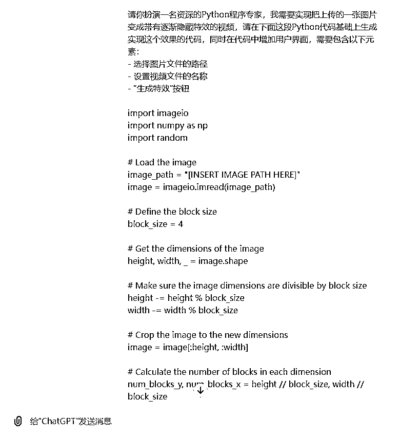

ChatGPT很快就把代码调整好了，经过反复测试和优化（完整对话过程放在文末附录，方便大家查阅），最终诞生了一个带图形界面的Python应用。

```
import tkinter as tk
from tkinter import filedialog, messagebox
import imageio.v2 as imageio
import numpy as np
import random
import os

def generate_effect(image_path, video_name):
    # Load the image
    image = imageio.imread(image_path)

    # Define the block size
    block_size = 4

    # Get the dimensions of the image
    height, width, _ = image.shape

    # Make sure the image dimensions are divisible by block size
    height -= height % block_size
    width -= width % block_size

    # Crop the image to the new dimensions
    image = image[:height, :width]

    # Calculate the number of blocks in each dimension
    num_blocks_y, num_blocks_x = height // block_size, width // block_size

    # Create an index map of blocks
    blocks = np.dstack(np.mgrid[0:num_blocks_y, 0:num_blocks_x]).reshape(-1, 2)

    # Multiply the indices by the block size to get the pixel coordinates
    blocks *= block_size

    # Define the distance to move the blocks
    distance = round(0.1 * width)

    # Define the number of times to move each block
    move_count = 3

    # Create a copy of the original image to work on
    working_image = image.copy()

    # Convert the blocks to a list and randomly shuffle it
    blocks_list = list(map(tuple, blocks))
    random.shuffle(blocks_list)

    # Define the number of blocks to move
    num_blocks_to_move = int(0.02 * len(blocks_list))

    # Create a video writer context
    with imageio.get_writer(video_name, mode='I', fps=30) as writer:
        # Write a static image to the first 3 frames
        for _ in range(3):
            writer.append_data(working_image)

        # Loop over the blocks in the shuffled list
        for _ in range(move_count):
            for i in range(0, len(blocks_list), num_blocks_to_move):
                # Select a slice of blocks to move
                blocks_to_move = blocks_list[i:i+num_blocks_to_move]

                # For each block, move it to the left by the specified distance
                for block in blocks_to_move:
                    y, x = block
                    shift_distance = int(min(distance * random.random(), x))  # Don't shift more than the x-coordinate of the block

                    if x - shift_distance >= 0:
                        working_image[y:y+block_size, x-shift_distance:x+block_size-shift_distance] = working_image[y:y+block_size, x:x+block_size]
                        working_image[y:y+block_size, x:x+block_size] = 0

                # Write the frame to the video file
                writer.append_data(working_image)

def select_image():
    file_path = filedialog.askopenfilename(filetypes=[("Image Files", "*.png;*.jpg;*.jpeg")])
    if file_path:
        image_path.set(file_path)

def generate_video():
    img_path = image_path.get()
    vid_name = video_name.get()
    if not img_path:
        messagebox.showerror("Error", "Please select an image file.")
        return
    if not vid_name:
        messagebox.showerror("Error", "Please enter a video file name.")
        return
    if not vid_name.endswith(".mp4"):
        vid_name += ".mp4"
    generate_effect(img_path, vid_name)
    messagebox.showinfo("Success", "Video generated successfully!")

# Create the main window
root = tk.Tk()
root.title("Image to Video Effect Generator")

# Create variables to store user input
image_path = tk.StringVar()
video_name = tk.StringVar()

# Create and place the widgets
tk.Label(root, text="Select Image File:").grid(row=0, column=0, padx=10, pady=10)
tk.Entry(root, textvariable=image_path, width=50).grid(row=0, column=1, padx=10, pady=10)
tk.Button(root, text="Browse...", command=select_image).grid(row=0, column=2, padx=10, pady=10)

tk.Label(root, text="Enter Video File Name:").grid(row=1, column=0, padx=10, pady=10)
tk.Entry(root, textvariable=video_name, width=50).grid(row=1, column=1, padx=10, pady=10)

tk.Button(root, text="Generate Effect", command=generate_video).grid(row=2, column=0, columnspan=3, pady=20)

# Start the GUI event loop
root.mainloop()
```

在做封装前，先把三个依赖库装好：imageio、imageio[ffmpeg]、imageio[pyav]。

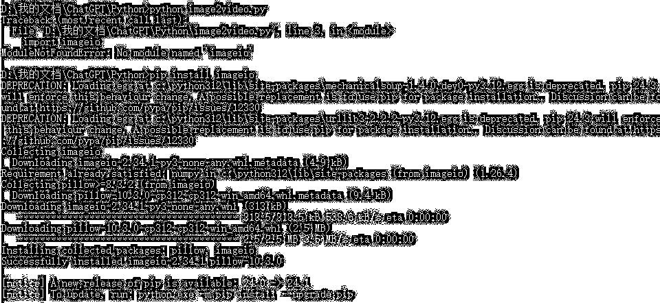

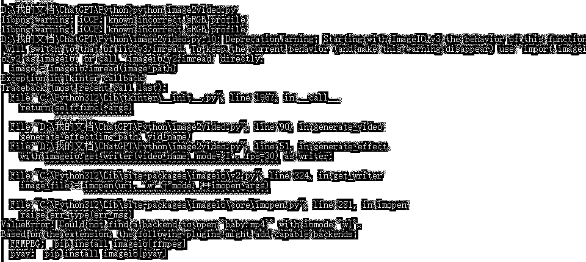

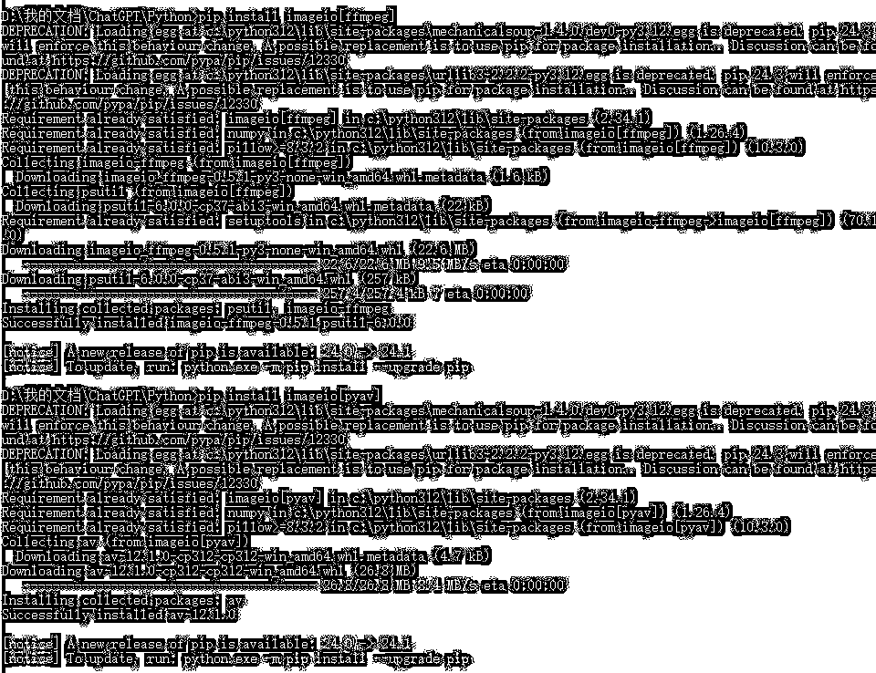

接下来，参考圈友壹壹分享的思路，直接运行这条命令即可：

pyinstaller -F -w image2video.py

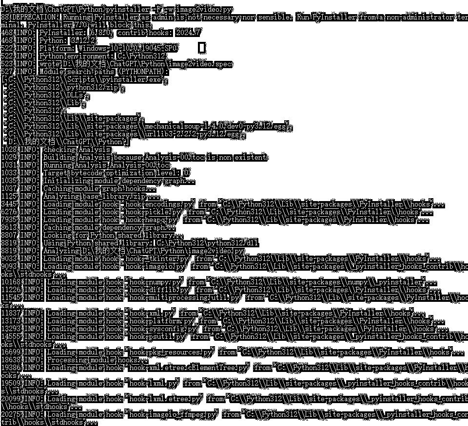

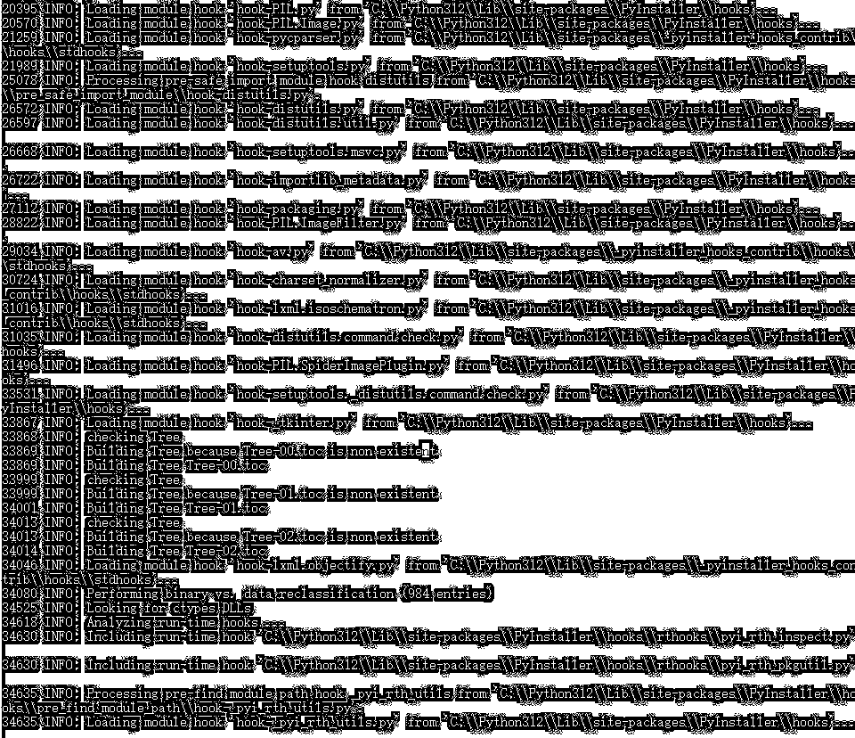

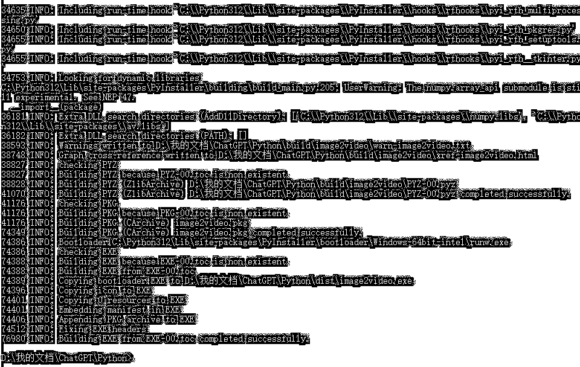

这样就能把Python脚本打包成独立的exe文件，实现“图片自动生成逐新淡出特效视频”的功能。

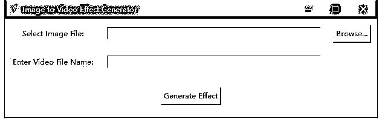

我亲自测试过，这个exe用起来很顺手，轻轻松松就把图片转成了带淡出效果的特效视频。

那这类可执行程序到底有什么用？除了自己用，已经有圈友在闲鱼、小红书这些平台上卖Python爬虫工具赚钱了：

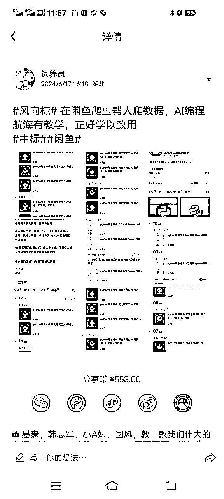

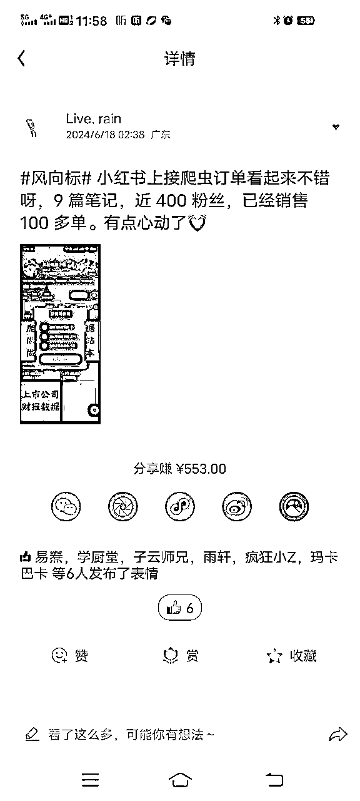

更进一步想，我们是不是也能帮亚马逊卖家做数据分析工具、帮短视频用户做视频处理工具、帮职场人员做批量处理工具？只要存在一个个具体的小需求，这就是我们在AI时代能抓住的机会。

最后，祝大家龙哥盟！

# 附录

## 用爬虫工具抓取网站文章的对话记录（GPT4o）


## 用爬虫工具抓取网站文章的对话记录（GPT4）


## 用爬虫工具抓取网站图片的对话记录

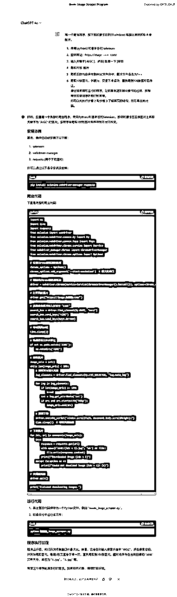

## 用爬虫工具抓取电商网站产品的对话记录


## 改写爬虫工具抓取某问答网站文章的对话记录


## 用GPTs生成爬虫工具抓取网站文章的对话记录

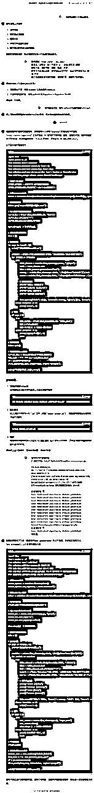

## 用GPTs生成爬虫工具抓取某网站笔记的对话记录

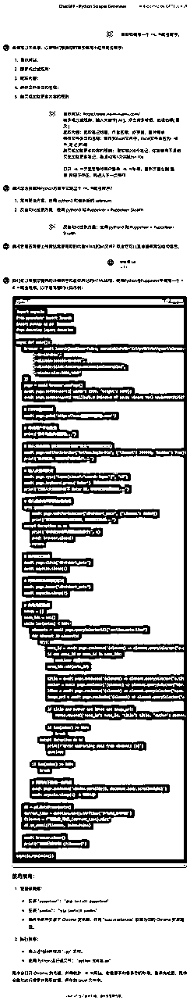

## 生成带UI的图片隐藏特效视频Python程序的对话记录

