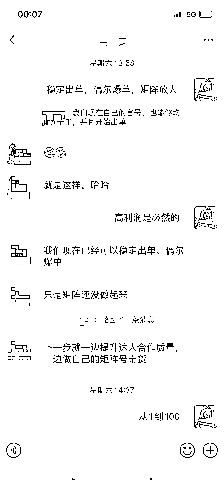
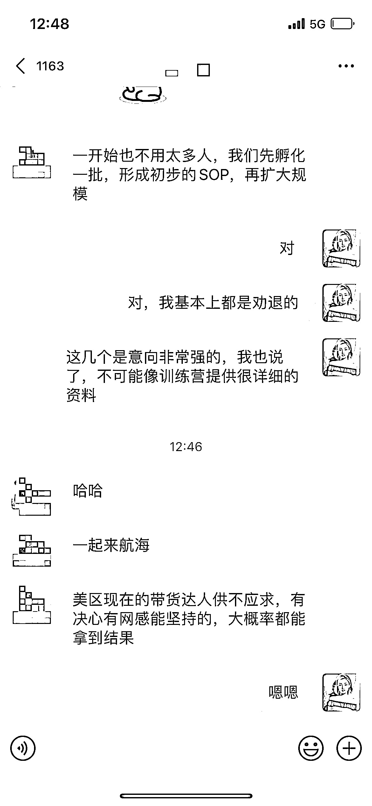
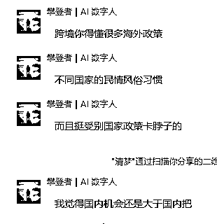
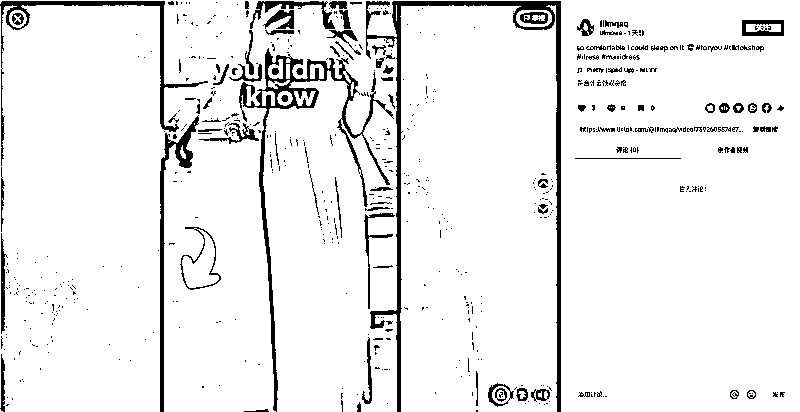
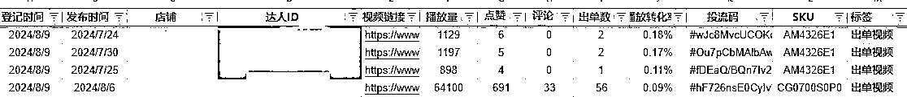
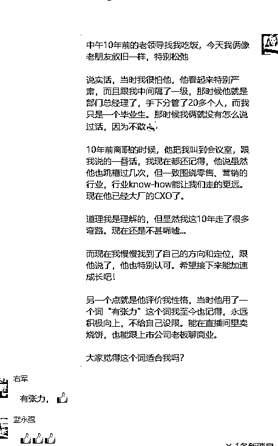

# 视频号老玩家转战TikTok：稳定出单，偶尔爆单，这个风口还有10年
作者：龙哥

> 最近和一个做了半年视频号、操盘过300万GMV、养了100多个账号、搭过30多个直播间的老玩家聊天，他提到了一个新项目，利润空间很大，但对执行力和硬件条件有要求。听完之后我的感受是：这可能是普通人未来十年不多的翻身机会之一。

先简单说下判断：

- 视频号这个盘子，至少还能玩2年；
- 内容电商的整体红利，保守估计还有3年；
- 如果放到“流量变现”这个大维度，10年都不是问题。

而眼下最值得关注的机会，是TikTok带货。

对个人玩家来说，TK的门槛确实不低。但换个角度看，门槛就是护城河，能把一大批想进场的人挡在外面。今天下午跟攀登者聊到这个话题，他也认同这个判断。

很多人纠结海外政策，我觉得现阶段没必要。咱们的体量还小，那些大环境的变化根本影响不到我们赚钱。再说了，内容电商的底层逻辑全球通用。到了Q4，欧洲、中东也会陆续开放。就算美区因为地缘政治受限，换个市场继续做就是了，没什么好怕的。

目前我们自己运营的三个单店，GMV都已经破了2000美金，偶尔爆单的时候，一天能干到2万美金。

顺着攀登者提到的政治经济学角度看，国家GDP的三驾马车——房地产、外贸、基建，前两者现在什么情况大家都懂，后面肯定要大力扶持出口。巧的是，今天中午一起吃饭的那位领导，做了20年营销，他给出的判断是：现在的出海电商，就像2015、2016年的中国电商，整个风口至少还有10年。

做过电商的人都明白，只要能踩中一两年的加速增长期，财务自由基本就稳了。

## 1. 为什么是TikTok？

### ① 平台现状：内容极度稀缺

你随便刷刷TK就会发现，很多达人的内容简直没什么技术含量。有人开着直播就是唠嗑，照样能卖货。整个平台目前最缺的是内容，不是商品。

大家有没有刷到过下面这种视频？

这种视频怎么变现？很多人可能想不到。

其实就是把多个爆款片段混剪在一起，加上贴图购物引导，反复强调“现在买很划算”来刺激下单。这个逻辑做电商的人一看就懂。制作成本极低，主要靠搬运混剪别人的热门视频，发到自己账号就能养活一个号，连样品都不用寄，完全没库存压力。

而且，这种账号背后很多就是中国人在运营。他们用的玩法和国内那套营销逻辑几乎一模一样，复制起来太容易了。

我们自己运营的官方账号，现在平均在线人数已经过千，也开始稳定出单了。

### ② 红利到底在哪？

先看流量。TK直播的推流非常猛，只要你想做，尤其是定位美国市场的，基本都能做起来。

再看价格。中国是生产大国，这个优势太明显了。我11年前在美国实习，一件泳衣卖20美金，国内淘宝也就20人民币。之前我做假发，国内卖150人民币，到美国能卖100多美金。还有咱们早就不稀罕的五六十块钱的充电宝，美国消费者没见过，愿意花30美金找我们买。

有人觉得这个项目难，要懂各种海外政策。但说实话，达人根本不需要了解那么多，真正需要操心的是商家。很多人连账号注册都搞不定，我前两天带一个私教学员起步，他也是破局的合伙人，两天就起了两个号。

难度对有经验的人来说反而是优势。越难，越能挡掉一批竞争者。

更何况我们还有换脸技术、AI视频、数字人这些工具，对海外那些还在靠纯聊天做内容的达人来说，简直是降维打击。

## 2. 稳定出单到偶尔爆单：矩阵放大是核心

目前我们已经跑通了从出单到爆单的规律，但想要把利润做大，必须在矩阵上下功夫。现在的目标很清晰：一是提升达人合作质量，二是做自己的矩阵号带货。

这个项目我们已经从达人端和商家端两头打通，目前主要做女装带货。整个TK美国生态极度缺达人，需求量巨大。

当你把自己的达人号养起来之后，后续可以接其他品牌商的货，甚至可以开课教海外达人怎么做TK，再往大了说，还能成立海外的MCN机构。

现在项目还处在早期，只要加入并且坚持做，大概率能吃到一波红利。之后你还能根据自己的资源延伸出更多TK业务，商业潜力很大。

尤其是美国TK直播，正处于推流猛、竞争小的阶段。美国本土很多主播压根不具备直播带货的能力，这基本就是一片蓝海。只要你勤劳一点，坚持播，就会出单。

在美国的小伙伴，一定要抓住这个机会！

国内特别想做的朋友也可以加入，无非是多花点时间学习怎么解决网络、设备这些硬条件。

## 3. 两个必须知道的点

### ① 积极主动，持续投入

我们这边已经有3个稳定的账号，每天单号2000GMV起步，爆单的时候能到10000+。

用当事人的原话说：只要你现在下定决心，愿意付出，真想在这里面做出点成绩，就一定能拿到结果。决心和投入度，比什么技巧都重要。

### ② 抓住信息差，卡位要趁早

为什么这个项目现在竞争还不激烈？因为很多人都卡在最关键的一环：网络环境、账号注册、报税问题。

前期投入跟国内达人带货一样，不需要砸钱，主要是花时间做视频。所以想做的人一定要把时间留出来，先做到量产。如果暂时没精力，可以等后续通知。

账号、网络、报税都有对应的解决办法。说白了，就是利用信息差和资源差，比别人先走一步。

当务之急不是纠结细节，而是抓住风口做出成绩。

今天下午我分享了一段感悟：基本盘+不设限。军哥还补了一句：基本盘决定起点厚度，不设限决定起飞高度。

现在的TK项目也是一样。希望大家都能抓住这波风口，狠狠赚一笔。

评论区有朋友问怎么上车，作者回复是：xuan626。

