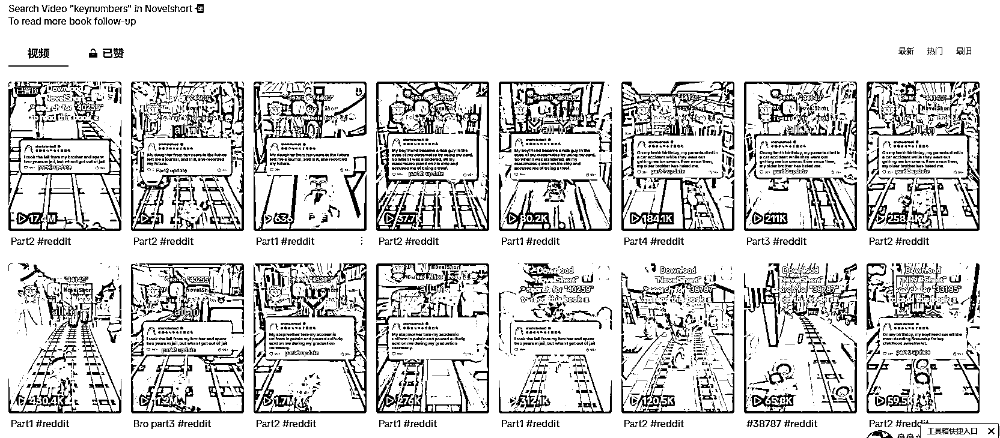

# ('TIKTOK 也出小说推文了？太猛了，一条视频充值 5W+', (2, 31))

兄弟们，小说推文的红利，这回轮到TikTok了！最近刷TikTok，你有没有刷到过一种画风清奇的视频：解压画面配上一段故事文案，播放量却高得离谱——几十万只是起步，上百万也不稀奇。有人已经靠一条视频充值收入破了5万，这操作也太猛了吧？

这种玩法到底怎么做？新手能不能上手？三年TikTok老玩家“路途”表示，他们团队自己就在做小说出海，门槛不高，比较适合小白入门。他还透露，这篇玩法拆解是因为肉松老师一周前请他推荐适合新手的TikTok项目，他想着手头正好有现成案例，就写了出来。不过他也提醒，做跨境内容容易踩敏感词，之前文章就被平台审核删过，改了之后才重新发出来。详细内容可以看腾讯文档：https://docs.qq.com/doc/DQW1mQkJNdmtVcmRN

评论区里的信息量也不小。有人问靠不靠谱、从哪入手；有人对比国内外的佣金，发现国内能到80%+，国外却低一截。还有一位做了两年推文的朋友分享了自己的经历：个人累计收入40多万，也带过上百人团队，但最近一个月退出了。他给出的判断是，这行确实容易见到钱，但想长期做强，更建议往中介机构方向走，单纯做个人博主后面会很受限。

对于这些讨论，“路途”一一回应：截图是他们自己的账号，最高播放跑过1700万；目前这个平台佣金确实不高，毕竟它以前主要做国内业务，TikTok推广是新加的。他正在和字节系的新平台谈，那边下载也有收益，单个下载最高能到4美金。他还强调，如果只靠TikTok一个平台推，收益可能差点意思，但加上TikTok中视频计划（万次播放约10美元），再同步发到YouTube，整体收益就非常可观了。

总结一下：TikTok小说推文是真的能赚，但很吃玩法和策略。想入局的朋友，建议先把平台规则和佣金结构摸清楚，再决定是个人单干还是走中介路线。