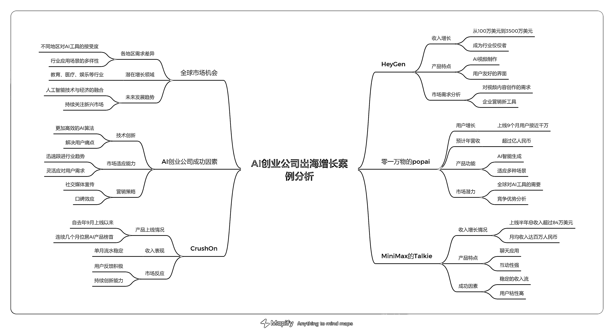
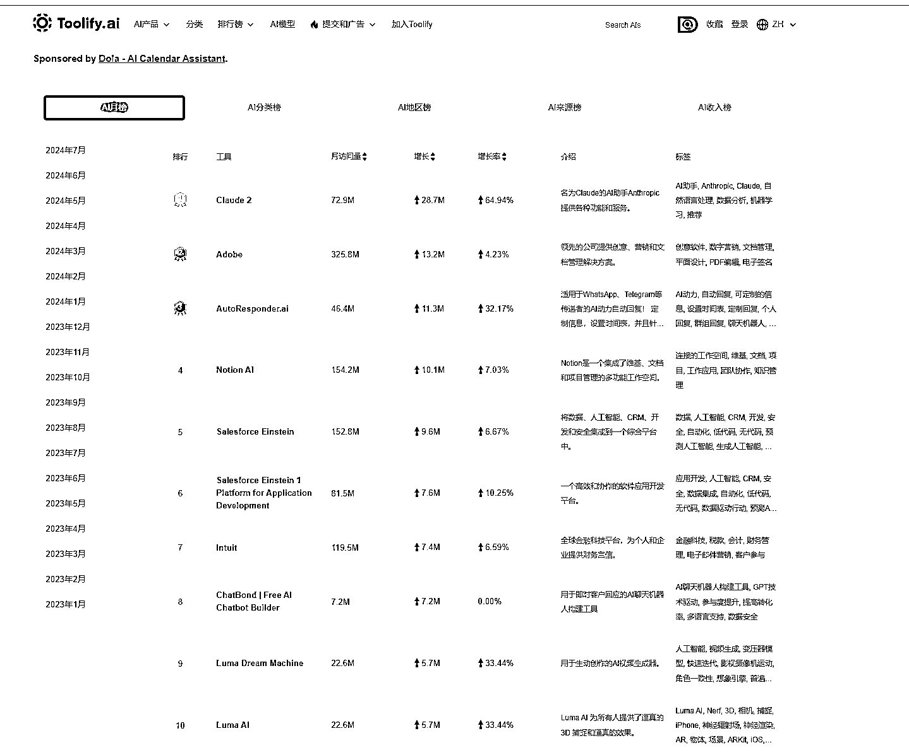

# AI出海营销;百万访问量 AI 产品 TikTok 广告营销情况

> 原文：[`www.yuque.com/for_lazy/zhoubao/vnfpuogbq5fbpeo3`](https://www.yuque.com/for_lazy/zhoubao/vnfpuogbq5fbpeo3)

## (10 赞)AI 出海营销;百万访问量 AI 产品 TikTok 广告营销情况

作者： 梁小伟

日期：2024-08-20

此刻，国内的人工智能厂商正以潮水之势涌向海外，这已不只是简单的出海动作，而是一轮真正意义上的全球化浪潮。走出去之后想要站稳脚跟，单靠底层模型和功能优势远远不够，关键在于让海外用户看见、信任并持续使用——主动发声、主动经营心智，才有机会抢占市场。

### 大获成功：运气之外另有章法。

部分人工智能初创在登陆海外后出现了爆发式增长。打造AI短视频的HeyGen，用12个月的时间把营收从100万美元拉升至3500万美元，一跃成为赛道头部。零一万物的海外应用popai，上线九个月用户规模逼近千万级别，预计全年收入可突破亿元人民币。这些惊人的曲线既体现了大模型能力带来的产品价值，也印证了海外市场对智能化工具的真实渴求度。

MiniMax推出的Talkie也颇具代表性，发布半年累计营收已超过84万美元，月收入均值稳定在百万元人民币区间，对一个新上线的智能应用而言已属亮眼成绩。CrushOn自2023年9月推出以来，多月蝉联智能产品榜首位置，单月流水可达6万美元。Fotor则借助1.5亿新增粉丝的势能，在早期阶段便实现盈利。

当然，上述现象并非偶然。短时间内聚拢数百万乃至上千万用户背后，都有着清晰的产品定位思考和细致到位的投放策略。这些团队对海外社媒生态运用娴熟，同时善于借助平台分发机制实现破圈传播。

总体来看，出海的底层思路可以用一句话概括：获取更广阔的曝光、打磨更具竞争力的能力、实现更迅速的商业化。

全球智能应用月度榜单

文章涉及短视频投放案例拆解，具体内容请移步原文查看

[`za6kyadmdr.feishu.cn/docx/DkU1d4iLboHRmzxvuOkc9mTLn0c?from=from_copylink`](https://za6kyadmdr.feishu.cn/docx/DkU1d4iLboHRmzxvuOkc9mTLn0c?from=from_copylink)

* * *

评论区：

来颗苹果咩 : 飞书权限开成互联网可编辑了[破涕为笑]

梁小伟 : ^_，谢谢提醒呀

* * *