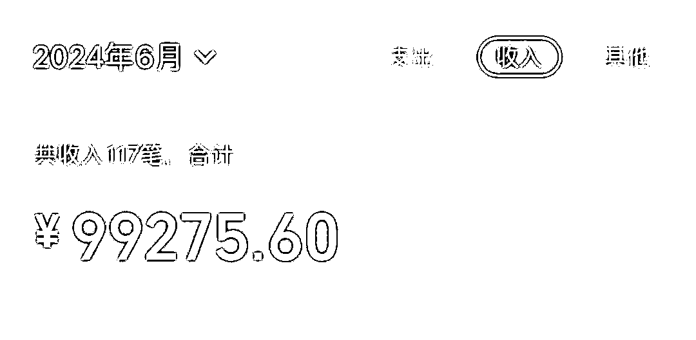
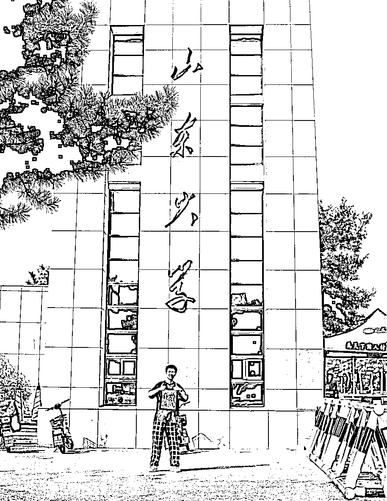
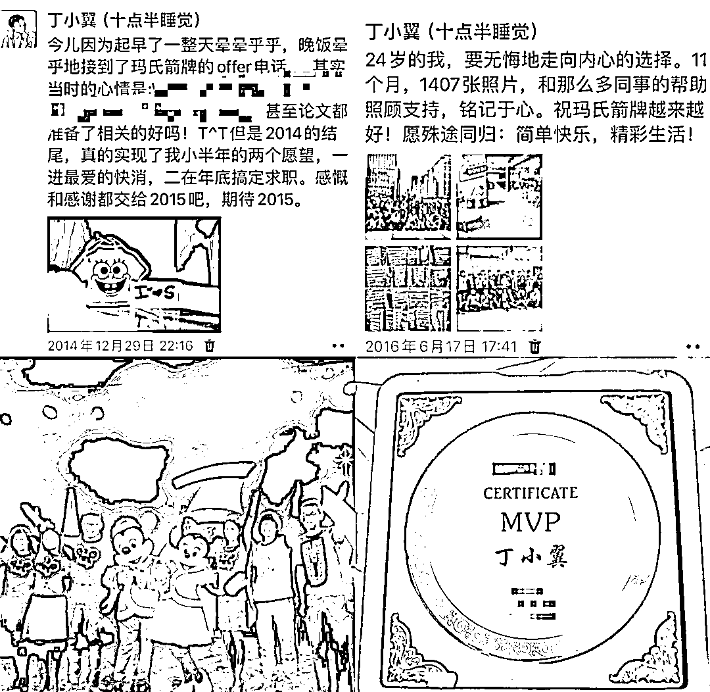
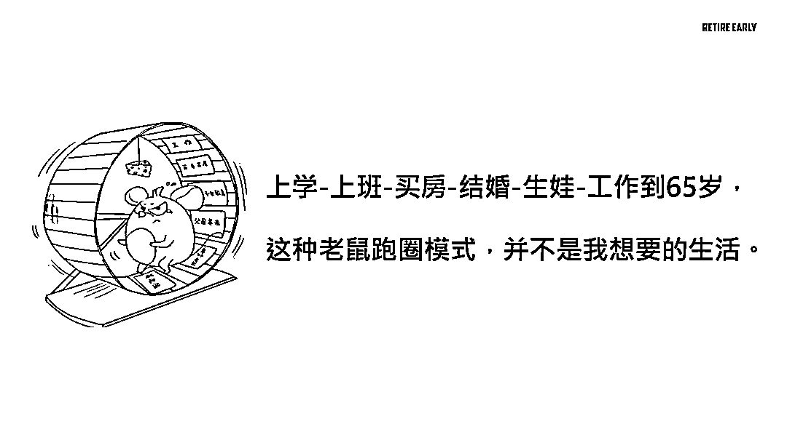
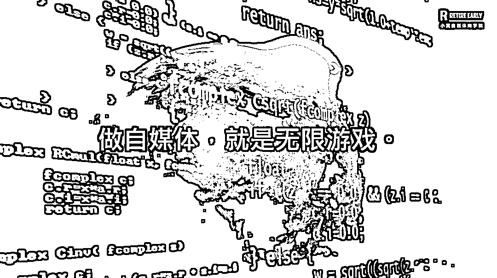
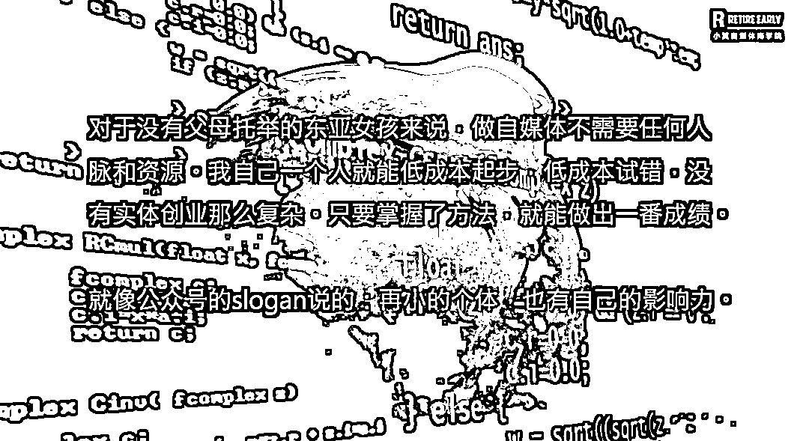
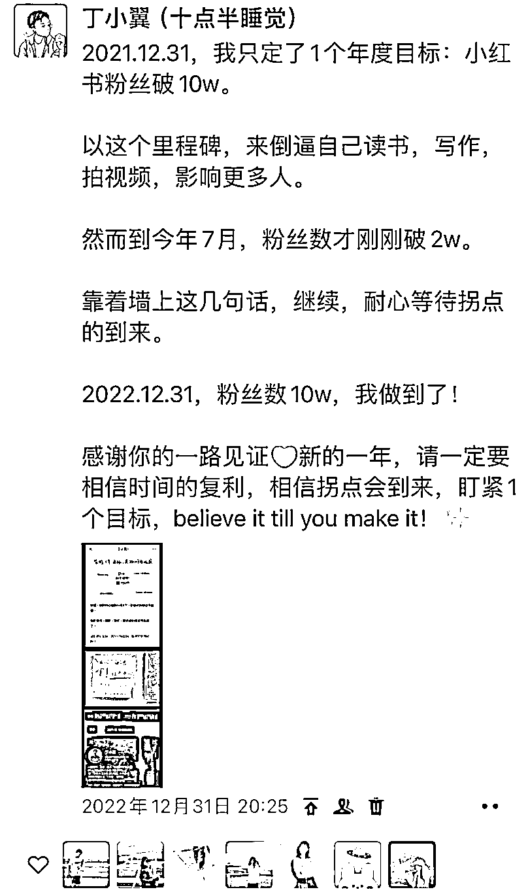
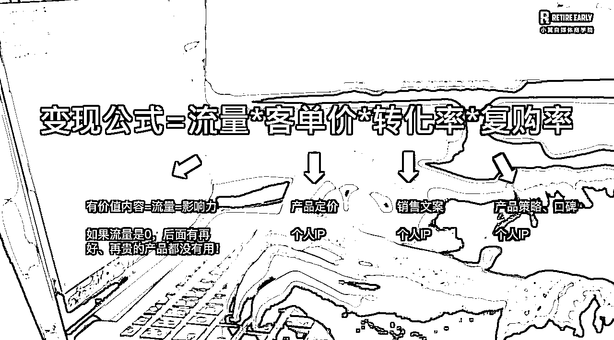

# 30 岁裸辞上岸一年，靠一个号做自媒体变现 80 万，普通人十年到点退休的实操笔记

> 原文：[`www.yuque.com/for_lazy/zhoubao/dn7lu4uog5ywi3un`](https://www.yuque.com/for_lazy/zhoubao/dn7lu4uog5ywi3un)

## 小红书一年涨粉 10w+，30 岁后不上班，变现 80W，一个普通女孩的十年退休之路

作者： 丁小翼

日期：2024-08-22

嗨，我是小翼。

距离去年七月提离职，到现在正好满一年**完全脱离体制**。

**三十岁的我，如今靠单人自媒体，累计收入已过 80 万。**

（上个月单一账号的营收截图）

今天就把我这条路掰开揉碎讲一讲，

**出身普通、没有靠山的一个女生，怎么一步步走上提前退休的十年规划？**

先打个预防针，我这里没有年入百万的捷径，也没有那种一夜逆袭的爽感。

**全是我自己踩坑、试错、复盘出来的真实经历。**

如果你的价值观跟我相近，也在想办法早点抽身，我希望这篇能给你一点共鸣和方向。

## 01 觉醒那年 29 岁

## 没有家族加持的女孩，往往醒得更晚

**“被父母托举的孩子，醒得早；靠自己长大的，往往 25 岁后才开窍。能看透规则、摸清逻辑，30 岁就是第二次起跑线。”**

这句话几乎就是我的自述。

我从一个很普通的县城家庭出发，18 岁第一次离家去外省读大学。

（上个月回母校，旧地重游）

毕业后家里帮不上任何忙，我一个人扛包进上海。

起初对职场还挺有热情，毕业前靠自己拿到 500 强外企的管培生offer。

干了一年后我明白，头衔的光鲜并不是我想要的，于是顶着压力辞掉，转去一个更能发挥空间的创业公司。

之后一路升迁，市场专员到经理再到总监，从执行到带团队。

可 29 岁那年，我莫名陷入巨大的空茫感，感觉自己像在轨道上自动运行：

**读书-工作-买房-结婚-生娃-干到 65 岁，永远在同一个跑圈里打转。**

即便职位在涨，薪水翻了五倍，我还是觉得不自由，像是被别人的剧本牵着走。

那个阶段我大量阅读，花了很长时间自问到底要什么。

两本笔记至今还常翻，《有限与无限的游戏》《认知觉醒》，它们让我在 29 岁时彻底顿悟：

**1、从小我们都在玩有限游戏，边界清晰、结局明确、你赢我输。**

譬如读书是为了成绩，成绩换大学，大学换工作，工作换对象……过程不重要，结果才是硬指标。

我不想继续这种玩法。相对的，还有无限游戏，人生就是一场不断把自己变好的修行。

**2、以前的我看上去很努力，其实很多事只停留在浅尝。业余也在读书学习，但生活并没有被实质改变。**

为什么？**因为我只做到了表层输入，学了却不去落地，不知道用来干嘛，那等于没学。**

工作的钱虽然在涨，但模式单一，停工就停收，永远出不掉老鼠圈。

小富即安反而成了枷锁，我从未真正为自己做过一个跳出循环的主动决定。

这些领悟让我下定决心换一种活法，要玩无限游戏，于是我给自己定了**40 岁退休**的目标。

很多人会问为什么是 40。

**很简单，人均寿命也就七八十岁，40 岁已经过半。**

后面一半的人生，还要把时间卖给老板吗？我不想。

我理解的提前退休不是躺平，而是**不再为钱被迫上班**。

30 到 40 这十年，我要攒够本金，把被动收入的管道搭起来。

40 岁之后，我想做很多事，去很多地方。**人生的选项越多，自由度才越高。**

## 02 自媒体这条路

## 小红书成了我提前退休的抓手

目标定了，怎么达成？

打工显然不够，一份时间只能卖一次，停了就没钱。

那怎么让一段时间被反复售卖？

《纳瓦尔宝典》里讲过，想在 5-10 年内靠运气之外实现富足快乐，就两条路：**资产或媒体/代码带来的被动收入。**

资产不是人人都有，代码我学不会，普通人最可行的就是做内容。

对东亚没有背景的女生来说，自媒体门槛极低，不用靠人脉，一个人就能低成本试错，比实体创业轻量太多。

于是我重新建了一个小红书的账号，从零开始。

我一个人日更坚持一年，粉丝刚好破 10 万：

同一时间，我的商务报价一年内涨了 20 倍。

听起来夸张吗？自媒体就是这样，前期可能觉得几百块太寒酸，不如上班一天的工资。

**但扛过一年后，复利和长尾效应就来了，作品在睡觉也在涨粉、也在变现。**

副业收入一旦超过主业，哪怕你没离职，底气和安全感也完全不同。

我越来越确信，做自媒体就是我一直在找的无限游戏。

用内容当杠杆，扩大影响力，影响力变现，再用资金去体验世界，获得新的内容素材……循环往复。

想通这一点后，世界一下子开阔了，不用再卷零和博弈的输赢。

如果我坚持十年，能否实现提前退休？答案在我心里已经是肯定的。

总之，**在内容赛道上，长期持续输出几年后的爆发，不是运气，是规律。**

正是小红书给了我希望，让我有底气在 30 岁后开启新的阶段。

## 03 不上班之后

## 商业模式迭代，让我完成第二次跃迁

小红书让我的副业持续跑赢主业，手上也攒下了**至少能躺三年**的安全垫。

于是去年七月我彻底告别职场，喊的是再也不上班了。

自由职业这一年里，我的变现结构已经升级，**从单一广告扩展到完整的产品矩阵，不再只靠平台投放。**

过程中自然冒出更多形态：广告之外，还有自研产品、带货、社群服务等等。

这套打法在业内其实很成熟，外行可能只以为写作投稿赚钱，或者以为除了广告就没别的路。

**我一直相信：拯救过我的东西，就该拿去拯救别人。**

我起家于小红书，所以开始带大家做小红书。

学员反馈普遍 5 星，有了万赞爆款，实现千元级到万元级的变现，而且把底层方法迁移到了多平台。

**这说明问题不在天赋，而在认知：**

很多人不信能成，成不了有什么用，怎么赚钱？缺乏重视、没人指导，玩两下就换赛道，注定做不起来。

**自媒体真正的厮杀，是商业认知和商业模式的厮杀。能力不缺，缺的是把能力商业化的思维。**

我把自己踩出来的方法，交给同样想提前退休的普通人，帮到别人的同时自己也在持续变现，这就是我今年的核心工作。

这个社会，90%的人都向往早日退休，但真正有清晰规划的人很少。

**与其沉浸在暴富幻想里，不如立刻行动起来。**

传统干到 65 岁退休的模式并不适合所有人。

**跳出跑圈、拿回主动权的需求越来越强，也值得被正视。**

最后再说一句：没有人能一夜变强，时间才是最大壁垒；但每个人都能一点点变强，因为所有大佬都是这么走过来的。

觉醒后持续行动、持续赚钱，就能跳出老鼠圈，拿回人生的选择权。

* * *

评论区：

刘智行 : 作者真的很棒，有被鼓舞到。对作者的一句话感同身受，因为我所做的只是最表层的学习，学了却没有真正去践行，没想好用来干嘛，那其实就是根本没学会。高效率的学习，学了就去实践，不仅是阅读，项目也是如此，这样才会得到质的改变。

阿仁 : 很厉害的经历

大栗子 : 好厉害👍涨粉这么快！怎么做到的啊[色]

* * *