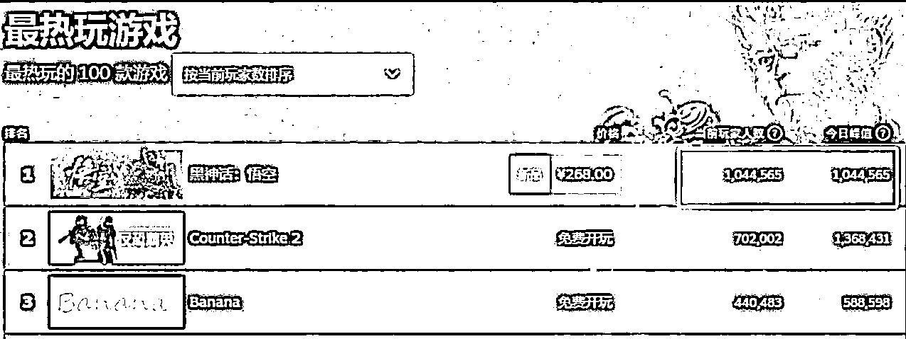
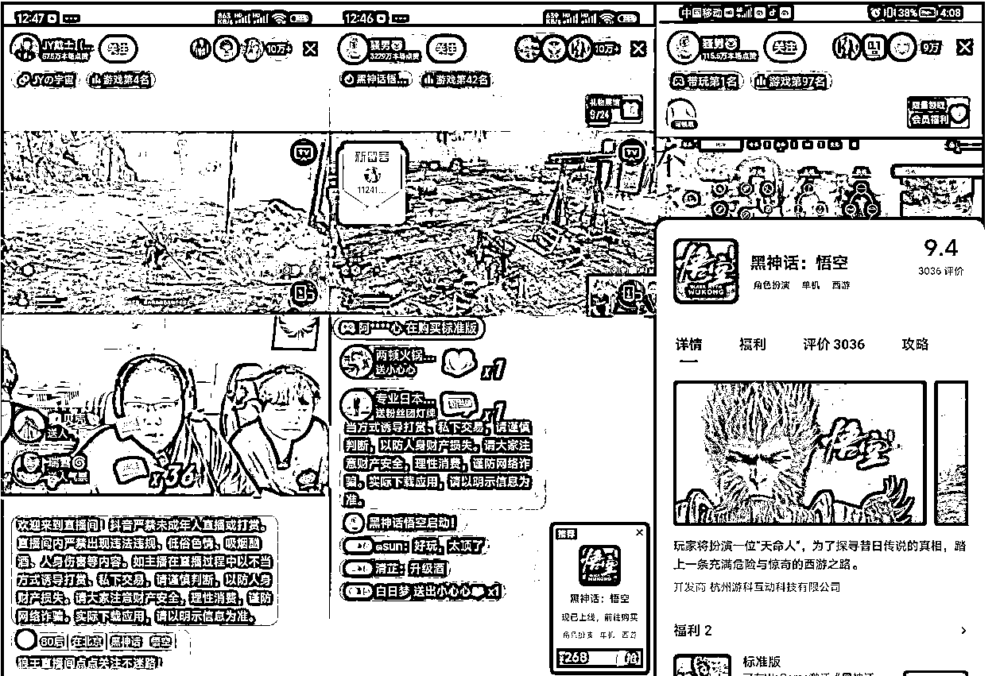
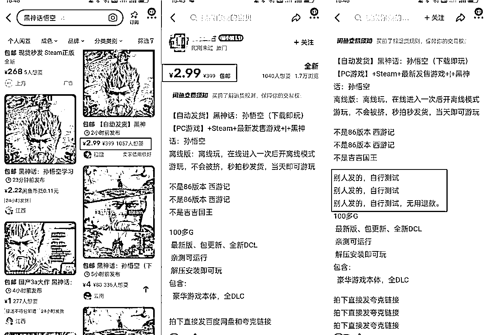
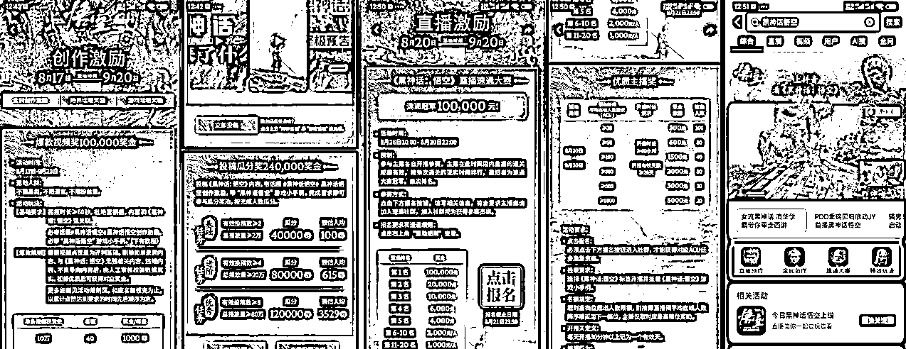

《黑神话：悟空》上线即王炸！无数人还在看热闹，这6个赚快钱的路子已经有人悄悄吃到了

8月20日，备受瞩目的国产3A大作《黑神话：悟空》在打磨整整4年后，于上午10点全球开售。结果大家都看到了：瞬间引爆全网，Steam平台同时在线人数直接冲破100万，甚至将《CS2》拉下马，一举拿下热玩榜第一。各大社交平台的热搜榜也几乎被“黑神话悟空”屠榜，这个流量简直恐怖。

一大早，我所在的微信群里就已经炸开了锅，不少伙伴都在聊这款游戏。

说实话，我平时对游戏基本没什么兴趣，大概率也不会掏几百块买来吃灰。但作为一个常年混迹互联网的人，我对流量特别敏感。因为流量所在，就是需求所在；需求所在，自然就有赚钱的可能。

游戏发售不过短短几小时，当大多数人还在围观惊叹的时候，已经有人趁着这波热度赚得眉开眼笑了。我花了大半天时间，把目前看到的变现玩法梳理了一遍，分享给大家。有想法的朋友请抓紧，现在还来得及上车。

第一招：直播间走起

最直接、见效最快的路子就是开直播。重点平台就选抖音、快手、B站，注册好后挂上游戏推广链接，然后打开游戏直接玩就行。有了这波热度加持，直播间根本不愁没人看。收入来源主要有两块：一是观众的礼物打赏，二是游戏推广带来的分成收益。

第二招：跑周边服务

如果不会开直播，或者压根没时间，也可以做游戏周边生意，这是游戏类项目特有的变现方式。比如帮客户代下载安装，一次收费30块；整理一份操作指南或游戏攻略，卖20元；还能卖修改器。再对接一下网盘拉新，又能多赚一笔。闲鱼上已经有不少人开干了，需求还挺旺盛。

第三招：账号出租

就算你完全不懂游戏，也不会做攻略，照样能赚钱。要知道这游戏定价300多，有些人很想玩但又舍不得掏钱，那就可以去做账号租赁。囤上几个账号，趁着游戏爆火往外租，客源根本不愁。

第四招：网盘拉新

现在去闲鱼上搜“黑神话悟空”，能搜出一堆卖游戏的，价格低得离谱，几毛钱到一块钱不等。买完之后对方给你发个网盘链接，据说要100多G，我没下载，因为实在太大了。我估计十有八九是忽悠人的——游戏才刚上线，哪来这么快的盗版？他们真正的目的其实就是骗网盘拉新。想把这100多G的东西存下来，不开会员基本搞不定，于是会员分成又到手了，小算盘打得噼啪响。这种做法不太厚道，但架不住人家确实能赚到钱。

第五招：蹭平台激励

黑神话悟空热度爆棚，抖音还专门为它推出了激励计划。创作者只要制作短视频或开直播，就能冲击排名奖励和流量奖励。短视频和直播两边的奖励是分开算的，另外还有流量扶持政策，感兴趣的可以去了解一下。

第六招：卖实体周边

卖游戏本身或相关实体周边都可以，消费群体以男性为主，淘宝和抖音都适合操作。手上有货源的可以考虑下场了，我猜义乌的缝纫机都已经快踩冒烟了吧……

当然，除了上述几种，肯定还有其他我还没遇到的玩法，毕竟网友们的脑洞永远超乎想象。不过说到底，目的都一样：借这波热度搞到钱。这些玩法的门槛都不算高，流量又大得像块肥肉，你看到了我也看到了，你能做我也能做，入局的人一定会越来越多。

另外要提醒一句：这类热点风口通常来得快去得也快，可能持续一个月，可能只有一周，甚至几天就凉了。别幻想着靠某一个热点吃一辈子，那不现实。正确姿势是趁着还有红利赶紧捞一把，赚不动了果断撤离，这才是风口项目的玩法。

机会永远偏爱有准备的人。如果你真有心，现在就行动起来吧。跑在前面的吃肉，稍慢的喝汤，慢半拍的连汤都捞不着。

好了，今天的分享就到这里，要是对各位有点启发，别忘了点个赞～

