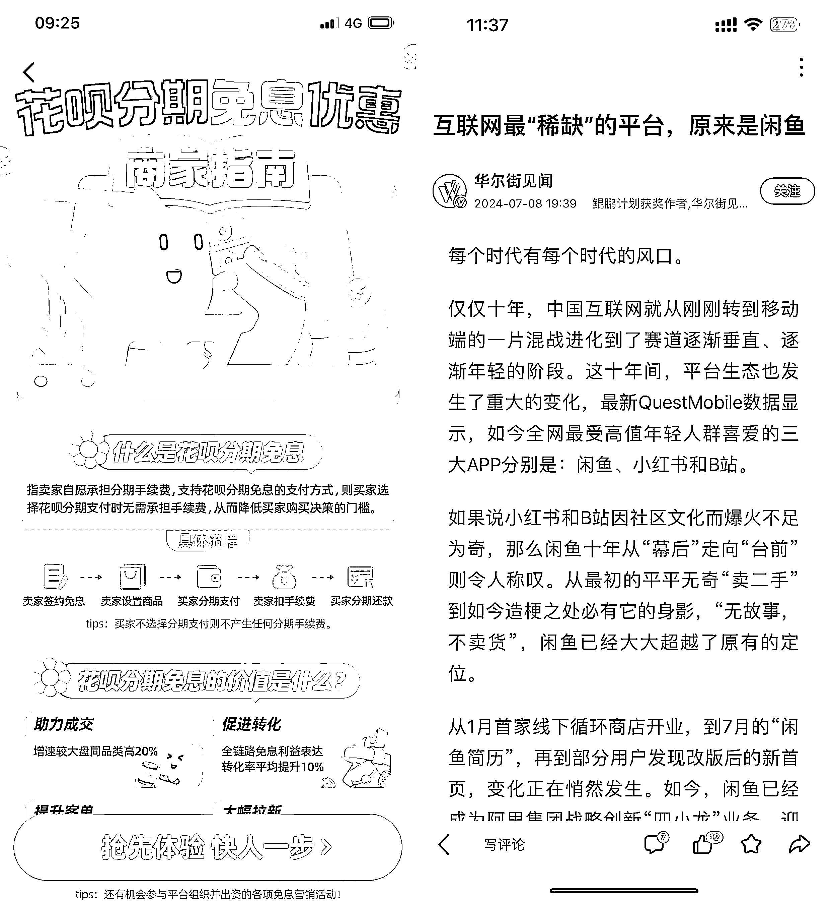
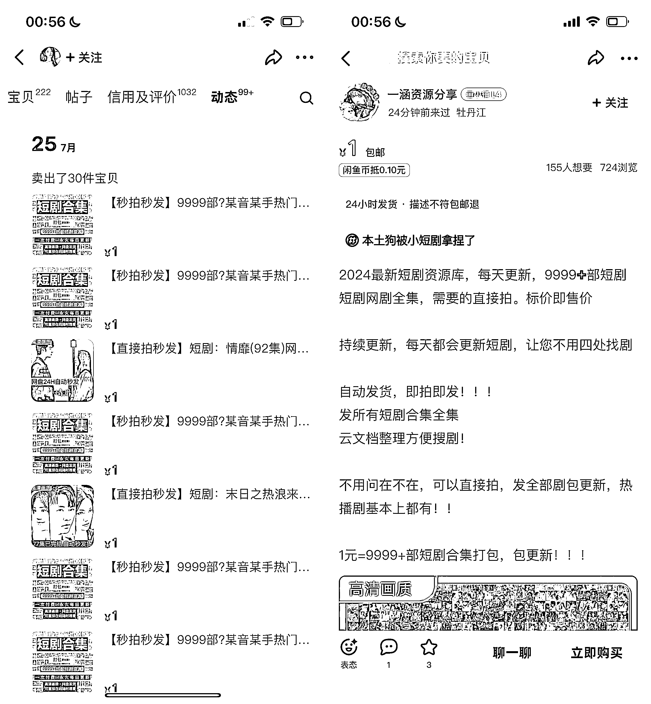
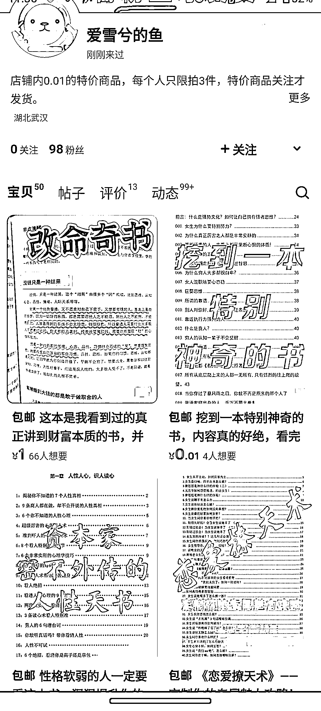
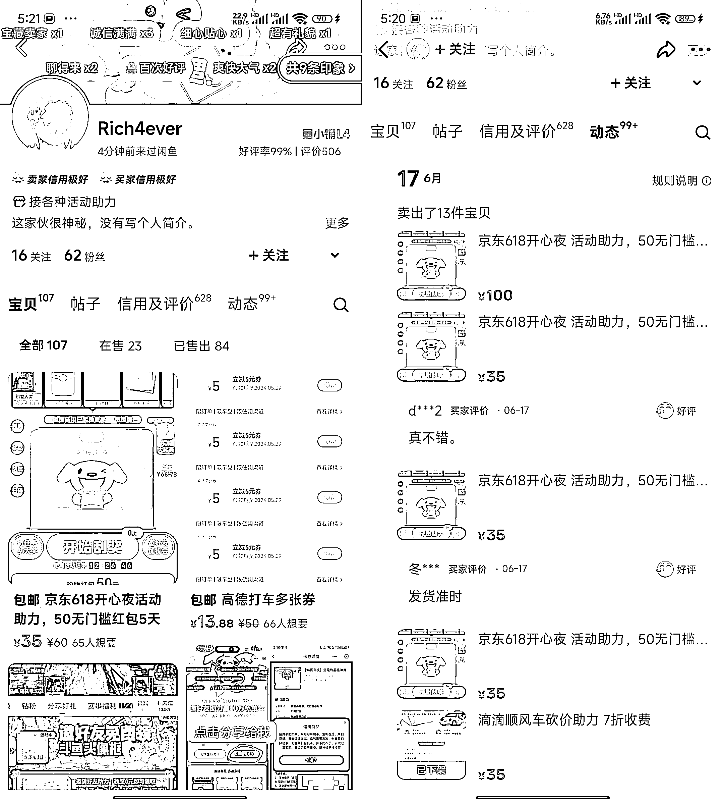
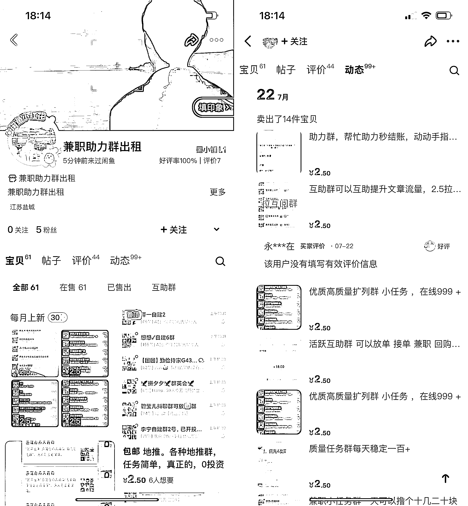
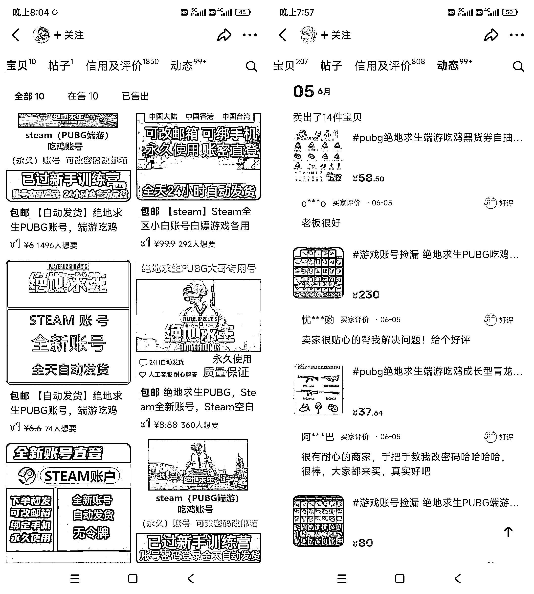
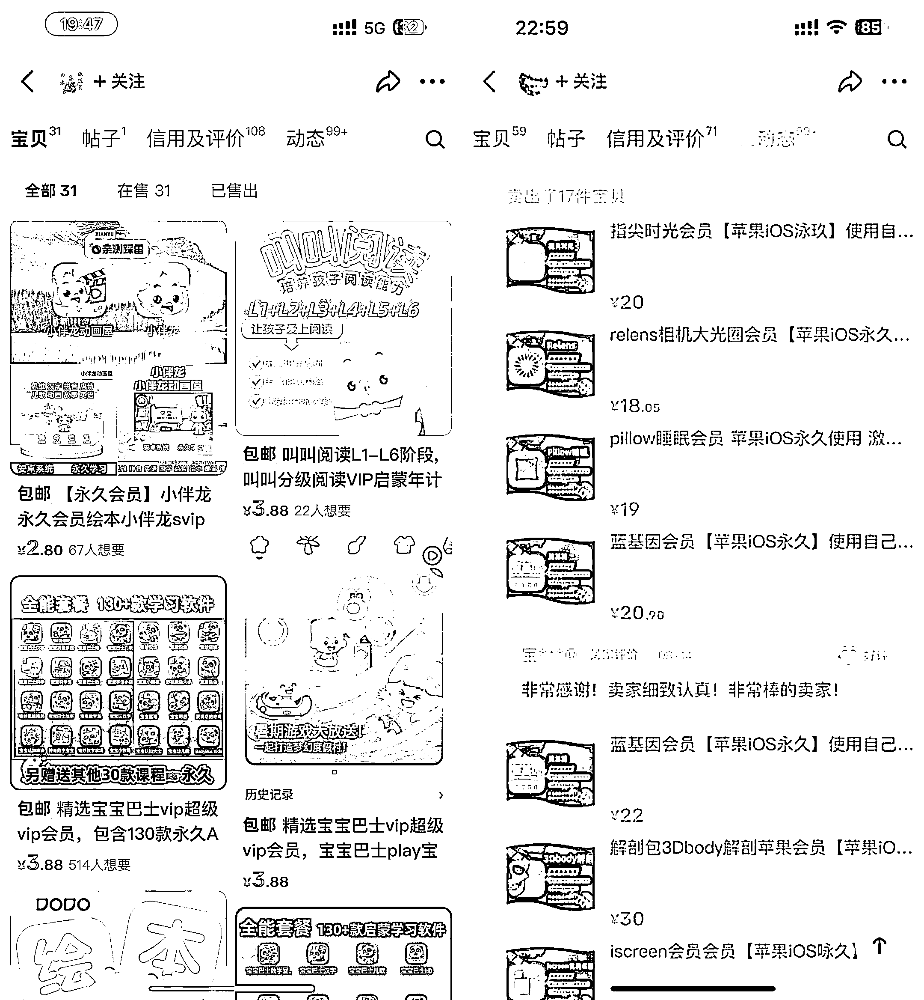
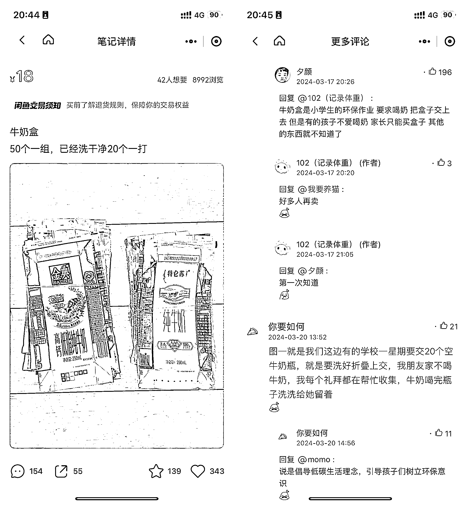
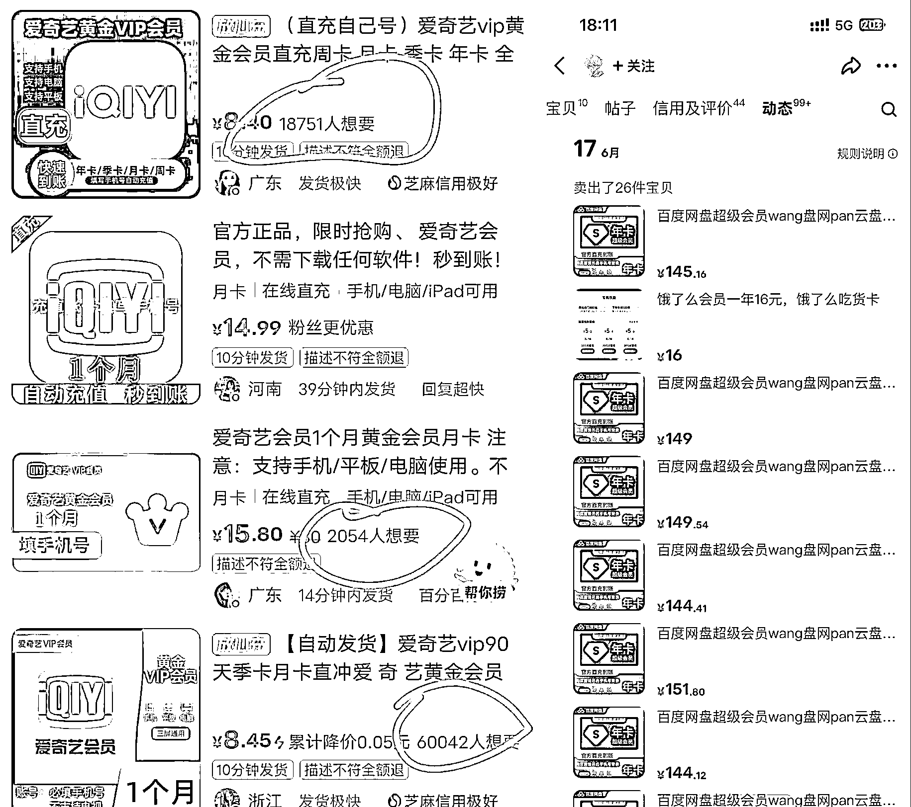
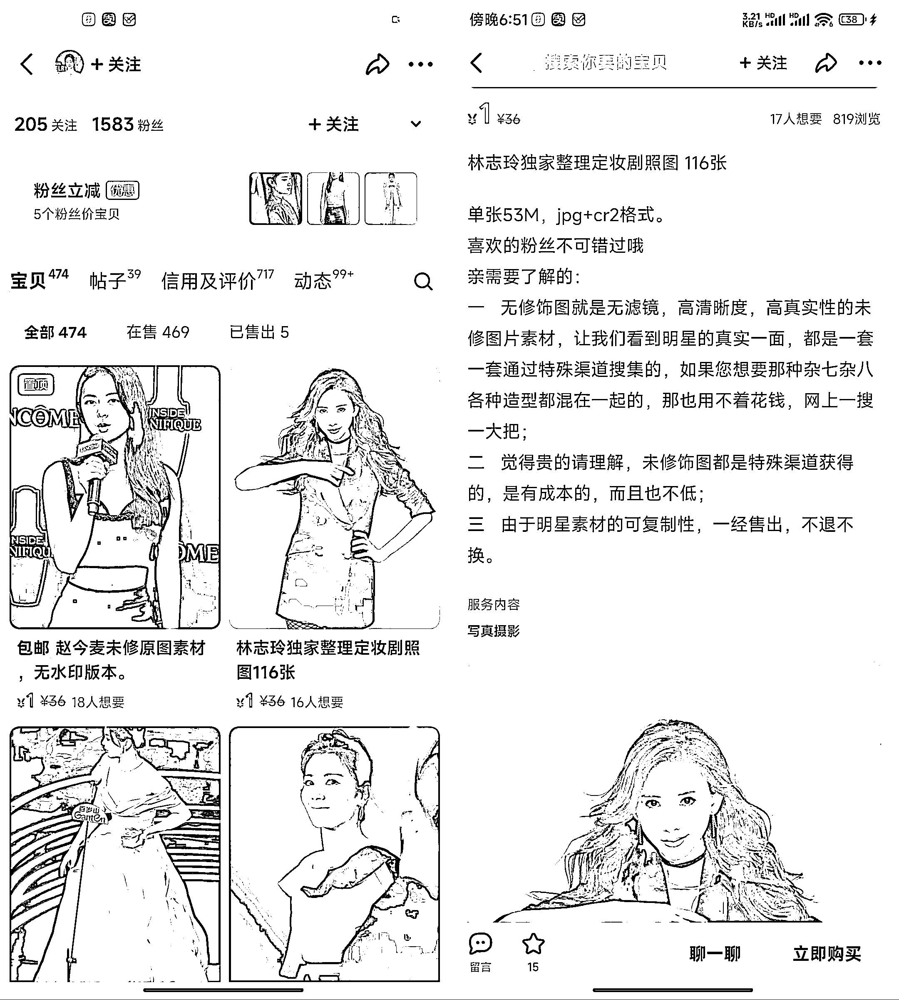

# 别小看这些“不起眼”的闲鱼小生意，闷声都能赚到

## (46 赞)多数人瞧不上，但闷声赚钱的小项目

作者： 大鹏

日期：2024-08-20

最近闲鱼有点热闹。

先是把微信小程序打通了，没过多久网页版也上线了，昨天更是直接支持花呗付款。老牌二手平台在经济承压、主站利润收窄的背景下，反而像被阿里重新扶正了，动作越来越频繁，势头越来越大。

聊到闲鱼，很多人第一反应就是“闲鱼无货源”。

这玩意儿在网上创业圈里算是活化石级别的存在了。我19年入行就开始干这个，当时就有人劝我卷了，现在想想，当时那句话没说错，但项目至今还活着，甚至越做越猛。真有人靠它起盘、变现。

凭啥能一直赚？门槛低到离谱。注册个账号就能开卖，上架审核也不刁钻，不用办一堆资质。门槛低，玩法自然就百花齐放，什么稀奇古怪的东西都能找到买家，真是需求在，钱就在。

整理了一些我觉得可以直接抄作业的冷门方向，搞个副业零花钱绰绰有余。

**1、短剧合集打包卖**
把几部短剧打包成合集售卖，下单后甩一个网盘链接。单笔有收益，还能顺带做网盘拉新，双重吃。

**2、电子资料包**
电子书、学习资料的需求一直在线。见过卖6000多本的，也有卖900多本的。搭配网盘拉新就是两份收入，绘本、漫画、小学教材、教辅都能套用这条路。

**3、代做助力**
帮忙冲各种助力活动，一单基本就是净赚。而且这种活复购率高，回头客多，挺适合做长尾。

**4、羊毛群引流**
加入大量羊毛群，闲鱼上挂着卖，成交后拉微信进群。哪怕是新号也能稳定出单，后期自己组建付费线报群，客单价还能再抬一截。

**5、游戏账号买卖**
游戏账号的需求非常刚性。想办法回收低价账号，再放到闲鱼高价卖出，成交量一直很稳。

**6、破解类软件**
闲鱼上这类软件的订单很猛，单价也不低，利润空间可观。口碑和评价好了，销量会自然滚起来，有渠道的可以入场。

**7、空牛奶盒**
听起来离谱，但真有市场。小学生写作业要交回收材料，这就是刚需。有需求就有生意。

**8、会员代充**
玩的人不少。通过低价充值渠道帮用户充会员，赚差价。只要有稳定货源，这条路就一直能走。

**9、原图素材照**
卖明星、网红的原素材照片，流量不小。一样可以配合网盘拉新，把单笔收益叠上去。

就先分享这些。

看完有没有觉得人的脑洞开得有点吓人？那个卖空牛奶盒的点子真的让我笑出声。闲鱼这个地方就是这么魔幻，什么都能卖。

其实还没列完的玩法还有不少，自己多逛逛就能摸到新机会。也可以在评论区交流补充。

对普通人来说，如果副业目标只是补点零花钱，没必要东一榔头西一棒子。守住闲鱼这一个池子，吃资料+网盘拉新的组合，一个月赚个几百上千，很正常。

今天就到这了，觉得有用就点个赞吧~

* * *

评论区：

刘智行 : 收获满满。谢谢🙏 小六六 : 卖空牛奶盒子，大开眼界！

跑通小闭环✅ : 卖空牛奶盒子，这个我可以啊，大宝最爱喝牛奶，之前的盒子都丢了，感觉丢了好多钱[偷笑][偷笑][偷笑]

大鹏 : [抱拳][抱拳]

大鹏 : 哈哈哈，万物皆可闲鱼[调皮]

大鹏 : 再去捡回来[呲牙]

元宝团子 : 卖会员的那个不知道哪里有货源，就是不知道哪里有货源，我自己就在闲鱼买会员用 💋李姑娘 : 对，我也是，用在咸鱼买这种。不知道生菜有没有有资源的人

* * *