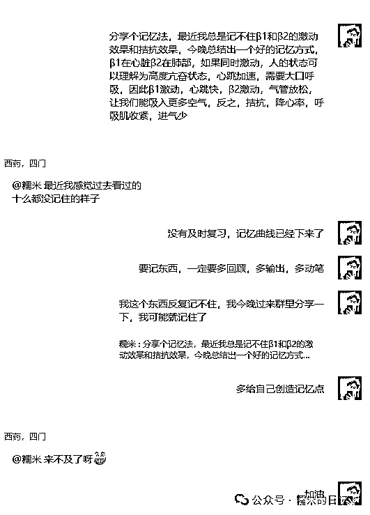
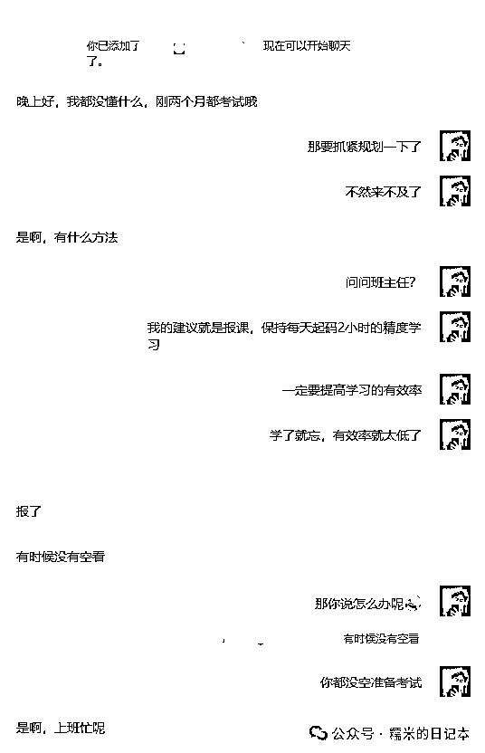

# 掏心窝子说说，避免在知识付费上“花冤枉钱”
作者：龙哥

花掉20多万买知识付费，我究竟图什么？这些真心话，想跟想学又怕吃亏的人聊一聊。

我经常被人说是“卖课的”，潜台词就是“你在割韭菜”。说实话，我不气。因为我自己，曾经也是被“割”过来的。

我第一次交知识付费的学费，是在高中毕业那年——失恋了，花了888块买了一个情感课。后来去广州学电商直播、混社群，最贵一单两万多，最便宜八百多。七七八八加起来，十几二十万是有的。如今我也有了自己的课程、圈子和产品，身边围了不少学员，但我太懂了：很多人心里明明想学，可一听到要花钱，刚抬起来的脚就缩了回去。

所以今天，我就把压箱底的想法翻出来聊聊。

先说什么样的知识付费，几乎不存在风险。

在我看来，只有一种。它满足两个条件：第一，你正被一个具体的业务问题卡住；第二，你非常确定，只要这个问题解开，你的效率、产能、收入都能往上走一截。这时候，你恰好遇到一位真正懂行的专家，能针对性地给你答案，那就放心大胆地付费。

我自己的经历就是现成例子。早先我搭矩阵，完全是新手，自己捣鼓出来的东西又别扭又没法用，还缺一套成型的管理SOP。恰好那时遇见一个玩矩阵很厉害的行家，我二话没说就买了对方的服务。为什么掏钱这么痛快？因为问题明确、收益也明确，而且躲不开。哪怕这一次没能直接解决，我也拿到了关键信息，剩下的就靠自己在实战中补。要是真被我补出来了，那我就是行业里最早跑通的那批人。

反过来，什么样的知识付费容易让人喊“后悔”？答案很简单：你在付款之前，根本没想清楚自己要什么。

举个很常见的画面。你看见一个人光鲜亮丽，过着你梦想中的生活。可人家背后那些辛苦和汗水，你看不见。你只觉得“我也能这样”，恰好他出了个课，你心头一热就买了。等真到了执行阶段，要么嫌难，要么犯懒，等那股热血凉透了，就开始后悔，严重一点的直接骂对方割韭菜。

今年我在备考执业药师，就在课程群里撞见了两幕，真实得让我哭笑不得。

群里的人买的是同一门课程，班主任把大家拉在了一起。那天我学到某个点，正好来了灵感，就顺手在群里输出了一段。结果一位同学看到后，跟我聊了起来。他今年要考四门，眼下还有60天，自己心里清楚是“学了记不住”，可就是不肯去想办法解决，反而直接摆烂，说“来不及了”。我心想，这不是还有60天吗？难道60天就不算时间了？当然，也可能是我多虑了，人家只是说说玩笑话，该学的时候照样学。

紧接着第二个互动也来了。

这位同学更让我无奈：他说自己也知道报了课就是不学，然后问我有什么好办法。我还能有什么办法？我又没有记忆面包，总不能硬塞进他脑子里吧。那一刻，我只想随波飘走。

要是换成我的陪诊课程，我大概会直接跟他说：你自己都没下定决心要做这件事，倒不如先想清楚，到底要不要做？你想想，我的陪诊课和那个执业药师课程，本质上有区别吗？如果一个人自己从不行动，却怪课程没用，那不管是哪门课，在他眼里恐怕都是割韭菜。问题往往不在“课”上，而在“人”上。

另外还有一种风险极高的知识付费，就是那种宣传语漂亮到不真实的：仿佛你只要买了，人生立刻就能翻盘。这基本就是“割一刀就跑”的套路，故意把希望吹到满分，好让你赶紧掏钱，毕竟人家做的是快生意。

讲了这么多，最后送你两条我花20多万换来的原则。

第一，学费别超过自己的承受力。你是来学东西、解决问题或投资人情的，不是来把身家性命押上去赌一个未来的。那种孤注一掷、一把梭哈然后赢大满贯的剧本，只存在于电影里。

第二，付费前先问自己：我到底图什么？最差能换到什么？这个最差的底线，我接不接受？

按我现在的习惯，我掏钱基本只有三种情况：为了混进一个圈子、靠近一些人；为了搞懂某类业务是怎么运转的；为了真刀真枪解决眼前的问题——可能是买服务，也可能是买工具。说到底，我买的是知识、工具、人脉、人情、圈子、身份、氛围这几样东西。

最后，想说几句掏心窝的话。

我也曾经是个什么都不懂的小白，也曾在付完款之后懊恼，觉得自己被割了。可现在回头看，那些其实都是必经之路。只要我不想把日子过成一潭死水，不想就此摆烂当咸鱼，我就得折腾；只要折腾，就会碰到陌生的领域；只要我不是全能天才，就不可能样样靠自学搞定。个人能力终究有限，所以踩坑在所难免。

如果你连一个坑都不敢踩，那可能永远都只能是一条心里痒痒的咸鱼。更扎心的是，闲着闲着就老了，到时候想折腾也没力气了。人生苦短，不扑腾几下，谁知道头顶会不会冒出彩虹呢？

而且，对于年轻新手来说，就算你花钱买了课，也不一定立刻变得多厉害。因为你的吸收能力、实战能力都还跟不上。很多知识付费真正的价值，根本不是那几节课，而是你付出之后，和那个人建立了一个“付费关系”。他能收你的费，就说明他身上一定有值得学的东西。你要做的，就是持续地靠近他、观察他、模仿他。

还有些知识付费，买的就是一个优质圈子。古话说近朱者赤，我自己就是受益者。老话不是常说嘛：头等舱的人习惯看书办公，一线城市的人爱聊经济聊项目，南方人喝茶都在琢磨怎么搞钱。圈子一换，你的动力、谈资、思维方式全都会跟着变。以前觉得自律很难，换到一个积极的环境里，那些事好像就自然而然了。

当然，我不是在这儿鼓吹每个人都必须买课。如果你能心安理得地躺平，那也是一种难得的本事。但大部分人都很难完全屏蔽外界的焦虑，包括我在内。要是你真能做到，恭喜你，你等于直接从“看山是山”跳到了“看山还是山”，没被中间那层迷惑绕进去，快乐其实很简单。

还有一类人，是完全不需要知识付费的。他们聪明到什么程度？你发一段免费口播，他看一遍就能照着做出来，甚至比你还像样；看个免费或盗版网课，他就能复刻出一版课程；跑到你朋友圈潜伏一段，就能把你的文章、短视频、直播、产品、私域摸得一清二楚。这种人，你是拦不住的。这个时代，想抄你，根本挡不住，与其想方设法防，不如主动拉一把——人家抄得好，就大大方方拥抱他，把他变成你的宣传案例。

好，全文写到这儿。你居然耐心看到了最后，我真的佩服，也感谢你的认可。如果觉得有用，点赞、评论、转发，你干了，我随意。

