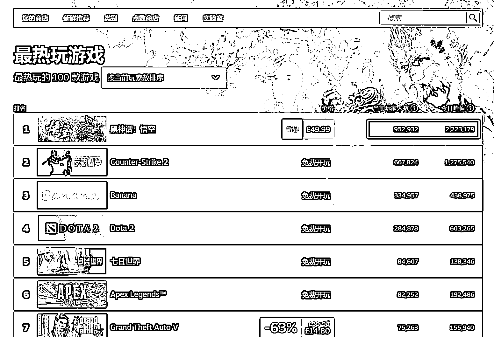

千呼万唤，那只传说中的猴子终于踏云而来！《黑神话：悟空》正式发售后，游戏圈像是被金箍棒搅了个天翻地覆。Steam 平台同时在线人数仅在开服一小时内就冲破百万大关，24 小时内更是一路狂飙到两百万量级——这在国内主机游戏史上从未有过。资本市场同样按捺不住，相关概念股接二连三封上涨停板，仿佛全网的话题都被这位“齐天大圣”牢牢攥在手里。人们都在好奇：一款国产单机游戏，凭什么能造成如此滚烫的现象级热度？它的营销打法，到底藏着什么门道？

昨晚我也亲自下场体验了一番。开打前心里默念“虎先锋不过如此”，结果三小时后，彻底没了脾气。朋友圈里全是求问“大头”和“广智”通关技巧的哀嚎，场面相当真实。

文章里穿插了大量视频演示片段，效果更直观。想弄清整套营销拆解思路的道友，可以移步飞书文档查看完整版：https://za6kyadmdr.feishu.cn/docx/VEiNdXLYuo57KexWzozctBHcndf?from=from_copylink

