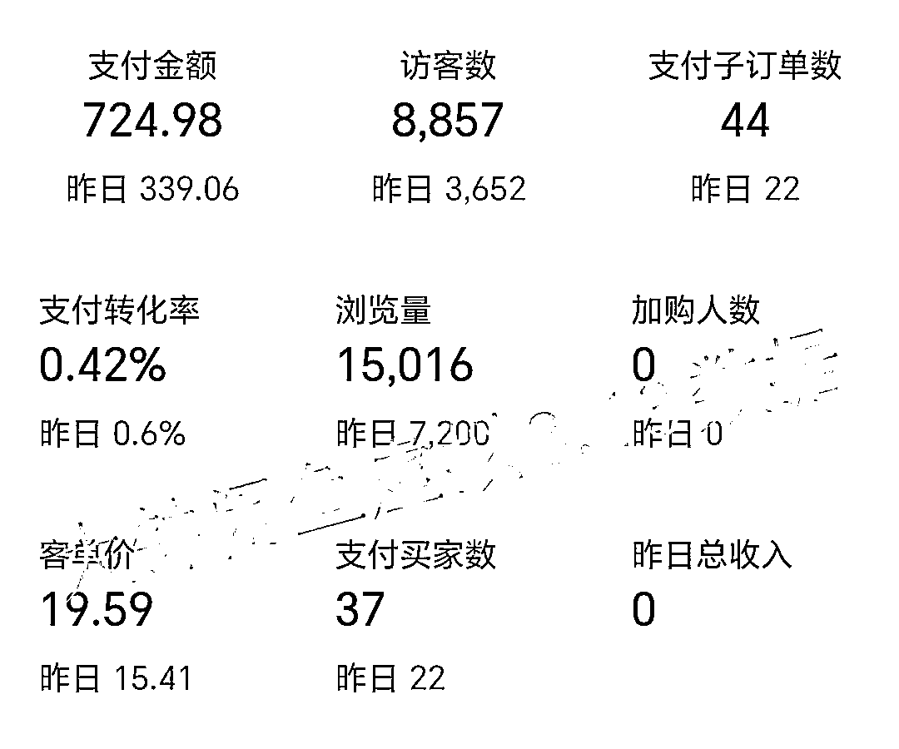
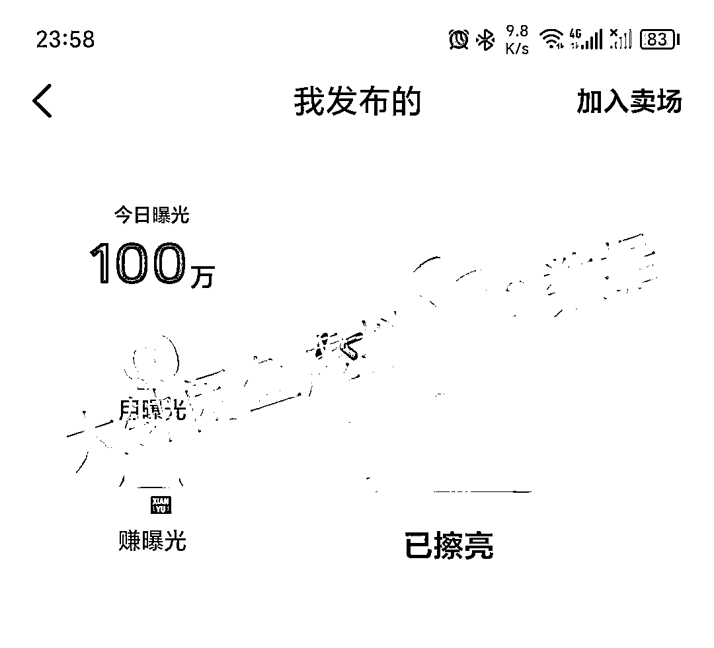

# 单飞闲鱼虚拟资料号，月入也能做5倍拉伸——不必靠矩阵堆量
作者：龙哥

## 单账号也能把闲鱼虚拟资料做到收入翻5倍！

作者：大钟  
日期：2024-08-14

大家好，我是龙哥。航海计划的老志愿者兼领队，涛哥40天跑步打卡群里的“卷王”，曾经的典型内耗选手。

最近逛社群，闲鱼虚拟资料的招新帖子刷屏了。我只能说不感冒，路数都差不多：客单价压到一两块钱，拼命冲百单，回头算下来到手还不到两百块，性价比感人。

我这边则相反。早晨6点半下楼去球场投一小时半的篮，白天看着女儿练舞，下午去县医院野球场打一场4V4，晚上刷手机时才想起来看数据——主号当天100万曝光、访客破8800，最后只成交44单。笑死，我的腿都快被自己气废了。

好了，玩笑到此为止。真正想聊的操作方法，我都整理到飞书文档里了。

* * *

评论区互动：

小查 Charles : 支持一波！

大钟 : 哈哈，谢谢小查同学

P.SAI : 您好，自动发货是闲鱼自带的吗？

大钟 : 不是，我这边用的是阿奇索。

长红 : 点点赞

大钟 : 谢谢老铁

P.SAI : 好的，谢谢啦[抱拳]，我去研究一下

Lin : 大钟棒棒的！加油⛽

* * *