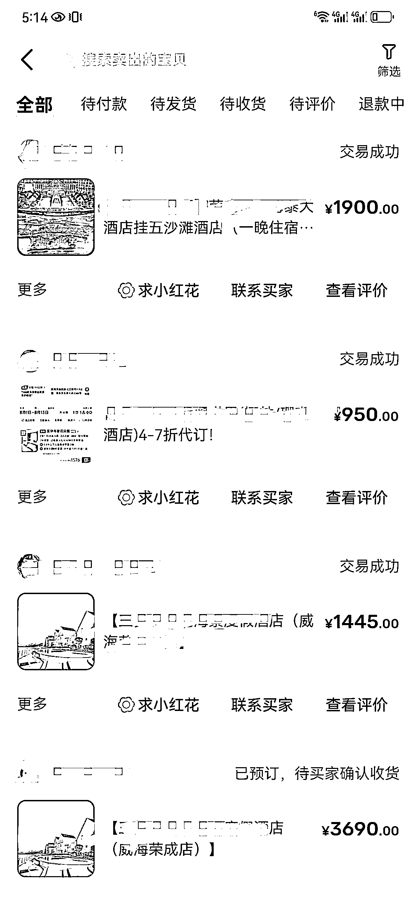
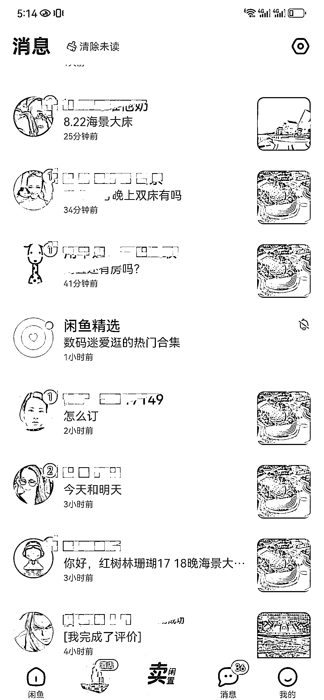
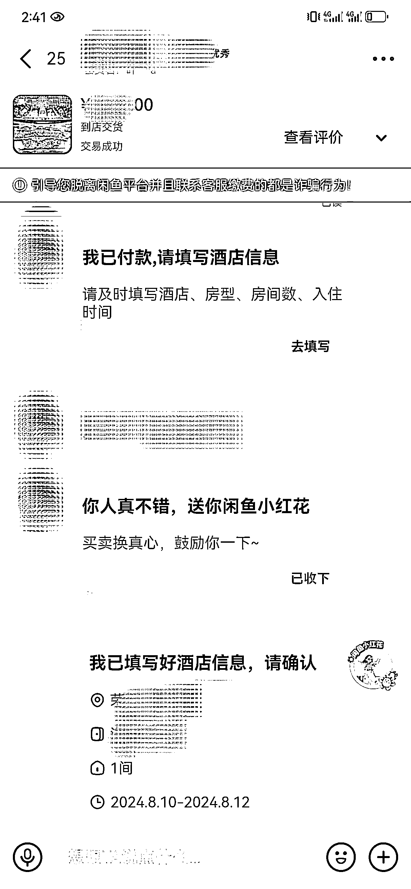
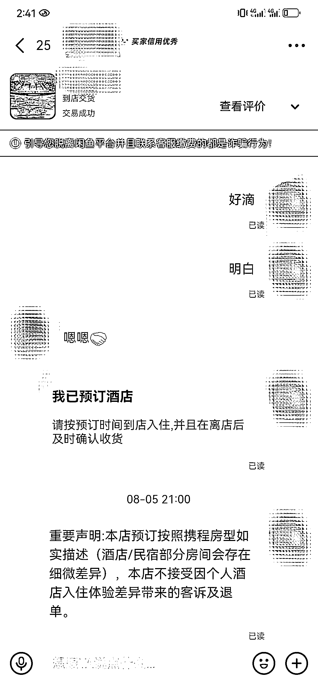
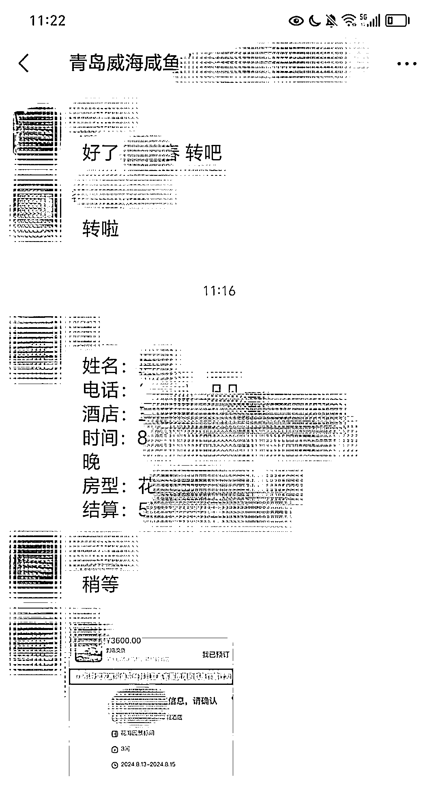

# 用闲鱼卖酒店订单，起号当晚就有咨询，算是反馈很利落的一个副业
作者：龙哥

## 闲鱼酒店代订，冷启动很快的现金流项目

作者： 一来

日期：2024-08-13

上回分享的一个风向标，关注的人出乎意料的多。眼下旺季已经过去了，但这条路子依然有聊点值。

**最直接的好处，就是以后自己出去玩订民宿、订酒店，完全可以绕开大平台，在闲鱼、📕上找代理拿更低的价格，省下的就是真金白银。很多人压根就不知道这个差价。**

我自己也实操过一段时间，把实战感受整理出来。

**一、怎么起的**

七月中旬，做旅行社的老朋友给我打电话，说他们在抖音上卖酒店房间卖得很顺，闲鱼和📕也完全能做，让我帮忙带一批人进来。

我本身对电商类项目没经验，也没多想，但朋友太热情，我不好推辞，就拉了几个小伙伴一起试水。

闲鱼不用养号，📕则麻烦一些，从那之后朋友就手把手带我们跑通了。

**二、玩法逻辑和赚钱点**

热门旅游目的地的酒店、民宿，在携程上价格普遍偏高，我们当时操作的房源单价在 300 到 1500 元之间。

携程抽成重，商家为了清库存、降空置率，就会把一部分房源交给旅行社去铺。

1. 商家视角，把原本给平台的佣金让一部分给旅行社，用旅行社的渠道把房顶出去，营收反而更高。
2. 旅行社视角，招募闲鱼和📕的代理来分销。举例来说，酒店给旅行社留了 20% 的利润空间，旅行社再给代理 10%-15%，靠量和数据赚钱，后续还能谈更多合作和更高毛利。
3. 代理视角，上架就有流量，有人问就能成交，赚的就是比携程便宜的差价。
4. 客户视角，反正要住，找代理下单直接便宜，尤其是多人连住，省得更明显。

所以这件事能成，也能持续。

利润这块跟参与人数强相关。刚开始做的时候，我单间一晚的净利能到 100 元，有客人连订两间多晚，一单利润 100-400 元以上很常见。

后来人多了，利润被压低，一般稳定在 50-200 元区间。旅行社为了避免恶性竞争，规定单间一晚至少加 50 元作为代理底线利润。

当时一起启动的小伙伴，10 天左右利润就有 9000 多的，也有 7000 多的，绝大多数人都出单了。

**三、闲鱼代订的几个舒服点**

1. 来闲鱼订的人大多是老客，知道这条路能省钱，不会一上来就怀疑你是不是骗子。
2. 闲鱼本身就有酒店代订的品类，交易流程很规范，客户体验完整。
3. 不需要做内容创作，直接搬运同行的上架信息，标题里带上酒店关键词即可，上架几分钟搞定。
4. 正反馈极快，刚上架当天就有咨询，第二天就能成交，这种即时感对新手很友好。想做大再考虑怎么提高曝光。

**四、做起来也会遇到的坑**

1. 房源渠道难找。我之所以能做，是因为线下朋友的旅行社提前和酒店谈好合作。普通人很难直接拿到货源。
2. 垫资问题。旅行社怕代理收钱跑路或客户临时退订，代理又怕旅行社跑路。所以一般是客户拍下后，代理提前两天把结算价的房费转给旅行社，旅行社去确认预定。
因为是我认识多年的朋友，这块信任成本低很多。
流程是：客户下单后，代理把房费扣除自留利润后打款给旅行社，旅行社出票；客人离店后，代理提醒确认收货，确认后钱直接到代理支付宝，未确认一般 3 天自动收货。
说白了，卖得越多，垫得越多。
3. 回复很耗时间。代理本质上就是客服，要反复回答房型、位置、入住流程等问题。闲鱼不像🛰️，经常你刚回完，对方就去跟别人砍价了。
4. 有淡旺季。七月底八月初订单爆炸，后面明显回落。问过旅行社，一年里国庆、元旦、寒假等节点都很稳，平时也有量。
5. 旺季房源紧。酒店自己也在降价时段自己卖，给到旅行社的额度会减少。

**五、从0到1的标准流程**

1. 和旅行社对齐能卖的酒店清单，以及每间房的结算价。
2. 找到同行在售的房源，复制到自己的闲鱼店铺批量上架。
3. 客户咨询后解答疑问，口头报价。
4. 因为上架价不是实价，要根据人数、天数重新算账并改价。
5. 客户拍下付款后，系统会生成行程单，代理填写后发给客户确认。
6. 把客人信息同步给旅行社，旅行社下单锁定房源，代理在闲鱼点“我已预定”。
7. 告诉客户取房方式，是前台报名字还是导游提前对接。
8. 发一份酒店预定免责协议给客户，避免后期退款纠纷。
9. 提前两天把房款打给旅行社。
10. 客人入住离店后，等待客户确认收货或自动收货，一单闭环。

**六、小结**

1. 自己订房时，优先去闲鱼、📕找代理，价格更香。
2. 如果能拿到优质位置的酒店资源，跟电商选品一样，货好就不愁卖。3-5 人小团队就能打出不错的现金流。
3. 想做大，必须有稳定的房源供给，靠走量。
4. 📕一旦做起来，客单和利润天花板更高。

我大概做了 20 天，从零到有，把踩到的点都写出来了，后续还会再补充。

* * *

评论区：

薄荷 Heidi : 很干的内容~~从 0 到 1 的正反馈特别适合新手[鼓掌]

豹子哥 : 刚去前段时间刚去威海，不过酒店渠道蛮难找的，

一来 : 有的酒店估计没有对外合作

牧之 : 可以可以 支持一下

牧之 : 还有本地导游也是有很多资源的 我朋友做导游 我订房都找他 又便宜又好[奸笑]

波本零 : 想问一下我发的品发出去总是没流量，你是一家酒店上很多链接吗

清味 7701 : 威海怎么样，我本来打算下周去的

豹子哥 : 不错呢，景子比较美，随便一拍都是大片

* * *