# 从0到1的TikTok橱窗带货：手把手教你撬动自然流量
作者：龙哥

你有没有留意到，最近在TikTok上做橱窗带货，有时候视频只有200播放就能出单？这不是运气，而是平台电商标签越来越完善，流量匹配更精准了；再加上玩的人越来越多，大家对平台的套路也摸得更透。但真正把自然流做起来的商家，其实并不多。

我认真聊过不少卡在路上的卖家，发现他们的问题基本集中在两点：第一，觉得自然流太慢、不稳定，压根没当回事；第二，想做却不知从哪入手——毕竟绑账号容易踩坑，一不小心就被扣分。今天我就用自己跑出来的经验，把这些坑一个个说清楚。

先说说很多人的认知误区。大家整天纠结网络、纠结各种技术问题，反而忘了兴趣电商的根本——内容才是核心。至于玩法，不管是达人、广告、自然流还是直播，只要能为商家带来GMV，就是好方法。具体选哪条路，得看你公司的战略和团队的擅长点。不同阶段做不同的事。

自然流到底有没有效果？我自己用200播放出一单、几百播放出几单的方式持续拿到结果后，发现这对商家很友好：一方面白赚一个GMV渠道，另一方面运营难度也不高。

接下来是大家最关心的账号绑定。新店新手期可以绑1个0粉官方号+1个5000粉渠道号。过了新手期，最多能绑1个官方达人+4个渠道达人，而且一个TikTok账号只能被一个商家绑定，绑后1天才能解绑。官方达人和渠道达人有什么区别呢？官方达人可以直接同步店铺商品到橱窗，也能通过“Add from shop”手动添加商品到橱窗、视频和直播；渠道达人只能通过“Add from shop”手动添加。

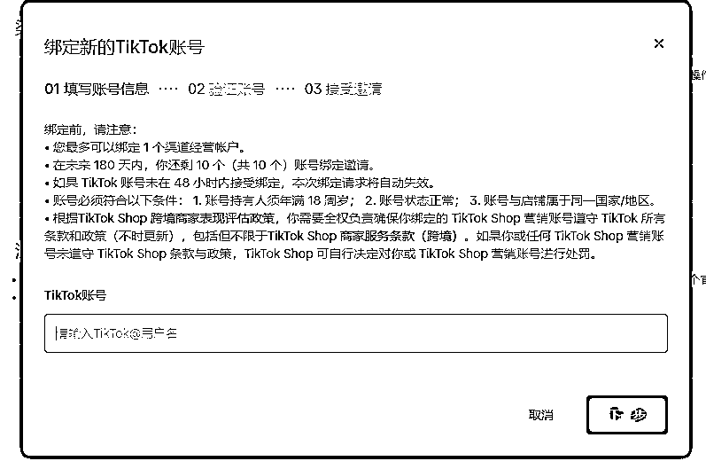

这里提醒几个注意事项：官方号最好挑那些流量正常、播放稳定、基础播放大于1000的0粉账号；渠道号则需要1000粉以上，且账号稳定、App版本最新、环境稳定。绑定的账号必须满足：年满18岁、状态正常、所在地与店铺经营地一致、没有违规记录。另外记得TikTok App要最新版，网络环境也要合适。

具体操作很简单：第一步，在商家后台点“我的账号>绑定TikTok账号>绑定新的TikTok账号”。

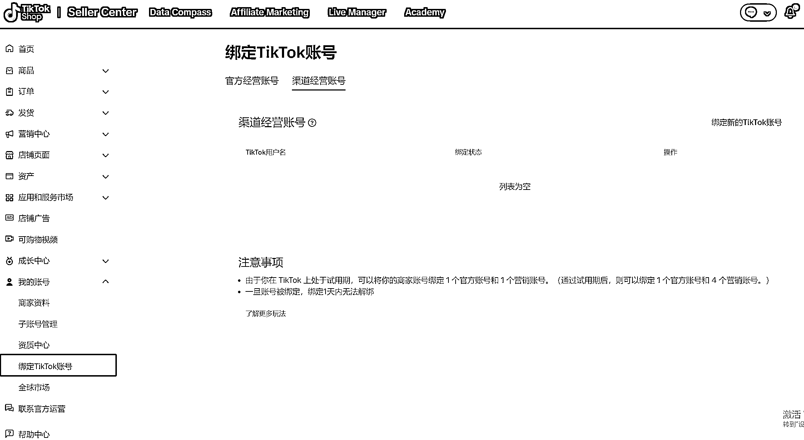

第二步，打开TikTok App，扫描二维码并确认绑定。

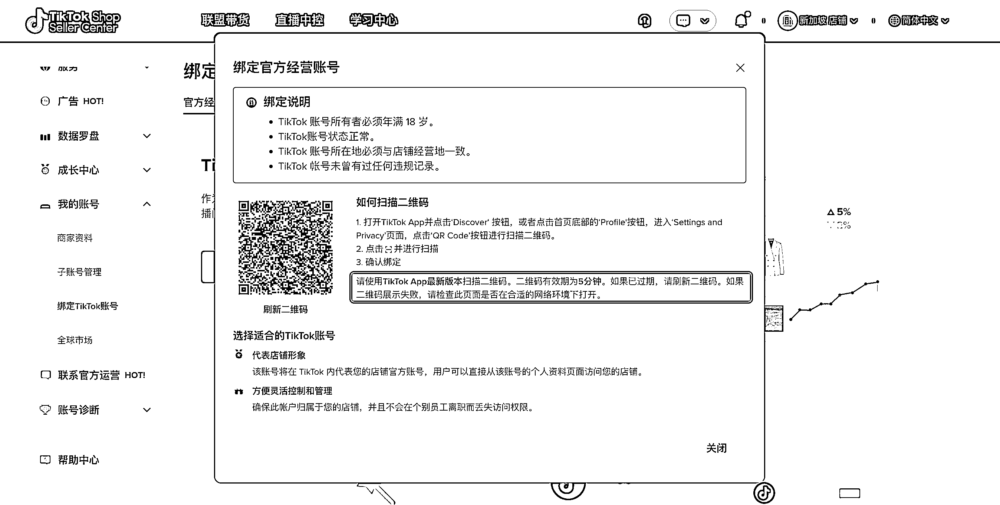

第三步，确认信息后点击“授权”就完成了。

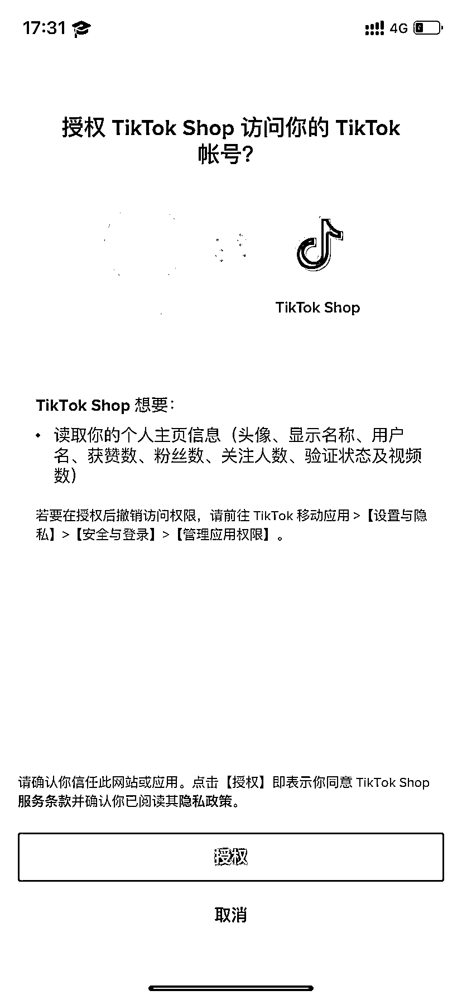

绑定中经常遇到的问题无非这几种：网络地址和经营国家不一致（换个对应国家的网络就行了）；账号没满18岁（如果年龄设置已≥18，可以提交客服工单）；店铺或账号状态异常（查一下站内信）；账号已经被别人绑了（一个号只能绑一个店）；还有隐性风控，比如内容违规、流量异常。

再分享我的实战账号配置。我店里做推广时一般会拉起15个账号一起来，核心配置是2:2:9——1个官方达人、1个渠道号（新手期只能两个号），2个5000粉达人，9个无电商权限的推广号。其中既有官方绑定的，也有自己养的达人号。这是最低配版，也是我们跑出结果的模型。账号越多、权重号越多，效果肯定越好。

把4个达人号统一叫“橱窗号”，橱窗号是主力，因为它们能直接产生转化。那另外9个没电商权限的推广号有用吗？有，而且非常明显。拿一个新店举例，它的数据是这样的：

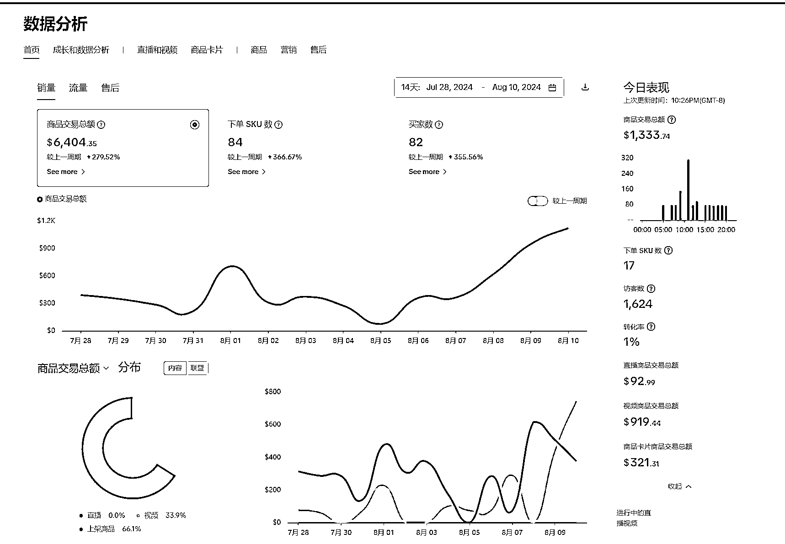

纯自然流橱窗起店，半个月就做起来了，第10天直接爆发。流量构成里，视频占比33.9%，商品占比66.1%。商品数据里，有1万人看过，其中2500美金的成交来自搜索。

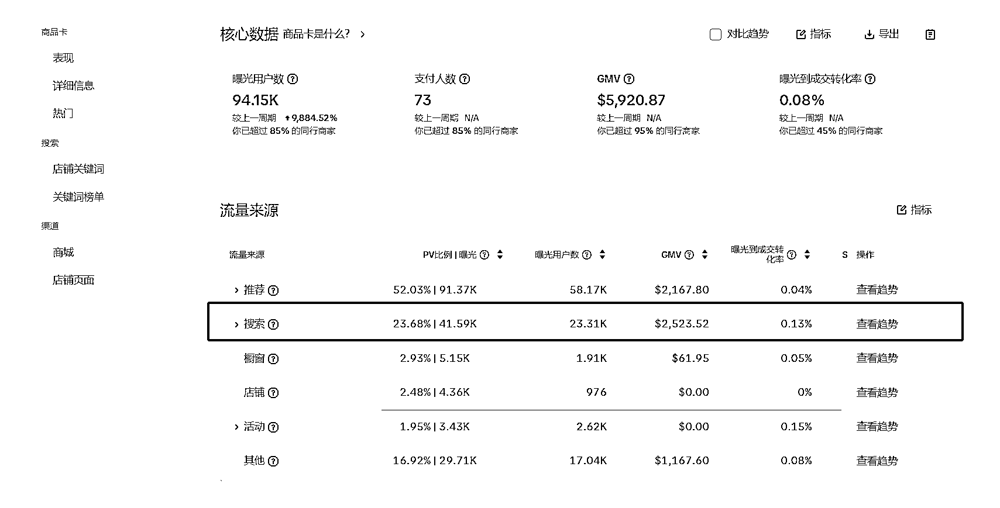

搜索趋势图如下：

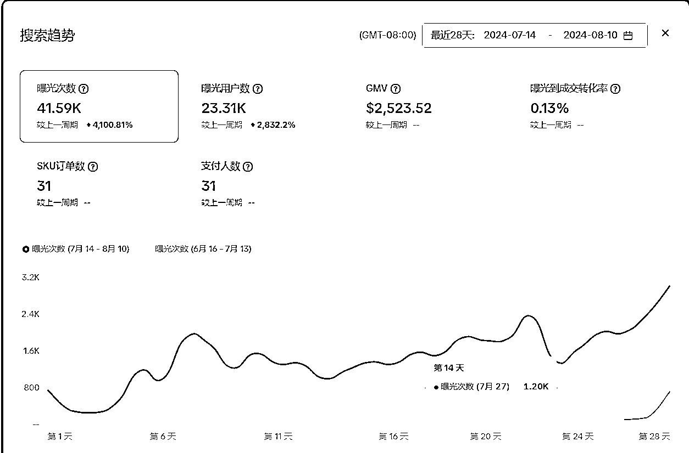

目前最大的痛点是电商权限账号太难开，渠道号也常出问题。

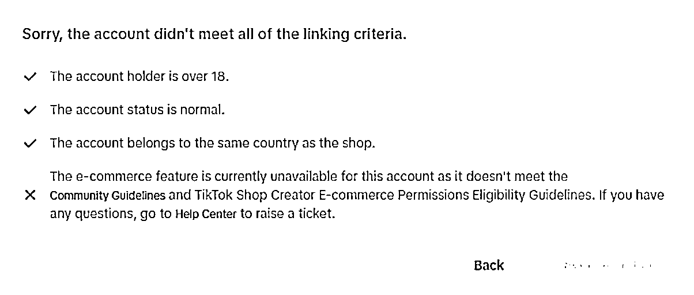

所以我新店起号时，除了橱窗号，还会打一批白号去做搜索和曝光。给你一个直观数据：让团队一上来就打几十万播放的带货视频，说实话挺难。但用9个号，每个号每天发3条，每条200-1000播放，一天就有5400-2.7万人看到，一个月就是16万到81万播放。这还没算偶尔爆的素材。就算只做这件事，一个月也能到手几十万流量。

听到这里，可能有人觉得这事做不大。

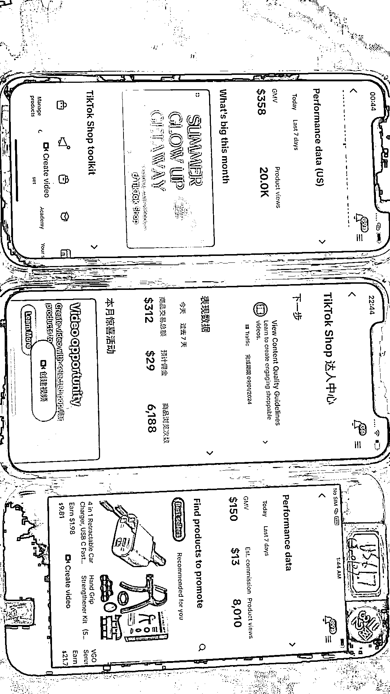

那就聊聊非橱窗号的细节玩法。第一是关键词SEO优化：从标题到内容再到标签，全部埋上店铺或商标关键词；第二是视频素材标签：把TikTok Shop商品页或下单页截图放进视频场景里。

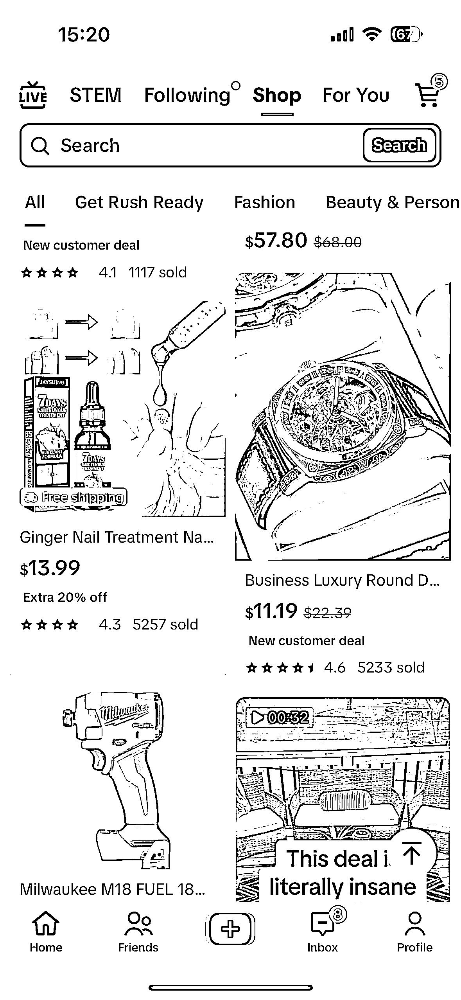

第三是埋用户常搜的热搜词，比如卖拖鞋，就写“最好穿的拖鞋”“质量最好的拖鞋”“云朵拖鞋”“情侣拖鞋推荐”“蓝色拖鞋”等等。

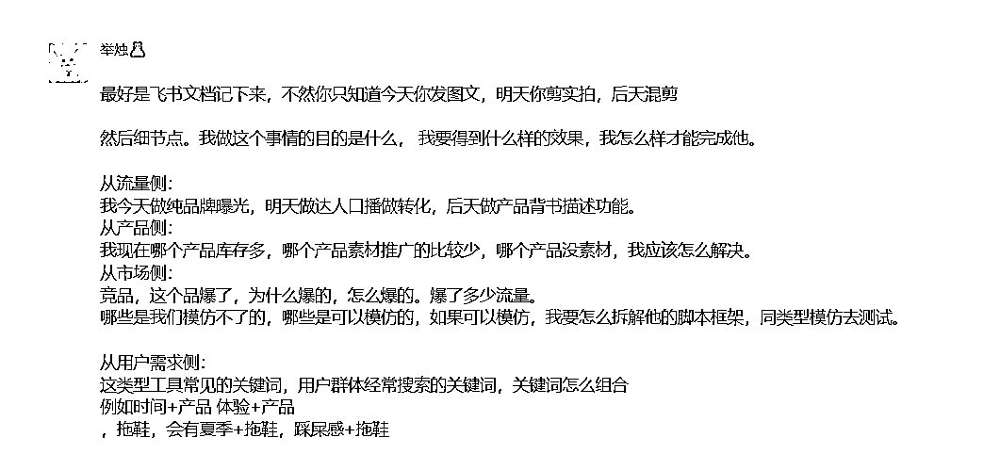

把这个逻辑理顺了，再看内容侧。我可以跟你说个数据：录制1小时素材，能剪出几十上百条高质量视频，混剪甚至能出上千条粗糙版本。我们的做法是，广告创意基本来自pipiads，脚本也大多从上面扒。你可能会觉得我在打广告，但最关键的，是我们团队自己真就这么干的。

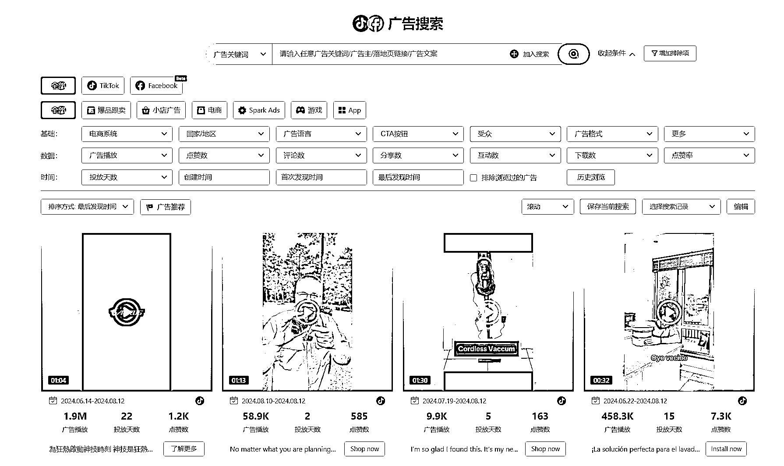

为什么选pipiads？因为上面的素材全是真金白银投过广告的，美区CPM在5-20美金/千次播放。抛开大品牌不说，那些投出大结果的素材，能放那么大量，创意绝对值得研究。

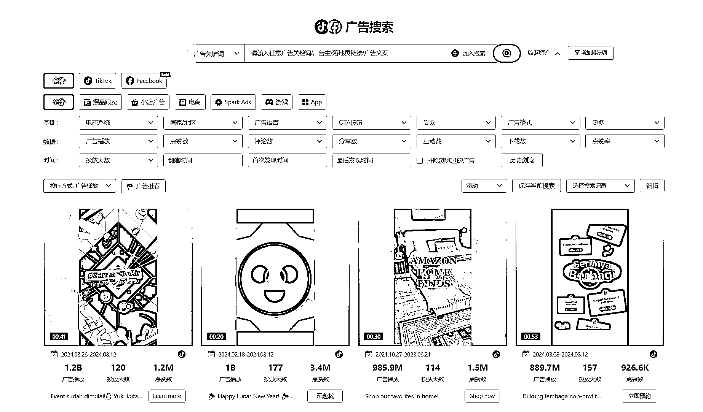

付费流量能赚钱，他们的广告创意都是花钱买出来的，不学白不学。

我带的人起初全是纯小白，连网感都没有。花了4个月，现在他们会兴奋地跑来跟我说“今天又出了10单”“今天又出了14单”，创意素材玩得飞起。

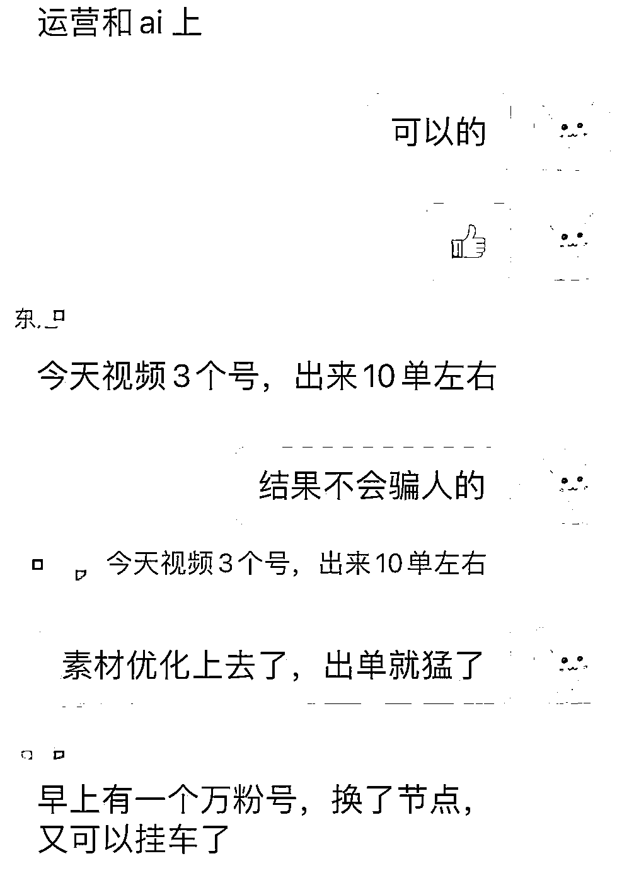

具体步骤：第一步打开pipiads，找到投得凶的广告主，收藏你觉得不错的创意——好广告就是可复制、可迭代的。

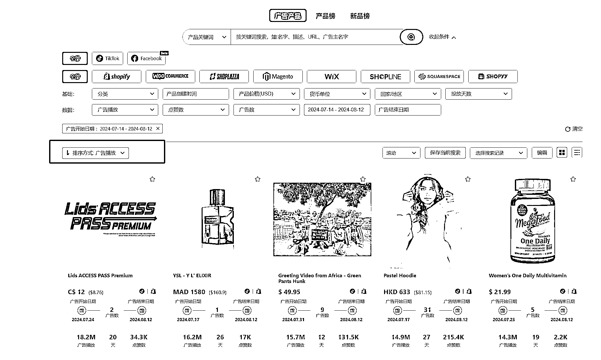

第二步复制文案链接，下载文案；

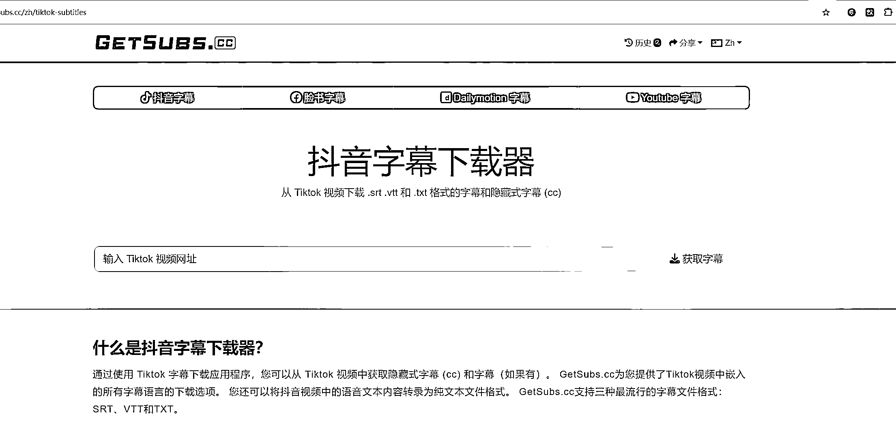

第三步丢给GPT帮你总结脚本、延伸框架。

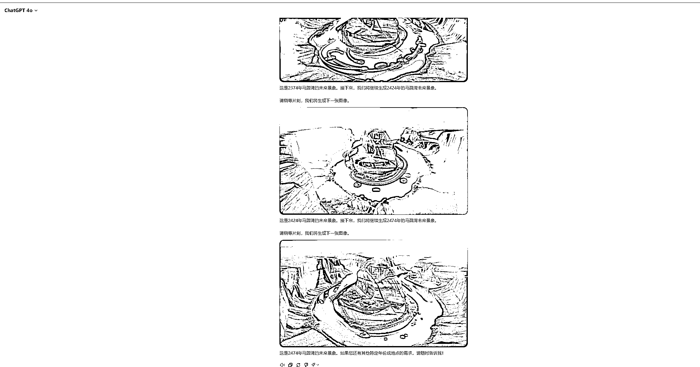

总结脚本核心：钩子（前3秒）、分镜故事、营销引导关键点（比如第几秒放什么文案、什么时候开始解说、第几秒引导小黄车）。提炼脚本框架，比如“描述痛点+产品功能+使用场景”。

拍摄上，同一个场景可以多账号共用，拍1小时分给10个号发，照样有播放；但千万别一个号反复发，容易掉车或被判低质量。场景可以近中远同步拍，也能去拼多多买些微场景道具搭配。拍摄时多加点动作、特效、切镜，比如倒放、旋转。

剪辑上没什么诀窍，多看多学多模仿。目前常见的混剪手法有缩放、加速、翻转、拉伸、碎剪、加边框、打乱顺序、贴纸、滤镜、改文案、配音、抽帧。剪映里的创意模板也很好用，尤其是绿幕模板。

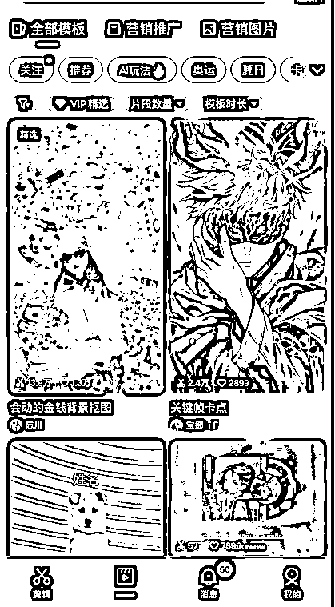

内容批量化方面，很多人不知道还能产什么内容。无非图文和视频：把商品图做成图文卡点，这就是一条素材；视频则要善用AI，比如用可灵AI生成老外真实露脸的背书视频，效果很好。

再讲讲放大。很多人觉得自然流见效慢、起不来。你可以听听我的理解。玩法一：对于没挂车的视频，如果播放表现好，就在24小时内加热刺激。选自然流量已经在2000-5000播放的视频，用20-30美金建组投互动，把它推到下个流量池。我测过10条，最好的一条从几千播放，加热30美金后几天翻了几千倍，点赞12万；普通的一般翻几倍到十几倍。这比较吃素材质量，核心是看自然流趋势，然后投互动。一旦自然流被刺激起来，就是赚了。但没必要刺激500播放的，加热没用；至少要进入二级流量池，也就是2000播放左右的，同时看点赞评论数，互动指标少的，投一点就能继续拉流量池。广告撬动自然流，国内玩家应该不陌生。再次强调：第一，一定是素材；第二，看前期自然流有没有基数，建议选播放量在2000-5000、已进二级池的。账号随时盯，主要看播放。比如正常投互动，受众不变时投20美金系统给1万播放，结果视频冲到2万甚至更高，说明刺激成功——停广告等订单就好。至于能走多远，取决于素材。

玩法二：对于挂车且出单效果好的素材，直接投流拉量，这个不多说，往期文章聊过。这就是我做自然流橱窗带货的真实心得，希望能给你一些启发。

