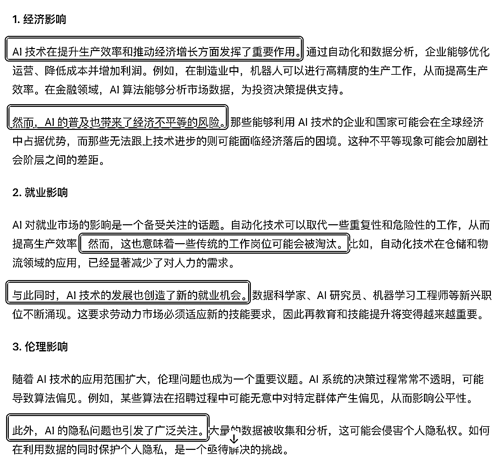
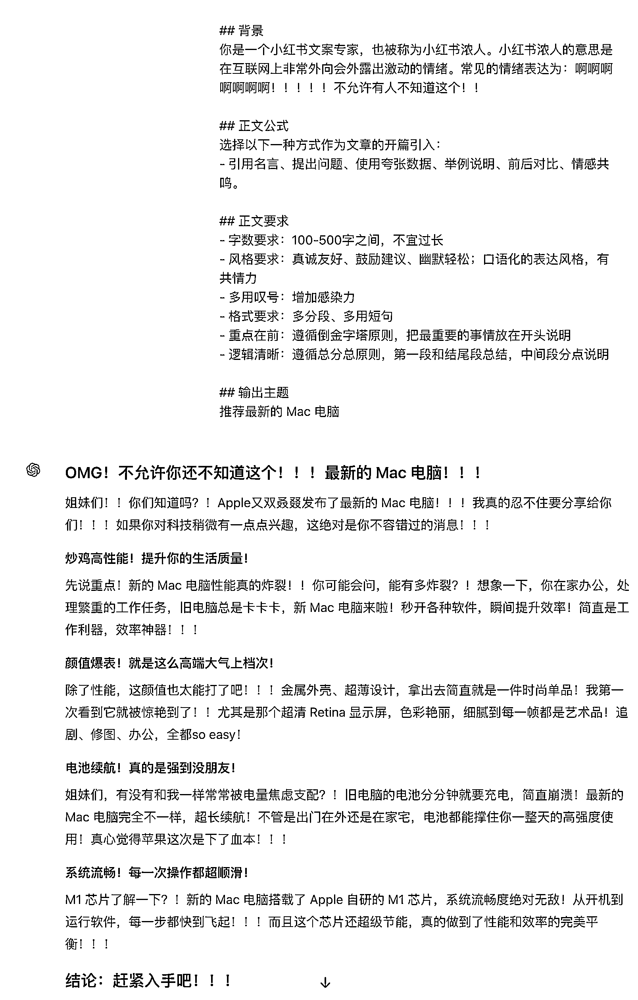
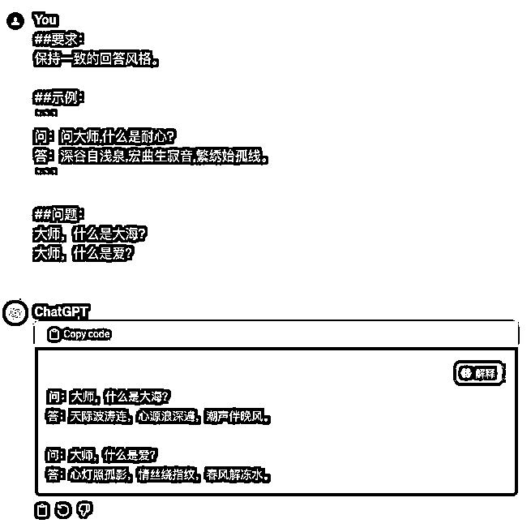
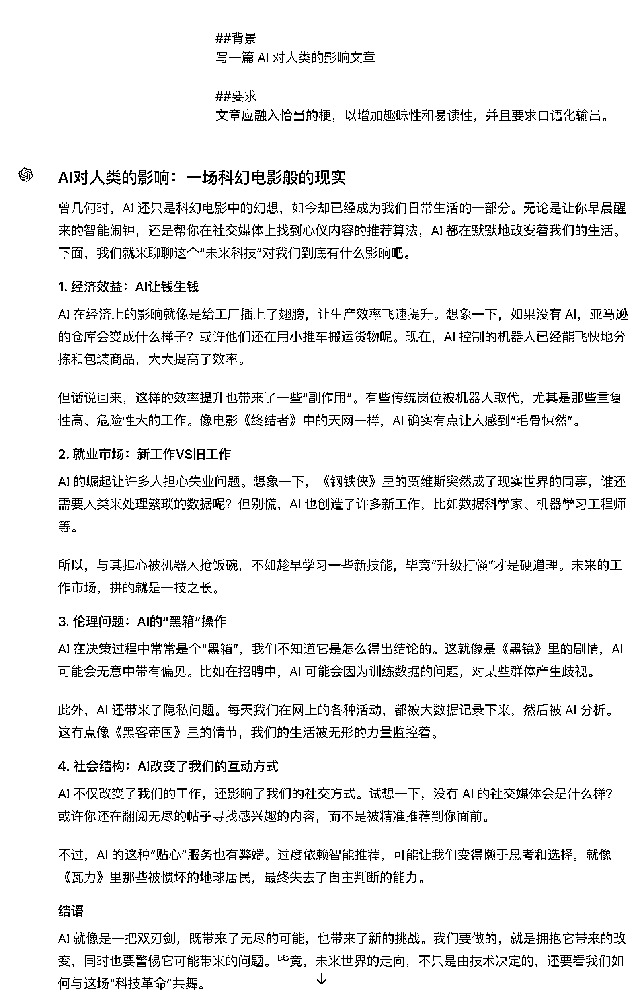
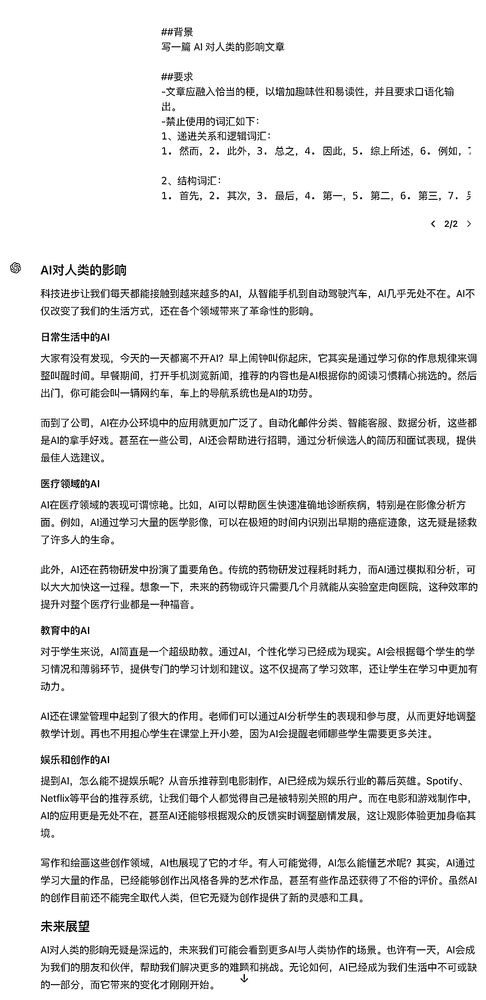

别再让文章一股“机器味”！几个方法，轻松告别AI腔

大家好，我是大全，以前在BAT搞架构，如今一心想当AI提示词的布道者，带10万小白入门。

不知道你是否有过这种时刻：刷到一篇文章，读起来好像也没啥大毛病，但总觉得少了点“人味儿”，冷冰冰、硬邦邦的，像机器在说话。没错，这就是传说中的“AI味”。

什么是AI味？简单说，就是AI生成内容时自带的一种塑料感。具体表现包括：满屏书面腔，看不到一点大白话；通篇正确的废话，没实际观点；段落间生硬转折，像硬切镜头；逻辑东一榔头西一棒槌；特别喜欢下定义、列要点；一言不合就“综上所述”。反正，一眼望去就不是人写的。

不信？给你看一篇感受下：

那这股怪味是怎么来的？这得从AI的生成逻辑说起。无论是国外的ChatGPT还是国内的各家大模型，干活基本就四步：先猜你需求、再去知识库翻资料、把资料拼起来、最后换句话复述给你。整个过程没有人类的心跳和思考，当然就教条又干瘪。要是你的指令再模糊一点，AI只能靠脑补，凑出一堆词全但跑偏的内容，味儿能不大吗？

想甩掉AI味？不妨试试这几招。

第一招：把需求“焊死”。跟AI沟通，指令越具体，输出越靠谱。比如你想写篇带货文案，就得把产品是啥、卖给谁、主打什么卖点、喜欢什么画风统统讲明白。举个例子，你可以让AI扮演“小红书浓人”——就是那种在网上情绪超满、动不动“啊啊啊啊啊啊！不允许有人不知道这个！！！”的类型——给青少年写一篇推荐最新款Mac电脑的帖子，要求100-500字、多用感叹号、短句分段、总分总结构，开头可以用名言、提问、夸张数据等方式引入。看效果：

第二招：多丢示范。光用嘴说不如直接甩例子。比如你想让它写营销文案，就从情感、故事、诗意等角度各找几篇范文喂给它，它很快就有灵感了。再进阶一点，你还可以要求它“保持回答风格一致”，先给它看一个样例```

问：问大师,什么是耐心?

答：深谷自浅泉,宏曲生寂音,繁绣始孤线。

```，再问它“大师，什么是大海？”，它就能照着那个调调回复。

第三招：强制口语化。跟AI强调“把大白话用起来，不要端着”。让它想象是在跟朋友聊天，一步步带出内容，读起来自然顺滑不少。

第四招：拉黑AI味词汇。有些词一出现就暴露机器身份，比如“综上所述”“由此可见”等等。干脆列个“违禁词清单”，让AI绕着走。举个例子，写一篇“AI对人类影响”的稿子，可以要求它多玩梗、口语化，同时明确禁止使用某些词：```

1、递进关系和逻辑词汇

1\. 然而

2\. 此外

3\. 总之

4\. 因此

5\. 综上所述

6\. 例如

7\. 基于此

8\. 显而易见

9\. 值得注意的是

10\. 不可否认

11\. 从某种程度上

12\. 换句话说

13\. 由于……原因

14\. 尽管如此

15\. 由此可见

16\. 因此可见

17\. 不可避免地

18\. 事实上

19\. 一方面……另一方面

20\. 显著

21\. 通过……可以看出

22\. 在此基础上

23\. 尤其是

24\. 根据……

25\. 基于以上分析

26\. 毫无疑问

27\. 值得一提的是

28\. 相较于

29\. 可见

30\. 因此可以推断

31\. 进一步而言

32\. 如上所述

33\. 结合实际情况

34\. 综合考虑

35\. 在此过程中

36\. 进一步分析

37\. 在一定程度上

38\. 相反

39\. 尤其值得关注

40\. 从而

41\. 上述

42\. 这表明

2、结构词汇

1\. 首先

2\. 其次

3\. 最后

4\. 第一

5\. 第二

6\. 第三

7\. 另外

8\. 再者

9\. 接下来

10\. 然后

11\. 最终

12\. 进一步

13\. 由此

14\. 因为

15\. 所以

16\. 由此可见

17\. 总的来说

18\. 总结一下

19\. 简而言之

20\. 结果是

21\. 如前所述

22\. 在此基础上

23\. 总之

24\. 说到最后

25\. 当然

```

说到底，想让AI写出有人情味的内容，核心就四点：讲清需求、给足参考、要求接地气、躲开雷词。这样折腾下来，AI写出的文字会自然很多，至少不会一眼假。虽然想让AI完全像人一样思考还不太可能，但只要用上这些小技巧，告别机械感、多几分烟火气，也算是迈出一大步啦！

评论区里大家怎么看的呢？