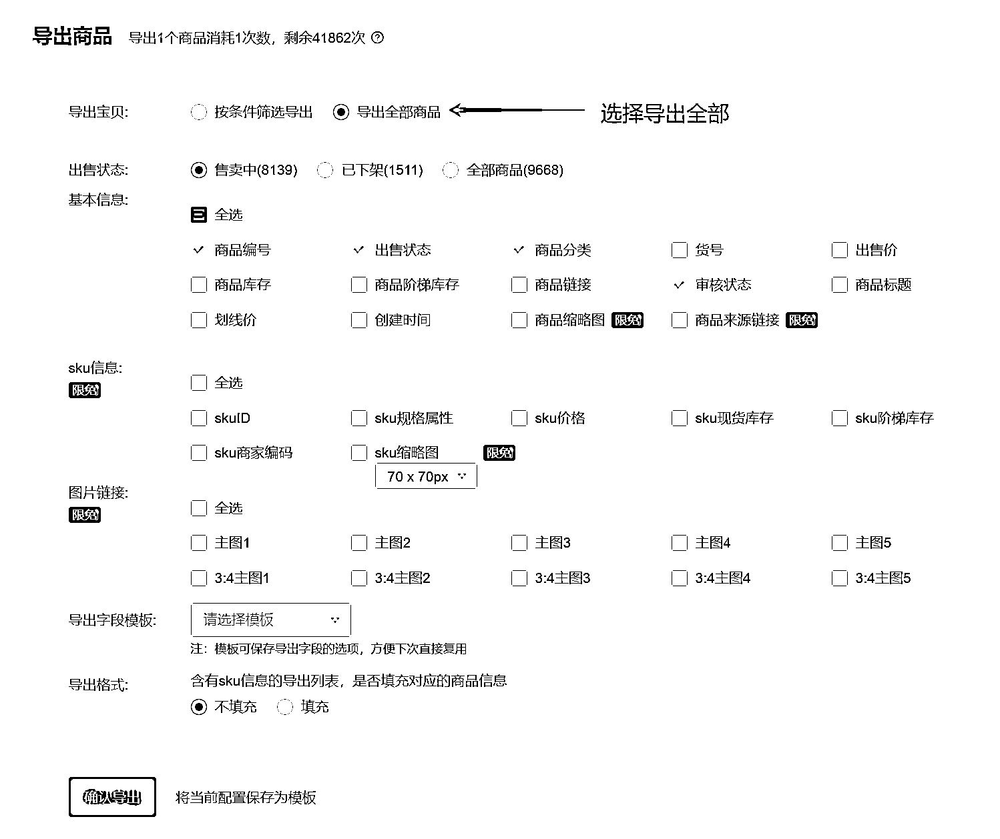
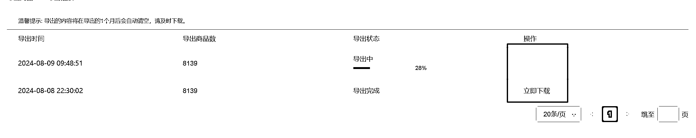
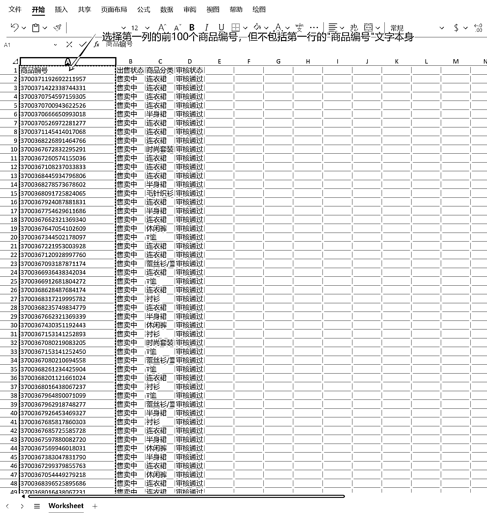
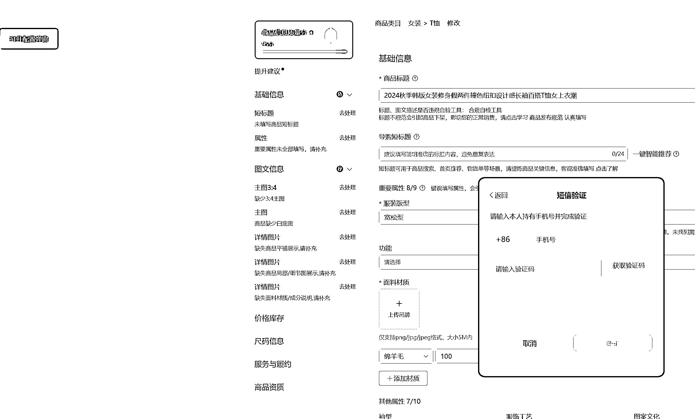
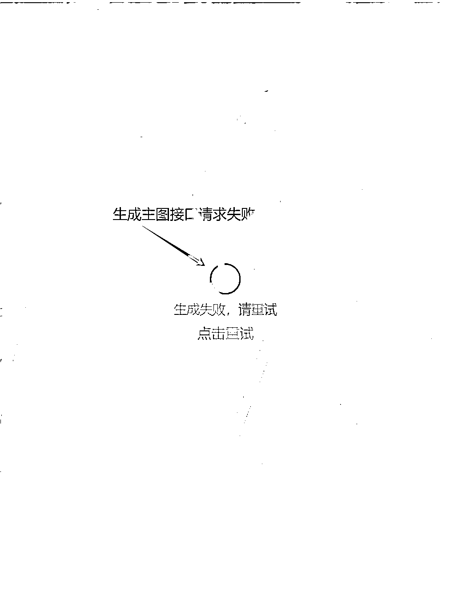
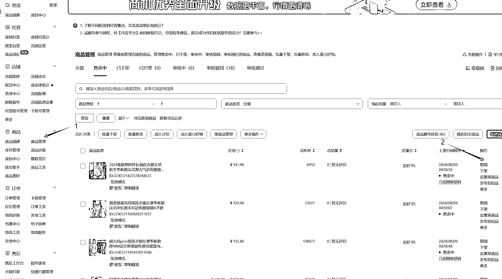
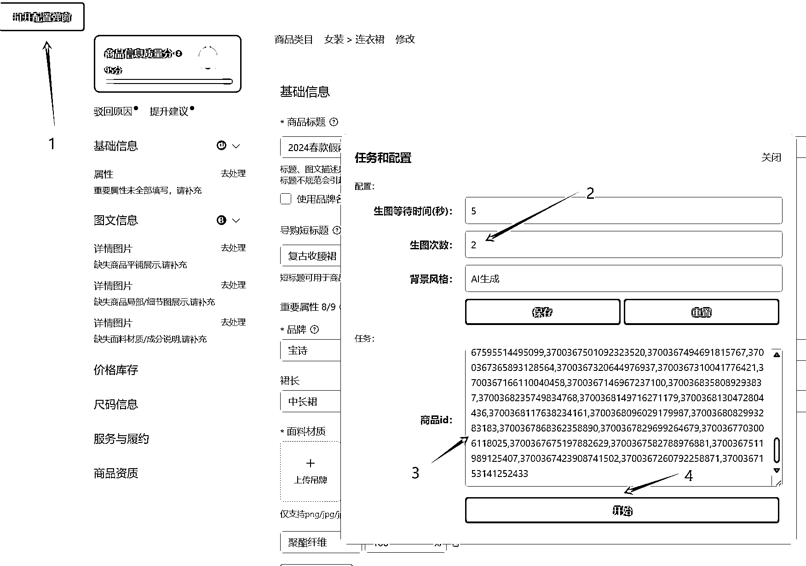
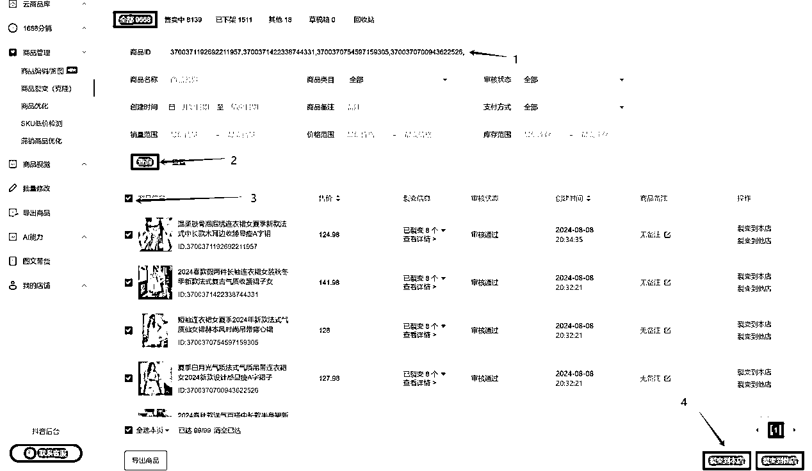
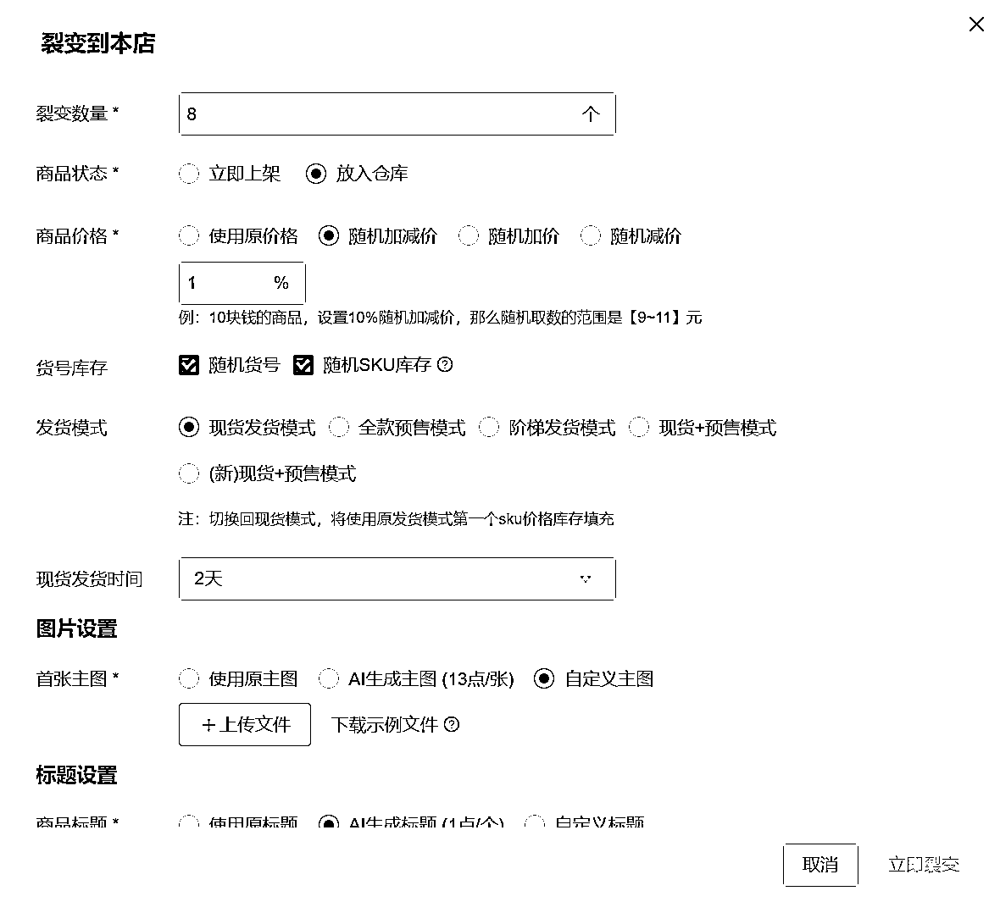

在这次的抖音小店（高客单）航海项目里，我用“欢乐逛”完成了商品裂变。身边不少圈友选择花钱用AI裂变工具，但考虑到项目起步阶段能省则省，我改用“自定义主图”的方式来做裂变，效果不错，成本也低。这篇教程就分享给同样在航海的伙伴们，希望能帮到你。

**开始之前，请先准备好两件事：**

1. 认真看完安信教练的“如何做好拍单售后”直播回放，去视频号“安信日常”就能找到。
2. 按直播里的要求，把“暴力猴”插件装好。

**下面是具体的操作流程：**

**第1步**：打开欢乐逛，在页面左侧找到“导出商品”并点击。进入导出页面后，选择“导出全部商品”（当然也能按条件筛选），“出售状态”根据你的实际需求选，其他项保持默认，最后点“确认导出”。  

**第2步**：跳转到新页面后稍等片刻，等导出完成，点“立即下载”，就能拿到一个Excel文件。  

**第3步**：打开Excel，复制第一列的前100个商品编号，注意不要连表头“商品编号”一起复制。这里特别提醒：一次别选太多。因为抖店官方对“生成主图”接口的请求频率有限制，我实测操作200次左右就会弹出验证窗口，之后不再响应。另外，生成的主图太多，打包后的zip也可能超过欢乐逛上传文件的900M限制（后面会提到）。所以每次复制100个是最稳妥的。  

**第4步**：回到欢乐逛，点左下角的“抖店后台”按钮。在抖店后台左侧找到“商品”栏目下的“商品管理”，然后在右侧商品列表里，点第一条的“编辑”（这部分操作直播回放里有演示）。  

**第5步**：打开商品编辑页面后，点左上角的“打开配置弹窗”，把刚才复制的商品编号粘贴到“商品ID”输入框里（商品ID就是商品编号）。页面里的“生图等待时间”，如果网络慢可以调大，比如设5秒；“生图次数”设2或3就行，因为暴力猴每次会生成4张主图，2次就是8张，3次就是12张，完全够用。比如我选2，那么后面裂变次数就填8。设置完记得点“保存”。  
接着点“开始”，之后就是漫长的等待了。我这边生成100个商品主图大概需要50分钟。等待期间尽量不要操作电脑，免得影响暴力猴运行。跑完后会自动生成一个zip压缩包，这个后面要用。  

**第6步**：再回到欢乐逛，点“商品管理”->“商品裂变(克隆)”，把刚才那100个商品编号粘贴到“商品ID”文本框，点“查询”。查询完成后勾选全部结果，再点页面右下角的“裂变到本店”按钮。  

**第7步**：在弹出的“裂变到本店”页面，裂变数量我通常填8（原因在第5步讲过）。其他选项按自己喜好设置就行，但图片设置里一定要选“自定义主图”。接着点“上传文件”上传刚才那个zip压缩包。欢乐逛对上传文件大小有限制（900M），这也是为什么之前每次别超过100个商品的原因之一。上传完成后点“立即裂变”，接下来又是漫长的等待，跟着提示操作就好。  

**第8步**：一次裂变结束后，回到Excel复制接下来的100个商品编号，重复第4到第7步即可。因为抖店对接口请求频率的限制是账号级别的，换IP、换电脑也没用，所以个人建议每天裂变一次就够了。

欢迎还在本届“抖音小店（高客单）”航海中奋战的圈友一起交流～

评论区：  
疯狗：感谢分享！  
