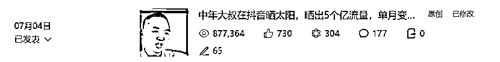
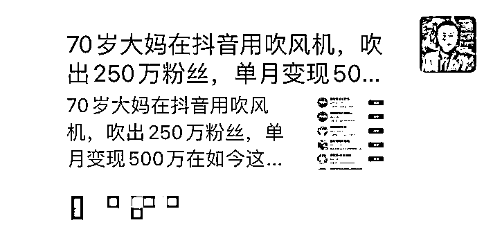
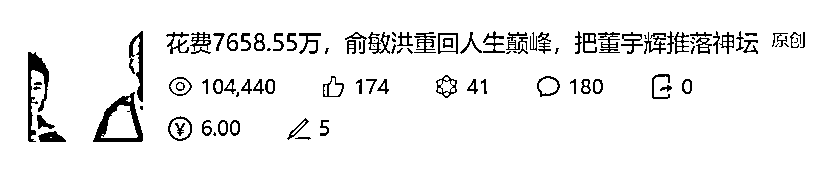

# ('边刷抖音边写公众号，一个月写出 9 篇 10w+爆款，最高一篇 87.7 万阅读', (2, 42))

7月日更公众号，一口气跑出9篇10w+，最高87.7万阅读。这不是神话，而是一个博主刚交出的成绩单。他最大的秘诀？刷着抖音，顺手把公众号写了。

先看成绩：一个月9篇10w+，其中——

最高一篇87.7万阅读

然后是52.3万阅读

第三名也有42.6万阅读

做到这种效果，他是怎么操作的？下面逐条拆解。

**一、公众号的灵感，全靠刷抖音**

现在用户的时间基本被抖音、视频号、公众号、小红书瓜分。图文作者就盯公众号和小红书，视频作者就盯抖音和视频号。这位博主的做法是：刷抖音找灵感，写公众号发内容。

比如他刷到“扛楼”这个题材，发现抖音上特别火，嘴哥、李炮等大博主都去蹭，扛楼博主阿兴也有260万粉丝。于是马上写了一篇：

《90后小伙在抖音扛楼，扛出260万粉丝，还清了所有外债》

这篇跑出了21.1万阅读。

**二、标题要够形象**

因为他账号粉丝基数小，平时阅读量也就千把个。标题不炸，根本进不了流量池。所以他复盘发现，10w+的标题都有很强的画面感。比如：

①中年大叔在抖音用吹风机，吹出250万粉丝，单月变现500万

②中年大叔在抖音跳擦边舞蹈，10天擦出450万粉丝，1年不到变现1个亿

③90后小伙在抖音扛楼，扛出260万粉丝，还清了所有外债

原本这些标题都写“涨粉多少”，太普通。改成“吹出”“擦出”“扛出”之后，画面感立刻拉满。结果也证实了判断：三篇全被推荐，篇篇爆了10w+。

还有个小伙伴用同样的框架写小红书喝茶博主，“喝出***粉丝”，也差点破10w。这个标题公式可以拿来拆解抖音、小红书的各个领域博主。

**三、内容要有趣又有用**

写干货很难出爆款。这位博主发现，加上段子后，流量就来了。所以他总结：爆款内容=有用+有趣。

有用，指拆解博主时给出实操干货，比如怎么拍摄、怎么剪辑、爆款底层逻辑、怎么立人设、怎么创新形式、怎么制作内容，针对不同博主定制。

有趣，就是写段子。比如标题里直接抛段子：

河北女子在抖音变装，变出72万粉丝，网友：彩礼说好8万的，怎么变成80万了？

正文里也埋段子：

写安安教练时，他说有女粉丝来问：我也是美女，想做自媒体但没方向。他的回答是：多看看成功案例，看多了心里就有数。接着写安安直播间16万人在线，12万人有驾照，1万人是教练，1万人是交警，1万人没驾照，还有1万人想把驾照吊销重考。还有女粉丝说，拿男友手机刷到安安，听到声音就受不了。

写大胯姐时：

标题就是段子：95后女子在抖音变魔术，不仅变出了200万粉丝，还变成了很多中年大叔的梦中情人

因为看她的人不只是中年大叔，还有不少18岁小伙。

评论区还有疑似18岁的小伙留言：说谁大叔呢，人家今年刚满18岁。

文章里也调侃：美女+专业才是王炸。纯靠颜值，看久了就没意思；展示专业，比如变魔术，大家就能给欣赏颜值找个借口：我是来学魔术的。就像很多美女舞蹈博主，评论区总有男同胞说：兄弟们，今天咱们又来学舞蹈了。

这些段子是怎么攒下来的？答案只有一个：积累。他专门建了一个段子库，随手写几个，或者从抖音评论区搜集，甚至去公众号搜有没有人模仿自己。结果发现一个号简直是离谱：

自己明明写的是50岁大叔，对方竟改成了70岁大妈。为了避开同质化，他连举报都懒得点，干脆把这件事也收进了段子库。

时间一长，攒了上百条段子，写文章时自然就能信手拈来。

**四、给写公众号的几点建议**

①想到就马上写，执行力拉满。 那天晚上他刷到一篇10w+爆款——《7658.55万赎身，董宇辉被老俞推进深渊！》，觉得有搞头，立刻构思标题、马上开写，结果也顺利拿下10w+。

②给写作赋予重大意义。文字永远有价值，独特的表达能跨越时空发光；写作有疗愈作用，每天早起先写点东西，整天都充实；日更是做好自媒体的基本功，不管做哪个领域，每天写3000字都受益。

③一切都是积累。想写出爆款，素材库必不可少。没事多翻翻推荐页，也多研究研究对标账号，无论是亮眼的标题、精彩的开头、有趣的段子，还是金句和结尾，只要觉得不错，就顺手收进对应分类，写文章时就会轻松很多。

以上就是一个博主一个月写出9篇10w+的全部复盘。虽然不一定能复制，但至少告诉我们：爆款背后不是玄学，而是方法+执行+积累。

