# 深耕👸号五年，实现百万 IP 的心法

大家好，我是龙哥。一个在👸号领域深耕了五年的创作者，目前拥有17万粉丝，也带过几百位学员一步步跑通👸号变现。今天这篇内容，我想敞开心扉，聊聊我这些年的真实经历和沉淀下来的心法。

## 一、五年👸号之路，我的四个关键阶段

### 阶段一：低谷期的沉淀与野心（月入200+）

小时候家里条件不好，高考又失利，只上了一所二本院校。虽然成了家中的第一个大学生，但我内心毫无喜悦，反而觉得辜负了所有人。那个暑假，我疯狂阅读了将近二十本书，与其说是沉淀，不如说是在为自己的遗憾寻找出口。

进入大学后，我竞选学委、认真学习，同时尝试各种兼职：发传单、食堂打菜、做助教、当家教……总之，满脑子都是“赚钱”二字。正是这种强烈的欲望，为我后来的坚持埋下了伏笔。

一次偶然的机会，我在知乎搜索“如何有意义地度过大学”，意外发现“写作投稿”这条兼职路，并通过这个渠道联系上了一位学长。他听说我喜欢写作，让我发一篇文章给他看看。没想到，他看完后直接签我做签约作者，一周供稿一篇，一个月给200块钱。

那一刻我哭了，不只是因为钱，而是因为被认可。之前的语文积累和暑假的疯狂输入，让我抓住了这个机会。

所以我特别想对大家说：做自媒体前，一定要善用自己的积累，同时点燃内心对搞钱的渴望。

### 阶段二：突破瓶颈，守住初心（月入5000-1w）

后来学长觉得我文笔不错、人也靠谱，便开始让我帮他代运营👸号。也是从那时起，我才真正与👸号运营结缘，那年我还在读大一。

但一开始我完全是摸着石头过河。两三个月里我写了大量文章，也跑去知乎发内容、做引流，费尽心思，最后涨粉只有个位数。那段时间我极度自我怀疑，经常跟闺蜜哭诉自己不适合做自媒体，每天都焦虑到不行，却还是逼着自己继续更新。

直到后来我逐渐了解：👸号背后其实有圈子。一个人埋头苦干一年，不如在圈子里浸泡一个月。我开始知道“征稿函涨粉”“互推涨粉”这些玩法，然后在📕、抖音、快手等平台分发征稿信息。但现在，这套打法已经不太可行了。

当时的主流操作有三种：自己开号去外站推广，比如📕；付费请粉丝帮忙传播；再就是付费请博主发推广。如果你做过学习类、写作类的📕博主，想必也见过不少这类“👸号推广”广告。一两年前，这还是一些小博主的收入来源，但随着平台对导流行为管控越来越严，这类广告风险太高，很多博主已经不愿再碰了。

虽然这套方式现在不太适用，但当年真正起家的号主们，基本都靠它完成了原始粉丝积累，我也一样。毕竟“酒香也怕巷子深”，先得把粉丝引进来，留下留得住，才是内容和账号质量的问题。

从最初的2000个粉丝（还是学长靠线下发单和知乎软文慢慢攒下的，花了几个月，效率很低），我一路做到约15万粉丝。这15万里包含三个号：

- 大号“晚安西柚”：约10万粉丝，以“桃子”的名义做IP；
- 小号“陶安笙”：约4万粉丝，电台治愈风，以“陶安笙”的名义征稿；
- 小小号“全是狗粮”：1万多粉丝，主收爱情故事，和粉丝互动性强，后来因为实在没时间打理，直接卖掉了，变现6000多元。

这三个号就是一组矩阵。矩阵思维的好处很明显：粉丝可以同时关注三个号，因为征稿方向不同，粉丝数自然放大三倍；而且三个号都能接广告，既能单接也能打包卖，收入不断叠加。

所以不管你现在做👸号、📕还是其他平台，一定要有矩阵意识——多账号、多平台、广撒网，东边不亮西边亮，你永远不知道哪个号会突然起来。

总结这一阶段，最核心的是三句话：

**第一，圈子。** 自媒体这事，一个人跑得慢，一群人才能跑得远。最好跟着有结果的人一起做，或者和伙伴互相打气，这样见效更快。而且在高能圈子里，你能第一时间知道平台最新的玩法。

**第二，机遇。** 我们这批人其实没赶上👸号的黄金风口——15年左右，随便一篇文章就能转发几万十几万。那时候很多人唱衰“👸号已死”，但我们没有放弃。后来遇到新的机遇，就是“外域引流”，并且狠狠咬住了，才把私域文字平台做得有声有色，实现快速涨粉。

**第三，坚持。** 跟我同期做👸号的人，很大一部分已经退隐，还有不少人直接卖号，转战别处，或者彻底离开自媒体。说实话，很可惜。尤其去年底“互选平台”（类似📕蒲公英）出现后，广告变难了。但真正坚持下来的号主，现在依然能靠👸号活得很好。前期全是沉淀，后期才是复利。

就像我，五年👸号路，前四年也才挣了30万左右，但正因为积累够了，去年我只用不到一年时间就变现了近百万。

所以请记住：做自媒体一定不要幻想一步登天，沉淀够了，爆发是必然的。谁能扛过最难的时候，谁就能绝处逢生。

### 阶段三：停下脚步，奔赴考研（收入范围2000-1w）

大三时，我虽然在专业上排名第一，但心里一直有“名校情结”。所以当事业逐步起色时，我坚定地选择了考研。因为我知道，自媒体的红利以后还有很多次机会，但人生弥补名校遗憾的机会可能就那么一次。取考研，暂放自媒体，是我的取舍。

我也想说，如果你目前的副业还没法完全覆盖学业或主业，那最好还是把主业放在第一位，尤其是不要冲动辞职。

虽然我暂时放下了号，但一直到11月初才真正停更。备考阶段👸号依然在变现，活跃度也维持得很好，全要感谢我的团队——当时有总助、排版助理和商务助理，她们替我处理掉了所有琐事，我只需要在复习间隙给一些方向和安排就行。

所以每一个想做大的人，迟早要搭建自己的团队。后期如果忙不过来，就学着慢慢组建起来吧。

### 阶段四：归来破圈，商业思维觉醒（月收益3000-10w）

考研复试结束后，我几乎没有休息，马上重新投入自媒体。这一阶段最离不开的还是“机遇”，以及破圈、商业思维、高能量和初心。

因为👸号圈子不断迭代，我开始接触知识付费圈子，学习新事物，提升认知和能力。我当时做的第一件事，是结合手里已有的资源，推出了自己的知识付费产品——对一个个人IP来说，付费产品是持续发展必不可少的一环。

如果你还没有资源，那就直接进入第二步：破圈。破圈的前提是付费，这已经是公开的秘密。我也开始大量付费学习，补认知、补技能、结识更厉害的人，把自己打磨成一个“六边形战士”，更强大也更无畏。

后来，我通过付费打开了圈子的视野。因为机遇，我持续做了整整一年的👸号爆文项目；通过付费学习和观察，我掌握了更高阶的商业模式，商业思维逐渐成型。再后来，我推出了多个付费产品、组建了私教团队，也一直不忘初心，用心做好服务和口碑。

可以说，正是因为一直坚持做👸号、探索👸号、跟着机制走，我才有今天的成绩，才能更踏实地打造个人IP。

也正因深耕👸号五年，我深深体会到：👸号这个🛰️最宠爱的文字平台，真的太适合做私域沉淀和个人IP打造了。

回顾这一段变现七位数的旅程，是👸号让我的命运开始转动。它让一个人脉全无的小镇女孩，能够凭自己的努力创造一份小而美的事业，还能成为别人的榜样。

所以不管别人说👸号走下坡路也好，说新问题不断也罢，我从来没有选择放弃或停滞。只要有机会，我都会去尝试。到今天，我依然坐在牌桌上，继续深耕。

## 二、👸号的新时代：更大众，更商业

在我看来，👸号正进入第五个阶段——一个更大众、更商业化的时代。之所以这么说，是因为当下出现了四个重要契机。

### 契机一：推荐机制全面开放

👸号原本是很封闭的私域，只有关注者才能看到内容。但现在，即使没有粉丝，只要你命中推荐逻辑，平台就会把文章推给更多人。

这对大号未必是好事，因为粉丝的关注会被分散。但小号则迎来重大利好——哪怕你刚开始做，阅读量也可能冲得非常高。很多新注册的小号，已经能跑到十万加阅读了。

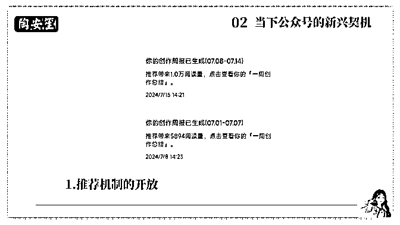

### 契机二：留言功能免费开放

早在2017年，新注册的👸号就没有留言功能了，账号和粉丝之间的互动少了一个关键入口。

前两年我为了开通留言，花了2000多块钱。现在官方陆续免费开放，说明腾讯愿意让号主与粉丝有更多连接，这也是一种扶持。

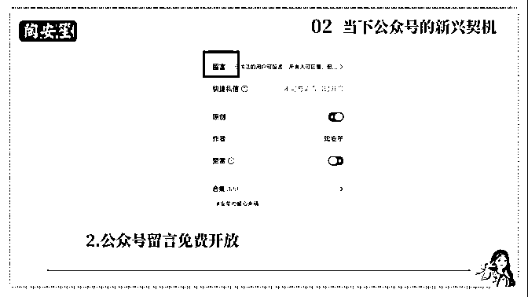

### 契机三：内容助推机制推出

👸号现在可以付费投流，把你的内容推给更多人，类似抖音的Dou+。但它有一个门槛：只有粉丝数低于一万人才能使用。

也就是说，你的内容不能是强商业性质的硬广。很明显，腾讯在扶持小号主——大号反而没资格投流。这种变化说明商业化方向正在转变：哪怕不能带太重的营销味，但用来引流、沉淀内容，依然非常方便。

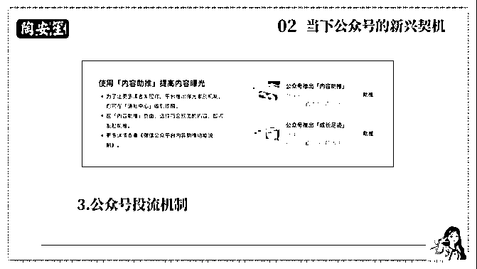

### 契机四：视频号与👸号强绑定

现在👸号首页可以直接看到视频号入口，点击蓝字就能跳过去；视频号首页也能挂上👸号。更棒的是，👸号文章里还能直接插入视频号内容，相当于给视频号倒了一次流量。

另外，视频号直播时，直播提醒不只发给视频号粉丝，也会同步推给👸号粉丝。所以👸号完全可以为视频号直播贡献力量，这正好是公域与私域联动的绝佳机会。

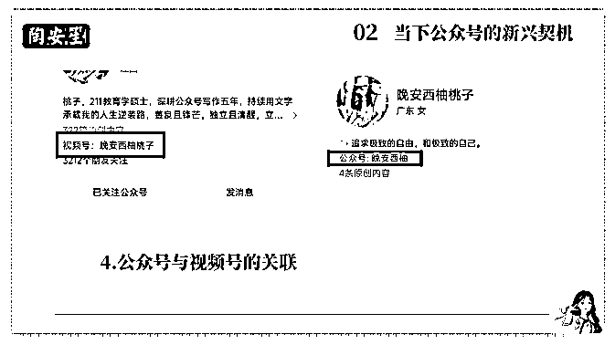

近几年，👸号的改动确实很多，我做了五年号，觉得这很不寻常，也说明腾讯越来越重视👸号，才会有这么多动作。

### 👸号平台的核心优势

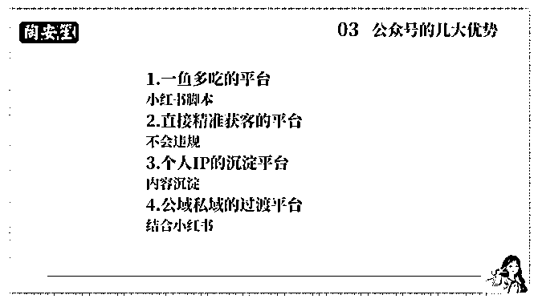

**1. 一个“一鱼多吃”的同步平台**

你完全可以把它当作分发矩阵的其中一环。比如你做📕，就可以把图文或脚本再发到👸号，简单排版调整一下即可。我自己有一套排版法，十分钟就能完成，看起来也很舒服。再加上推荐机制带来的流量助推，👸号作为“一鱼多吃”的平台，简直太顺手了。

**2. 直接且精准的获客平台**

👸号还能承接精准获客。外域平台引流处处有违规风险，但👸号不会——直接贴🛰️二维码、放🛰️号都没问题。目前几乎没有哪个公域平台能做到这一步。你甚至可以直接在👸号里做招生宣传，用户马上就能加到你。

**3. 个人IP的沉淀平台**

👸号非常适合做个人IP沉淀，也可以说是企业和品牌文化的沉淀空间。个人可以沉淀品牌故事，企业可以沉淀文化理念。而且文字内容能筛选出更沉浸、更优质的读者。同类内容还能用专栏打包，形成体系，这也是一个大优势。

**4. 公域与私域的过渡平台**

许多公域平台不允许留🛰️号，但你可以告诉用户“全网同名”，让他们来👸号找到你，再从👸号进入私域。现在视频号对留🛰️也比以前严格，所以很多人会利用“👸号+视频号”的关联，让用户借道👸号走到自己的私域池里。

说了这么多，核心想告诉大家：今年做👸号，趋势是在向好的。而且变现路径也越来越多，我归纳了8大变现模式，标红的普遍适用。

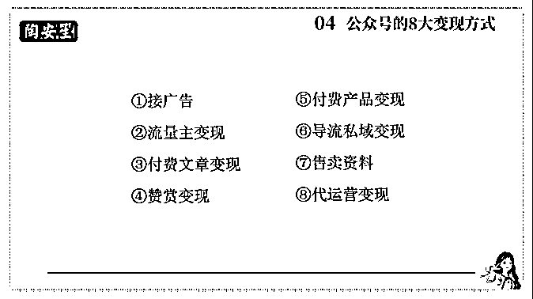

比如接广告、流量变现，适合所有👸号创作者。如果你做个人IP、有私域产品，还可以使用付费产品、私域转化等方式。付费文章、赞赏、卖资料、做代运营等等，也都是可落地的变现路径。

总结下来，第一，小号的春天已经来了，这一波对小号来说堪称“第三次浪潮”；第二，👸号的商业化进程，无论对个人IP还是对企业，都是新的契机。

记得去年视频号刚起来时，我关注的一位商业博主也是从零起步，她坚持用视频号打造创始人IP，如今已经是头部级别的商业IP之一。平台红利从来不等人，如果感兴趣，不妨给自己一年的时间持续更新👸号，一年后你一定会看到脱胎换骨的自己。

## 三、打造爆款：低粉也能10W+的秘密

这部分其实也源于推荐机制，我把它分成两个阶段来看。

### 阶段一：流量主玩法

去年六七月左右，我开始接触以流量主变现为核心的👸号，说白了就是靠阅读收益赚钱。我小号发的一些文章，数据非常夸张：59万、19万、12万、20万……这些截图我只是随手存了一部分。

后来团队带着学员继续跑，大多数人都做出了变现。很多人第一个月就实现了四位数的收入。还有学员写出百万阅读爆文，当天就变现4000多。一个私教学员甚至七天赚了一万多，靠的就是流量主。

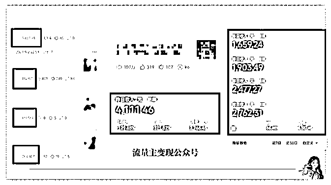

从去年研究👸号爆文到现在，我们越来越确认：推荐机制一旦启动，威力远超想象。只要善用机制，收益非常可观。

### 阶段二：个人原创文章

去年10月前后，我发现👸号也在持续推荐原创个人号。我的账号可能是“老顽童”，之前一直没被推荐，但我没停止尝试。终于有一次，我发现自己的某篇文章开始被推荐，于是开始持续测试。

热点类文章被推了，我就继续发偏热点的内容；后来我又发现，我每次写写作相关的内容，多少都会被推荐——屡试不爽。这说明“写作”就是我这个账号的爆款因子。

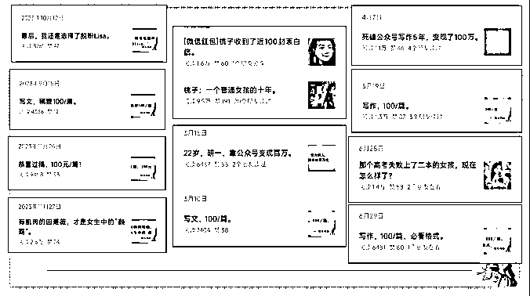

只要持续写这个关键词下的内容，被推荐几乎是必然。但为什么我没有每篇都发写作类？因为我不想只做一个单调的干货号，我更想要一个有温度、有灵魂的IP，同时我也在测试更多关键词。

后来我尝试发自己人设故事“一个普通女孩的十年”，以及其他内容，也陆陆续续拿到了推荐。有一阵子，我几乎每篇文章都能被推荐，虽然量不大，但至少说明账号已经被系统看见了。

前几天我恢复日更，开始试创业和商业赛道的内容。第三篇就爆了：一天跑到67万阅读，推荐占比达到99%，涨粉三位数，引流三位数，流量主变现三位数（因为方便阅读，我只开了文末广告条；如果开文中广告，收益直接翻10倍）。更重要的是，它还带动了我其他文章也获得了更多推荐。

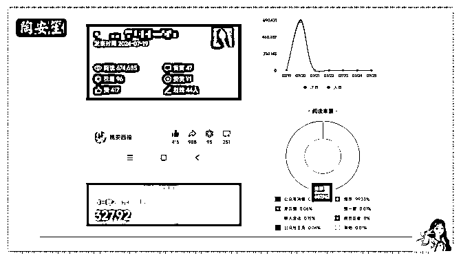

所以我的结论是：一旦账号成功入池，并且你能持续输出优质内容，哪怕关键词不太一致，也同样可能被推荐。而且一篇爆文会带动全部内容起飞。因此，第一次被推荐时，一定要认真对待。

深耕👸号五年，我最大的信念就是：平台一直在变，但内容沉淀与个人IP的力量从不褪色。希望我的方法和经历，能给你带来一点信心和参考。一起加油，我们都能在👸号里挖到属于自己的金矿。

我把自己在👸号上的实操拆成了几个阶段走过来的。

第一个阶段是我拿自己的号去试水那种原创新IP的文章能不能推。结果是能推，而且从6月底开始一直都有不错的推荐量，这条路算是走通了。

### 第三阶段：带IP👸号一起跑

看到IP号的推荐率起来了，我就带着他们一起测，给他们整理了一批关键词建议和对应的选题库。

效果看得见，都是从新号开始做，现在已有爆款在手，而且热度能一直维系住。

我还让一个做专业型私教的IP，按爆文思维去做👸号，坚持一阵子后，也成功进入了流量池。

现在阅读量基本在三位数到四位数之间稳定，文章里带上引流钩子，每天更新就相当于每天在被动获客。

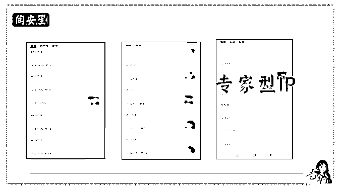

对后端有产品的IP来说，精准引流才是最关键的。👸号的好处是文章可以反复发，有需要的时候还能凑一凑数量，特别省心。

经过这几轮测试，我对👸号的流量逻辑算是有了比较完整的认知，也实操跑通了。

下面是我的一些打造爆款的实操心得。

## 2、👸号做爆款的关键点

### 1、标题决定生死，打开率是关键

做过📕的都知道标题和封面是门面，后面再靠赞藏评论去推。

👸号不一样，点赞作用有限，在看才比较关键，可以在文中适当引导一下。但真正占大头的还是标题，我觉得至少占50%以上。

### 2、找到属于你号的关键词

每个号的敏感词都不一样，必须靠不断测试去找。找到那个能持续给你推量的词，就是你的核心资产。

### 3、测试+保底+再测试

这是我带学员做爆文最常说的底层逻辑。

先测出一类稳定出量的选题，出了爆款就先把它当成保底选题持续写。另一边再持续测试新方向，让账号保持多元化。

### 4、从自身出发，对标自己

结合你的个人特质和后端产品，挖出你的关键词作为测试方向。测出来之后就用自己当标杆，好好复盘自己的爆款，持续复刻高质量内容。

### 5、数据思维+测试思维+空杯心态

测试不是瞎试，是看数据说话。核心看推荐数据，推荐量占比超过50%的文章，基本就是你号当前吃香的选题或关键词，再多做几次验证即可。

空杯心态也非常重要。不管在📕还是别的平台做得有多好，来到新平台规则不一样，一定要放空重新学。

比如我做👸号转📕，虽然逻辑懂，但手感完全不一样，后来又找花生老师专门精进📕的运营方法。

在某个平台深耕久了自然熟练，但想跨平台就得保持空杯，多看多学。

可能会有人觉得追求爆款和热点很low，尤其是专业型的人，追热点会很别扭。

但换个角度想，你想被更多人看见，就必须先被平台推得多。被看见的前提是数据好、爆款多。

追流量没错，但要以自己为出发点，用流量当外壳，把内容打磨好。

另外内容层面，平台上需要的是鲜活的你，而不是千篇一律的干货号。

如果一篇文章写👸号怎么玩，一篇文章写📕怎么玩，最后读者对你本人一无所知，那这个号是没有灵魂的。

要做的是全方位展示你这个人，让认同你的人、认同你的价值观的人，顺理成章地信任你，进而接受你的后端产品。

# 三、精准获客：👸号怎么做到精准引流

怎样用👸号实现精准获客？

我前几天的一篇文章被推了，短时间内就有大量人来添加，但忙起来忘记通过就过期了。粗算十天左右，👸号被动加人600+。一旦被推荐，钩子设好后，人就是源源不断的。

我当时在文末放了一个比较隐晦的钩子，也有很多读者没看到。但如果想引流更高效，就放一个醒目的🛰️图。

👸号引流效率很高。从去年5月到现在，我从2000多好友涨到快满员，小号也有1000多好友。关键是合规不封号，钩子设置得和产品贴合，来的人就很精准。

👸号获客流程其实很简单。

前提是第二部分说到的，有爆款有数据，先让人看见你。

第二，提前准备好钩子。比如📕的，可以准备一份起号干货包。

第三，引导添加。直接放🛰️即可，比如备注“通过👸号添加送👸号入门干货”。

相比公域获客，👸号更便捷也更安全。

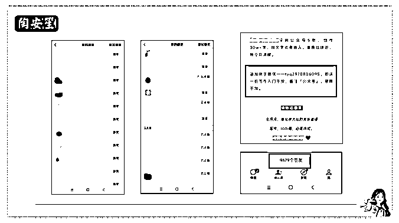

# 四、闭环管理：沉淀IP价值，打造高溢价

最后说说在👸号上如何沉淀IP价值，实现商业化。

对有产品的人来说，建议沉淀六类内容：

1、个人品牌故事文
一篇能讲清你是谁的文章。我的《一个普通女孩的十年》就被推过，阅读接近十万。读者能看到你的0到1过程，容易产生共情，转粉和加🛰️的转化也不错。这类文自带爆点。

2、产品介绍文
把你的产品体系整理成一篇收藏向的合集介绍。让用户自己看自己选，不用你一对一解释。

3、定期复盘文
每月复盘一次，写你这个月做了什么、收获了什么。能体现你的自律性和成长轨迹，也给读者提供参考价值。

4、个人感悟抒发文
对某件事的看法、感受，随性的观点输出，让人更立体地认识你。

5、领域干货沉淀文
IP必须有的专业性证明。我会在号里沉淀对👸号的思考、排版方法、变现模式等。干货内容是付费用户的“验货文”。

6、学员案例/评价文
可选但强烈建议有。案例和真实评价比自卖自夸更有说服力。

这六类内容能帮你把IP价值沉淀下来，尤其是品牌故事、产品介绍和干货文，客户了解你更快。

# 五、给想入局👸号的建议

1、无产品的普通人
别抱太大变现幻想，主要靠流量主。坚持写也能有不错收益，而且👸号对小白非常友好，坚持就有机会被看见。十万+阅读开通流量主，一个月也有五六百收入，爆的时候更可观。可以同步其他平台内容。

2、有产品定位/后端产品的IP
律师、老师等都可以把👸号当成商业IP和企业文化的沉淀阵地。持续更新、打造爆款、引流私域变现。👸号的理念是再小的个体也有品牌。你完全可以创造价值，被看见就有机会。

我当初也是从没推荐的时期写了两三个月，后来咬牙坚持，差一年不到就有了明显效果。

如果你觉得👸号适合你，建议用一年的时间来经营。以年为单位，一定会有不一样的收获。

以上是我全部的实操经验。希望能帮你更清楚地认识👸号当下的机会。不管你现在在哪个平台，都可以把👸号作为精准获客和一鱼多吃的重要阵地。

* * *

评论区：

暗夜 : d ji.nnijingleihbvubuujingleijingle

Rio : 听君一席话

* * *